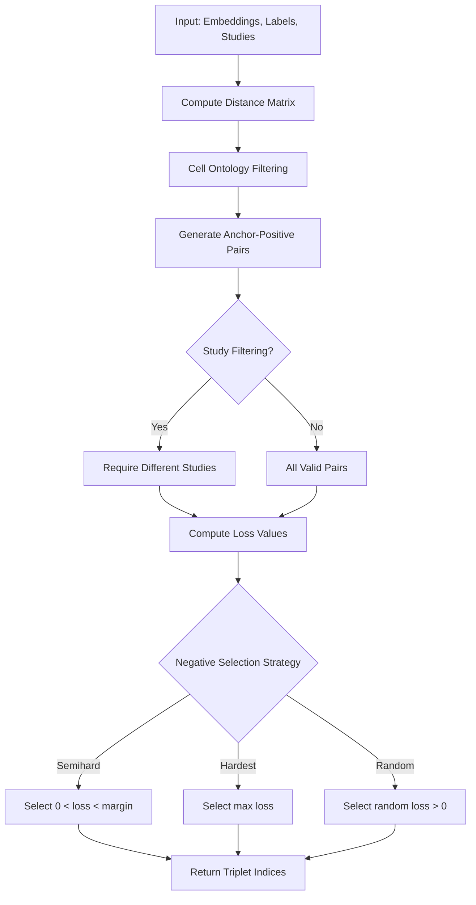

Triplet selection is the foundation of effective metric learning in SCimilarity, determining which cell samples serve as anchor, positive, and negative examples during training. The implementation leverages Cell Ontology hierarchy to ensure biologically meaningful triplet construction that respects cell type relationships while enforcing cross-study robustness.

## Core Triplet Selection Architecture

The triplet selection pipeline centers on the `TripletSelector` class, which orchestrates the complex process of mining informative triplets from single-cell transcriptomic data. For each anchor-positive pair (cells from the same cell type), the system identifies appropriate negative samples by examining all non-violating cell types—excluding ancestors and descendants in the Cell Ontology hierarchy.

The architecture integrates three critical components: distance computation, ontology-aware filtering, and negative selection strategies. Distance matrices are computed using efficient pairwise distance calculations [triplet_selector.py](src/scimilarity/triplet_selector.py#L201-L218), then filtered through ontology constraints where violating terms (ancestors and descendants) are excluded from the negative candidate pool [triplet_selector.py](src/scimilarity/triplet_selector.py#L131-L140).



## Negative Selection Strategies

SCimilarity implements three distinct negative selection strategies, each with different tradeoffs between training stability and convergence speed. The strategy is specified via the `negative_selection` parameter in `TripletSelector.__init__()` [triplet_selector.py](src/scimilarity/triplet_selector.py#L36-L42).

### Semihard Negative Selection

The default strategy (`negative_selection="semihard"`) selects negatives that produce a positive triplet loss but remain within the margin threshold. This approach balances difficulty and stability by avoiding both trivial negatives (loss ≤ 0) and overly difficult negatives (loss ≥ margin) [triplet_selector.py](src/scimilarity/triplet_selector.py#L257-L273).

Semihard negatives are defined by the condition: `0 < loss < margin`. For each anchor-positive pair, the system identifies all negative candidates satisfying this constraint and randomly selects one, introducing beneficial stochasticity that prevents overfitting to specific hard examples.

> [!TIP]
> Semihard selection provides the best convergence characteristics for most cell embedding tasks. It prevents gradient explosion from excessively hard negatives while maintaining meaningful signal compared to random negatives that may not contribute to learning.

### Hardest Negative Selection

The hardest negative strategy (`negative_selection="hardest"") selects the negative that maximizes the triplet loss value for each anchor-positive pair [triplet_selector.py](src/scimilarity/triplet_selector.py#L223-L238). This aggressive approach can accelerate convergence when the model is well-initialized but risks instability with noisy data or when cell type boundaries are ambiguous.

The implementation computes loss values for all negative candidates and selects the maximum using `np.argmax()`, with a guard clause that returns `None` if the maximum loss is not positive (meaning all candidates are trivial negatives).

### Random Negative Selection

The random strategy (`negative_selection="random"`) selects uniformly from all negative candidates that produce positive loss values [triplet_selector.py](src/scimilarity/triplet_selector.py#L240-L255). This approach provides maximum stability but slower convergence, as it doesn't prioritize more informative negatives.

Random selection is particularly useful during early training stages when the embedding space is still forming, as it avoids premature convergence to suboptimal local minima that can occur with aggressive hard negative mining.

| Strategy | Selection Criterion | Convergence Speed | Stability | Use Case |
|----------|-------------------|-------------------|-----------|----------|
| Semihard | `0 < loss < margin` | Medium | High | Default choice for most training scenarios |
| Hardest | `max(loss)` | Fast | Low | Well-initialized models, clear cell boundaries |
| Random | `loss > 0` (uniform) | Slow | Very High | Early training, noisy data, ambiguous cell types |

## Ontology-Aware Triplet Mining

The triplet selection process incorporates Cell Ontology hierarchy to ensure biologically meaningful distance learning. For each anchor cell type, the system identifies violating terms—ancestors and descendants in the ontology—and excludes them from negative candidate selection [triplet_selector.py](src/scimilarity/triplet_selector.py#L131-L140).

This ontology awareness ensures that the model learns to distinguish truly different cell types rather than pushing apart related cell types that should remain proximal in the latent space. For example, a "T cell" anchor will not select a "CD4-positive T cell" as a negative, recognizing their hierarchical relationship.

The implementation uses the Cell Ontology graph to compute:
- **Ancestors**: All parent cell types in the ontology hierarchy (excluded from negatives)
- **Descendants**: All child cell types (treated as same cluster for distance calculations)

This hierarchical awareness is critical for maintaining meaningful gradients during training, as it prevents the model from learning spurious distinctions that contradict biological reality.

> [!TIP]
> The ontology-aware filtering requires cell type annotations to use Cell Ontology identifiers (e.g., "CL:0000084" for T cells) rather than free-form names. This is why the training pipeline requires the `cellTypeOntologyID` column in the metadata [training_tutorial.ipynb](docs/notebooks/training_tutorial.ipynb#L200-L210).

## Cross-Study Sampling

To ensure model robustness across different experimental protocols, the triplet selector enforces that anchor and positive cells originate from different studies when `sample_across_studies=True` [triplet_selector.py](src/scimilarity/triplet_selector.py#L145-L152). This filtering is applied after generating all valid anchor-positive pairs within a cell type.

Cross-study sampling prevents the model from learning study-specific technical artifacts rather than true biological differences. This is particularly important for single-cell data, where batch effects and protocol variations can dominate the signal if not explicitly addressed during training.

The filtering step is integrated into the triplet mining loop:

```python
# enforce anchor and positive coming from different studies
if studies is not None:
    anchor_positives = [
        (anchor, positive)
        for anchor, positive in anchor_positives
        if studies[anchor] != studies[positive]
    ]
```

This requirement can be disabled via the `sample_across_studies=False` parameter in the training model configuration [training_models.py](src/scimilarity/training_models.py#L83), though this is not recommended for production models intended for general use.

## Label Perturbation for Regularization

The triplet selector supports an optional label perturbation mechanism (`perturb_labels=True`) that coarse-grains cell type labels by moving them one level up the ontology hierarchy for a specified fraction of cells [triplet_selector.py](src/scimilarity/triplet_selector.py#L100-L124). This regularization technique prevents overfitting to fine-grained cell type distinctions and encourages the model to learn more generalizable features.

The perturbation process:
1. Randomly selects a fraction of cells (controlled by `perturb_labels_fraction`)
2. For each selected cell, retrieves its Cell Ontology term ID
3. Finds the parent term in the ontology (one level up)
4. Replaces the original label with the parent label if it exists in the dataset

For example, a cell labeled as "CD4-positive, alpha-beta T cell" might be perturbed to "CD4-positive T cell" or simply "T cell" depending on available ancestors in the dataset.

This technique is particularly useful when:
- The dataset contains highly granular cell type annotations
- Certain cell types have limited examples
- The model should prioritize general cell type patterns over rare subtypes

## Integration with Training Pipeline

The `TripletLoss` class serves as the PyTorch interface, wrapping the `TripletSelector` functionality within `torch.nn.TripletMarginLoss` [triplet_selector.py](src/scimilarity/triplet_selector.py#L357-L437). During the forward pass, it calls `get_triplets_idx()` to mine triplets, extracts the corresponding embeddings, and computes the triplet margin loss.

The training integration in `MetricLearning.get_losses()` demonstrates the complete workflow [training_models.py](src/scimilarity/training_models.py#L207-L317):

1. Generate embeddings and reconstructions from input cells
2. Call `triplet_loss_fn()` to mine triplets and compute loss
3. Extract metrics: number of violating triplets, number of viable triplets
4. Optionally track triplet compositions for analysis
5. Combine triplet loss with reconstruction loss via weighted mixing

The training script [train.py](scripts/train.py#L133-L142) shows practical usage, with command-line parameters controlling the selection strategy:

```python
model = MetricLearning(
    ...
    margin=margin,
    negative_selection=negative_selection,
    sample_across_studies=(args.cross == 1),
    perturb_labels=(args.perturb == 1),
    perturb_labels_fraction=args.perturb_fraction,
    ...
)
```

## Ontology-Aware Silhouette Width

For evaluation and validation, the `TripletSelector` includes a method to compute Average Silhouette Width (ASW) that respects cell ontology relationships [triplet_selector.py](src/scimilarity/triplet_selector.py#L280-L356). Unlike standard ASW calculations, this implementation treats descendants as intra-cluster and excludes ancestors from inter-cluster calculations.

The ASW computation for each cell:
1. Calculate mean distance to cells of the same type or descendants (intra-cluster)
2. Calculate mean distance to cells of unrelated types (inter-cluster, excluding ancestors)
3. Compute silhouette coefficient: `(b_i - a_i) / max(a_i, b_i)`
4. Average across all cells

This ontology-aware metric provides a more accurate assessment of embedding quality than standard silhouette scores, as it accounts for the hierarchical nature of cell type relationships rather than treating all different labels as equally distant.

Sources: [triplet_selector.py](src/scimilarity/triplet_selector.py#L17-L356), [triplet_selector.py](src/scimilarity/triplet_selector.py#L357-L437), [training_models.py](src/scimilarity/training_models.py#L207-L317), [train.py](scripts/train.py#L1-L200), [training_tutorial.ipynb](docs/notebooks/training_tutorial.ipynb#L200-L210)

## Key Configuration Parameters

| Parameter | Type | Default | Description |
|-----------|------|---------|-------------|
| `margin` | float | Required | Margin threshold for triplet loss; also defines semihard bound |
| `negative_selection` | str | "semihard" | Strategy: "semihard", "hardest", or "random" |
| `sample_across_studies` | bool | True | Enforce anchor-positive from different studies |
| `perturb_labels` | bool | False | Enable label perturbation for regularization |
| `perturb_labels_fraction` | float | 0.5 | Fraction of cells to perturb when enabled |

Understanding triplet selection strategies is essential for effective model training. Next, explore [Training Configuration and Hyperparameters](20-training-configuration-and-hyperparameters) to learn how these selection parameters integrate with the broader training pipeline, or review [Metric Learning with Triplet Loss](18-metric-learning-with-triplet-loss) for deeper mathematical foundations.