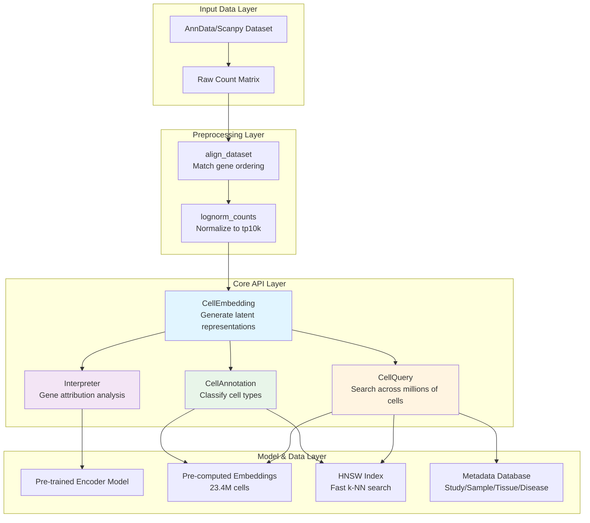

Welcome to SCimilarity—a foundation model for single-cell RNA sequencing (scRNA-seq) data that enables scalable cell search and annotation across millions of cells. This Quick Start guide will get you up and running with SCimilarity's core capabilities in under 15 minutes, regardless of your single-cell analysis experience.

SCimilarity provides a unified representation of cell states that generalizes across studies, allowing you to search massive public atlases to find similar cells, annotate unknown cell types, and understand the genetic drivers of cell differences. The library is built on a PyTorch Lightning architecture trained with triplet loss learning, featuring pre-trained models on 23.4 million human cells [README.rst](README.rst#L1-L15).

## Architecture Overview

SCimilarity follows a modular design that separates concerns across embedding generation, search/query operations, annotation, and interpretability. This architecture enables flexible workflows while maintaining performance at scale.



## Installation and Setup

SCimilarity can be installed via pip in minutes, but requires careful attention to system resources. The library operates with high memory requirements due to the scale of its pre-computed indices and embeddings.


### System Requirements

| Component | Minimum Requirement | Recommended | Notes |
|-----------|---------------------|-------------|-------|
| **RAM** | 64 GB | 128 GB+ | Required for loading k-NN indices and metadata |
| **Storage** | 50 GB | 200 GB+ | For model files, embeddings, and datasets |
| **GPU** | Not required | NVIDIA GPU with CUDA | Only needed for model training, not inference |
| **Python** | 3.8 | 3.10+ | Tested on Python 3.10 |

> [!TIP]
> If your environment crashes during model loading or k-NN queries despite having sufficient RAM, this typically indicates outdated dependencies (especially `hnswlib` or `numpy`). Use the Docker container or Conda environment specified below to avoid dependency conflicts.

### Installation Methods

**Option 1: PyPI (Recommended for production)**
```bash
pip install scimilarity
```
Sources: [README.rst](README.rst#L26-L27)

**Option 2: Development Installation**
```bash
git clone https://github.com/genentech/scimilarity.git
cd scimilarity
pip install -e .
```
Sources: [docs/install.rst](docs/install.rst#L15-L21)

**Option 3: Docker Container**
```bash
docker pull ghcr.io/genentech/scimilarity:latest
```
The Docker container includes four preset bind points: `/models`, `/data`, `/workspace`, and `/scratch`. For development work:
```bash
docker run -it --platform linux/amd64 -p 8888:8888 \
    -v /path/to/workspace:/workspace \
    -v /path/to/data:/data \
    -v /path/to/models:/models \
    ghcr.io/genentech/scimilarity:latest start-notebook
```
Sources: [docs/install.rst](docs/install.rst#L53-L78)

### Download Pre-trained Models and Data

SCimilarity requires pre-trained model weights, embeddings, k-NN indices, and metadata for full functionality. These assets are distributed via Zenodo:

```bash
# Download model files (~10GB compressed)
curl -L -o /models/model_v1.1.tar.gz \
  https://zenodo.org/records/10685499/files/model_v1.1.tar.gz?download=1
tar -xzvf /models/model_v1.1.tar.gz
```

The model archive contains:
- **Encoder model** (`encoder.ckpt`): Neural network for generating embeddings
- **Gene order** (`gene_order.tsv`): Fixed ordering of 23,469 genes
- **Layer configuration** (`layer_sizes.json`): Network architecture parameters
- **Label mappings** (`label_ints.csv`): Cell ontology label encodings

After installation and model download, you can proceed to SCimilarity's three core workflows. For detailed installation troubleshooting, see [Installation and Setup](3-installation-and-setup). For a complete breakdown of downloadable assets, visit [Downloading Pretrained Models and Data](4-downloading-pretrained-models-and-data).

## Core Workflow: Data Preprocessing

Before using any SCimilarity API, your data must be preprocessed to match the format used during model training. This ensures accurate embeddings and reliable search results.


### Step 1: Load Your Data

SCimilarity works seamlessly with AnnData objects from the Scanpy ecosystem:

```python
import scanpy as sc
from scimilarity.utils import align_dataset, lognorm_counts

# Load your scRNA-seq dataset
adata = sc.read("path/to/your/data.h5ad")
```

### Step 2: Align Gene Space

SCimilarity uses a fixed gene ordering across all datasets. The `align_dataset` function reorders your data's gene space and handles missing genes:

```python
from scimilarity import CellQuery

# Initialize any SCimilarity API object to access gene_order
cq = CellQuery(model_path="/models/model_v1.1")

# Align dataset to SCimilarity's gene ordering
adata = align_dataset(adata, cq.gene_order)
```

This function performs three critical operations:
1. **Reorders genes** to match the training data's fixed ordering
2. **Zero-fills missing genes** that exist in SCimilarity but not your dataset
3. **Validates compatibility** (requires ≥5,000 overlapping genes)

The model was trained with high data dropout, making it robust to differences in gene lists between datasets [docs/notebooks/cell_search_tutorial_1.ipynb](docs/notebooks/cell_search_tutorial_1.ipynb#L133-L137).
Sources: [src/scimilarity/utils.py](src/scimilarity/utils.py#L58-L94)

### Step 3: Normalize Expression

SCimilarity expects log-normalized counts targeting 10,000 transcripts per cell:

```python
adata = lognorm_counts(adata)
```

The `lognorm_counts` function performs:
1. **Count normalization**: Scales counts to sum to 10,000 per cell
2. **Log transformation**: Applies log1p transformation
3. **NAN handling**: Converts any NaN values to zeros

**Critical requirement**: Your raw counts must be stored in `adata.layers["counts"]` before normalization.
Sources: [src/scimilarity/utils.py](src/scimilarity/utils.py#L8-L50)

Once preprocessed, your data is ready for any SCimilarity workflow. For deeper understanding of the embedding process, see [Cell Embedding Fundamentals](6-cell-embedding-fundamentals).

## Workflow 1: Cell Search (Finding Similar Cells)

The most common SCimilarity use case is searching for similar cells across millions of profiles. This enables you to leverage public atlases to understand cell states of interest.

### Quick Example: Search IPF-derived Myofibroblasts

```python
from scimilarity import CellQuery

# Initialize CellQuery (loads model and pre-computed indices)
model_path = "/models/model_v1.1"
cq = CellQuery(model_path=model_path)

# Preprocess your data (as shown above)
adata = align_dataset(adata, cq.gene_order)
adata = lognorm_counts(adata)

# Generate embeddings for your query cells
adata.obsm["X_scimilarity"] = cq.get_embeddings(adata.X)

# Search for similar cells across the 23.4M cell atlas
nn_idxs, nn_dists, metadata = cq.search_nearest(
    embeddings=adata.obsm["X_scimilarity"],
    k=100,  # Return top 100 nearest neighbors per query cell
)

# Analyze results: compile sample metadata from matches
results = cq.compile_sample_metadata(
    nn_idxs,
    levels=["study", "sample", "tissue", "disease"]
)
print(results.head())
```

### Understanding the Output

The `search_nearest` method returns three components:

| Output | Description | Shape |
|--------|-------------|-------|
| `nn_idxs` | Indices of nearest neighbors in the pre-computed database | List of arrays, one per query cell |
| `nn_dists` | Euclidean distances to each neighbor | List of arrays, same shape as `nn_idxs` |
| `metadata` | Full metadata for all matched cells | DataFrame with columns: study_id, sample_id, cell_id, tissue, disease, cell_type |

The `compile_sample_metadata` function aggregates information from matches to show which studies, samples, tissues, and diseases contain cells similar to your query. This is particularly useful for discovering disease associations or identifying tissues with similar cell states.
Sources: [src/scimilarity/cell_query.py](src/scimilarity/cell_query.py#L206-L252), [src/scimilarity/cell_query.py](src/scimilarity/cell_query.py#L150-L178)

### Advanced Search Options

SCimilarity provides multiple search strategies depending on your needs:

| Method | Use Case | Speed | Precision | Resources |
|--------|----------|-------|-----------|-----------|
| `search_nearest` | Standard k-NN search | ⚡ Fast | High | Moderate RAM |
| `search_exhaustive` | Find all cells within distance threshold | 🐢 Slow | Complete | High RAM |
| `search_centroid_nearest` | Search from cluster centroids | ⚡⚡ Fastest | Moderate | Low RAM |
| `search_cluster_centroids_nearest` | Batch search for multiple clusters | ⚡ Fast | High | Moderate RAM |

> [!TIP]
> For most use cases, `search_nearest` with `k=1000` provides an excellent balance of comprehensiveness and performance. Only switch to exhaustive search when you need guaranteed completeness within a specific distance threshold.

For detailed API reference and parameter explanations, see [Cell Query API Reference](9-cell-query-api-reference) and [K-NN Search with HNSW](10-k-nn-search-with-hnsw). Advanced filtering options are covered in [Metadata Filtering and Query Optimization](12-metadata-filtering-and-query-optimization).

## Workflow 2: Cell Annotation (Classifying Cell Types)

SCimilarity can automatically annotate cell types by comparing your cells to a reference database of annotated cells. This is particularly valuable for exploring new datasets or validating existing annotations.


### Quick Example: Annotate Unknown Cell Types

```python
from scimilarity import CellAnnotation

# Initialize CellAnnotation
model_path = "/models/model_v1.1"
ca = CellAnnotation(model_path=model_path)

# Preprocess your data
adata = align_dataset(adata, ca.gene_order)
adata = lognorm_counts(adata)

# Annotate the entire dataset
annotated_adata = ca.annotate_dataset(adata)

# View predictions
print(annotated_adata.obs["scimilarity_prediction"].value_counts())
```

The `annotate_dataset` method performs three operations in one call:
1. **Generates embeddings** for your cells using the pre-trained encoder
2. **Searches k-NN** to find similar annotated cells in the reference database
3. **Predicts cell types** based on neighbor labels using weighted voting

### Understanding Predictions

The annotation process adds several columns to your AnnData object:

| Column | Description |
|--------|-------------|
| `scimilarity_prediction` | Predicted cell type label |
| `scimilarity_confidence` | Prediction confidence score (0-1) |
| `scimilarity_votes` | Vote distribution across candidate cell types |

By default, predictions are made from the 50 nearest neighbors. You can customize this behavior:

```python
# Get detailed prediction information
preds, confidences, votes, neighbor_metadata = ca.get_predictions_knn(
    embeddings=adata.X,
    k=50,  # Use 50 nearest neighbors
    weighting=True,  # Apply distance-based weighting
)
```

The `weighting` parameter applies exponential decay to neighbor votes based on distance, giving more weight to closer cells.
Sources: [src/scimilarity/cell_annotation.py](src/scimilarity/cell_annotation.py#L148-L237), [src/scimilarity/cell_annotation.py](src/scimilarity/cell_annotation.py#L281-L300)

### Safelist and Blocklist Cell Types

You can constrain predictions to specific cell types or exclude unwanted categories:

```python
# Only predict from specific cell types
ca.safelist_celltypes(["T cell", "B cell", "NK cell"])

# Exclude specific cell types from predictions
ca.blocklist_celltypes(["Unknown", "Low quality"])

# Reset to use all available cell types
ca.reset_knn()
```

These methods modify the k-NN index in-place by marking cell types as deleted, allowing you to iteratively refine your annotation strategy.
Sources: [src/scimilarity/cell_annotation.py](src/scimilarity/cell_annotation.py#L92-L116), [src/scimilarity/cell_annotation.py](src/scimilarity/cell_annotation.py#L118-L146)

For complete annotation API reference, see [Cell Annotation API Reference](13-cell-annotation-api-reference). To understand the classification methodology in detail, visit [Understanding Cell Type Classification](14-understanding-cell-type-classification).

## Workflow 3: Gene Attribution (Understanding Cell Differences)

The Interpreter module helps you understand the genetic drivers that distinguish two cell states by computing feature attributions using integrated gradients.


### Quick Example: Identify Genes Differentiating Two Cell Types

```python
from scimilarity import CellEmbedding
from scimilarity.interpreter import Interpreter

# Initialize embedding model
ce = CellEmbedding(model_path="/models/model_v1.1")

# Initialize interpreter with the encoder
interpreter = Interpreter(ce.model, ce.gene_order)

# Select anchor and negative cells
# (anchor: cell state of interest, negative: comparison cell state)
anchor_cell = adata[adata.obs["cell_type"] == "Myofibroblast"].X[0]
negative_cell = adata[adata.obs["cell_type"] == "Fibroblast"].X[0]

# Compute attributions
attrs = interpreter.get_attributions(
    anchors=anchor_cell,
    negatives=negative_cell
)

# Get ranked gene list
genes_df = interpreter.get_ranked_genes(attrs)
print(genes_df.head())
```

The attribution scores indicate which genes contribute most to the difference between the two cell states in the latent space.

### Visualizing Gene Contributions

```python
# Plot top contributing genes
interpreter.plot_ranked_genes(
    attrs_df=genes_df,
    n_plot=15,
    filename="gene_attributions.png"
)
```

This visualization shows the genes with the highest attribution scores, helping you quickly identify key molecular drivers of phenotypic differences.
Sources: [src/scimilarity/interpreter.py](src/scimilarity/interpreter.py#L69-L132), [src/scimilarity/interpreter.py](src/scimilarity/interpreter.py#L133-L164)

For detailed methodology on how attributions are computed, see [Gene Attribution and Comparison](27-gene-attribution-and-comparison). Complete API reference is available at [Interpreter API Reference](28-interpreter-api-reference).

## Summary: Choosing Your Workflow

SCimilarity's three primary workflows address different research questions:

| Research Question | Recommended Workflow | Primary API |
|-------------------|----------------------|-------------|
| "Which studies/diseases have cells like mine?" | Cell Search | `CellQuery` |
| "What are these cells' types?" | Cell Annotation | `CellAnnotation` |
| "Which genes drive the difference between these cells?" | Gene Attribution | `Interpreter` |

All three workflows share the same preprocessing pipeline (`align_dataset` → `lognorm_counts`), making it easy to transition between analyses. The APIs are designed to work independently or in combination—for example, you might first search for similar cells, then annotate your results, and finally use the interpreter to understand the molecular differences.

## Next Steps

Now that you've completed the Quick Start guide, here are recommended next steps based on your goals:

- **For detailed installation troubleshooting**: [Installation and Setup](3-installation-and-setup)
- **To understand the embedding architecture**: [Cell Embedding Fundamentals](6-cell-embedding-fundamentals) and [Encoder and Decoder Architecture](7-encoder-and-decoder-architecture)
- **For advanced search techniques**: [Metadata Filtering and Query Optimization](12-metadata-filtering-and-query-optimization)
- **To learn about prediction weighting**: [Prediction Weighting Strategies](16-prediction-weighting-strategies)
- **For working with large-scale data**: [Working with Large-Scale Data Storage](26-working-with-large-scale-data-storage)

For hands-on practice with complete workflows, explore the interactive tutorials:
- [Cell Search Tutorial](https://github.com/Genentech/scimilarity/blob/main/docs/notebooks/cell_search_tutorial_1.ipynb)
- [Cell Annotation Tutorial](https://github.com/Genentech/scimilarity/blob/main/docs/notebooks/cell_annotation_tutorial.ipynb)
- [Advanced Tutorial](https://github.com/Genentech/scimilarity/blob/main/docs/notebooks/advanced_tutorial.ipynb)

The complete API reference is available at [API Documentation](https://genentech.github.io/scimilarity/index.html).
Sources: [README.rst](README.rst#L10-L13)