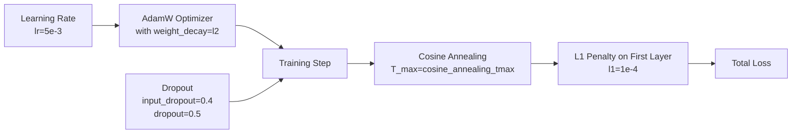

This page provides a comprehensive guide to configuring SCimilarity model training, detailing the hyperparameters that control network architecture, loss functions, optimization strategies, and triplet selection mechanisms. Understanding these configurations is essential for achieving optimal cell embedding quality and generalization performance across diverse single-cell datasets.

## Architecture Hyperparameters

The model architecture is defined by encoder and decoder neural networks with configurable dimensionality and regularization parameters. The core architectural hyperparameters determine the network's capacity to learn meaningful latent representations while preventing overfitting.

The encoder network maps high-dimensional gene expression data to a compressed latent space through multiple hidden layers. Key architectural parameters include `latent_dim` (default: 128) which specifies the dimensionality of the embedding space, and `hidden_dim` (default: [1024, 1024, 1024]) which defines the number and size of hidden layers in the encoder and decoder. The encoder applies input dropout and layer-wise dropout to reduce overfitting, with dropout rates configurable via `input_dropout` (default: 0.4) for the input layer and `dropout` (default: 0.5) for hidden layers. Each hidden layer uses a PReLU activation function combined with batch normalization to stabilize training dynamics.

Sources: [training_models.py](/src/scimilarity/training_models.py#L73-L131), [nn_models.py](/src/scimilarity/nn_models.py#L31-L62)

The decoder network reconstructs the original gene expression from the latent representation, using the same hidden dimensions in reverse order. The reconstruction task forces the encoder to preserve essential biological information while discarding noise. The decoder architecture mirrors the encoder but omits input dropout on the latent representation, ensuring the latent space retains maximal discriminative information for the downstream triplet loss task.

Sources: [nn_models.py](/src/scimilarity/nn_models.py#L130-L159)

```mermaid
flowchart TD
    A[Gene Expression<br/>n_genes] --> B[Input Layer<br/>input_dropout]
    B --> C[Hidden Layer 1<br/>hidden_dim[0]]
    C --> D[Hidden Layer 2<br/>hidden_dim[1]]
    D --> E[Hidden Layer 3<br/>hidden_dim[2]]
    E --> F[Latent Space<br/>latent_dim]
    F --> G[Hidden Layer 1<br/>hidden_dim[2]]
    G --> H[Hidden Layer 2<br/>hidden_dim[1]]
    H --> I[Hidden Layer 3<br/>hidden_dim[0]]
    I --> J[Reconstruction<br/>n_genes]
    
    style F fill:#e1f5e1,stroke:#4caf50
    style B stroke:#ff9800,stroke-width:2px
    style C stroke-dasharray: 5 5
    style D stroke-dasharray: 5 5
    style E stroke-dasharray: 5 5
```

## Loss Function Configuration

SCimilarity employs a hybrid loss function combining metric learning objectives with reconstruction loss, balancing the competing goals of learning discriminative embeddings and preserving reconstruction fidelity. The `triplet_loss_weight` parameter (default: 0.001) controls the trade-off between these objectives, with lower values prioritizing reconstruction and higher values emphasizing metric learning.

The triplet loss operates with a configurable `margin` parameter (default: 0.05) that defines the minimum distance required between anchor-negative pairs versus anchor-positive pairs. This margin prevents the model from collapsing all embeddings to a single point while allowing flexibility for biological variability. The implementation extends PyTorch's `TripletMarginLoss` with custom triplet selection strategies that can be configured through the `negative_selection` parameter.

Sources: [training_models.py](/src/scimilarity/training_models.py#L293-L315), [training_models.py](/src/scimilarity/training_models.py#L155-L162)

The mixed loss calculation combines both objectives: when `triplet_loss_weight` equals 0, only MSE reconstruction loss is used; when it equals 1, only triplet loss is used; otherwise, the weighted sum is computed. This flexible approach allows gradual transition from reconstruction-focused pre-training to metric learning fine-tuning.

Sources: [training_models.py](/src/scimilarity/training_models.py#L309-L315)

| Loss Component | Parameter | Default | Description |
|----------------|-----------|---------|-------------|
| Triplet Loss | `triplet_loss_weight` | 0.001 | Weight for metric learning objective |
| Triplet Loss | `margin` | 0.05 | Minimum anchor-negative distance |
| Reconstruction | `1.0 - triplet_loss_weight` | 0.999 | Weight for MSE reconstruction |

## Triplet Selection Strategies

Triplet selection is critical for effective metric learning, as the choice of negative samples directly impacts embedding quality. SCimilarity supports three negative selection strategies configurable via the `negative_selection` parameter, each with different characteristics for training dynamics and convergence speed.

The **semihard** strategy (default) selects negative samples whose distances fall within the margin, providing informative gradients that push negatives just far enough without being too easy or too hard. This strategy typically provides the most stable training and good generalization. The **hardest** strategy selects the negative with maximum distance, providing aggressive gradients but potentially leading to collapse or instability with noisy labels. The **random** strategy selects negatives uniformly at random, providing regularization through noise injection but requiring more epochs to converge.

Sources: [triplet_selector.py](/src/scimilarity/triplet_selector.py#L223-L267), [training_models.py](/src/scimilarity/training_models.py#L82-L82)

Two advanced triplet selection parameters provide additional control over the training distribution. The `sample_across_studies` parameter (default: True) enables cross-study negative sampling, which improves generalization across different experimental protocols and batch effects. When disabled, negatives are sampled only within the same study, potentially reducing domain shift but limiting transferability. The `perturb_labels` parameter (default: False) enables label perturbation with parent cell type ontologies, controlled by `perturb_labels_fraction` (default: 0.5), which adds regularization by forcing the model to learn hierarchical relationships rather than overfitting to fine-grained labels.

Sources: [training_models.py](/src/scimilarity/training_models.py#L82-L85), [training_models.py](/src/scimilarity/training_models.py#L145-L147)

| Strategy | Description | Best For |
|----------|-------------|----------|
| `semihard` | Negatives within margin distance | Stable training, general purpose |
| `hardest` | Furthest negative samples | Aggressive learning, clean data |
| `random` | Uniform random sampling | Regularization, noisy labels |

## Optimization Hyperparameters

The training process uses AdamW optimization with configurable learning rates and regularization terms to balance convergence speed and model stability. The `lr` parameter (default: 5e-3) sets the initial learning rate for the optimizer, with cosine annealing schedule providing adaptive learning rate decay.

The `max_epochs` parameter (default: 500) controls training duration, while `cosine_annealing_tmax` (default: max_epochs) determines the period of the cosine annealing schedule. When cosine annealing is configured, the learning rate follows a cosine curve from the initial value to a minimum, providing smooth decay that often improves final model quality compared to step decay schedules.

Sources: [training_models.py](/src/scimilarity/training_models.py#L86-L91), [training_models.py](/src/scimilarity/training_models.py#L171-L185)

Regularization is achieved through multiple mechanisms. L1 regularization on the encoder's first layer weights, controlled by `l1` (default: 1e-4), encourages sparsity in the initial feature representation. L2 regularization, configured via `l2` (default: 0.01), is applied through AdamW's weight decay parameter to prevent large weights throughout the network. The dropout layers in the encoder and decoder provide additional regularization during training. Notably, the code includes commented-out L2 penalty calculation that could be enabled for more aggressive regularization.

Sources: [training_models.py](/src/scimilarity/training_models.py#L87-L88), [training_models.py](/src/scimilarity/training_models.py#L343-L368)



## Command-Line Training Configuration

The `train.py` script provides a comprehensive command-line interface for configuring all hyperparameters, enabling reproducible training workflows and systematic hyperparameter exploration. Each architectural and optimization parameter has a corresponding command-line argument with sensible defaults.

Core training parameters include batch size (`-b`, default: 1000), number of batches per epoch (`-n`, default: 100), maximum epochs (`-e`, default: 500), and learning rate (`-l`, default: 0.005). Architecture parameters include latent dimension (`--latent_dim`, default: 128), hidden layer dimensions (`--hidden_dim`, default: [1024, 1024, 1024]), and dropout rates (`--dropout` and `--input_dropout`).

Sources: [train.py](/scripts/train.py#L64-L77), [train.py](/scripts/train.py#L240-L263)

Loss-specific parameters include triplet margin (`-m`, default: 0.05), triplet loss weight (`-w`, default: 0.001), and negative selection type (`-t`, default: "semihard"). Regularization parameters include L1 (`--l1`, default: 1e-4) and L2 (`--l2`, default: 0.01) coefficients. Advanced options include cross-study sampling (`--cross`, default: 1), label perturbation (`--perturb`, default: 0), and cosine annealing period (`--cosine_annealing_tmax`, default: 0 which maps to max_epochs).

Sources: [train.py](/scripts/train.py#L241-L257)

## Model Naming and Checkpoint Management

Training configurations are automatically encoded into model names for reproducibility and version control. The model name format incorporates batch size, margin, latent dimension, number of hidden layers, triplet loss weight, and a custom suffix: `model_{batch_size}_{margin}_{latent_dim}_{n_hidden_layers}_{triplet_loss_weight}_{suffix}`.

Sources: [train.py](/scripts/train.py#L82-L84)

Checkpoint management enables training resumption. The script automatically detects existing checkpoints in the log directory and resumes training from the most recent checkpoint if available. This feature provides fault tolerance and enables iterative training extensions. The `LearningRateMonitor` callback tracks learning rate changes throughout training, logged at every step for analysis.

Sources: [train.py](/scripts/train.py#L209-L221)

> [!TIP]
> Start with the default hyperparameters for your first training run. The configuration of `triplet_loss_weight=0.001` prioritizes reconstruction initially, which stabilizes the latent space before metric learning. Increase this value incrementally (e.g., to 0.01 or 0.1) if you observe that embeddings are not sufficiently discriminative for your cell type classification task.

## Training Metrics and Monitoring

Comprehensive metrics are logged during training to monitor model progress and diagnose issues. Training metrics include total loss, triplet loss, MSE reconstruction loss, fraction of hard triplets, and count of nonzero-loss triplets. These metrics help identify whether the model is learning meaningful representations or experiencing optimization difficulties.

Validation and test metrics provide additional insight into generalization performance. Beyond the loss components, evaluation includes Average Silhouette Width (ASW) for clustering quality and Normalized MSE (NMSE) for reconstruction quality. A composite evaluation metric combines both: `(1 - asw) / 2 + nmse`, balancing clustering and reconstruction objectives for model selection.

Sources: [training_models.py](/src/scimilarity/training_models.py#L370-L385), [training_models.py](/src/scimilarity/training_models.py#L475-L493)

> [!TIP]
> Monitor the "hard triplets" metric during training. A stable value around 0.3-0.5 indicates the model is learning appropriate discrimination. If this metric approaches 1.0, consider increasing the margin or switching to semihard negative selection. If it approaches 0.0, the model may be collapsing, suggesting the need for lower learning rates or increased regularization.

## Next Steps

After configuring hyperparameters and training your model, continue with [PyTorch Lightning Integration](21-pytorch-lightning-integration) to understand the training infrastructure, or explore [Triplet Selection Strategies](19-triplet-selection-strategies) for deeper insight into metric learning optimization. For practical training examples, refer to the [Training Tutorial](training_tutorial.ipynb) notebook which demonstrates end-to-end model training workflows.
