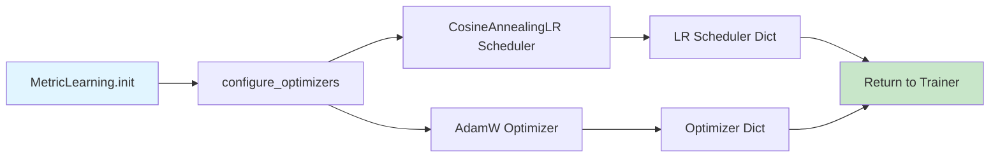
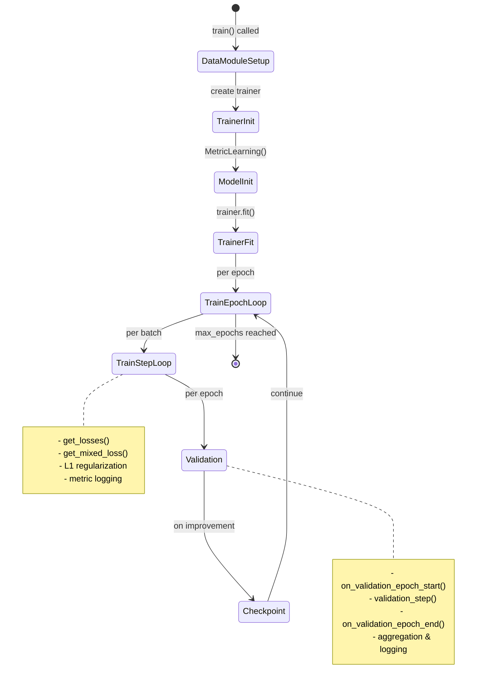

PyTorch Lightning provides the foundational training framework for scimilarity's metric learning pipeline, abstracting away the complexity of PyTorch's training loop while maintaining flexibility for custom behavior. This integration enables scalable, reproducible training workflows across different data storage backends (TileDB, Zarr, AnnData) with automatic checkpointing, logging, and multi-GPU support. The architecture follows Lightning's modular design pattern, separating model logic from training orchestration and data pipeline management.

## LightningModule Architecture

The `MetricLearning` class extends `pl.LightningModule` and implements the complete metric learning workflow, combining triplet loss optimization with autoencoder reconstruction. This dual-objective approach learns latent space representations that preserve cell type similarities while maintaining gene expression reconstruction capability.

Sources: [training_models.py](src/scimilarity/training_models.py#L15-L94)

### Core Lightning Hooks

The model implements all essential Lightning lifecycle hooks, with the training step serving as the computational center:

```python
def training_step(self, batch, batch_idx):
    triplet_losses, mse, num_hard_triplets, num_viable_triplets = self.get_losses(batch)
    triplet_loss = triplet_losses.mean()
    loss = self.get_mixed_loss(triplet_loss, mse)
    
    # L1 regularization on encoder's first layer
    if self.l1 > 0:
        for layer in self.encoder.network:
            if isinstance(layer, nn.Linear):
                l1_norm = sum(p.abs().sum() for p in layer.parameters())
                l1_penalty = self.l1 * l1_norm * current_lr
                loss += l1_penalty
                break
    
    # Comprehensive metric logging
    self.log("train loss", loss, prog_bar=False, logger=True)
    self.log("train triplet loss", triplet_loss, prog_bar=True, logger=True)
    self.log("train mse", mse, prog_bar=True, logger=True)
    self.log("train hard triplets", hard_triplets, prog_bar=True, logger=True)
```

Sources: [training_models.py](src/scimilarity/training_models.py#L317-L394)

### Optimizer Configuration

The `configure_optimizers()` method sets up AdamW optimization with cosine annealing learning rate scheduling:

Sources: [training_models.py](src/scimilarity/training_models.py#L171-L185)



The scheduler configuration follows Lightning's required dictionary format with `"interval": "epoch"` and `"frequency": 1`, ensuring learning rate updates occur after each epoch rather than per-step. The cosine annealing parameter `T_max` defaults to `max_epochs` but can be customized via the `cosine_annealing_tmax` parameter.

## LightningDataModule Implementations

Three distinct LightningDataModule variants support different storage backends, each implementing the standard data pipeline interface: `train_dataloader()`, `val_dataloader()`, and `test_dataloader()`.

Sources: [tiledb_data_models.py](src/scimilarity/tiledb_data_models.py#L208-L684), [zarr_data_models.py](src/scimilarity/zarr_data_models.py#L54-L283), [anndata_data_models.py](src/scimilarity/anndata_data_models.py)

### TileDB Data Module

`CellMultisetDataModule` provides the most comprehensive data pipeline, supporting:

- **Multi-study datasets** with study-level holdout validation
- **Custom filtering** via TileDB query syntax (e.g., cell type, count thresholds)
- **Sample exclusion** for quality control (cancer dataset filtering)
- **Dynamic class balancing** through weighted random sampling
- **Persistent workers** for improved DataLoader performance

Sources: [tiledb_data_models.py](src/scimilarity/tiledb_data_models.py#L281-L466)

The module harmonizes cell types across studies, removes singleton classes, and calculates sampling weights to ensure balanced representation:

```python
def get_sampler_weights(self, data_df, use_study=True, class_target_sum=1e4, study_target_sum=1e6):
    """Calculate weighted sampling for balanced class and study representation."""
```

Sources: [tiledb_data_models.py](src/scimilarity/tiledb_data_models.py#L547-L593)

### Zarr Data Module

`MetricLearningDataModule` offers a simpler interface optimized for Zarr-formatted data:

Sources: [zarr_data_models.py](src/scimilarity/zarr_data_models.py#L88-L283)

```python
datamodule = MetricLearningDataModule(
    train_path="train",
    gene_order="gene_order.tsv",
    obs_field="celltype_name",
    batch_size=1000,
    num_workers=1,
)
```

### Data Module Comparison

| Feature | TileDB (CellMultisetDataModule) | Zarr (MetricLearningDataModule) | AnnData |
|---------|--------------------------------|----------------------------------|---------|
| **Study-level validation** | ✓ Built-in | ✗ Manual | ✗ Manual |
| **Filtering syntax** | ✓ TileDB queries | ✗ Pre-filtered | ✗ Pre-filtered |
| **Sample exclusion** | ✓ Per-study lists | ✗ | ✗ |
| **Class harmonization** | ✓ Automatic | ✗ | ✗ |
| **Persistent workers** | ✓ Configurable | ✗ | ✗ |
| **Use case** | Large-scale production | Research/exploratory | Local experimentation |

## Training Workflow Integration

The training scripts demonstrate the complete Lightning workflow, from data module initialization through trainer configuration and model checkpointing.

Sources: [train.py](scripts/train.py#L64-L220), [train_anndata.py](scripts/anndata/train_anndata.py#L11-L130)

### Trainer Configuration

The `pl.Trainer` is configured with production-ready settings:

Sources: [train.py](scripts/train.py#L195-L220)

```python
from pytorch_lightning.callbacks import LearningRateMonitor
from pytorch_lightning.loggers import TensorBoardLogger

logger = TensorBoardLogger(
    log_folder,
    name=model_name,
    default_hp_metric=False,
    flush_secs=1,
    version=suffix,
)

lr_monitor = LearningRateMonitor(logging_interval="step")

params = {
    "max_epochs": max_epochs,
    "logger": logger,
    "accelerator": "gpu",
    "callbacks": [lr_monitor],
    "log_every_n_steps": 1,
    "limit_train_batches": n_batches,
    "limit_val_batches": 10,
    "limit_test_batches": 10,
}

trainer = pl.Trainer(**params)
```

> [!TIP]
> The `flush_secs=1` parameter in TensorBoardLogger ensures metrics are written immediately rather than batched, enabling real-time monitoring during long training runs. This is critical for debugging convergence issues in early training stages.

### Checkpointing and Resumption

Automatic checkpoint management supports seamless training resumption:

Sources: [train.py](scripts/train.py#L209-L220)

```python
ckpt_path = os.path.join(log_folder, model_name, suffix, "checkpoints")
if os.path.isdir(ckpt_path):
    ckpt_files = sorted(
        [x for x in os.listdir(ckpt_path) if x.endswith(".ckpt")],
        key=lambda x: int(x.replace(".ckpt", "").split("=")[-1]),
    )
    trainer.fit(
        model,
        datamodule=datamodule,
        ckpt_path=os.path.join(ckpt_path, ckpt_files[-1]),
    )
```

Lightning automatically creates checkpoints at optimal validation points, and the training script sorts these by epoch to resume from the most recent checkpoint.

### Training Lifecycle

The complete training flow follows Lightning's structured lifecycle:



## Validation and Testing Pipeline

Lightning's structured validation hooks enable comprehensive evaluation beyond simple loss metrics.

Sources: [training_models.py](src/scimilarity/training_models.py#L396-L445)

### Validation Hooks

The validation workflow accumulates outputs across all validation batches:

```python
def on_validation_epoch_start(self):
    """Pytorch-lightning validation epoch start."""
    super().on_validation_epoch_start()
    self.val_step_outputs = []

def validation_step(self, batch, batch_idx):
    """Pytorch-lightning validation step."""
    if self.trainer.datamodule.val_dataset is None:
        return {}
    return self._eval_step(batch, prefix="val")

def on_validation_epoch_end(self):
    """Pytorch-lightning validation epoch end evaluation."""
    if self.trainer.datamodule.val_dataset is None:
        return {}
    self._eval_epoch(prefix="val")
```

Sources: [training_models.py](src/scimilarity/training_models.py#L396-L445)

The `_eval_step()` and `_eval_epoch()` methods handle the actual evaluation logic, computing metrics like triplet loss, reconstruction error, and triplet statistics. This separation of concerns allows the same evaluation logic to be reused across validation and test phases.

## Model Persistence

Lightning manages training checkpoints automatically, but the model also provides explicit save/load methods for deployment:

Sources: [training_models.py](src/scimilarity/training_models.py#L568-L649)

```python
model.save_all(model_path=os.path.join(model_folder, model_name))
```

The `save_all()` method persists encoder and decoder weights separately, enabling independent model component loading for inference workflows. This design supports scenarios where only the encoder is needed for embedding generation.

## Configuration Parameters

The MetricLearning module exposes 20+ hyperparameters through Lightning's automatic hyperparameter saving:

Sources: [training_models.py](src/scimilarity/training_models.py#L73-L116)

### Model Architecture Parameters

| Parameter | Type | Default | Description |
|-----------|------|---------|-------------|
| `n_genes` | int | Required | Number of genes (input dimensions) |
| `latent_dim` | int | 128 | Latent space dimensionality |
| `hidden_dim` | List[int] | [1024, 1024, 1024] | Encoder/decoder hidden layer sizes |
| `dropout` | float | 0.5 | Dropout rate for hidden layers |
| `input_dropout` | float | 0.4 | Dropout rate for input layer |

### Training Hyperparameters

| Parameter | Type | Default | Description |
|-----------|------|---------|-------------|
| `lr` | float | 5e-3 | Initial learning rate |
| `l1` | float | 1e-4 | L1 regularization weight (0 to disable) |
| `l2` | float | 0.01 | L2 regularization weight (weight decay) |
| `max_epochs` | int | 500 | Maximum training epochs |
| `cosine_annealing_tmax` | Optional[int] | None | Cosine annealing T_max (defaults to max_epochs) |

### Loss Function Parameters

| Parameter | Type | Default | Description |
|-----------|------|---------|-------------|
| `triplet_loss_weight` | float | 0.001 | Weight for triplet loss vs MSE (sums to 1) |
| `margin` | float | 0.05 | Triplet loss margin parameter |
| `negative_selection` | str | "semihard" | Negative selection strategy: "semihard", "hardest", "random" |

### Data Pipeline Parameters

| Parameter | Type | Default | Description |
|-----------|------|---------|-------------|
| `sample_across_studies` | bool | True | Enforce anchor-positive pairs from different studies |
| `perturb_labels` | bool | False | Apply label perturbation using cell ontology |
| `perturb_labels_fraction` | float | 0.5 | Fraction of cells to perturb per batch |
| `track_triplets` | Optional[str] | None | Directory to track triplet composition |
| `track_triplets_above_step` | int | -1 | Only track triplets above this step |

> [!TIP]
> The `triplet_loss_weight` parameter controls the trade-off between metric learning (triplet loss) and autoencoder reconstruction (MSE). A value of 0.001 means 0.1% of the loss comes from triplet loss - this is intentionally low to prioritize reconstruction quality while still learning meaningful latent space structure. Increase this value (up to ~0.1) if embedding quality is insufficient for downstream tasks.

## Logging and Monitoring

Comprehensive logging enables detailed training analysis and debugging.

Sources: [training_models.py](src/scimilarity/training_models.py#L370-L394)

### Metrics Logged

The `training_step()` logs 8 distinct metrics:

```python
self.log("train loss", loss, prog_bar=False, logger=True)
self.log("train triplet loss", triplet_loss, prog_bar=True, logger=True)
self.log("train mse", mse, prog_bar=True, logger=True)
self.log("train hard triplets", hard_triplets, prog_bar=True, logger=True)
self.log("train num nonzero loss", num_nonzero_loss, prog_bar=False, logger=True)
self.log("train num hard triplets", num_hard_triplets, prog_bar=False, logger=True)
self.log("train num viable triplets", num_viable_triplets, prog_bar=False, logger=True)
```

Metrics with `prog_bar=True` appear in the console progress bar, while all metrics are logged to TensorBoard for visualization. The distinction between "hard triplets" (margin-violating) and "viable triplets" (valid anchor-positive-negative combinations) provides insight into training difficulty.

### Learning Rate Monitoring

The `LearningRateMonitor` callback tracks the cosine annealing schedule, logging the current learning rate at each step. This is essential for understanding optimization dynamics and diagnosing convergence issues.

## Hardware Acceleration

Lightning's abstraction layer enables seamless GPU acceleration with minimal code changes:

Sources: [train.py](scripts/train.py#L195-L200)

```python
params = {
    "accelerator": "gpu",
    # ... other params
}
```

The `"accelerator": "gpu"` configuration enables automatic multi-GPU training when available. Lightning handles device placement, data movement, and gradient synchronization automatically, requiring no changes to the model code.

## Advanced Features

### Label Perturbation

The optional label perturbation mechanism uses cell ontology hierarchies to create harder training examples by coarsening cell type labels:

Sources: [training_models.py](src/scimilarity/training_models.py#L41-L44)

When `perturb_labels=True`, a fraction of cells per batch have their labels mapped to parent ontology terms (e.g., "CD8+ T cell" → "T cell"), encouraging the model to learn hierarchical relationships between cell types rather than memorizing fine-grained distinctions.

### Triplet Tracking

For debugging or analysis, triplet composition can be tracked and saved:

Sources: [training_models.py](src/scimilarity/training_models.py#L56-L59)

```python
track_triplets=result_folder,  # uncomment this to track triplet compositions per step
track_triplets_above_step=-1,
```

When enabled, the anchor, positive, and negative cell IDs for each triplet are saved as CSV files, enabling post-hoc analysis of which cell types are being compared during training. The `track_triplets_above_step` parameter allows tracking to start after an initial warmup period.

## Next Steps

- For understanding the loss functions powering the Lightning module, see [Metric Learning with Triplet Loss](18-metric-learning-with-triplet-loss)
- To learn about selecting optimal training examples, explore [Triplet Selection Strategies](19-triplet-selection-strategies)
- For guidance on tuning hyperparameters for your specific use case, refer to [Training Configuration and Hyperparameters](20-training-configuration-and-hyperparameters)
- To understand how the encoder and decoder architectures used in the LightningModule work, see [Encoder and Decoder Architecture](7-encoder-and-decoder-architecture)
- For information on data storage backends compatible with LightningDataModules, visit [Data Module Pipeline Architecture](25-data-module-pipeline-architecture)