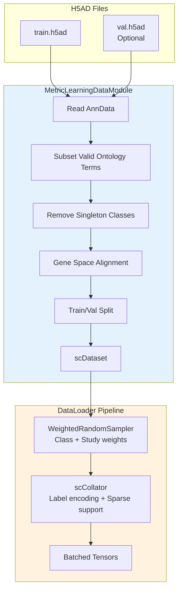

The AnnData data models provide a streamlined interface for training metric learning models on single-cell RNA sequencing data stored in the AnnData format. These models handle the complete data pipeline from loading h5ad files to creating PyTorch DataLoader instances with sophisticated sampling strategies, ontology-based filtering, and gene space alignment. This architecture enables scalable training while addressing common challenges in single-cell data analysis such as batch effects, class imbalance, and cross-study consistency.

Sources: [anndata_data_models.py](src/scimilarity/anndata_data_models.py#L75-L116), [anndata_data_models.rst](docs/modules/anndata_data_models.rst#L1-L7)

## Architecture Overview

The AnnData data model architecture follows a layered design pattern where each component handles a specific responsibility in the data preparation pipeline. At the foundation, PyTorch Lightning's LightningDataModule provides the orchestration framework, while custom classes handle dataset representation, batch collation, and data loading with weighted sampling.

The three core components work together seamlessly: scDataset wraps AnnData matrices into PyTorch's Dataset interface, scCollator manages batch construction with optional sparse matrix support, and MetricLearningDataModule orchestrates the entire pipeline with automated filtering and alignment.



Sources: [anndata_data_models.py](src/scimilarity/anndata_data_models.py#L75-L200), [anndata_data_models.py](src/scimilarity/anndata_data_models.py#L320-L363)

## Core Components

### scDataset

The scDataset class serves as the bridge between AnnData objects and PyTorch's Dataset interface. It encapsulates gene expression data (X), cell type labels (Y), and study identifiers, providing the standard __len__ and __getitem__ methods required for data loading. The implementation efficiently handles sparse matrices by converting them to dense format only when accessed during batch creation, allowing memory-efficient storage while maintaining compatibility with downstream training operations.

The class design prioritizes simplicity with a focused initialization that accepts pre-extracted matrices from AnnData objects. When __getitem__ is called with an index, it returns a tuple of three elements: the flattened gene expression vector (converted from sparse matrix using toarray()), the cell type label, and the study identifier. This structure enables the collator to process all samples in a batch efficiently.

Sources: [anndata_data_models.py](src/scimilarity/anndata_data_models.py#L17-L41)

### scCollator

The scCollator implements custom batch collation logic that handles the transformation from individual dataset samples to batched PyTorch tensors. Unlike PyTorch's default collation, this class performs critical preprocessing including converting string labels to integer class indices using a provided label2int mapping, stacking gene expression profiles, and optionally converting dense tensors to sparse format for memory efficiency.

During batch construction, the collator receives a list of tuples from scDataset, zips them to separate profiles, labels, and studies, stacks the expression profiles vertically using numpy.vstack, and converts them to PyTorch tensors. Label strings are mapped to integers using the label2int dictionary, which is essential for cross-entropy loss computation during training. The sparse option enables memory-efficient handling for large datasets by converting tensors to sparse format.

Sources: [anndata_data_models.py](src/scimilarity/anndata_data_models.py#L43-L73)

### MetricLearningDataModule

The MetricLearningDataModule is the central orchestration component that extends PyTorch Lightning's LightningDataModule. It implements the complete data preparation pipeline including file loading, ontology-based filtering, singleton class removal, gene space alignment, and weighted sampler creation. This class abstracts away the complexity of data preprocessing, providing a clean interface for model training while ensuring consistency between training, validation, and test data splits.

Key initialization parameters include paths to training and optional validation h5ad files, column names for cell type labels and study identifiers, gene order specification for cross-dataset alignment, and numerous DataLoader configuration options including batch size, worker threads, sparse matrix support, and memory pinning settings.

Sources: [anndata_data_models.py](src/scimilarity/anndata_data_models.py#L75-L200)

## Data Processing Pipeline

The MetricLearningDataModule implements a sophisticated data processing pipeline with multiple filtering and transformation stages. This pipeline ensures data quality, ontology compliance, and cross-study consistency before model training begins. Each stage addresses specific challenges in single-cell RNA sequencing analysis, from batch effects to class imbalance.

### Ontology Validation

The subset_valid_terms method filters cells based on cell type ontology compliance by matching cell type names against the Cell Ontology database. It imports the Cell Ontology using import_cell_ontology(), creates a bidirectional ID mapper using get_id_mapper(), and filters the AnnData object to retain only cells with cell type names that have valid ontology identifiers. This validation is critical for downstream tasks such as cell annotation and ontology-based analysis, ensuring that all labels correspond to standardized, biologically meaningful cell type definitions.

The method raises a RuntimeError if no valid ontology terms are found, preventing training on improperly annotated data. This early validation catches common data quality issues before they propagate through the training pipeline.

Sources: [anndata_data_models.py](src/scimilarity/anndata_data_models.py#L202-L225), [ontologies.py](src/scimilarity/ontologies.py#L30-L52), [ontologies.py](src/scimilarity/anndata_data_models.py#L126-L145)

### Singleton Class Removal

The remove_singleton_label_ids method addresses the problem of cell types that appear in only one study, which can lead to overfitting and poor generalization. It first identifies "singleton labels" by counting how many unique studies each cell type appears in, then attempts to resolve these singletons through ontology-based coarse-graining using find_most_viable_parent(). For each singleton cell type, the method searches the Cell Ontology hierarchy for a parent cell type that appears in multiple studies and remaps the singleton to its parent.

If coarse-graining fails or the resulting cell type still appears in fewer than the minimum number of studies (default: 2), those cells are removed from the dataset entirely. This two-stage approach maximizes data retention while ensuring robust cross-study generalization. The method returns a filtered AnnData object containing only well-represented cell types.

Sources: [anndata_data_models.py](src/scimilarity/anndata_data_models.py#L226-L271), [ontologies.py](src/scimilarity/ontologies.py#L331-L369)

### Gene Space Alignment

The align_dataset utility function ensures that different datasets use a consistent gene ordering, which is essential for model training and inference. This function takes an AnnData object and a target gene order (typically derived from the training dataset or a pretrained model) and reorders the gene columns accordingly. It includes rigorous validation checks including verifying gene overlap (default minimum: 5000 genes), converting dense matrices to sparse format for efficiency, and checking for negative values in expression or count matrices.

If the dataset is already aligned to the target gene order, the function returns the original object immediately. Otherwise, it creates a new AnnData "shell" with the target gene order, concatenates the aligned data using anndata.concat(), and optionally preserves the original obsm matrices. The original gene list is stored in shell.uns["orig_genes"] for reference.

Sources: [utils.py](src/scimilarity/utils.py#L50-L131)

## Weighted Sampling Strategy

The get_sampler_weights method implements a sophisticated weighted random sampling strategy that addresses two critical sources of bias in single-cell data: class imbalance and study bias. By assigning higher sampling weights to underrepresented cell types and studies, the sampler ensures that the model sees balanced examples during training, improving generalization across diverse cell types and experimental conditions.

When only labels are provided (studies=None), the method computes inverse class frequency weights using Counter, giving higher weights to rare cell types. When both labels and studies are provided, it computes separate weights for classes and studies using a logarithmic normalization scheme with configurable target sums (default: 1e4 for classes, 1e6 for studies). The final sample weight is the product of class and study weights, enabling balanced sampling across both dimensions. The method also caps extreme weights using a 99.9th percentile threshold to prevent outliers from dominating sampling.

> [!TIP]
> The logarithmic normalization in weighted sampling (1.0 / np.log1p(count / target_sum)) prevents extremely large weights for very rare classes, which can cause training instability. This approach balances the need for representative sampling with computational efficiency and model convergence.

Sources: [anndata_data_models.py](src/scimilarity/anndata_data_models.py#L273-L319)

## DataLoader Configuration

The train_dataloader, val_dataloader, and test_dataloader methods provide PyTorch DataLoader instances configured for efficient training. All three methods use the same configuration strategy, with validation and test dataloaders returning None if no validation dataset is available. The DataLoaders are configured with batch size, number of worker threads, memory pinning for GPU transfer efficiency, and custom samplers using the weighted sampling strategy described above.

Key configuration options include:
- drop_last=True: Ensures all batches have the same size by dropping the final incomplete batch
- persistent_workers: Keeps worker processes alive between epochs for improved performance
- multiprocessing_context: Supports "fork" (default) or "spawn" multiprocessing strategies
- collate_fn: Uses scCollator for custom batch preprocessing with label encoding and sparse matrix support

The test_dataloader method simply returns the val_dataloader, reflecting the common practice of using validation data for final evaluation in metric learning scenarios.

Sources: [anndata_data_models.py](src/scimilarity/anndata_data_models.py#L321-L374)

## Configuration Reference

### MetricLearningDataModule Parameters

| Parameter | Type | Default | Description |
|-----------|------|---------|-------------|
| train_path | str | Required | Path to training h5ad file |
| val_path | str, optional | None | Path to validation h5ad file |
| label_column | str | "celltype_name" | Column containing ontology-compliant cell type names |
| study_column | str | "study" | Column containing study identifiers |
| gene_order_file | str, optional | None | File containing target gene order (one gene per line) |
| batch_size | int | 1000 | Number of cells per batch |
| num_workers | int | 1 | Number of DataLoader worker threads |
| sparse | bool | False | Use sparse matrices for memory efficiency |
| remove_singleton_classes | bool | True | Filter cell types appearing in only one study |
| pin_memory | bool | False | Use pinned memory for faster GPU transfer |
| persistent_workers | bool | False | Keep workers alive between epochs |
| multiprocessing_context | str | "fork" | Multiprocessing context ("fork" or "spawn") |

Sources: [anndata_data_models.py](src/scimilarity/anndata_data_models.py#L117-L131)

### scCollator Parameters

| Parameter | Type | Default | Description |
|-----------|------|---------|-------------|
| label2int | dict | Required | Mapping from string labels to integer class IDs |
| sparse | bool | False | Convert output tensors to sparse format |

Sources: [anndata_data_models.py](src/scimilarity/anndata_data_models.py#L54-L60)

## Usage Example

The following example demonstrates the typical workflow for using AnnData data models in training:

```python
from scimilarity.anndata_data_models import MetricLearningDataModule

# Initialize the data module with training and validation data
datamodule = MetricLearningDataModule(
    train_path="path/to/train.h5ad",
    val_path="path/to/val.h5ad",
    label_column="celltype_name",
    study_column="study",
    gene_order_file="path/to/gene_order.txt",
    batch_size=1000,
    num_workers=4,
    sparse=True,
    remove_singleton_classes=True,
    pin_memory=True,
)

# Access the data loaders for training
train_loader = datamodule.train_dataloader()
val_loader = datamodule.val_dataloader()

# The datamodule automatically:
# 1. Filters cells with invalid ontology terms
# 2. Removes singleton cell types or coarse-grains them
# 3. Aligns gene spaces across datasets
# 4. Creates weighted samplers for balanced training
# 5. Encodes labels and handles sparse matrices
```

Sources: [anndata_data_models.py](src/scimilarity/anndata_data_models.py#L107-L115), [anndata_data_models.py](src/scimilarity/anndata_data_models.py#L149-L200)

## Integration with Training Pipeline

The AnnData data models integrate seamlessly with the PyTorch Lightning training framework. The MetricLearningDataModule implements the required LightningDataModule interface, providing train_dataloader(), val_dataloader(), and test_dataloader() methods that are automatically called during the training loop. This integration enables automated data loading, validation, and testing with minimal boilerplate code.

> [!TIP]
> When using sparse=True with pin_memory=True, the pin_memory parameter is automatically disabled to avoid incompatibility issues. The system ensures configuration consistency by checking these parameters during initialization.

For complete training examples, see the [Training Configuration and Hyperparameters](20-training-configuration-and-hyperparameters) documentation and the training script at [scripts/anndata/train_anndata.py](scripts/anndata/train_anndata.py#L11-L133).

Sources: [anndata_data_models.py](src/scimilarity/anndata_data_models.py#L144-L147), [train_anndata.py](scripts/anndata/train_anndata.py#L11-L133)

## Data Quality Requirements

The AnnData data models enforce several data quality requirements to ensure reliable training outcomes. These requirements are validated during initialization, with informative error messages for non-compliant data.

### Gene Space Requirements
- Minimum gene overlap of 5,000 genes between dataset and target gene order
- Gene symbols must be in var.index
- No negative values in expression matrix (data.X)
- No negative values in count matrix (data.layers["counts"] if present)
- Non-empty gene space after alignment

### Annotation Requirements
- Cell type labels must map to valid Cell Ontology identifiers
- At least one cell type with valid ontology ID must exist
- For robust training, multiple cell types appearing in multiple studies are recommended

### Structural Requirements
- Valid h5ad file format readable by anndata.read_h5ad()
- Specified label_column and study_column must exist in data.obs
- Expression matrix can be dense or sparse (automatically converted to sparse)

Sources: [anndata_data_models.py](src/scimilarity/anndata_data_models.py#L150-L196), [utils.py](src/scimilarity/utils.py#L85-L111)

## Performance Considerations

The AnnData data models are designed for efficient handling of large-scale single-cell datasets. Several architectural choices and configuration options impact performance:

### Memory Efficiency
- Sparse matrix support (sparse=True) significantly reduces memory usage for sparse single-cell data
- Lazy conversion from sparse to dense during batch creation avoids unnecessary memory allocation
- Gene space alignment preserves sparse matrix format throughout the pipeline

### I/O Performance
- Multiple worker threads (num_workers > 1) enable parallel data loading and preprocessing
- Persistent workers (persistent_workers=True) reduce overhead of worker process creation
- Pinned memory (pin_memory=True) accelerates GPU data transfer

### Training Efficiency
- Weighted sampling ensures balanced gradients across rare and common cell types
- Batch size tuning impacts GPU utilization and training stability
- Gene overlap threshold (5,000 default) prevents wasted computation on incompatible datasets

For large-scale deployments with millions of cells, consider combining AnnData data models with [Zarr Data Models](23-zarr-data-models) or [TileDB Data Models](24-tiledb-data-models) for enhanced storage and query capabilities.

Sources: [anndata_data_models.py](src/scimilarity/anndata_data_models.py#L125-L143), [utils.py](src/scimilarity/utils.py#L96-L106)

## Error Handling and Troubleshooting

The AnnData data models include comprehensive error handling to catch common data issues early. Understanding these error messages helps diagnose problems quickly.

### Common Errors

**"No celltype labels have a valid ontology id."**
- Cause: Cell type names in the label_column don't match Cell Ontology names
- Solution: Verify cell type names use standard ontology terminology, check label_column parameter

**"Dataset incompatible. Gene overlap of {count} less than {threshold}."**
- Cause: Insufficient gene overlap between dataset and target gene order
- Solution: Ensure var.index uses gene symbols (not Ensembl IDs), verify gene_order_file format

**"Dataset contains negative values in expression matrix X."**
- Cause: Expression matrix contains negative values, often from log-normalized or scaled data
- Solution: Use raw count data in data.layers["counts"] or ensure data.X contains non-negative values

**"RuntimeError: Empty gene space detected."**
- Cause: No genes from target gene order found in dataset
- Solution: Verify gene naming consistency, check var.index values

Sources: [anndata_data_models.py](src/scimilarity/anndata_data_models.py#L194-L195), [utils.py](src/scimilarity/utils.py#L86-L90), [utils.py](src/scimilarity/utils.py#L100-L111)

## Advanced Features

### Custom Gene Orders

You can specify a custom gene order using the gene_order_file parameter, which is useful for:
- Aligning datasets to a pretrained model's gene space
- Using a curated gene list focused on specific pathways
- Ensuring consistency across multiple training runs

The gene order file should contain one gene symbol per line. If not specified, the training dataset's gene order is used as the reference.

### Study-Aware Sampling

The weighted sampling strategy considers both class and study distributions when both are provided. This is particularly valuable for:
- Preventing model overfitting to specific experimental conditions
- Ensuring robust generalization across different platforms and protocols
- Balancing batch effects while maintaining class representation

The class_target_sum and study_target_sum parameters control the logarithmic normalization strength, allowing fine-tuning of sampling behavior.

Sources: [anndata_data_models.py](src/scimilarity/anndata_data_models.py#L158-L165), [anndata_data_models.py](src/scimilarity/anndata_data_models.py#L273-L319)

## Next Steps

After understanding AnnData data models, explore these related topics to deepen your understanding of the scimilarity architecture:

- [Zarr Data Models](23-zarr-data-models) - Learn about alternative data formats optimized for cloud storage and parallel access
- [Data Module Pipeline Architecture](25-data-module-pipeline-architecture) - Understand how different data models integrate in the complete pipeline
- [Training Configuration and Hyperparameters](20-training-configuration-and-hyperparameters) - Explore training-specific data configuration options
- [Cell Ontology Integration](30-cell-ontology-integration) - Deepen your understanding of ontology-based validation and filtering

For practical implementation details, review the training notebook at [docs/notebooks/training_tutorial.ipynb](docs/notebooks/training_tutorial.ipynb) and the example training script at [scripts/anndata/train_anndata.py](scripts/anndata/train_anndata.py).