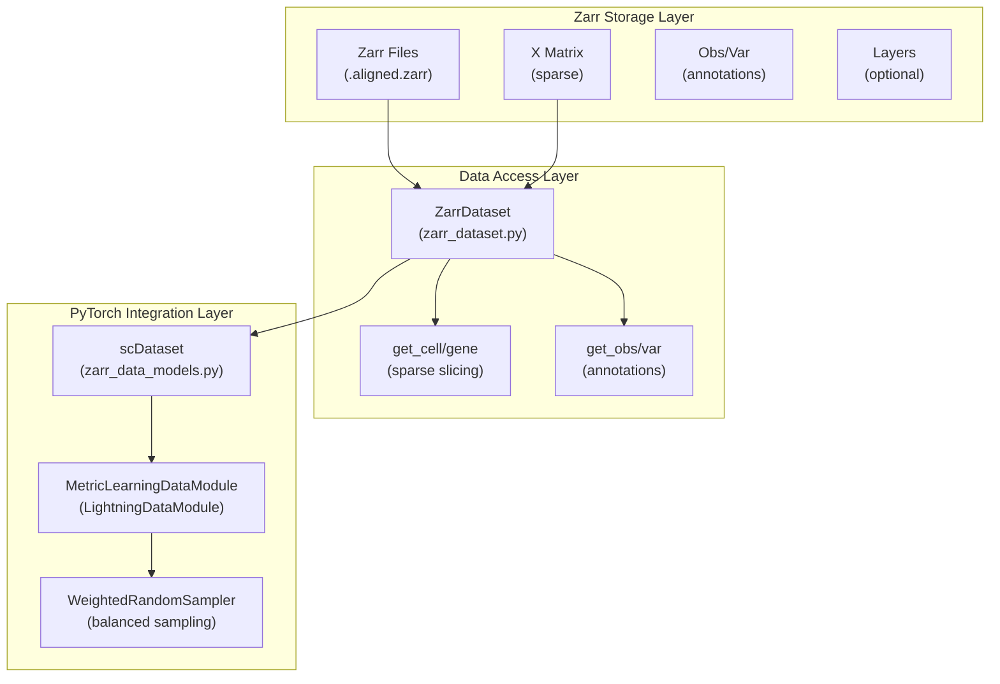

Zarr data models provide an efficient storage and access layer for large-scale single-cell RNA-seq datasets, enabling memory-efficient operations through sparse matrix representations backed by cloud-native zarr storage. This architecture supports training workflows that require access to millions of cells across multiple studies without loading entire datasets into memory.

## Architecture Overview

The Zarr data model system implements a three-tier architecture that bridges AnnData's zarr format with PyTorch's training infrastructure. At the foundation lies `ZarrDataset`, which provides direct access to zarr-backed sparse matrices. The middle layer, `scDataset`, abstracts collections of datasets for PyTorch's Dataset interface. The top layer, `MetricLearningDataModule`, orchestrates training, validation, and test dataloaders with PyTorch Lightning integration, implementing sophisticated sampling strategies for balanced metric learning.

Sources: [zarr_data_models.py](src/scimilarity/zarr_data_models.py#L13-L55), [zarr_dataset.py](src/scimilarity/zarr_dataset.py#L12-L35)



## ZarrDataset: Core Data Access

`ZarrDataset` serves as the primary interface for reading and manipulating zarr datasets saved by AnnData, adapted from the backedarray library [source](src/scimilarity/zarr_dataset.py#L12-L26). The class initializes with a store path and mode parameter, defaulting to read-only mode for efficient data access without modification capabilities. The implementation leverages zarr's DirectoryStore for hierarchical data organization, opening groups with optional chunk stores for optimized I/O performance.

The dataset structure follows AnnData conventions with three primary components: the gene expression matrix (X), observation metadata (obs), and variable metadata (var). Optional layers provide access to alternative representations such as raw counts or normalized data. All sparse matrices support three encoding formats: CSR (Compressed Sparse Row), CSC (Compressed Sparse Column), and COO (Coordinate format), enabling efficient access patterns for different query types.

Sources: [zarr_dataset.py](src/scimilarity/zarr_dataset.py#L28-L35), [zarr_dataset.py](src/scimilarity/zarr_dataset.py#L36-L62)

### Dataset Information Access

The `dataset_info` property provides a comprehensive summary of dataset contents, returning a dictionary containing available keys in var, obs, layers, and uns (unstructured) attributes, along with the matrix shape [source](src/scimilarity/zarr_dataset.py#L36-L62). This metadata enables downstream applications to discover available features and data structures without loading the full dataset.

The `shape` property returns the matrix dimensions as a tuple of (n_cells, n_genes), retrieved from the X matrix attributes [source](src/scimilarity/zarr_dataset.py#L64-L80). Similarly, `var_index` and `obs_index` properties expose the pandas Index objects for genes and cells respectively, while the `var` and `obs` properties reconstruct the complete dataframes by combining index information with column data [source](src/scimilarity/zarr_dataset.py#L82-L164).

> [!TIP]
> The lazy evaluation pattern in ZarrDataset means that accessing properties like `obs` or `var` triggers column-by-column loading rather than loading the entire dataframe at once, which can be more memory-efficient for large datasets but may incur overhead for repeated access patterns.

### Sparse Matrix Operations

The core data access methods center around sparse matrix retrieval and manipulation. The `get_X` method returns the primary gene expression matrix, with an optional `in_mem` parameter to force loading the complete matrix into memory [source](src/scimilarity/zarr_dataset.py#L166-L187). When `in_mem=False` (default), the returned sparse matrix contains zarr array references that load data on-demand, enabling memory-efficient access to datasets far exceeding available RAM.

For count data, the `get_counts` method accesses the 'counts' layer if present, providing access to raw UMI counts separate from normalized expression values [source](src/scimilarity/zarr_dataset.py#L189-L212). The `set_X` and `append_X` methods enable matrix modification, with append operations constrained by matrix type: CSR matrices support row-wise concatenation, while CSC matrices support column-wise concatenation [source](src/scimilarity/zarr_dataset.py#L214-L253).

Sources: [zarr_dataset.py](src/scimilarity/zarr_dataset.py#L166-L212), [zarr_dataset.py](src/scimilarity/zarr_dataset.py#L214-L253)

### Cell and Gene Access Patterns

Efficient single-element access is provided through `get_cell` and `get_gene` methods, which retrieve individual cell rows or gene columns as sparse matrices [source](src/scimilarity/zarr_dataset.py#L381-L471). These methods dispatch to `get_row` and `get_col` based on the matrix encoding type, automatically selecting the appropriate slicing strategy for CSR, CSC, or COO formats.

For layered data access, `get_layer_cell` and `get_layer_gene` extend this functionality to alternative matrix representations stored in the layers hierarchy [source](src/scimilarity/zarr_dataset.py#L403-L471). This enables training workflows to access raw counts while simultaneously retrieving normalized or batch-corrected expressions from different layers without redundant storage.

> [!TIP]
> When working with CSR-encoded matrices, prefer row-wise access via `get_cell` for optimal performance. Conversely, CSC-encoded matrices are optimized for column-wise access via `get_gene`. The zarr format's chunk storage means that accessing elements in the same chunk benefits from cached reads.

Sources: [zarr_dataset.py](src/scimilarity/zarr_dataset.py#L321-L379), [zarr_dataset.py](src/scimilarity/zarr_dataset.py#L403-L471)

### Annotation Handling

The annotation system provides efficient access to cell and gene metadata through `get_obs` and `get_var` methods, which retrieve individual columns as either numpy arrays or pandas Categoricals [source](src/scimilarity/zarr_dataset.py#L253-L276). Categorical data is automatically reconstructed with proper type preservation, supporting both modern AnnData zarr formats (≥0.8.0) and legacy formats with different categorical storage schemes.

For writing operations, `set_annotation` creates or replaces entire annotation groups from pandas DataFrames, handling both categorical and regular columns with appropriate zarr encoding [source](src/scimilarity/zarr_dataset.py#L910-L974). The `append_annotation` method concatenates new annotations with existing data, requiring careful handling of column consistency across appended datasets [source](src/scimilarity/zarr_dataset.py#L976-L1000).

Sources: [zarr_dataset.py](src/scimilarity/zarr_dataset.py#L253-L276), [zarr_dataset.py](src/scimilarity/zarr_dataset.py#L856-L908), [zarr_dataset.py](src/scimilarity/zarr_dataset.py#L910-L1000)

## Matrix Storage and Retrieval Internals

The underlying matrix operations rely on `get_matrix`, which constructs sparse matrices directly from zarr array references rather than loading data into memory [source](src/scimilarity/zarr_dataset.py#L645-L689). For CSR and CSC matrices, this involves binding the zarr arrays for data, indices, and indptr attributes to the corresponding sparse matrix attributes. COO matrices follow a similar pattern with data, row, and col arrays. When `in_mem=True`, these arrays are fully materialized with bracket notation `[...]`, triggering complete data loading.

The `set_matrix` method implements the inverse operation, creating zarr datasets for each sparse matrix component with appropriate dtype preservation [source](src/scimilarity/zarr_dataset.py#L691-L724). Encoding metadata is stored as group attributes, including encoding-type, encoding-version, and shape, ensuring compatibility with AnnData's serialization format.

Sources: [zarr_dataset.py](src/scimilarity/zarr_dataset.py#L645-L724)

## scDataset: PyTorch Dataset Integration

`scDataset` bridges multiple zarr datasets with PyTorch's Dataset interface, treating a collection of datasets as a single logical training set [source](src/scimilarity/zarr_data_models.py#L13-L51). The constructor accepts a list of ZarrDataset objects along with column names for cell type and study metadata, computing cumulative cell counts across all datasets to enable global indexing.

The class maintains parallel index arrays (`data_idx` and `cell_idx`) that map global indices to specific datasets and local cell positions, enabling constant-time lookup of any cell across the entire collection [source](src/scimilarity/zarr_data_models.py#L33-L38). The `__len__` method returns the total cell count, while `__getitem__` retrieves individual cells, returning a tuple of gene expression vectors, cell type labels, and study identifiers.

Sources: [zarr_data_models.py](src/scimilarity/zarr_data_models.py#L26-L51)

## MetricLearningDataModule: Training Orchestration

`MetricLearningDataModule` implements a PyTorch Lightning DataModule that encapsulates the complete data pipeline for metric learning model training [source](src/scimilarity/zarr_data_models.py#L54-L173). The constructor requires a training directory path and a gene order file, with optional validation path and parameters for batch size, number of workers, and the observation field containing cell type labels.

### Dataset Discovery and Loading

During initialization, the module recursively scans the training directory for `.aligned.zarr` folders, constructing a list of (study, sample) tuples for dataset discovery [source](src/scimilarity/zarr_data_models.py#L116-L134). Each discovered dataset is loaded as a ZarrDataset and appended to the training list, with cell type labels and study identifiers extracted for sampling configuration. The gene order file defines the expected gene space, which must align with the zarr datasets after preprocessing [source](src/scimilarity/zarr_data_models.py#L103-L108).

The class maintains label mappings converting between string cell type names and integer indices, enabling efficient categorical handling in PyTorch [source](src/scimilarity/zarr_data_models.py#L138-L140). This mapping is essential for classification tasks and loss computation during metric learning.

Sources: [zarr_data_models.py](src/scimilarity/zarr_data_models.py#L88-L173)

### Weighted Sampling Strategies

The `get_sampler_weights` method implements sophisticated balancing strategies for imbalanced datasets, returning a WeightedRandomSampler that adjusts sampling probabilities based on class and study frequencies [source](src/scimilarity/zarr_data_models.py#L175-L209). When studies are not provided, sampling weights are computed as the inverse of class sample counts, giving higher probability to underrepresented cell types.

When study information is included, the method computes combined weights that account for both class imbalance and study bias. Class sample counts are transformed using `log1p(count/1e4)` to dampen extreme imbalances, while study counts use `log1p(count/1e5)` for similar normalization. The final weight for each sample is the product of inverse class and study weights, ensuring balanced representation across both dimensions.

Sources: [zarr_data_models.py](src/scimilarity/zarr_data_models.py#L175-L209)

### DataLoader Configuration

The `collate` method customizes batch creation by stacking gene expression profiles and converting string labels to integer indices using the label2int mapping [source](src/scimilarity/zarr_data_models.py#L211-L233). The resulting batch contains three elements: a torch.Tensor of expression vectors, a torch.Tensor of integer labels, and a list of study identifiers for tracking provenance.

The `train_dataloader` and `val_dataloader` methods create DataLoader instances with optimized settings for performance, including pin_memory for GPU transfer, drop_last for consistent batch sizes, and the weighted sampler for balanced training [source](src/scimilarity/zarr_data_models.py#L235-L273). The test_dataloader defaults to returning the validation dataloader, though this can be customized for specific evaluation scenarios.

Sources: [zarr_data_models.py](src/scimilarity/zarr_data_models.py#L211-L285)

## Storage Format Comparison

| Component | Zarr Implementation | Memory Usage | Access Pattern | Use Case |
|-----------|-------------------|--------------|----------------|----------|
| **X Matrix** | Sparse (CSR/CSC/COO) | O(nnz) | Row/col optimized | Primary expression data |
| **Layers** | Multiple sparse matrices | O(nnz × layers) | Same as X | Alternative representations |
| **obs** | Columnar zarr arrays | O(columns × cells) | Random access | Cell metadata |
| **var** | Columnar zarr arrays | O(columns × genes) | Random access | Gene metadata |
| **uns** | Hierarchical zarr groups | Variable | Key-value | Unstructured data |

Sources: [zarr_dataset.py](src/scimilarity/zarr_dataset.py#L5-L9), [zarr_dataset.py](src/scimilarity/zarr_dataset.py#L36-L62)

## Configuration Parameters

| Parameter | Type | Default | Description |
|-----------|------|---------|-------------|
| **store_path** | str | required | Path to zarr dataset directory |
| **mode** | str | "r" | Persistence mode (read/write) |
| **in_mem** | bool | False | Load full matrix into memory |
| **batch_size** | int | 1000 | Training batch size |
| **num_workers** | int | 1 | DataLoader worker threads |
| **obs_field** | str | "celltype_name" | Cell type column in obs |
| **gene_order** | str | required | File defining gene space alignment |

Sources: [zarr_dataset.py](src/scimilarity/zarr_dataset.py#L28-L34), [zarr_data_models.py](src/scimilarity/zarr_data_models.py#L88-L96)

## Usage Patterns

### Basic Dataset Access

```python
from scimilarity.zarr_dataset import ZarrDataset

# Open zarr dataset
zarr_data = ZarrDataset("/data/dataset.zarr")

# Access metadata
shape = zarr_data.shape  # (n_cells, n_genes)
obs = zarr_data.obs       # Cell metadata
var = zarr_data.var       # Gene metadata

# Retrieve single cell as sparse matrix
cell_expr = zarr_data.get_cell(42)  # Returns CSR/COO matrix
cell_dense = cell_expr.toarray().flatten()  # Convert to dense vector
```

Sources: [zarr_dataset.py](src/scimilarity/zarr_dataset.py#L28-L35), [zarr_dataset.py](src/scimilarity/zarr_dataset.py#L381-L401)

### Training Data Module Setup

```python
from scimilarity.zarr_data_models import MetricLearningDataModule

datamodule = MetricLearningDataModule(
    train_path="train_data/",
    gene_order="gene_order.tsv",
    val_path="val_data/",
    obs_field="celltype_name",
    batch_size=1000,
    num_workers=4,
)

# Access dataloaders
train_loader = datamodule.train_dataloader()
val_loader = datamodule.val_dataloader()
```

Sources: [zarr_data_models.py](src/scimilarity/zarr_data_models.py#L88-L96), [zarr_data_models.py#L235-L273)

## Next Steps

The Zarr data model system provides the foundation for efficient large-scale single-cell data processing and training. For deeper understanding of data handling patterns, explore [AnnData Data Models](22-anndata-data-models) to compare storage formats and access patterns. To understand how these data models integrate with the complete training pipeline, see [Data Module Pipeline Architecture](25-data-module-pipeline-architecture). For insights into working with datasets exceeding local storage capacity, refer to [TileDB Data Models](24-tiledb-data-models) for distributed storage solutions.
