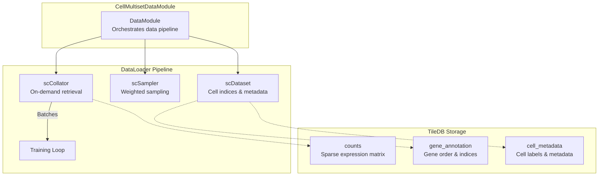
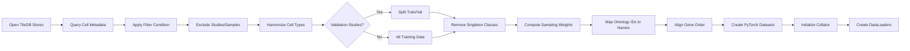

TileDB Data Models provide a scalable, on-demand data access layer for single-cell transcriptomic data, designed to handle datasets that exceed available memory through efficient lazy loading from persistent TileDB arrays. This architecture is particularly valuable for training embedding models on large-scale cell atlases where loading entire datasets into memory is impractical.

## Architecture Overview

The TileDB data access layer implements a three-tier architecture that separates metadata management, gene annotation, and expression matrix storage. This separation enables efficient querying, flexible gene ordering, and on-demand retrieval of expression data during training.



The architecture follows a lazy evaluation pattern where cell metadata is loaded initially, but expression counts are retrieved only when needed during batch collation. This design enables training on datasets containing millions of cells while maintaining manageable memory footprint.

## TileDB Storage Schema

TileDB arrays store data in three distinct collections, each optimized for specific access patterns required during model training.

### Cell Metadata Store

The cell metadata array (`cell_metadata_uri`) contains descriptive information about each cell, including study identifiers, sample identifiers, and cell type ontology labels. This store enables efficient filtering and querying of cells based on metadata criteria before retrieving expression data.

### Gene Annotation Store

The gene annotation array (`gene_annotation_uri`) maintains the canonical gene ordering used across the dataset, including `cellarr_gene_index` attributes that map gene symbols to their positions in the expression matrix. This store allows for gene space alignment when training models on datasets with different gene orderings.

### Counts Matrix Store

The counts array (`counts_uri`) stores the sparse expression matrix in TileDB's sparse array format, optimized for efficient retrieval of subsets of genes and cells. The matrix uses cell and gene indices as dimensions, enabling fast multi-index queries that retrieve expression data for arbitrary cell-gene subsets.

Sources: [tiledb_data_models.py](src/scimilarity/tiledb_data_models.py#L280-L310)

## Core Classes

### scDataset

`scDataset` extends PyTorch's Dataset class to provide indexed access to cell metadata stored in memory. This lightweight wrapper serves as the foundation for the data pipeline, holding references to cell indices and their associated labels without storing expression data.

```python
from scimilarity.tiledb_data_models import CellMultisetDataModule

# Initialize data module with TileDB stores
datamodule = CellMultisetDataModule(
    dataset_path="/path/to/tiledb/dataset",
    cell_metadata_uri="cell_metadata",
    gene_annotation_uri="gene_annotation",
    counts_uri="counts",
    label_id_column="cellTypeOntologyID",
    study_column="datasetID",
    batch_size=1000,
    num_workers=5
)
```

The dataset maintains a pandas DataFrame containing cell metadata, which can be filtered and transformed during initialization. This design allows for pre-processing operations like cell type harmonization and singleton removal to be performed before training begins.

Sources: [tiledb_data_models.py](src/scimilarity/tiledb_data_models.py#L23-L42)

### scSampler

`scSampler` implements weighted sampling strategies to ensure balanced minibatch composition during training. The sampler supports both static and dynamic weight decay mechanisms to address class imbalance and prevent over-sampling of the same cells.

**Sampling Configuration**:

| Parameter | Type | Default | Description |
|-----------|------|---------|-------------|
| `dynamic_weights` | bool | False | Enable dynamic weight decay for sampled cells |
| `weight_decay` | float | 0.5 | Decay factor applied to sampled cell weights |
| `batch_size` | int | 1000 | Number of cells per batch |
| `n_batches` | int | 100 | Number of batches per epoch |

The sampler computes sampling weights based on both cell type frequency and study frequency, creating a balanced representation across different biological conditions. When `dynamic_weights` is enabled, cells that have been sampled recently have their weights reduced, encouraging exploration of under-sampled regions of the dataset.

Sources: [tiledb_data_models.py](src/scimilarity/tiledb_data_models.py#L45-L111)

### scCollator

`scCollator` performs the critical function of retrieving expression data from TileDB on-demand and applying normalization transformations. This class implements the lazy loading pattern, connecting in-memory cell metadata with the persistent counts matrix.

**Key Features**:

- **Multi-index queries**: Efficiently retrieves sparse expression data for cell-gene subsets
- **Log-normalization**: Applies `log1p` normalization with configurable target sum (default: 1e4)
- **Gene ordering**: Reorders expression data to match the model's expected gene space
- **Sparse matrix support**: Can return data in sparse format when needed

```python
# Collator configuration example
collator = scCollator(
    counts_uri="/path/to/counts",
    gene_indices=[0, 1, 2, ..., 19999],  # Gene indices to retrieve
    study_column="datasetID",
    lognorm=True,
    target_sum=1e4,
    sparse=False
)
```

The collator maintains an open TileDB connection throughout training, configured with a 50GB memory budget and single-threaded execution to control resource usage. This configuration prevents TileDB's internal multithreading from interfering with PyTorch's data loading workers.

Sources: [tiledb_data_models.py](src/scimilarity/tiledb_data_models.py#L112-L207)

### CellMultisetDataModule

`CellMultisetDataModule` integrates all components into a PyTorch Lightning-compatible data pipeline, handling dataset initialization, filtering, label harmonization, and DataLoader creation.

## Data Pipeline Flow

The data pipeline follows a structured sequence of operations to prepare data for training, from initial TileDB connection through batch generation.



### Filter Conditions

TileDB filter conditions enable flexible cell selection using TileDB's query syntax. By default, the data module filters out cells without valid cell type labels, but custom conditions can be specified for more sophisticated filtering.

```python
# Example filter conditions
filter_condition = "cellTypeOntologyID!='nan' AND tissue=='lung'"
filter_condition = "cellTypeOntologyID IN ('CL:0000738', 'CL:0000084')"
```

Sources: [tiledb_data_models.py](src/scimilarity/tiledb_data_models.py#L466-L475)

### Cell Type Harmonization

The data module performs manual harmonization of specific cell type ontology IDs to consolidate redundant or deprecated labels. This ensures consistency across studies and prevents fragmentation of cell types due to ontology version differences.

**Harmonized Cell Types**:

| Original ID | Mapped ID | Description |
|-------------|-----------|-------------|
| `CL:0000792` | `CL:0000815` | Regulatory T cell consolidation |
| `CL:0001043` | `CL:0000896` | Activated CD4+ T cell harmonization |
| `CL:0001056` | `CL:0000451` | Dendritic cell normalization |
| `CL:0001057` | `CL:0000782` | Myeloid dendritic cell harmonization |
| `CL:0001058` | `CL:0000784` | Plasmacytoid dendritic cell normalization |

This harmonization occurs before singleton class removal, ensuring that aggregated cell types have sufficient representation across studies.

Sources: [tiledb_data_models.py](src/scimilarity/tiledb_data_models.py#L594-L623)

### Singleton Class Removal

To prevent overfitting to rare cell types, the data module removes cell types that exist in fewer than the minimum number of studies (default: 2). This process includes an ontology-aware coarse-graining step that attempts to map singleton labels to their most specific parent that meets the minimum study requirement.

> [!TIP]
> The singleton removal process uses the Cell Ontology graph to find viable parent terms, preserving biological hierarchy when consolidating rare cell types. This prevents loss of information while ensuring robust training.

Sources: [tiledb_data_models.py](src/scimilarity/tiledb_data_models.py#L497-L545)

### Sampling Weight Computation

The sampler computes balanced weights using a logarithmic scaling strategy that considers both cell type frequency and study frequency:

```python
# Weight computation formula
class_weight = 1 / log1p(class_count / class_target_sum)
study_weight = 1 / log1p(study_count / study_target_sum)
final_weight = class_weight * study_weight
```

This formulation ensures that rare cell types and underrepresented studies receive higher sampling weights while preventing extreme weight values through quantile-based clipping at the 99.9th percentile.

Sources: [tiledb_data_models.py](src/scimilarity/tiledb_data_models.py#L547-L592)

## DataLoader Configuration

The data module creates PyTorch DataLoaders with configurable parameters to optimize performance for different hardware configurations.

**DataLoader Parameters**:

| Parameter | Type | Default | Purpose |
|-----------|------|---------|---------|
| `batch_size` | int | 1000 | Cells per batch |
| `num_workers` | int | 5 | Parallel data loading workers |
| `pin_memory` | bool | False | Pin memory for faster GPU transfer |
| `persistent_workers` | bool | False | Keep workers alive across epochs |
| `multiprocessing_context` | str | "fork" | Process spawning method |

When using sparse matrices, `pin_memory` is automatically disabled as sparse tensors don't support memory pinning. The `fork` multiprocessing context is recommended for data loading to avoid data serialization overhead.

Sources: [tiledb_data_models.py](src/scimilarity/tiledb_data_models.py#L625-L686)

## Advanced Features

### Gene Order Alignment

The data module supports alignment to a predefined gene order, enabling training on datasets with different gene orderings or models trained on specific gene subsets. Gene indices are computed by matching the TileDB gene annotation to the specified gene order file.

```python
# Align to custom gene order
datamodule = CellMultisetDataModule(
    dataset_path="/path/to/dataset",
    gene_order="/path/to/gene_order.txt",  # One gene symbol per line
    ...
)
```

Genes not found in the TileDB annotation are logged but skipped, allowing flexible subset selection.

Sources: [tiledb_data_models.py](src/scimilarity/tiledb_data_models.py#L415-L435)

### Validation Study Splitting

By specifying validation studies, the data module can perform study-level splitting, ensuring that validation and test sets contain entirely independent studies from training data. This approach provides a more rigorous evaluation of model generalization.

```python
# Study-level split example
datamodule = CellMultisetDataModule(
    dataset_path="/path/to/dataset",
    val_studies=["study_A", "study_B"],
    ...
)
```

When validation studies are specified, the data module automatically filters validation cell types to only those present in the training data, ensuring consistent label sets.

Sources: [tiledb_data_models.py](src/scimilarity/tiledb_data_models.py#L351-L364)

## Integration with Training Pipeline

The TileDB Data Module integrates seamlessly with PyTorch Lightning training workflows:

```python
import pytorch_lightning as pl
from scimilarity.tiledb_data_models import CellMultisetDataModule

# Initialize data module
datamodule = CellMultisetDataModule(
    dataset_path="/path/to/tiledb/dataset",
    batch_size=1000,
    num_workers=8,
    n_batches=200
)

# Setup data splits
datamodule.setup(stage="fit")

# Access dataloaders
train_loader = datamodule.train_dataloader()
val_loader = datamodule.val_dataloader()

# Initialize trainer and model
trainer = pl.Trainer(gpus=1, max_epochs=100)
model = MyLightningModule()

# Train
trainer.fit(model, datamodule)
```

The Lightning integration handles automatic sharding across multiple workers and supports distributed training scenarios through configurable multiprocessing contexts.

> [!TIP]
> The `n_batches` parameter should be set based on the desired number of training steps per epoch. Since sampling is with replacement, this parameter directly controls training duration rather than dataset size.

## Performance Considerations

### Memory Management

The TileDB configuration uses a 50GB memory budget with single-threaded execution, optimizing for controlled resource usage during parallel data loading. Workers maintain separate TileDB connections, each with its own memory budget.

### Batch Size Tuning

Optimal batch size depends on:
- Available GPU memory
- Gene space dimensionality
- Expression data sparsity
- Number of workers

For sparse expression matrices, effective memory usage is significantly lower than dense representations, allowing larger batch sizes for equivalent memory consumption.

### Worker Configuration

The `num_workers` parameter should be tuned based on:
- Number of CPU cores available
- I/O bandwidth of storage system
- TileDB query latency

For high-performance storage (NVMe SSDs), higher worker counts (8-16) can achieve better throughput. For networked storage, lower worker counts (2-4) may be optimal to avoid I/O contention.

## Comparison with Other Data Models

The TileDB implementation offers distinct advantages compared to alternative storage approaches:

| Feature | TileDB | AnnData | Zarr |
|---------|--------|---------|------|
| On-demand loading | ✅ | ⚠️ Limited | ✅ |
| Efficient metadata queries | ✅ | ❌ | ⚠️ Basic |
| Sparse matrix optimization | ✅ | ✅ | ✅ |
| Concurrent access | ✅ | ❌ | ✅ |
| Schema validation | ✅ | ❌ | ❌ |
| Distributed storage | ✅ | ❌ | ✅ |

Sources: [tiledb_data_models.py](src/scimilarity/tiledb_data_models.py#L136-L145)

## Next Steps

For practical implementation details, refer to the [Training Models API Reference](17-training-models-api-reference) for integrating the data module with model training pipelines. To understand how learned embeddings are stored and retrieved from TileDB, see [Cell Embedding Fundamentals](6-cell-embedding-fundamentals). For alternative storage backends, compare with [Zarr Data Models](23-zarr-data-models) and [AnnData Data Models](22-anndata-data-models).
