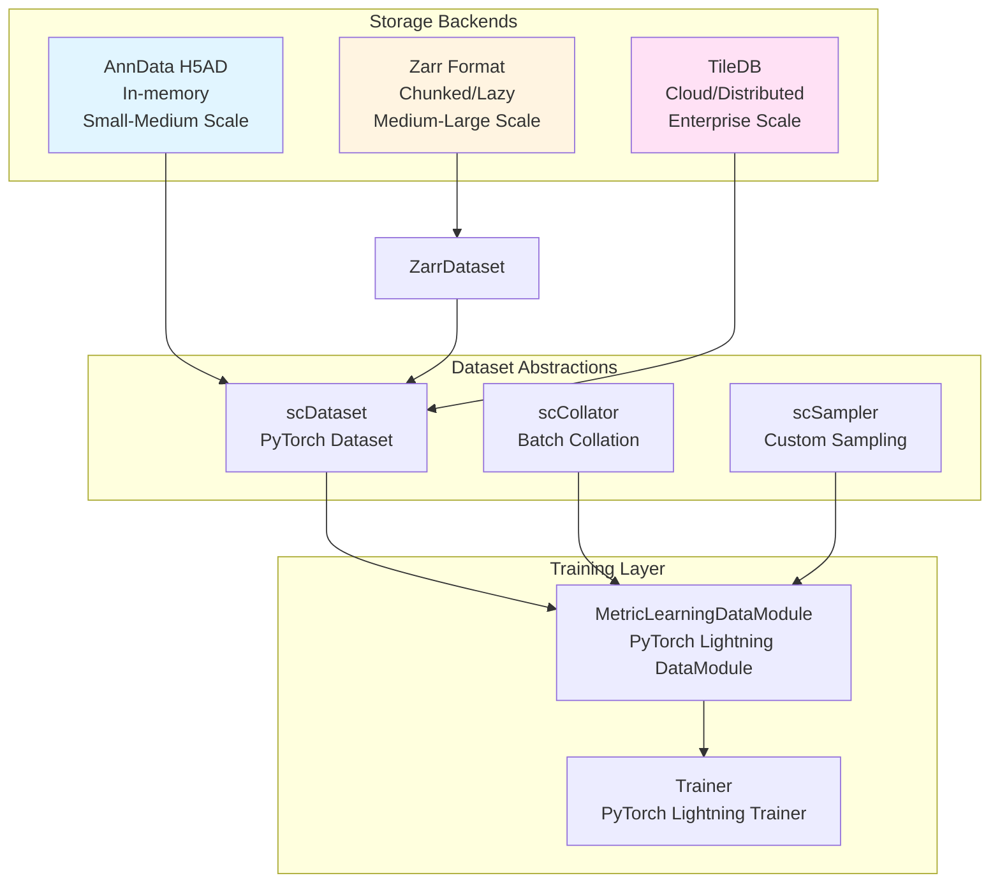

The data module pipeline in SCimilarity provides a unified abstraction layer over multiple storage backends, enabling scalable training of single-cell foundation models. This architecture supports three distinct storage formats—AnnData, Zarr, and TileDB—each optimized for different data scales and use cases while maintaining a consistent PyTorch Lightning interface for model training. The pipeline handles gene space alignment, label validation, batch sampling strategies, and efficient data loading through a modular design that separates storage concerns from training logic.

Sources: [anndata_data_models.py](src/scimilarity/anndata_data_models.py#L1-L375), [zarr_data_models.py](src/scimilarity/zarr_data_models.py#L1-L285), [tiledb_data_models.py](src/scimilarity/tiledb_data_models.py#L1-L686)

## Architectural Overview

The data module pipeline follows a three-tier architecture: storage backends, dataset abstractions, and PyTorch Lightning data modules. This separation allows switching between storage formats without modifying training code while enabling format-specific optimizations for scale and access patterns.

The pipeline's modularity enables each backend to implement format-specific optimizations: AnnData loads entire datasets into memory for fast access on smaller experiments, Zarr provides chunked lazy loading for memory-efficient processing of medium-scale datasets, and TileDB supports cloud-native distributed queries for enterprise-scale single-cell atlases. Despite these differences, all backends expose a consistent interface through PyTorch's Dataset protocol, ensuring seamless integration with PyTorch Lightning's training infrastructure.

Sources: [anndata_data_models.py](src/scimilarity/anndata_data_models.py#L17-L42), [zarr_data_models.py](src/scimilarity/zarr_data_models.py#L13-L45), [tiledb_data_models.py](src/scimilarity/tiledb_data_models.py#L23-L42)

## Storage Backend Implementations

### AnnData Backend

The AnnData backend is designed for in-memory processing of single-cell datasets stored in h5ad format. This approach is optimal for datasets that fit comfortably in RAM, typically ranging from tens of thousands to a few million cells. The backend loads the entire expression matrix into memory during initialization, enabling rapid random access during training.

The `MetricLearningDataModule` class orchestrates data loading with built-in preprocessing: it filters cells to retain only those with valid cell ontology terms, removes singleton classes that appear in fewer than two studies, and aligns the gene space to a target gene order for model compatibility. The module automatically creates train/validation splits, maps text labels to integer indices for classification, and applies configurable options for sparse matrices and parallel data loading.

Sources: [anndata_data_models.py](src/scimilarity/anndata_data_models.py#L75-L205), [train_anndata.py](scripts/anndata/train_anndata.py#L48-L68)

### Zarr Backend

The Zarr backend introduces a two-layer architecture for out-of-core processing. The `ZarrDataset` class provides low-level access to Zarr arrays, supporting methods for retrieving individual cells, genes, or entire matrices with optional memory loading. This layer handles format-specific details such as sparse matrix conversions (CSR, CSC, COO) and chunked array access patterns.

The `MetricLearningDataModule` builds on this foundation by aggregating multiple Zarr datasets from a directory structure. It automatically discovers `.aligned.zarr` files across studies and samples, creating a unified dataset that spans multiple files. The lazy loading design means expression data remains on disk until accessed by the training loop, enabling processing of datasets larger than available RAM. This backend is particularly suited for medium-scale experiments with tens of millions of cells.

Sources: [zarr_data_models.py](src/scimilarity/zarr_data_models.py#L13-L175), [zarr_dataset.py](src/scimilarity/zarr_dataset.py#L12-L977)

### TileDB Backend

The TileDB backend represents the most scalable implementation, designed for cloud-native storage of massive single-cell atlases. This backend separates metadata from expression data, storing cell annotations in a queryable TileDB array while keeping sparse counts in a separate optimized array. The `scCollator` class performs runtime batch retrieval, fetching only the cells needed for each training iteration and applying log-normalization on-the-fly.

The `CellMultisetDataModule` provides sophisticated filtering capabilities through TileDB's query engine, supporting exclusion of specific studies or samples, validation set construction by study ID, and custom filter conditions. It implements a custom `scSampler` that balances class and study representation across batches using dynamic weight adjustment, ensuring that rare cell types receive adequate representation during training. The backend also includes manual cell type harmonization to address annotation inconsistencies across studies.

Sources: [tiledb_data_models.py](src/scimilarity/tiledb_data_models.py#L208-L500), [train.py](scripts/train.py#L1-L80)

## Data Processing Pipeline

All three backends follow a consistent data processing pipeline that transforms raw single-cell data into training-ready batches. This pipeline handles quality control, alignment, and preprocessing to ensure model training receives clean, standardized data regardless of storage format.

```mermaid
flowchart LR
    subgraph Ingestion["Data Ingestion"]
        Load[Load Raw Data]
        Filter[Filter Valid Cells]
    end
    
    subgraph Alignment["Alignment"]
        GeneAlign[Gene Space Alignment]
        LabelMap[Label to Integer Mapping]
        StudyExtract[Study Metadata Extraction]
    end
    
    subgraph Sampling["Sampling Strategy"]
        ClassWeight[Class Weighting]
        StudyWeight[Study Weighting]
        Sampler[Weighted Sampler]
    end
    
    subgraph Collation["Batch Collation"]
        Fetch[Fetch Expression Data]
        Normalize[Log Normalize]
        Tensor[Convert to Tensors]
    end
    
    Load --> Filter
    Filter --> GeneAlign
    GeneAlign --> LabelMap
    LabelMap --> StudyExtract
    StudyExtract --> ClassWeight
    ClassWeight --> StudyWeight
    StudyWeight --> Sampler
    Sampler --> Fetch
    Fetch --> Normalize
    Normalize --> Tensor
```

**Data Ingestion** begins with loading raw data from the storage backend, followed by filtering to retain only cells with valid cell ontology identifiers. This step removes cells with missing or uninterpretable annotations, ensuring that the model learns from high-quality labeled data. The TileDB backend extends this with SQL-like filter conditions for complex selection criteria.

**Alignment** ensures consistency across datasets. Gene space alignment reorders gene expression vectors to match a target gene order, typically a curated set of genes used during model training. This step handles gene symbol variations and missing genes with configurable overlap thresholds. Label mapping converts text-based cell type names to integer indices for classification, while study metadata extraction enables cross-study sampling strategies that improve model generalization.

**Sampling Strategy** addresses class imbalance through weighted sampling. Each backend computes sample weights that balance representation across cell types and studies, with configurable target sums for class and study distributions. The TileDB backend implements dynamic weight adjustment during training, updating sampling probabilities based on batch composition to maintain balance throughout training.

**Batch Collation** transforms individual samples into training-ready tensors. The collator retrieves expression data for batch indices, applies log-normalization to a target sum (default 10,000), converts sparse matrices to dense tensors or preserves sparsity based on configuration, and returns a tuple of expression data, label indices, and study identifiers. The TileDB backend performs collation at runtime to minimize memory footprint.

Sources: [anndata_data_models.py](src/scimilarity/anndata_data_models.py#L202-L280), [zarr_data_models.py](src/scimilarity/zarr_data_models.py#L175-L215), [tiledb_data_models.py](src/scimilarity/tiledb_data_models.py#L176-L210)

## Component Comparison

The three storage backends offer distinct tradeoffs in terms of scale, performance, and feature set. Understanding these differences enables informed selection based on dataset size and deployment requirements.

| Feature | AnnData Backend | Zarr Backend | TileDB Backend |
|---------|----------------|--------------|----------------|
| **Scale** | Small-Medium (≤1M cells) | Medium-Large (≤10M cells) | Enterprise (100M+ cells) |
| **Memory Usage** | In-memory full load | Lazy chunked loading | Minimal, on-demand loading |
| **Access Pattern** | Random access | Chunked random access | Metadata-filtered queries |
| **Parallel Loading** | Multi-worker DataLoader | Multi-worker DataLoader | Multi-worker + parallel queries |
| **Cloud Native** | Filesystem required | Object storage compatible | Full cloud support |
| **Normalization** | Precomputed | Precomputed or on-demand | Runtime per-batch |
| **Metadata Filtering** | AnnData queries | File discovery | TileDB query engine |
| **Study Sampling** | WeightedRandomSampler | WeightedRandomSampler | Custom scSampler |
| **Best For** | Quick prototyping, laptops | Workstations, shared clusters | Cloud deployments, atlases |

The AnnData backend prioritizes simplicity and speed for smaller datasets, with the tradeoff of requiring sufficient RAM to hold the entire expression matrix. The Zarr backend introduces memory efficiency through chunked storage, enabling processing of datasets larger than available RAM while maintaining relatively simple file-based access patterns. The TileDB backend provides the most comprehensive feature set, including distributed query processing, metadata indexing, and sophisticated sampling strategies, but requires TileDB infrastructure and has a steeper learning curve.

Sources: [anndata_data_models.py](src/scimilarity/anndata_data_models.py#L75-L132), [zarr_data_models.py](src/scimilarity/zarr_data_models.py#L54-L97), [tiledb_data_models.py](src/scimilarity/tiledb_data_models.py#L281-L310)

## Configuration and Integration

The data modules are designed for seamless integration with PyTorch Lightning training workflows. Each data module implements the standard `train_dataloader()`, `val_dataloader()`, and `test_dataloader()` methods required by Lightning's training API, enabling automatic data loading during training, validation, and testing phases.

The training scripts demonstrate typical integration patterns. The AnnData training script configures a `MetricLearningDataModule` with paths to training and validation h5ad files, gene order alignment, and batch processing parameters. The TileDB training script uses a `CellMultisetDataModule` with paths to TileDB arrays, study-based validation splits, and custom sampling configurations. Both scripts pass the data module's `n_genes` attribute to the `MetricLearning` model to configure the input layer dimensions.

> [!TIP]
> When configuring data modules for training, set `num_workers` based on available CPU cores and I/O bandwidth. Too many workers can cause contention for storage resources, while too few limits data loading throughput. For TileDB backends, the recommended default is 5 workers, while AnnData and Zarr backends typically use 1-2 workers unless high-performance storage is available.

Sources: [train_anndata.py](scripts/anndata/train_anndata.py#L48-L82), [train.py](scripts/train.py#L48-L80), [training_models.py](src/scimilarity/training_models.py#L73-L94)

## Gene Space Alignment

Gene space alignment is a critical preprocessing step that ensures all datasets use a consistent gene ordering. This alignment is necessary because different single-cell studies may use different gene sets, naming conventions, or orderings. The `align_dataset` utility function handles this by mapping each dataset's gene symbols to a target gene order, filtering to genes that overlap between datasets and the target space.

The alignment process raises an error if gene overlap falls below a configurable threshold (default 5,000 genes), protecting against dataset incompatibility. For sparse matrices, the function efficiently selects columns by gene symbol without materializing dense matrices. The aligned result retains original metadata and observation matrices while ensuring the expression matrix uses the target gene order. This preprocessing step is applied during data module initialization for all three backends.

Sources: [utils.py](src/scimilarity/utils.py#L52-L110), [anndata_data_models.py](src/scimilarity/anndata_data_models.py#L159-L165)

## Cell Type Harmonization

The TileDB backend implements manual cell type harmonization to address annotation inconsistencies across studies. This step maps cell type ontology IDs to standardized names using the Cell Ontology, enabling consistent labeling across datasets with different annotation conventions. The harmonization process also filters out cells with unmappable identifiers, ensuring that training data uses only well-defined cell types.

The `remove_singleton_label_ids` function removes cell types that appear in fewer than a configurable number of studies (default 2), preventing the model from overfitting to rare cell types that may represent annotation artifacts rather than biological signals. This filtering is applied to both training and validation datasets, with validation cell types further constrained to those present in the training set to ensure valid evaluation.

Sources: [tiledb_data_models.py](src/scimilarity/tiledb_data_models.py#L482-L496), [tiledb_data_models.py](src/scimilarity/tiledb_data_models.py#L497-L546)

## Performance Considerations

The data module pipeline is designed for performance at scale, with each backend implementing optimizations appropriate to its storage model. The AnnData backend leverages numpy operations for in-memory processing, the Zarr backend uses chunked array access patterns to minimize I/O, and the TileDB backend employs distributed query processing and runtime normalization.

> [!TIP]
> For training on large-scale datasets, enable `persistent_workers=True` and `multiprocessing_context="fork"` in the DataLoader configuration to reduce worker initialization overhead. This optimization is particularly beneficial when using the Zarr or TileDB backends with high `num_workers` settings. However, ensure that each worker has sufficient memory to hold its allocated chunk size.

The pipeline's modular design enables performance tuning at multiple levels: dataset-level filtering reduces the number of cells loaded, sampler-level weighting optimizes batch composition, and collator-level normalization transforms data efficiently. These layers work together to minimize data transfer and maximize GPU utilization during training.

Sources: [anndata_data_models.py](src/scimilarity/anndata_data_models.py#L127-L131), [zarr_data_models.py](src/scimilarity/zarr_data_models.py#L88-L96), [tiledb_data_models.py](src/scimilarity/tiledb_data_models.py#L295-L309)

## Next Steps

For deeper understanding of specific storage backends, consult the [AnnData Data Models](22-anndata-data-models), [Zarr Data Models](23-zarr-data-models), and [TileDB Data Models](24-tiledb-data-models) documentation. To learn about the training models that consume these data modules, see the [Training Models API Reference](17-training-models-api-reference). For practical examples of data module usage, explore the training scripts in the [scripts/](scripts/) directory, particularly [train_anndata.py](scripts/anndata/train_anndata.py) and [train.py](scripts/train.py).