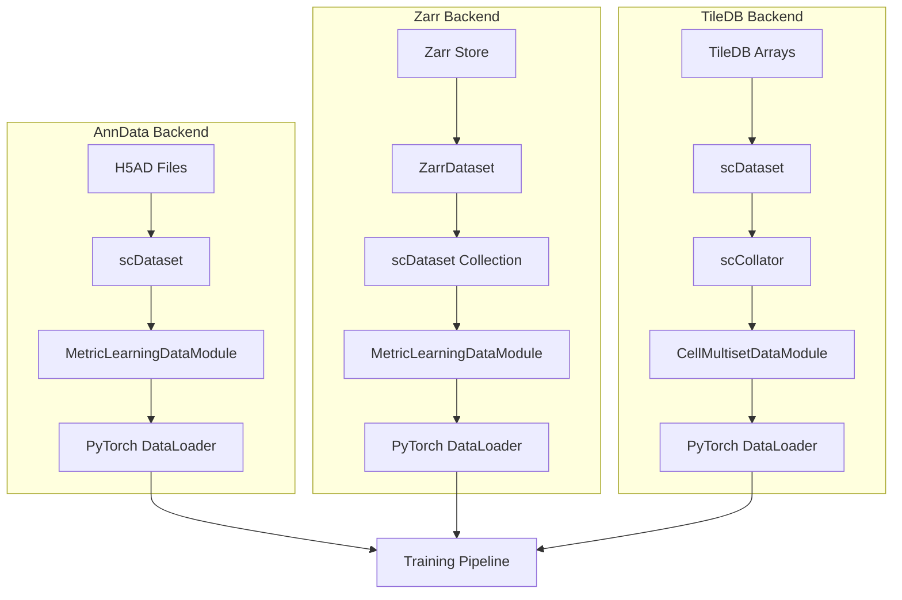
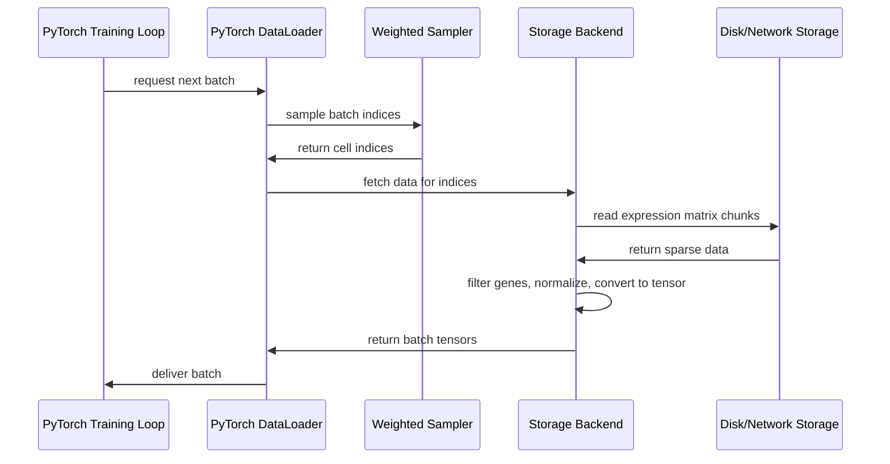

This page explains how SCimilarity handles large-scale single-cell RNA sequencing data storage through three complementary backend systems. Each backend is optimized for different scale requirements while maintaining consistent API interfaces through PyTorch Lightning DataModule architecture. The storage backends enable efficient training on millions of cells without loading entire datasets into memory simultaneously.

Sources: [anndata_data_models.py](src/scimilarity/anndata_data_models.py#L75-L200), [zarr_data_models.py](src/scimilarity/zarr_data_models.py#L54-L175), [tiledb_data_models.py](src/scimilarity/tiledb_data_models.py#L208-L320)

## Storage Backend Architecture Overview

SCimilarity provides three distinct storage backends, each designed for specific use cases in the single-cell analysis workflow. The architecture follows a unified pattern where each backend implements a PyTorch Lightning DataModule that integrates seamlessly with the training pipeline while optimizing memory usage and I/O performance for different data scales.



The unified architecture enables switching between backends without modifying training code, as all backends expose the same PyTorch DataLoader interface. This design supports progressive scaling from small prototype datasets (AnnData) to medium-scale collections (Zarr) to massive cell atlases (TileDB) while maintaining consistent data access patterns.

Sources: [anndata_data_models.py](src/scimilarity/anndata_data_models.py#L321-L375), [zarr_data_models.py](src/scimilarity/zarr_data_models.py#L235-L285), [tiledb_data_models.py](src/scimilarity/tiledb_data_models.py#L625-L686)

## AnnData Data Models

AnnData models provide the simplest entry point for working with SCimilarity, ideal for datasets that fit within system memory (typically up to 10-20 million cells depending on system RAM). The `MetricLearningDataModule` class encapsulates AnnData H5AD files and handles all preprocessing steps including gene space alignment, cell type validation, and label encoding.

The initialization process automatically filters cells to those with valid Cell Ontology terms, removes singleton classes that exist in only one study, and aligns the gene space either to the training data's gene order or to a provided gene order file. This ensures consistent feature representation across training and validation datasets.

```python
from scimilarity.anndata_data_models import MetricLearningDataModule

datamodule = MetricLearningDataModule(
    train_path="train.h5ad",
    val_path="val.h5ad",
    label_column="celltype_name",
    study_column="study",
    gene_order_file="gene_order.txt",
    batch_size=1000,
    num_workers=4,
    sparse=True,
    remove_singleton_classes=True,
    pin_memory=True,
    persistent_workers=True,
)
```

The `scCollator` class handles batch assembly, converting cell type labels from text to integers and applying sparse matrix conversion when requested. For training workflows requiring multi-GPU support, the datamodule integrates with PyTorch Lightning's distributed training through the `num_workers` and `multiprocessing_context` parameters.

Sources: [anndata_data_models.py](src/scimilarity/anndata_data_models.py#L117-L175), [anndata_data_models.py](src/scimilarity/anndata_data_models.py#L43-L73)

## Zarr Data Models

Zarr storage enables working with collections larger than system memory by providing chunked, compressed data access on demand. The `ZarrDataset` class serves as the foundational component, implementing lazy loading of expression matrices, cell metadata (obs), and gene annotations (var) from Zarr stores created by AnnData's `write_zarr` method.

The key advantage of Zarr is the ability to work with millions of cells distributed across multiple sample files without loading everything into RAM simultaneously. The `MetricLearningZarrDataModule` scans directories for aligned Zarr datasets, builds a registry of available samples, and constructs a unified training interface that accesses data on-demand during training.

```python
from scimilarity.zarr_data_models import MetricLearningDataModule

datamodule = MetricLearningDataModule(
    train_path="/path/to/train_zarr_collection/",
    val_path="/path/to/val_zarr_collection/",
    gene_order="gene_order.txt",
    obs_field="celltype_name",
    batch_size=1000,
    num_workers=4,
)
```

The Zarr implementation supports three sparse matrix formats—CSR, CSC, and COO—with automatic detection and appropriate chunking strategies. When accessing expression data, you can choose between lazy loading (default, memory-efficient) or loading the entire matrix into memory (`in_mem=True`) for faster repeated access.

Sources: [zarr_dataset.py](src/scimilarity/zarr_dataset.py#L28-L166), [zarr_data_models.py](src/scimilarity/zarr_data_models.py#L88-L175), [zarr_dataset.py](src/scimilarity/zarr_dataset.py#L645-L750)

### Sparse Matrix Access Patterns

Zarr stores sparse matrices in chunked formats that optimize access patterns for different use cases:

| Matrix Format | Access Pattern | Best Use Case | Storage Layout |
|---------------|----------------|---------------|----------------|
| CSR | Row-wise operations | Accessing individual cells or cell subsets | `data`, `indices`, `indptr` |
| CSC | Column-wise operations | Gene-level queries and feature extraction | `data`, `indices`, `indptr` |
| COO | Random access | Efficient slice operations and transformations | `data`, `row`, `col` |

The `ZarrDataset.get_matrix()` method automatically handles the conversion from zarr chunks to scipy sparse matrix objects, with optional materialization to dense arrays when needed for GPU operations.

Sources: [zarr_dataset.py](src/scimilarity/zarr_dataset.py#L645-L691), [zarr_dataset.py](src/scimilarity/zarr_dataset.py#L3-L12)

## TileDB Data Models

TileDB provides the most scalable storage backend, designed for cell atlases containing tens to hundreds of millions of cells distributed across thousands of samples. The `CellMultisetDataModule` leverages TileDB's efficient multi-dimensional array storage and query capabilities to enable training on datasets far exceeding single-machine memory capacity.

The TileDB architecture separates metadata from expression data, storing cell metadata in a queryable array, gene annotations in a reference table, and raw counts in a sparse multi-dimensional array. This separation enables efficient filtering and retrieval of specific cell subsets without scanning the entire dataset.

```python
from scimilarity.tiledb_data_models import CellMultisetDataModule

datamodule = CellMultisetDataModule(
    dataset_path="/path/to/tiledb_dataset",
    cell_metadata_uri="cell_metadata",
    gene_annotation_uri="gene_annotation",
    counts_uri="counts",
    gene_order="gene_order.txt",
    val_studies=["Study_A", "Study_B"],
    label_id_column="cellTypeOntologyID",
    study_column="datasetID",
    sample_column="sampleID",
    filter_condition="cellTypeOntologyID!='nan'",
    batch_size=1000,
    num_workers=5,
    n_batches=100,
    lognorm=True,
    target_sum=1e4,
    sparse=False,
    remove_singleton_classes=True,
)
```

The `scCollator` class performs on-demand data retrieval during training, fetching count matrices for batch cells, applying gene filtering, performing log normalization, and converting to PyTorch tensors. This lazy retrieval pattern ensures memory usage scales with batch size rather than dataset size.

Sources: [tiledb_data_models.py](src/scimilarity/tiledb_data_models.py#L208-L310), [tiledb_data_models.py](src/scimilarity/tiledb_data_models.py#L112-L207)

### TileDB Configuration for Large-Scale Training

The TileDB collator uses a specialized configuration to optimize performance for large-scale data access:

| Configuration Parameter | Value | Purpose |
|-------------------------|-------|---------|
| `sm.mem.total_budget` | 50GB | Total memory budget for TileDB operations |
| `sm.compute_concurrency_level` | 1 | Disable TileDB internal multithreading (handled by PyTorch) |
| `sm.io_concurrency_level` | 1 | Single-threaded I/O to avoid resource contention |
| `vfs.num_threads` | 1 | Filesystem threading control |

This configuration ensures efficient resource utilization when training with multiple PyTorch workers, preventing thread oversubscription that can degrade performance on shared filesystems.

Sources: [tiledb_data_models.py](src/scimilarity/tiledb_data_models.py#L136-L143)

## Weighted Sampling Strategies

All three storage backends implement sophisticated weighted sampling to handle class and study imbalance inherent in single-cell atlases. The sampling weights combine two factors: class frequency (to balance rare vs. common cell types) and study frequency (to prevent over-representation of large studies).

```python
# Weight calculation formula used across backends
class_weight = 1.0 / log1p(class_count / class_target_sum)
study_weight = 1.0 / log1p(study_count / study_target_sum)
final_weight = class_weight * study_weight
```

The `scSampler` class in the TileDB backend implements batch sampling with replacement, generating exactly `n_batches` batches per epoch. This provides deterministic training iterations while accommodating datasets larger than can fit in memory. The sampler supports dynamic weight decay to gradually reduce the emphasis on rare classes as training progresses.

For AnnData and Zarr backends, PyTorch's `WeightedRandomSampler` provides similar functionality, automatically creating mini-batches according to the calculated sampling weights.

Sources: [anndata_data_models.py](src/scimilarity/anndata_data_models.py#L273-L320), [tiledb_data_models.py](src/scimilarity/tiledb_data_models.py#L45-L110), [tiledb_data_models.py](src/scimilarity/tiledb_data_models.py#L547-L593)

## Data Access and Performance Considerations

### Memory Management Strategies

> [!TIP]
> When working with large-scale data, always use the default lazy loading behavior (Zarr `in_mem=False`, TileDB on-demand retrieval) to prevent out-of-memory errors. Only load full matrices into memory when performing repeated random access operations on a subset of cells.

The memory footprint scales as follows:
- **AnnData**: Full dataset size (requires RAM > dataset size)
- **Zarr**: Batch size + chunk cache (typically < 2GB regardless of dataset size)
- **TileDB**: Batch size + tile cache (configurable, typically < 5GB)

### I/O Optimization Patterns



This pipelined approach overlaps I/O with computation, enabling high-throughput training even with network-attached storage. The `num_workers` parameter controls the degree of I/O parallelism, with optimal values typically between 4-8 for local SSD storage and 8-16 for network filesystems.

Sources: [zarr_data_models.py](src/scimilarity/zarr_data_models.py#L211-L230), [tiledb_data_models.py](src/scimilarity/tiledb_data_models.py#L176-L207)

## Comparison of Storage Backends

| Feature | AnnData | Zarr | TileDB |
|---------|---------|------|--------|
| **Maximum Scale** | ~20M cells (memory-limited) | ~100M cells | Unlimited |
| **Access Pattern** | Random access | Chunked access | Query-based |
| **Metadata Filtering** | Pandas operations | Pandas operations | Native TileDB queries |
| **Memory Requirements** | Full dataset in RAM | Batch size + cache | Batch size + cache |
| **Setup Complexity** | Simple | Moderate | Complex |
| **Best For** | Prototyping, small-medium datasets | Medium-scale collections, cloud storage | Production-scale atlases, multi-node training |
| **Gene Alignment** | Automatic during load | Requires pre-alignment | Automatic during load |

> [!TIP]
> When scaling from AnnData to Zarr or TileDB, pre-align all datasets to a common gene order before training. This avoids expensive gene ordering operations during data loading and ensures consistent feature representation across all backends.

Sources: [anndata_data_models.py](src/scimilarity/anndata_data_models.py#L117-L200), [zarr_data_models.py](src/scimilarity/zarr_data_models.py#L88-L175), [tiledb_data_models.py](src/scimilarity/tiledb_data_models.py#L281-L465)

## Integration with Training Pipeline

All three storage backends expose consistent PyTorch DataLoader interfaces, enabling seamless integration with the training pipeline. The datamodules handle validation/test splits automatically through either file-based partitioning (AnnData/Zarr) or study-based splitting (TileDB).

For production training workflows with TileDB, consider these performance optimizations:

```python
# Optimal TileDB configuration for multi-GPU training
datamodule = CellMultisetDataModule(
    # ... other parameters ...
    num_workers=8,  # Match CPU cores available for I/O
    pin_memory=True,  # Speed up CPU-to-GPU transfer
    persistent_workers=True,  # Avoid worker initialization overhead
    multiprocessing_context="fork",  # Faster than spawn on Linux
    n_batches=100,  # Match batches per epoch to your training schedule
)
```

The datamodules automatically handle study-aware sampling, gene alignment, and cell type harmonization, allowing you to focus on model architecture and training hyperparameters rather than data engineering details.
