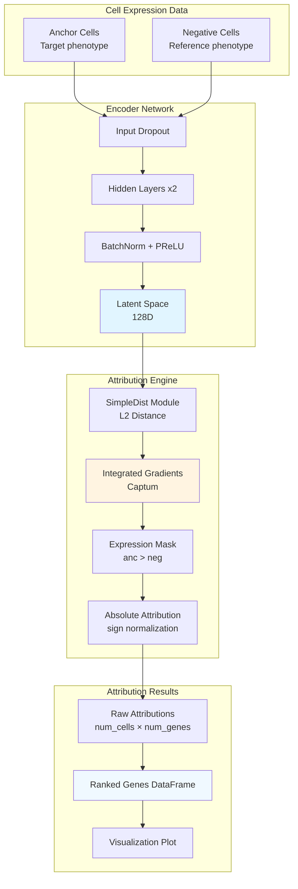

Gene attribution and comparison in SCimilarity provides a powerful interpretability framework for understanding which genes drive differences between cell states in the learned latent space. By leveraging gradient-based attribution methods, you can identify the specific genes that most significantly influence the distance metric separating different cell populations, enabling deeper biological insight into cell state transitions and phenotype comparisons.

## Core Architecture

The gene attribution system builds upon SCimilarity's encoder architecture and integrates with Captum's attribution framework to compute feature importance based on gradient flow through the neural network. The architecture centers on the **Interpreter class**, which wraps the encoder model and applies integrated gradients to measure how changes in gene expression affect the distance between cell representations in the latent space.



The attribution pipeline begins with two cell populations: **anchors** (your target cell state of interest) and **negatives** (a reference or comparison state). The encoder transforms these expression profiles into latent space representations, and a distance function calculates the L2 distance between them. Integrated gradients then trace how small changes in each gene's expression affect this distance, revealing which genes most significantly separate the populations in the learned representation space.

Sources: [interpreter.py](src/scimilarity/interpreter.py#L5-L41)

## Attribution Computation Methodology

The core attribution mechanism uses **Integrated Gradients**, a gradient-based attribution method that satisfies desirable axioms like sensitivity and implementation invariance. The implementation applies this method to a custom distance module (`SimpleDist`) that computes the sum-of-squares distance between encoded representations. Importantly, the baseline for integration is set to the negative cell expression, meaning attributions measure the contribution of gene expression changes as you move from the reference state (negatives) to the target state (anchors).

**Critical Implementation Details:**

The attribution calculation includes three post-processing steps that ensure biological interpretability:

1. **Expression masking** (`attr *= anc > neg`): Only genes that are expressed more highly in anchors than negatives receive non-zero attribution. This prevents attributions for genes that aren't differentially expressed.

2. **Absolute value** (`attr = +attr.abs()`): Gradient signs can be unreliable due to non-linear network interactions, so absolute values provide more stable attribution scores.

3. **Aggregation across cells**: For queries involving multiple cells, attributions are averaged to identify consistently important genes across the population.

Sources: [interpreter.py](src/scimilarity/interpreter.py#L69-L131)

> [!TIP]
> The mask `anc > neg` ensures that only differentially expressed genes contribute to attribution values. If you need to understand down-regulated genes that separate populations, swap the anchor and negative inputs—the absolute value attribution will remain the same, but the mask will capture differentially expressed genes in the opposite direction.

## Practical Usage Workflow

The typical attribution analysis follows a structured workflow that begins with identifying your cell populations of interest and proceeds through attribution calculation, ranking, and visualization.

### Step 1: Initialize the Interpreter

The `Interpreter` class requires two components: the trained encoder model and the gene ordering used during model training. The gene order is critical because it maps attribution indices back to specific gene names.

```python
from scimilarity import CellQuery, Interpreter

# Load your query/model object
model_path = "/models/model_v1.1"
cq = CellQuery(model_path)

# Initialize interpreter with model and gene order
explainer = Interpreter(cq.model, cq.gene_order)
```

Sources: [interpreter.py](src/scimilarity/interpreter.py#L58-L68)

### Step 2: Prepare Anchor and Negative Cell Populations

Your input data can be provided as numpy arrays, sparse matrices, or PyTorch tensors. The method handles automatic conversion and GPU placement based on your model's device configuration. The shape must match between anchors and negatives ([num_cells × num_genes]).

```python
# Example: Get expression matrices for two populations
# anchors: cells from your target phenotype
# negatives: cells from reference phenotype
anchors = pos_expression_matrix  # Shape: (n_anchor_cells, n_genes)
negatives = neg_expression_matrix  # Shape: (n_neg_cells, n_genes)

# Verify shapes match
assert anchors.shape == negatives.shape
```

Sources: [interpreter.py](src/scimilarity/interpreter.py#L99-L113)

### Step 3: Compute Attributions

The `get_attributions()` method performs the gradient computation and returns a raw attribution matrix where each row corresponds to a cell pair and each column corresponds to a gene.

```python
# Compute attributions
attrs = explainer.get_attributions(anchors, negatives)

# Returns: numpy.ndarray with shape (num_cells × num_genes)
# High values indicate genes that, when more highly expressed in anchors,
# significantly increase the distance to negatives in latent space
```

**Supported Input Types:**

| Input Type | Conversion Required | Notes |
|------------|-------------------|-------|
| `numpy.ndarray` | Auto-converted to torch.Tensor | Most common format |
| `scipy.sparse.csr_matrix` | Densified then converted | Use for sparse count data |
| `torch.Tensor` | No conversion | Direct use, device preserved |

Sources: [interpreter.py](src/scimilarity/interpreter.py#L69-L131)

### Step 4: Rank and Aggregate Genes

Raw attributions for multiple cells are aggregated using mean and standard deviation to identify consistently important genes across your comparison population.

```python
# Aggregate and rank genes by mean attribution
attrs_df = explainer.get_ranked_genes(attrs)

# Resulting DataFrame columns:
# - gene: Gene name from gene_order
# - gene_idx: Index in input matrix
# - attribution: Mean attribution across all cells
# - attribution_std: Standard deviation across cells
# - cells: Number of cells in the comparison

# Preview top genes
print(attrs_df.head(10))
```

The ranking uses mean attribution in descending order, so the first rows contain the genes with the highest average contribution to separating the populations.

Sources: [interpreter.py](src/scimilarity/interpreter.py#L133-L163)

### Step 5: Visualize Results

The built-in visualization method creates a bar plot showing top-ranked genes with error bars representing the 95% confidence interval (calculated as 1.96 × std/√n).

```python
# Plot top 15 genes
explainer.plot_ranked_genes(
    attrs_df, 
    n_plot=15,
    filename="gene_attributions.pdf"  # Optional: save to file
)
```

The visualization uses seaborn for bar plotting with rotated x-axis labels to accommodate gene names. Error bars indicate variability across your input cells—narrow bars indicate consistent importance, while wide bars suggest the gene's importance varies across the population.

Sources: [interpreter.py](src/scimilarity/interpreter.py#L165-L214)

## Advanced Usage Patterns

### Pairwise Cell Comparisons

For fine-grained analysis, you can compute attributions for individual cell pairs rather than aggregated populations. This is useful when you have a small number of representative cells or want to understand heterogeneity within a population.

```python
# Single cell comparison
single_anchor = anchor_expression[0:1]  # Single cell as 1×n_genes
single_negative = negative_expression[0:1]

attrs_single = explainer.get_attributions(single_anchor, single_negative)
# Returns shape: (1, n_genes)
```

Sources: [interpreter.py](src/scimilarity/interpreter.py#L69-L131)

### Integration with Cell Query Workflows

The most common use case combines cell search with attribution analysis—after identifying similar cells to your query, you use attribution to understand the genes driving those similarities.


This pattern enables hypothesis testing: "Which genes differentiate my query cells from the closest alternatives in the reference dataset?" The tutorial demonstrates this with fibrosis-associated macrophages, comparing in vivo disease cells against in vitro alternatives.

Sources: [advanced_tutorial.ipynb](docs/notebooks/advanced_tutorial.ipynb#L400-L407)

## Understanding Attribution Output

The attribution values are **relative measures** rather than absolute biological quantities. Due to the non-linear nature of neural networks and the gradient computation, the scale of attribution values lacks intuitive interpretation. The correct approach focuses on:

1. **Rank ordering**: Which genes have higher attribution than others within the same comparison
2. **Consistency**: Genes with low standard deviation across cells provide more reliable signals
3. **Directional context**: Only genes more highly expressed in anchors contribute (due to the mask)

**Interpretation Guidelines:**

- High mean attribution + low standard deviation: Strong, consistent driver of the difference
- High mean attribution + high standard deviation: Important for some cells but not all—may indicate subpopulations
- Low attribution regardless of std: Not a significant contributor to the separation in latent space

Sources: [advanced_tutorial.ipynb](docs/notebooks/advanced_tutorial.ipynb#L454-L459)

## Performance Considerations

GPU acceleration is automatically applied if your model is on CUDA. The attribution computation involves multiple forward and backward passes (integrated gradients typically uses 50-100 integration steps by default in Captum), making it computationally intensive for large cell populations.

**Optimization Strategies:**

| Scenario | Approach | Trade-off |
|----------|----------|-----------|
| Large populations (>1000 cells) | Subsample representative cells | Reduced granularity but faster computation |
| Many comparisons | Cache encoder outputs | Faster if reusing same cells |
| Exploratory analysis | Use fewer integration steps | Less accurate attributions but faster |

Sources: [interpreter.py](src/scimilarity/interpreter.py#L115-L131)

## API Reference Summary

| Class/Method | Purpose | Key Parameters |
|--------------|---------|----------------|
| `Interpreter.__init__` | Initialize attribution engine | `encoder`, `gene_order` |
| `get_attributions` | Compute gradient-based attributions | `anchors`, `negatives` |
| `get_ranked_genes` | Aggregate and rank by mean attribution | `attrs` matrix |
| `plot_ranked_genes` | Visualize top-ranked genes | `attrs_df`, `n_plot`, `filename` |

Sources: [interpreter.py](src/scimilarity/interpreter.py#L43-L214)

## Next Steps

For comprehensive understanding of the underlying model architecture that the attribution method interprets, see **[Encoder and Decoder Architecture](7-encoder-and-decoder-architecture)**. To understand how cell search identifies the populations you compare, refer to **[Cell Query API Reference](9-cell-query-api-reference)** and **[K-NN Search with HNSW](10-k-nn-search-with-hnsw)**. For complete API documentation of all Interpreter methods, consult **[Interpreter API Reference](28-interpreter-api-reference)**.