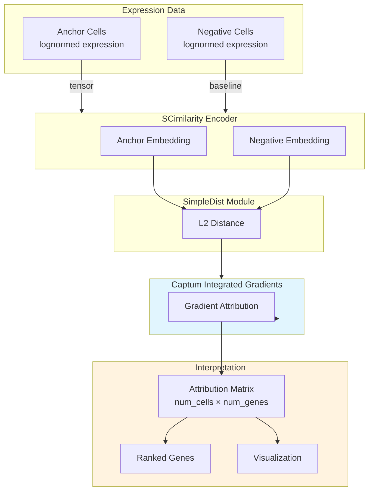

The Interpreter API provides tools for understanding which genes contribute most to differences between cell populations in SCimilarity's latent space. By leveraging **Captum's Integrated Gradients** attribution method, the interpreter quantifies how each gene influences the distance between cell representations, enabling biological interpretation of model decisions and identifying signature genes that distinguish cell states.

Sources: [interpreter.py](src/scimilarity/interpreter.py#L43-L56)

## Architecture Overview

The Interpreter operates on top of SCimilarity's learned embeddings, using gradient-based attribution to trace how changes in gene expression affect the distance between cells in latent space. The architecture integrates three key components:



This design enables **gene-level interpretation** of learned representations without requiring manual feature engineering, as the attribution signal emerges directly from the neural network's gradients.

Sources: [interpreter.py](src/scimilarity/interpreter.py#L58-L67), [interpreter.py](src/scimilarity/interpreter.py#L5-L40)

## Core Classes

### SimpleDist

The `SimpleDist` module is a helper class that computes the **squared L2 distance** between encoded cell representations. This distance metric serves as the target function for attribution—Integrated Gradients computes how much each input feature (gene) contributes to this distance.

**Parameters:**
| Parameter | Type | Description |
|-----------|------|-------------|
| `encoder` | `torch.nn.Module` | The SCimilarity encoder model |

**Forward Pass:**
- Accepts `anchors` (target/positive cells) and `negatives` (baseline/reference cells) as tensors
- Encodes both inputs to latent representations
- Returns the sum-of-squares distance between embeddings

Sources: [interpreter.py](src/scimilarity/interpreter.py#L5-L40)

### Interpreter Class

The `Interpreter` class orchestrates gene attribution analysis, providing methods to compute, aggregate, and visualize feature importance.

#### Constructor

```python
Interpreter(encoder, gene_order)
```

**Parameters:**

| Parameter | Type | Description |
|-----------|------|-------------|
| `encoder` | `torch.nn.Module` | SCimilarity encoder model (typically from `CellEmbedding.model`) |
| `gene_order` | `list` | Ordered list of gene names matching the model's training data |

**Example Initialization:**

```python
from scimilarity import CellEmbedding, Interpreter

# Load model and retrieve encoder + gene order
ce = CellEmbedding("/path/to/model", use_gpu=True)
interpreter = Interpreter(ce.model, ce.gene_order)
```

> [!TIP]
> The encoder must be in evaluation mode (`model.eval()`) and loaded with trained weights before passing to the Interpreter. The `CellEmbedding` class handles this automatically when instantiated.

Sources: [interpreter.py](src/scimilarity/interpreter.py#L58-L67), [cell_embedding.py](src/scimilarity/cell_embedding.py#L19-L65)

#### Methods

### get_attributions

Computes **Integrated Gradients attributions** quantifying each gene's contribution to the distance between anchor and negative cells.

```python
interpreter.get_attributions(anchors, negatives) -> numpy.ndarray
```

**Parameters:**

| Parameter | Type | Description |
|-----------|------|-------------|
| `anchors` | `torch.Tensor` \| `numpy.ndarray` \| `scipy.sparse.csr_matrix` | Target cell expression matrix [num_anchors × num_genes] |
| `negatives` | `torch.Tensor` \| `numpy.ndarray` \| `scipy.sparse.csr_matrix` | Baseline cell expression matrix [num_negatives × num_genes] |

**Returns:**
- `numpy.ndarray`: Attribution matrix of shape `[num_cells × num_genes]`

**Method Behavior:**

1. **Input Normalization**: Converts numpy arrays and sparse matrices to dense tensors; handles GPU device placement automatically
2. **Gradient Computation**: Uses Integrated Gradients with `negatives` as the integration baseline, computing gradients along the path from negative to anchor expression
3. **Attribution Filtering**: `attr *= anc > neg` masks attributions to only consider genes where anchor expression exceeds baseline
4. **Absolute Value**: `attr = +attr.abs()` ensures positive attributions since gradient signs can be unreliable in complex networks
5. **Device Handling**: Returns CPU numpy arrays regardless of input device

**Key Implementation Details:**

The integration path is critical—by integrating from negatives to anchors, the method quantifies how increasing gene expression from baseline to target affects the distance metric. This directionality makes biological sense: we want to know which genes, when upregulated in the anchor, push it away from the negative population.

Sources: [interpreter.py](src/scimilarity/interpreter.py#L69-L131)

**Example Usage:**

```python
# Assuming pos and neg are AnnData objects with aligned gene order
attrs = interpreter.get_attributions(pos.X, neg.X)
print(f"Attribution matrix shape: {attrs.shape}")  # (num_cells, num_genes)
```

### get_ranked_genes

Aggregates attribution scores across multiple cells to produce a ranked gene list.

```python
interpreter.get_ranked_genes(attrs) -> pandas.DataFrame
```

**Parameters:**

| Parameter | Type | Description |
|-----------|------|-------------|
| `attrs` | `numpy.ndarray` | Attribution matrix from `get_attributions()` [num_cells × num_genes] |

**Returns:**

| Column | Type | Description |
|--------|------|-------------|
| `gene` | `str` | Gene name |
| `gene_idx` | `int` | Index in the gene order |
| `attribution` | `float` | Mean attribution score across all cells |
| `attribution_std` | `float` | Standard deviation of attributions |
| `cells` | `int` | Number of cells in the analysis |

**Aggregation Method:**

1. Computes mean attribution per gene across all cells
2. Sorts genes by mean attribution in descending order
3. Preserves gene indices and calculates standard deviation for uncertainty assessment

Sources: [interpreter.py](src/scimilarity/interpreter.py#L133-L163)

**Example Usage:**

```python
attrs_df = interpreter.get_ranked_genes(attrs)

# Display top 10 genes
print(attrs_df.head(10))

# Access specific gene data
print(attrs_df[attrs_df['gene'] == 'CXCL10'])
```

### plot_ranked_genes

Visualizes top-ranked gene attributions with confidence intervals.

```python
interpreter.plot_ranked_genes(attrs_df, n_plot=15, filename=None)
```

**Parameters:**

| Parameter | Type | Default | Description |
|-----------|------|---------|-------------|
| `attrs_df` | `pandas.DataFrame` | Required | Ranked attribution DataFrame from `get_ranked_genes()` |
| `n_plot` | `int` | `15` | Number of top genes to display |
| `filename` | `str` \| `None` | `None` | Output file path (optional; saves to PDF) |

**Visualization Features:**

- **Bar plot**: Shows mean attribution for each gene
- **Error bars**: 95% confidence intervals (`1.96 * std / sqrt(n)`) indicating attribution stability
- **Formatting**: Rotated x-axis labels for gene names, no y-axis ticks (focus on relative ranking)
- **Publication-ready**: Uses Type 42 fonts for PDF compatibility

Sources: [interpreter.py](src/scimilarity/interpreter.py#L165-L214)

**Example Usage:**

```python
# Plot top 25 genes
interpreter.plot_ranked_genes(attrs_df, n_plot=25)

# Save to file
interpreter.plot_ranked_genes(attrs_df, n_plot=20, filename="gene_attributions.pdf")
```

> [!TIP]
> Because attribution values are derived from neural network gradients, their absolute scale lacks intuitive biological meaning. Focus interpretation on **relative rankings** between genes within a comparison rather than cross-study comparisons of absolute scores.

## Complete Workflow Example

The following example demonstrates a typical analysis pipeline comparing fibrosis-associated macrophages to standard macrophages:

```python
import scanpy as sc
from scimilarity import CellEmbedding, align_dataset
from scimilarity.utils import lognorm_counts
from scimilarity import Interpreter

# 1. Load and preprocess data
ce = CellEmbedding("/models/model_v1.1", use_gpu=True)
adams = sc.read("GSE136831_subsample.h5ad")
adams = align_dataset(adams, ce.gene_order)  # Match gene order
adams = lognorm_counts(adams)                # Normalize to lognorm(tp10k)

# 2. Identify cell populations
fibr_mac = adams[adams.obs['cell_type'] == 'fibrosis_macrophage']
std_mac = adams[adams.obs['cell_type'] == 'macrophage']

# 3. Initialize interpreter
interpreter = Interpreter(ce.model, ce.gene_order)

# 4. Compute attributions
attrs = interpreter.get_attributions(fibr_mac.X, std_mac.X)

# 5. Rank and visualize genes
attrs_df = interpreter.get_ranked_genes(attrs)
print("Top 5 signature genes:")
print(attrs_df.head(5)[['gene', 'attribution']])

interpreter.plot_ranked_genes(attrs_df, n_plot=25, 
                              filename="fibr_mac_signature.pdf")
```

Sources: [advanced_tutorial.ipynb](docs/notebooks/advanced_tutorial.ipynb#L426-L429)

## Data Format Requirements

The Interpreter accepts multiple input formats for flexibility:

| Input Type | Handling | Notes |
|------------|----------|-------|
| `scipy.sparse.csr_matrix` | Converted to dense via `.todense()` | Efficient for large sparse matrices |
| `numpy.ndarray` | Converted to tensor | Direct processing |
| `torch.Tensor` | Used directly | Supports GPU tensors |

**Critical Requirements:**

1. **Gene order alignment**: Input matrices must have the same number of columns as the model's gene order. Use `align_dataset()` to reorder and pad/fill genes.
2. **Normalization**: Expression values should be log-normalized (log10(counts per 10,000 + 1)) to match training distribution.
3. **Shape consistency**: `anchors.shape[1] == negatives.shape[1] == len(gene_order)`

Sources: [interpreter.py](src/scimilarity/interpreter.py#L99-L131), [cell_embedding.py](src/scimilarity/cell_embedding.py#L38-L39)

## GPU Acceleration

The Interpreter automatically detects and utilizes GPU acceleration when the encoder model is placed on CUDA:

```python
# GPU-enabled initialization
ce = CellEmbedding("/path/to/model", use_gpu=True)
interpreter = Interpreter(ce.model, ce.gene_order)

# Automatic device handling occurs in get_attributions()
attrs = interpreter.get_attributions(anchors, negatives)  # Runs on GPU if available
# Returns numpy array on CPU regardless of device
```

**Device Placement:**

- Encoder parameters determine device: `next(encoder.parameters()).is_cuda`
- Input tensors are automatically transferred to matching device
- Output is always returned as CPU numpy array for compatibility

Sources: [interpreter.py](src/scimilarity/interpreter.py#L115-L131), [cell_embedding.py](src/scimilarity/cell_embedding.py#L62-L63)

## Integration with SCimilarity Ecosystem

The Interpreter integrates seamlessly with other SCimilarity components:

| Component | Integration Point |
|-----------|-------------------|
| `CellEmbedding` | Provides encoder model and gene_order |
| `CellQuery` | Extends same model/gene_order access |
| `align_dataset()` | Preprocessing utility for gene order alignment |
| `lognorm_counts()` | Normalization utility matching training procedure |

Sources: [cell_embedding.py](src/scimilarity/cell_embedding.py#L19-L65), [advanced_tutorial.ipynb](docs/notebooks/advanced_tutorial.ipynb#L35-L43)

## Summary of API Methods

| Method | Input | Output | Purpose |
|--------|-------|--------|---------|
| `__init__()` | `encoder`, `gene_order` | `Interpreter` object | Initialize attribution engine |
| `get_attributions()` | `anchors`, `negatives` | `numpy.ndarray` | Compute per-gene attributions |
| `get_ranked_genes()` | `attributions` | `pandas.DataFrame` | Aggregate and rank genes |
| `plot_ranked_genes()` | `attrs_df`, `n_plot`, `filename` | None (plots/saves) | Visualize top genes |

Sources: [interpreter.py](src/scimilarity/interpreter.py#L5-L214)

## Next Steps

- **Gene Attribution and Comparison** ([27-gene-attribution-and-comparison](27-gene-attribution-and-comparison)): Explore biological applications and interpretation strategies for attribution results
- **Understanding Feature Importance** ([29-understanding-feature-importance](29-understanding-feature-importance)): Deep dive into how attribution scores map to biological significance
- **Cell Annotation API Reference** ([13-cell-annotation-api-reference](13-cell-annotation-api-reference)): Compare attribution-based interpretation with classification-based annotation methods
- **Cell Query API Reference** ([9-cell-query-api-reference](9-cell-query-api-reference)): Learn how to retrieve query cell populations for attribution analysis