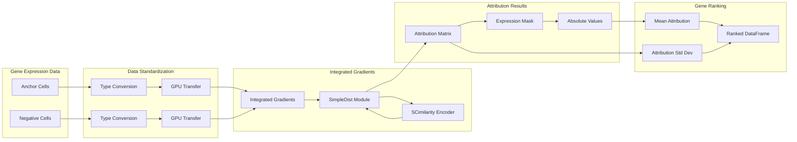
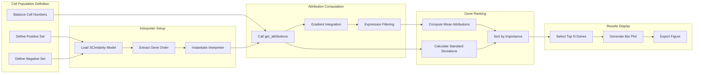

Feature importance analysis in SCimilarity enables researchers to identify which genes most strongly distinguish between different cell states or phenotypes. This capability transforms the black-box neural embeddings into interpretable biological insights by attributing predictions back to individual genes. The feature importance system leverages gradient-based attribution methods from Captum's interpretability framework, providing quantitative measures of gene significance alongside uncertainty estimates through standard deviation calculations across multiple cells.

## Attribution Architecture

The attribution mechanism operates through a sophisticated neural interpretability pipeline that connects gene-level inputs to the latent space distances computed by SCimilarity's encoder. At the architectural level, the `Interpreter` class orchestrates this process using Integrated Gradients, a gradient-based attribution method that computes the integral of gradients along a path from a baseline reference to the actual input. This approach provides a principled way to assign importance scores by measuring how each gene contributes to changes in the model's internal representations.

The computational flow begins with the `SimpleDist` module, a PyTorch neural component that calculates the Euclidean distance between encoded representations of anchor and negative cells. This distance serves as the target function for attribution analysis—genes that maximize this distance when moving from negatives to anchors receive higher attribution scores, indicating they are more characteristic of the anchor cell population. The integration path is critical: gradients are computed along trajectories from negative cells (baseline) to anchor cells (input), ensuring attributions capture the directional influence of gene expression changes.

Sources: [src/scimilarity/interpreter.py](src/scimilarity/interpreter.py#L5-L42)

## Attribution Computation

The `get_attributions()` method executes the core attribution calculation, accepting gene expression data in multiple formats including NumPy arrays, SciPy sparse matrices, or PyTorch tensors. The method first validates that anchor and negative cell sets have matching dimensions, then performs device-aware tensor conversion to handle both CPU and GPU configurations seamlessly. During GPU execution, tensors are transferred to CUDA devices before attribution computation and moved back to CPU for return, maintaining efficient memory management across computational contexts.

The attribution algorithm applies several critical processing steps to ensure biological relevance and numerical stability. First, Integrated Gradients computes attribution values by integrating gradients along paths from negative cells (baseline) to anchor cells (target), with the `SimpleDist` module calculating distances between their encoded representations. An expression filter (`attr *= anc > neg`) then masks out attributions for genes where the anchor cell doesn't exhibit higher expression than the negative cell, ensuring that attributions reflect genuinely upregulated genes. Finally, absolute values transform potentially unreliable signed gradients into stable importance measures, as attribution signs can be inconsistent due to the non-linear nature of the embedding space.

Sources: [src/scimilarity/interpreter.py](src/scimilarity/interpreter.py#L69-L132)

> [!TIP]
> The expression filtering step (`attr *= anc > neg`) is critical for biological interpretation—it ensures attributions only capture genes that are actually upregulated in the anchor population relative to negatives, preventing spurious attributions from genes that contribute to embedding distance through downregulation patterns.

## Gene Ranking and Analysis

The `get_ranked_genes()` method transforms raw attribution matrices into interpretable ranked gene lists by aggregating statistics across all analyzed cells. This method computes the mean attribution value for each gene across the anchor cell population, providing a single importance score per gene. Standard deviation calculations quantify the consistency of attributions across cells, with lower values indicating genes that uniformly contribute to the distinction between populations. The method returns a pandas DataFrame containing five essential columns: the gene identifier, its index in the gene order, the mean attribution score, the attribution standard deviation, and the total number of cells analyzed.

The ranking process sorts genes by descending mean attribution, placing the most discriminative genes at the top of the list. This enables researchers to quickly identify the strongest molecular signatures differentiating their cell populations of interest. The DataFrame structure facilitates downstream analysis, enabling filtering by attribution thresholds, statistical significance testing based on standard deviation-to-mean ratios, or integration with external gene annotation databases for biological interpretation.

Sources: [src/scimilarity/interpreter.py](src/scimilarity/interpreter.py#L133-L164)

| Column | Description | Interpretation |
|--------|-------------|----------------|
| `gene` | Gene identifier | Matches gene order used for training |
| `gene_idx` | Index in gene order array | For mapping back to expression matrix positions |
| `attribution` | Mean attribution across cells | Higher values indicate greater discriminative power |
| `attribution_std` | Standard deviation of attributions | Lower values indicate more consistent contributions |
| `cells` | Number of cells analyzed | More cells reduce standard deviation through averaging |

## Visualization and Interpretation

The `plot_ranked_genes()` method provides publication-ready visualizations of gene attribution results using seaborn bar plots. The method accepts the ranked gene DataFrame and allows customization of the number of genes displayed through the `n_plot` parameter, defaulting to the top 15 genes. Each bar represents a gene's mean attribution value, while the method implicitly incorporates uncertainty through the standard deviation values available in the DataFrame (though the current implementation displays point estimates without explicit confidence intervals). The visualization uses horizontal bars with rotated gene labels for readability, facilitating rapid identification of the most significant molecular signatures.

The plotting function supports optional file output through the `filename` parameter, enabling automatic saving of figures for documentation or publication. The implementation sets high-resolution output parameters (DPI=200) and uses PDF-compatible font settings, ensuring that generated figures meet scientific publishing standards. The compact figure dimensions (5×2 inches) are optimized for including in multi-panel figures, while the barplot format enables clear comparison of relative attribution strengths across the top-ranked genes.

Sources: [src/scimilarity/interpreter.py](src/scimilarity/interpreter.py#L165-L214)

> [!TIP]
> When interpreting attribution plots, consider both the absolute attribution value and the standard deviation—genes with high attribution but also high standard deviation may represent heterogeneous responses within the anchor population, whereas genes with moderate attribution but very low standard deviation indicate consistent, robust markers.

## Practical Implementation Workflow

The practical application of feature importance analysis follows a structured workflow that begins with preparing contrasting cell populations. Researchers must define positive (anchor) and negative reference cell sets that represent the biological contrast they wish to analyze—these could be different cell states, treatment conditions, disease phenotypes, or any other biological distinction of interest. The positive set should contain the cells whose defining characteristics you want to identify, while the negative set provides a reference background for comparison.

After instantiating the `Interpreter` class with the SCimilarity model encoder and the gene ordering used during training, the attribution process involves three primary method calls. The `get_attributions()` method performs the computationally intensive gradient integration, returning a matrix of attribution values shaped as `[n_anchor_cells × n_genes]`. The `get_ranked_genes()` method then aggregates this matrix into a sorted DataFrame of gene importance scores. Finally, `plot_ranked_genes()` generates visualization of the top-ranked genes for immediate interpretation. This workflow is demonstrated in the advanced tutorial notebook, where fibrosis-associated macrophage signatures are derived by comparing high-scoring query cells against low-scoring background cells.

Sources: [docs/notebooks/advanced_tutorial.ipynb](docs/notebooks/advanced_tutorial.ipynb#L343-L360)

## Methodological Considerations

Several methodological factors influence the reliability and biological relevance of attribution results. The number of cells used in each population directly impacts statistical power—larger cell numbers reduce standard deviation through averaging and provide more robust estimates of gene importance. The choice of negative reference population is equally critical; selecting an appropriate biological background ensures that attributions capture meaningful contrasts rather than technical artifacts or unrelated biological differences.

The computational cost of attribution scales linearly with the number of anchor cells, making analysis of large populations potentially resource-intensive. For datasets with thousands of cells, consider subsampling to a representative subset before attribution computation to balance statistical power with computational efficiency. Additionally, the expression filtering mechanism ensures that attributions reflect genuinely upregulated genes, but researchers should verify that this aligns with their biological hypotheses—comparisons focused on downregulated gene signatures may require analytical modifications.

Sources: [src/scimilarity/interpreter.py](src/scimilarity/interpreter.py#L69-L132)

| Factor | Impact | Recommendation |
|--------|--------|----------------|
| Cell count per population | Inversely related to standard deviation | Use minimum 10-20 cells per population |
| Negative reference selection | Determines contrast direction | Choose biologically appropriate control |
| Subsample size | Trades statistical power for speed | Start with 50-100 cells per group |
| Gene expression filtering | Removes downregulated genes | Standard for upregulated signature discovery |

## Advanced Attribution Patterns

The attribution framework enables several advanced analytical patterns beyond simple pairwise comparisons. Researchers can perform temporal analyses by comparing sequential time points to identify genes driving developmental progression or disease progression trajectories. Spatial analyses can compare cells from different anatomical locations within the same tissue type to uncover regional specialization markers. Treatment response analyses can compare pre- and post-treatment samples to identify genes associated with therapeutic response or resistance mechanisms.

For more complex experimental designs, multi-group comparisons can be executed through pairwise attribution analyses followed by comparative meta-analysis of the resulting gene rankings. This enables identification of genes that consistently distinguish across multiple contrasts or genes that show population-specific effects. The quantitative nature of attribution scores facilitates sophisticated downstream analyses including pathway enrichment testing, comparison with published gene signatures, or integration with orthogonal modalities such as chromatin accessibility data.

Sources: [docs/notebooks/advanced_tutorial.ipynb](docs/notebooks/advanced_tutorial.ipynb#L343-L360)

## Integration with Downstream Analysis

Feature importance results integrate seamlessly with the broader SCimilarity analysis ecosystem. Attribution-derived gene signatures can serve as query terms for the cell search functionality, enabling identification of additional cells exhibiting similar molecular programs. The ranked gene lists can also inform cell annotation decisions by providing interpretable evidence for predicted cell types, particularly useful for ambiguous cases or novel cell states.

For researchers developing custom cell type classification models, attribution results provide training features and biological validation of learned representations. The gene-level insights can guide experimental design by highlighting marker genes for validation experiments such as flow cytometry panel design or spatial transcriptography probe selection. This tight integration between interpretability and analysis positions attribution as both an analytical endpoint and a tool for iterative hypothesis refinement.

Sources: [docs/modules/interpreter.rst](docs/modules/interpreter.rst)

To deepen your understanding of SCimilarity's interpretability capabilities, explore the [Gene Attribution and Comparison](27-gene-attribution-and-comparison) documentation for comparative analysis patterns or the [Interpreter API Reference](28-interpreter-api-reference) for detailed parameter specifications. For context on how embeddings are generated that attributions analyze, see the [Cell Embedding Fundamentals](6-cell-embedding-fundamentals) documentation.