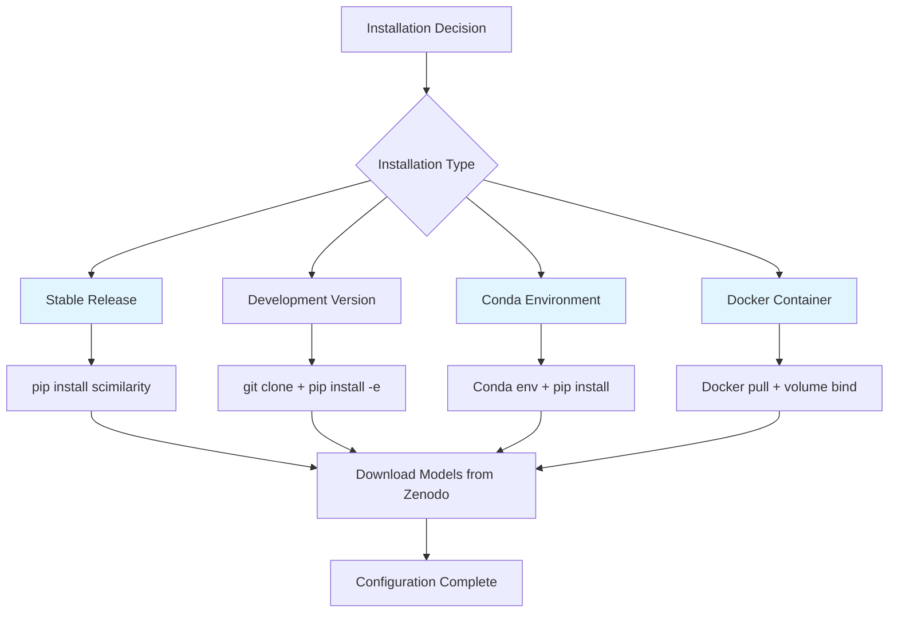

This guide provides comprehensive instructions for installing and configuring SCimilarity across different environments. SCimilarity is a single cell embedding framework that quantifies similarity between expression states, enabling large-scale cell search capabilities across millions of profiles. Whether you're setting up for local development, production deployment, or interactive analysis, this document covers all installation pathways and their requirements.

## System Requirements

Before installing SCimilarity, ensure your system meets the hardware and software prerequisites for your intended use case. The requirements vary significantly based on whether you plan to perform cell queries, model training, or both.

**Hardware Requirements:**

| Use Case | Minimum RAM | Recommended RAM | GPU | Storage |
|----------|-------------|-----------------|-----|---------|
| Cell Queries | 64 GB | 128 GB+ | Optional | 50 GB+ |
| Model Training | 128 GB | 256 GB+ | Required (NVIDIA) | 100 GB+ |
| Development | 32 GB | 64 GB | Optional | 20 GB+ |

**Software Requirements:**

- Python 3.10 or higher
- Operating System: Linux (recommended) or macOS
- Package Manager: pip, conda, or Docker
- Git (for development installation)

> [!TIP]
> SCimilarity has very high memory requirements due to its ability to perform rapid searches across tens of millions of cells. If loading the model or making kNN queries crashes despite sufficient memory, ensure you're using recent versions of dependencies like `hnswlib` and `numpy`. The Docker container or Conda environment below include tested dependency versions.
> Sources: [docs/install.rst](docs/install.rst#L27-L35)

## Installation Overview

The installation architecture supports multiple deployment pathways depending on your environment and needs:



## Installation Methods

### Method 1: Stable Release via pip

The simplest installation method uses pip to install the latest stable release from PyPI. This approach is recommended for most users who want to quickly get started with production-ready code.

```bash
pip install scimilarity
```

This command downloads and installs all core dependencies automatically, including PyTorch, scanpy, tiledb-vector-search, and other required packages [setup.cfg](setup.cfg#L63-L76). The stable release includes all bug fixes and features from the latest version (currently 0.4.1) [setup.cfg](setup.cfg#L18).

### Method 2: Development Version from GitHub

For users who need the latest features or plan to contribute to SCimilarity, install directly from the GitHub repository:

```bash
git clone https://github.com/genentech/scimilarity.git
cd scimilarity
pip install -e .
```

The `-e` flag creates an editable installation, allowing you to modify the source code and have changes reflected immediately without reinstalling [docs/install.rst](docs/install.rst#L14-L18). This method is ideal for developers and researchers who want to experiment with cutting-edge features or extend the library.

### Method 3: Conda Environment Setup

For reproducible environments and better dependency management, we recommend using Conda. This approach provides isolated environments with consistent dependency versions across different systems.

**Step 1: Create the Conda environment** using the provided environment specification:

```bash
conda env create -f docs/_static/environment.yaml
conda activate scimilarity
```

**Step 2: Install SCimilarity** within the activated environment:

```bash
pip install scimilarity
```

The Conda environment file [docs/_static/environment.yaml](docs/_static/environment.yaml#L1-L13) includes:

| Package | Version | Purpose |
|---------|---------|---------|
| Python | 3.10 | Core runtime |
| ipykernel | Latest | Jupyter kernel |
| ipython | Latest | Enhanced Python shell |
| ipywidgets | Latest | Interactive widgets |
| leidenalg | Latest | Community detection |
| pip | Latest | Package manager |

This configuration includes essential channels (nvidia, pytorch, bioconda, conda-forge) for optimized package access [docs/_static/environment.yaml](docs/_static/environment.yaml#L3-L5).

### Method 4: Docker Container

Docker provides the most consistent installation experience across different platforms by containerizing the entire environment including all dependencies and system libraries.

**Pull the Docker image:**

```bash
docker pull ghcr.io/genentech/scimilarity:latest
```

The Docker image is built on Fedora 42 and includes all required system packages, Python libraries, and scientific computing tools [docker/Dockerfile](docker/Dockerfile#L1-L98).

**Container Bind Points:**

The Docker container includes four predefined volume bind points for organizing your data and models:

| Bind Point | Purpose | Required |
|------------|---------|----------|
| `/models` | SCimilarity model files | Yes |
| `/data` | scRNA-seq data repository | Yes |
| `/workspace` | Notebook and workspace directory | Yes |
| `/scratch` | Temporary files | Optional |

**Launch Jupyter Notebook:**

```bash
docker run -it --platform linux/amd64 -p 8888:8888 \
    -v /path/to/workspace:/workspace \
    -v /path/to/data:/data \
    -v /path/to/models:/models \
    ghcr.io/genentech/scimilarity:latest start-notebook
```

This command starts a Jupyter Notebook server accessible at `http://localhost:8888`, with your workspace, data, and models mounted as volumes [docs/install.rst](docs/install.rst#L82-L91). The `start-notebook.sh` script launches the notebook server in the container's `/workspace` directory [docker/start-notebook.sh](docker/start-notebook.sh#L1-L4).

> [!TIP]
> Models are not included in the Docker container to reduce image size and allow version flexibility. You must download pretrained models separately from Zenodo and bind them to the `/models` volume.
> Sources: [docs/install.rst](docs/install.rst#L72-L73)
> </cgq_tip>
>
> ## Dependency Architecture
>
> SCimilarity relies on a sophisticated dependency stack optimized for large-scale single cell analysis:
>
> ```mermaid
> graph TB
>     subgraph "SCimilarity Core"
>         A[SCimilarity API]
>     end
>
>     subgraph "Deep Learning Framework"
>         B[PyTorch]
>         C[PyTorch Lightning]
>     end
>
>     subgraph "Vector Search & Storage"
>         D[tiledb-vector-search]
>         E[hnswlib]
>         F[tiledb]
>     end
>
>     subgraph "Data Processing"
>         G[scanpy]
>         H[zarr]
>         I[pyarrow]
>     end
>
>     subgraph "Interpretability"
>         J[captum]
>     end
>
>     A --> B
>     A --> C
>     A --> D
>     A --> E
>     A --> G
>     A --> H
>     A --> I
>     A --> J
>
>     style A fill:#ff6b6b
>     style B fill:#4ecdc4
>     style C fill:#4ecdc4
>     style D fill:#45b7d1
>     style E fill:#45b7d1
>     style F fill:#45b7d1
>     style G fill:#96ceb4
>     style H fill:#96ceb4
>     style I fill:#96ceb4
>     style J fill:#feca57
> ```
>
> **Core Dependencies** [setup.cfg](setup.cfg#L63-L76):
>
> - **PyTorch (≥1.10.1)**: Deep learning framework for neural network models
> - **PyTorch Lightning (≥2.0.0)**: Training framework with simplified API
> - **tiledb-vector-search (≥0.11.0)**: Scalable vector similarity search
> - **hnswlib (≥0.8.0)**: Approximate nearest neighbor search
> - **scanpy (≥1.9.2)**: Single-cell analysis toolkit
> - **zarr (≥2.6.1, <3.0.0)**: Chunked array compression for large datasets
> - **pyarrow (≥15.0.0)**: Columnar data format and I/O
> - **captum (≥0.5.0)**: Model interpretability and attribution
> - **obonet (≥1.0.0)**: Ontology graph parsing
> - **circlify (≥0.14.0)**: Circular visualization and plotting
>
> ## Downloading Pretrained Models
>
> After installing SCimilarity, download the pretrained models to begin analysis immediately:
>
> ```bash
> # Visit Zenodo to access all models and data
> # https://zenodo.org/records/10685499
> ```
>
> **Available Resources:**
>
> | Resource | Description | Size |
> |----------|-------------|------|
> | Pretrained encoder | Trained model weights for cell embeddings | ~500 MB |
> | Cell embeddings | Pre-computed embeddings for reference datasets | 10-50 GB |
> | kNN graphs | Pre-built neighbor graphs for fast searching | 5-20 GB |
> | Metadata | Cell type annotations and metadata | 1-5 GB |
>
> <CgxTip>
> Download only the resources you need. The pretrained encoder is sufficient for most use cases, while embeddings and kNN graphs provide instant search capabilities without recomputation.
> Sources: [README.rst](README.rst#L29-L32)

## Verification

After installation, verify your setup by testing core functionality:

```python
import scimilarity
import torch

# Check version
print(f"SCimilarity version: {scimilarity.__version__}")

# Check PyTorch availability
print(f"PyTorch available: {torch.cuda.is_available()}")

# Import key modules
from scimilarity import CellEmbedding, CellQuery, CellAnnotation
print("All modules imported successfully!")
```

Successful verification confirms that:
- SCimilarity is installed correctly
- All dependencies are compatible
- PyTorch recognizes your GPU (if available)

## Troubleshooting

**Memory Issues:**
- **Problem**: kNN queries crash with out-of-memory errors
- **Solution**: Ensure at least 64 GB RAM available. Check `hnswlib` and `numpy` versions are recent [docs/install.rst](docs/install.rst#L31-L35)

**Import Errors:**
- **Problem**: `ModuleNotFoundError` for dependencies
- **Solution**: Use the Conda environment or Docker container for tested dependency combinations

**Docker Platform Issues:**
- **Problem**: Container fails to start on ARM-based Macs
- **Solution**: Use `--platform linux/amd64` flag in docker run command [docs/install.rst](docs/install.rst#L83)

**GPU Recognition:**
- **Problem**: PyTorch doesn't detect GPU
- **Solution**: Install CUDA-enabled PyTorch version or use Conda with nvidia channel [docs/_static/environment.yaml](docs/_static/environment.yaml#L4)

## Next Steps

After successful installation, proceed to these documentation pages:

- **[Downloading Pretrained Models and Data](4-downloading-pretrained-models-and-data)** - Learn how to download and configure pretrained models for immediate use
- **[Quick Start](2-quick-start)** - Run your first cell search query with a hands-on tutorial
- **[Docker Usage](5-docker-usage)** - Advanced Docker configuration for production deployments

For comprehensive understanding of SCimilarity's capabilities, refer to **[Overview](1-overview)** to learn about the architecture and use cases before diving into specific functionality.

