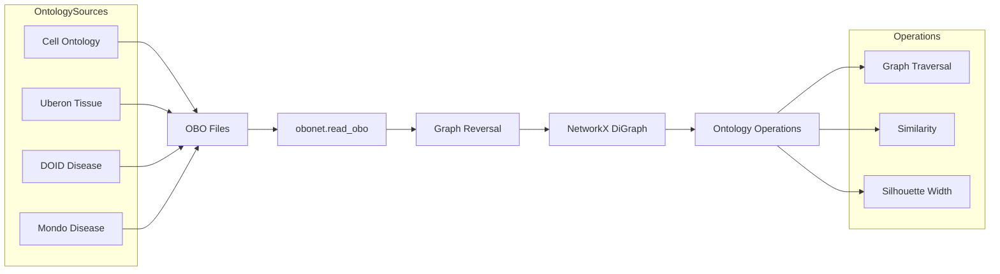
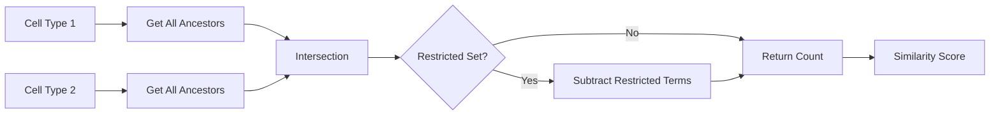

Cell ontologies provide a structured framework for understanding biological relationships between cell types. In SCimilarity, ontologies enable sophisticated cell type classification by capturing hierarchical relationships, computing semantic similarities, and supporting constrained annotation workflows. This integration allows researchers to leverage biological knowledge to improve annotation accuracy and interpret results within a taxonomic context.

## Ontology Architecture

SCimilarity leverages NetworkX directed acyclic graphs (DAGs) to represent ontological relationships from multiple biological ontologies. The architecture supports four major ontology sources imported from OBO files and transformed into graph structures for efficient traversal and analysis. Each ontology represents a different biological dimension: cell types, tissues, diseases, and disease cross-references.

The core architecture follows a modular pattern where each ontology type is imported through dedicated functions that perform graph reversal for intuitive parent-child relationships. The graph structure enables efficient traversal algorithms for ancestor/descendant queries and similarity computations across hierarchical taxonomies.



Sources: [ontologies.py](src/scimilarity/ontologies.py#L30-L57)

## Ontology Import Functions

SCimilarity provides specialized functions for importing biological ontologies from their respective OBO (Open Biomedical Ontologies) files. Each function downloads or reads an ontology file, parses it into a graph structure, and reverses the edge direction to make parent relationships point from specific to general terms, which aligns with biological intuition.

The import functions support custom URL parameters for flexibility, enabling users to work with different ontology versions or local file copies. All imported ontologies are returned as NetworkX DiGraph objects, providing access to a rich ecosystem of graph algorithms and traversal methods.

| Function | Ontology Source | Default URL | Purpose |
|----------|---------------|------------|---------|
| `import_cell_ontology()` | Cell Ontology (CL) | cl-basic.obo | Cell type hierarchy |
| `import_uberon_ontology()` | Uberon | basic.obo | Multi-species anatomical structures |
| `import_doid_ontology()` | Human Disease Ontology (DOID) | doid.obo | Disease classification |
| `import_mondo_ontology()` | Mondo | mondo.obo | Disease cross-references and harmonization |

The import process follows a consistent pattern: `obonet.read_obo()` parses the OBO format, `.reverse()` flips the edge direction for intuitive traversal (children point to parents), and `nx.DiGraph()` converts the result to a proper directed graph structure.

Sources: [ontologies.py](src/scimilarity/ontologies.py#L30-L105)

## Graph Traversal Operations

Ontology traversal functions enable navigation through hierarchical relationships to understand cell type ancestry, descendants, siblings, and common ancestors. These operations form the foundation for ontology-aware similarity calculations and constrained annotation workflows.

### Parent and Child Navigation

The `get_parents()` function retrieves direct parent terms for a given cell type, representing immediate broader categories in the taxonomy. Conversely, `get_children()` returns direct descendant terms, representing more specialized subtypes. Both functions support optional `node_list` parameters for filtering results to a restricted subset of the ontology, enabling context-aware queries.

The `get_siblings()` function identifies terms that share common parents, representing sibling cell types at the same hierarchical level. This is particularly useful for understanding alternative subtypes within a broader category or for comparing closely related cell types.

Sources: [ontologies.py](src/scimilarity/ontologies.py#L147-L176)

### Hierarchical Traversal

For deeper ancestry analysis, `get_all_ancestors()` recursively retrieves all parent terms at every level of the hierarchy. This function includes an `inclusive` parameter to optionally include the query node itself in the results. Similarly, `get_all_descendants()` retrieves all descendant terms, supporting both single node queries and multiple node inputs for batch operations.

These hierarchical traversals utilize NetworkX's built-in graph algorithms, ensuring efficient computation even for large ontologies with thousands of terms. The functions are essential for understanding the full taxonomic context of cell types and computing ontology-aware similarity metrics.

Sources: [ontologies.py](src/scimilarity/ontologies.py#L234-L268)

### Common Ancestor Detection

The `get_lowest_common_ancestor()` function identifies the most recent shared ancestor between two cell types, representing the taxonomic point where their evolutionary or developmental pathways converge. This is computed using NetworkX's lowest common ancestor algorithm, which finds the ancestor with maximum depth in the DAG.

For scenarios where direct parent relationships aren't available, `find_most_viable_parent()` provides a sophisticated fallback mechanism that searches for appropriate parents at multiple hierarchical levels, checking first parents, then grandparents if needed. This function is particularly valuable when working with partial or incomplete ontology annotations.

Sources: [ontologies.py](src/scimilarity/ontologies.py#L304-L332)

## Ontology Similarity Metrics

SCimilarity implements ontology-based similarity measures that quantify the relatedness between cell types based on their taxonomic structure. These metrics provide biological context that complements embedding-based similarity measures, enabling more informed cell type classification and cluster analysis.

### Common Ancestor Similarity

The `ontology_similarity()` function computes similarity as the count of shared ancestors between two cell types. The intuition is that cell types with more shared ancestors are more closely related biologically. This function supports an optional `restricted_set` parameter to exclude certain terms from consideration, allowing researchers to focus similarity calculations on specific aspects of the ontology.



This approach captures hierarchical relationships at multiple levels, making it sensitive to both fine-grained differences (few shared ancestors) and broad relationships (many shared ancestors including root-level terms).

Sources: [ontologies.py](src/scimilarity/ontologies.py#L372-L403)

### All-Pair Similarity Computation

For batch similarity analysis, `all_pair_similarities()` computes pairwise ontology similarities across a list of cell types, returning a symmetric DataFrame where each cell represents the similarity between two terms. This is useful for creating similarity matrices, performing clustering analyses, or identifying groups of related cell types.

The function uses itertools.combinations to generate all unique pairs efficiently, avoiding redundant computations. The resulting matrix can be visualized as heatmaps or used as input for downstream analyses that require semantic similarity measures.

Sources: [ontologies.py](src/scimilarity/ontologies.py#L404-L438)

## Ontology-Aware Cluster Evaluation

Traditional silhouette width metrics treat all inter-cluster distances equally, but this approach doesn't account for biological relationships encoded in ontologies. SCimilarity addresses this with `ontology_silhouette_width()`, which modifies the standard silhouette calculation to respect hierarchical cell type relationships.

The key innovation is distinguishing between truly inter-cluster comparisons and those that should be considered intra-cluster due to ancestry relationships. Descendant terms are treated as intra-cluster (they represent subtypes of the same cell type), while ancestor terms are excluded from inter-cluster calculations entirely (they represent broader categories that shouldn't penalize separation).

Sources: [ontologies.py](src/scimilarity/ontologies.py#L439-L518)

> [!TIP]
> This ontology-aware approach prevents the silhouette metric from unfairly penalizing biological separation that reflects legitimate cell type differentiation. For example, "CD8-positive T cell" and "CD4-positive T cell" might appear close in embedding space, but their distinct identities warrant separation that shouldn't be penalized.

### Silhouette Width Computation Flow

The function computes for each cell type:
1. Intra-cluster distances (aᵢ): Average distance to cells of the same type or descendant types
2. Inter-cluster distances (bᵢ): Average distance to cells of different types, excluding ancestors
3. Silhouette score (sᵢ): (bᵢ - aᵢ) / max(aᵢ, bᵢ)

This yields a biologically meaningful cluster quality metric that reflects both embedding compactness and taxonomic appropriateness.

Sources: [ontologies.py](src/scimilarity/ontologies.py#L439-L518)

## Cell Type Identification and Mapping

The `get_id_mapper()` function creates a bidirectional mapping between ontology term identifiers (e.g., "CL:0000084") and their human-readable names (e.g., "T cell"). This mapping is essential for translating between technical ontology representations and user-facing labels throughout the SCimilarity pipeline.

The function extracts the `name` attribute from each node in the ontology graph, providing a dictionary that enables both forward lookups (ID to name) and reverse lookups (name to ID) through dictionary inversion. This mapping is used extensively in the annotation pipeline to display user-friendly labels while maintaining ontology-aware computations with term identifiers.

Sources: [ontologies.py](src/scimilarity/ontologies.py#L126-L146)

## Integration with Cell Annotation

Ontology concepts are deeply integrated with the cell annotation workflow through the `CellAnnotation` class. The class provides `safelist_celltypes()` and `blocklist_celltypes()` methods that leverage ontology knowledge to constrain prediction spaces, enabling researchers to focus annotation on relevant cell types or exclude inappropriate ones.

These methods operate at the kNN index level, marking cells as deleted or restored based on their cell type labels. The safelist approach is particularly powerful when analyzing tissue-specific datasets, as it prevents predictions for cell types that don't exist in the biological context, improving annotation accuracy and reducing noise.

Sources: [cell_annotation.py](src/scimilarity/cell_annotation.py#L92-L147)

### Constrained Annotation Workflow

In practice, researchers can:
1. Import the cell ontology and explore available cell type labels
2. Identify cell types relevant to their experimental context
3. Safelist only those types, creating a constrained prediction space
4. Run annotation with improved specificity and reduced false positives

This workflow is demonstrated in the cell annotation tutorial, where lung-specific cell types are safelisted to prevent predictions for irrelevant cell types like kidney epithelial cells or neural cell types.

Sources: [cell_annotation_tutorial.ipynb](docs/notebooks/cell_annotation_tutorial.ipynb#L14-L16)

## Practical Example: Ontology-Guided Annotation

The following example demonstrates how to use ontology functions to guide cell type annotation:

```python
from scimilarity import CellAnnotation
from scimilarity.ontologies import import_cell_ontology, get_id_mapper

# Load cell ontology
onto = import_cell_ontology()
id2name = get_id_mapper(onto)

# Initialize annotation model
ca = CellAnnotation(model_path="/models/model_v1.1")

# Explore available cell types
print("Available cell types:")
print("\n".join(ca.classes))

# Safelist lung-relevant cell types
target_celltypes = [
    "lung macrophage", "alveolar macrophage",
    "type I pneumocyte", "type II pneumocyte",
    "CD4-positive, alpha-beta T cell",
    "CD8-positive, alpha-beta T cell",
]
ca.safelist_celltypes(target_celltypes)

# Annotate with constrained prediction space
annotations = ca.annotate_dataset(query_data)
```

This workflow ensures predictions are biologically plausible and domain-relevant, leveraging ontology structure to improve annotation quality.

Sources: [cell_annotation_tutorial.ipynb](docs/notebooks/cell_annotation_tutorial.ipynb#L5-L16)

## Next Steps

Understanding ontology integration provides the foundation for advanced cell annotation workflows. For practical implementation details, see the [Cell Annotation API Reference](13-cell-annotation-api-reference) which documents the full annotation pipeline. To learn about cell type classification strategies and how ontology constraints influence predictions, explore [Understanding Cell Type Classification](14-understanding-cell-type-classification).

For readers interested in the underlying cell representations that enable ontology-aware similarity, refer to [Cell Embedding Fundamentals](6-cell-embedding-fundamentals) to understand how embeddings capture biological relationships that complement taxonomic knowledge.