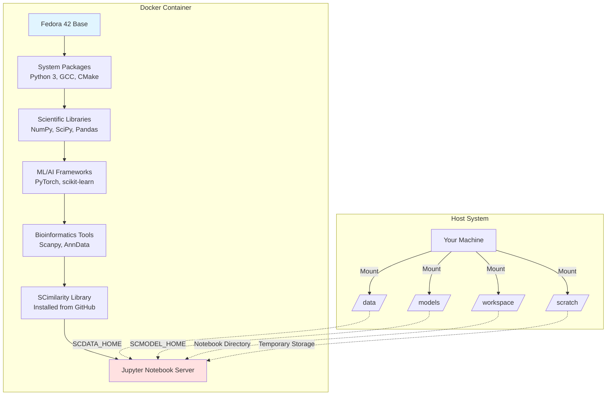

Docker provides a complete, isolated environment for running SCimilarity with all dependencies pre-configured. This approach eliminates local installation conflicts and ensures reproducibility across different development machines. The Docker setup is particularly valuable for computational biology workflows where consistent environments are critical for reproducible research.

## Docker Architecture Overview

The SCimilarity Docker container creates a self-contained computational environment with Fedora Linux as the base operating system. The architecture follows a layered approach where system dependencies, Python packages, and the SCimilarity library are installed in sequence, creating a fully functional data science workspace.



This architecture separates persistent data storage from the container's ephemeral file system through volume mounts. The container runs Jupyter Notebook as the primary interface, exposing it on port 8888 for web-based interaction with SCimilarity's capabilities.

**Sources:** [Dockerfile](docker/Dockerfile#L1-L98), [start-notebook.sh](docker/start-notebook.sh#L1-L4)

## Building the Docker Image

The Docker image builds automatically from the included Dockerfile, installing all required dependencies and the SCimilarity library itself. The build process downloads and configures approximately 80+ packages spanning system utilities, scientific computing libraries, and machine learning frameworks.

```mermaid
flowchart LR
    A[Start Build] --> B[Pull Fedora 42 Base]
    B --> C[Install System Packages<br/>via DNF]
    C --> D[Install Python Dependencies<br/>via pip3]
    D --> E[Clone SCimilarity Repo]
    E --> F[Install SCimilarity<br/>pip install .]
    F --> G[Copy Notebook Script]
    G --> H[Configure Volumes<br/>data, models, workspace, scratch]
    H --> I[Set Environment Variables<br/>SCDATA_HOME, SCMODEL_HOME]
    I --> J[Complete Image]
    
    style C fill:#fff4e1
    style D fill:#fff4e1
    style J fill:#e1ffe1
```



To build the image, navigate to the repository root and execute:

```bash
docker build -t scimilarity:latest ./docker
```

This command compiles all layers into a single image tagged as `scimilarity:latest`. The build process may take 10-20 minutes depending on your network speed, as it downloads numerous scientific packages. The image size will be substantial (several GB) due to the inclusion of PyTorch, scientific computing stacks, and bioinformatics tools.

**Sources:** [Dockerfile](docker/Dockerfile#L1-L98)

## Running the Container

Once built, run the container with appropriate volume mounts to access your local data and models. The container exposes Jupyter Notebook on port 8888, which you can access through your web browser.

### Basic Execution

```bash
docker run -d \
  --name scimilarity \
  -p 8888:8888 \
  -v $(pwd)/data:/data \
  -v $(pwd)/models:/models \
  -v $(pwd)/workspace:/workspace \
  -v $(pwd)/scratch:/scratch \
  scimilarity:latest
```

### Volume Mount Strategy

The container uses four volume mounts to separate different types of data:

| Volume Mount | Purpose | Environment Variable | Recommended Local Path |
|-------------|---------|----------------------|------------------------|
| `/data` | Input datasets (AnnData, Zarr, TileDB) | `SCDATA_HOME` | `./data` |
| `/models` | Pretrained model files | `SCMODEL_HOME` | `./models` |
| `/workspace` | Jupyter notebooks and analysis scripts | — | `./workspace` |
| `/scratch` | Temporary files and intermediate results | — | `./scratch` |

This separation ensures that your data persists outside the container, allowing you to upgrade or rebuild the Docker image without losing your work. The `/workspace` directory serves as the default notebook directory, where you should place your analysis notebooks.

> [!TIP]
> Always use absolute paths or expand `$PWD` when mounting volumes to avoid path resolution issues. Relative paths can behave unexpectedly depending on your Docker Compose version or Docker Desktop configuration.

### Accessing Jupyter Notebook

After starting the container, access Jupyter Notebook at `http://localhost:8888`. The container runs Jupyter without authentication in the default configuration, making it suitable for local development environments. For production deployments, consider adding security measures such as password authentication or SSL/TLS encryption.

The notebook server automatically starts in the `/workspace` directory, so any notebooks you create or modify there will persist on your host machine through the volume mount.

**Sources:** [Dockerfile](docker/Dockerfile#L6-L18), [start-notebook.sh](docker/start-notebook.sh#L1-L4)

## Installed Dependencies

The Docker image includes a comprehensive scientific computing stack optimized for single-cell analysis and machine learning. Understanding these dependencies helps troubleshoot issues and extend functionality.

### System-Level Dependencies

Fedora packages provide the foundational tools including compilers, scientific libraries, and utilities:

| Category | Key Packages | Purpose |
|----------|--------------|---------|
| Build Tools | gcc-c++, cmake, Cython | Compilation of Python extensions |
| Data I/O | bzip2, lz4, zstd | Compression and archive handling |
| Scientific Computing | python3-numpy, python3-scipy, python3-pandas | Numerical computing foundation |
| Visualization | python3-matplotlib, python3-seaborn | Plotting and statistical graphics |
| Documentation | pandoc, nbsphinx, python3-pydata-sphinx-theme | Documentation generation |
| Network Tools | python3-aiohttp, python3-cloudpickle | Asynchronous I/O and serialization |

### Python Package Dependencies

PyPI packages provide domain-specific functionality for single-cell genomics and machine learning:

| Domain | Packages | Functionality |
|--------|----------|---------------|
| Deep Learning | torch, pytorch-lightning, captum | Neural networks and attribution |
| Single-Cell Analysis | scanpy, scrublet | Preprocessing and doublet detection |
| Clustering | leidenalg, louvain, python3-igraph | Community detection algorithms |
| Dimensionality Reduction | umap-learn, hnswlib | Manifold learning and ANN search |
| Data Storage | tiledb, tiledb-cloud, python3-zarr, python3-h5py | Multi-format data handling |
| Bioinformatics | python3-biopython, obonet | Biological data and ontologies |
| Visualization | circlize, python3-matplotlib-scalebar | Circular plots and scale bars |

This comprehensive dependency set enables SCimilarity's full functionality without requiring any additional package installation within the container.

**Sources:** [Dockerfile](docker/Dockerfile#L20-L94)

## Configuration and Customization

The Docker environment can be customized through environment variables and modifications to the startup script.

### Environment Variables

Two critical environment variables configure data paths within the container:

| Variable | Default Value | Purpose |
|----------|---------------|---------|
| `SCDATA_HOME` | `/data` | Root directory for input datasets |
| `SCMODEL_HOME` | `/models` | Root directory for pretrained models |

These variables are set in the Dockerfile but can be overridden at runtime using the `-e` flag:

```bash
docker run -d \
  --name scimilarity \
  -p 8888:8888 \
  -e SCDATA_HOME=/custom/data \
  -e SCMODEL_HOME=/custom/models \
  -v $(pwd)/data:/custom/data \
  -v $(pwd)/models:/custom/models \
  scimilarity:latest
```

### Custom Startup Commands

While the default entry point launches Jupyter Notebook, you can override this to run scripts directly or execute specific commands:

```bash
# Run an interactive shell
docker run -it scimilarity:latest /bin/bash

# Execute a Python script
docker run -v $(pwd)/scripts:/scripts scimilarity:latest python /scripts/my_analysis.py

# Launch Jupyter Lab instead of Notebook
docker run -d -p 8888:8888 scimilarity:latest jupyter lab --ip=0.0.0.0 --no-browser
```

**Sources:** [Dockerfile](docker/Dockerfile#L16-L18), [start-notebook.sh](docker/start-notebook.sh#L1-L4)

## GPU Support

The base Dockerfile does not include NVIDIA CUDA support by default. For GPU-accelerated model training and inference, modify the Dockerfile to use an NVIDIA base image and install CUDA-enabled PyTorch:

1. Change the base image from `fedora:42` to `nvidia/cuda:11.8.0-devel-fedora42`
2. Install PyTorch with CUDA support: `pip3 install torch --index-url https://download.pytorch.org/whl/cu118`
3. Run containers with GPU access: `docker run --gpus all -d scimilarity-gpu:latest`

GPU acceleration significantly speeds up neural network training and large-scale embedding computations, particularly when working with datasets containing millions of cells.

> [!TIP]
> When adding GPU support, verify that your host system has compatible NVIDIA drivers and the nvidia-container-toolkit installed. Without proper host configuration, GPU passthrough will fail silently, and PyTorch will fall back to CPU operations.

**Sources:** [Dockerfile](docker/Dockerfile#L1-L94)

## Common Troubleshooting

### Port Conflicts

If port 8888 is already in use on your host system, map the container to a different port:

```bash
docker run -d -p 9999:8888 scimilarity:latest
```

Then access Jupyter at `http://localhost:9999` instead.

### Permission Issues

Volume mounts may encounter permission problems if the container runs as a different user than the host. Resolve this by matching user IDs:

```bash
docker run -d \
  --user $(id -u):$(id -g) \
  -v $(pwd)/workspace:/workspace \
  scimilarity:latest
```

### Memory Constraints

Large-scale single-cell analyses can be memory-intensive. Increase Docker's allocated memory through Docker Desktop settings or use the `--memory` flag:

```bash
docker run -d --memory=16g scimilarity:latest
```

### Build Failures

If package installations fail during the build, try these strategies:

1. Clear Docker's build cache: `docker build --no-cache -t scimilarity:latest ./docker`
2. Use a different mirror or proxy if network issues occur
3. Check the Fedora 42 package repository availability for your region

**Sources:** [Dockerfile](docker/Dockerfile#L1-L98)

## Production Considerations

While the default Docker configuration serves development well, production deployments require additional security measures:

1. **Authentication**: Replace the default Jupyter configuration with password or token-based authentication
2. **Network Security**: Use Docker networks or Kubernetes network policies to restrict container access
3. **Resource Limits**: Implement CPU and memory quotas to prevent runaway processes
4. **Health Checks**: Add container health checks to monitor Jupyter Notebook status
5. **Logging**: Configure log drivers to centralize container logs for monitoring and debugging

For scalable deployments serving multiple users, consider using JupyterHub with DockerSpawner to manage user containers dynamically.

**Sources:** [Dockerfile](docker/Dockerfile#L1-L98), [start-notebook.sh](docker/start-notebook.sh#L1-L4)

## Next Steps

Once you have the Docker environment running, you're ready to explore SCimilarity's capabilities. The logical progression from Docker setup is:

- **[Downloading Pretrained Models and Data](4-downloading-pretrained-models-and-data)** - Acquire the reference models and datasets needed for cell search and annotation tasks
- **[Cell Embedding Fundamentals](6-cell-embedding-fundamentals)** - Understand how SCimilarity transforms high-dimensional gene expression data into compact latent representations
- **[Cell Query API Reference](9-cell-query-api-reference)** - Learn to perform similarity searches against reference cell atlases

The Docker environment provides immediate access to all tutorial notebooks in the `docs/notebooks/` directory, allowing you to run examples interactively without any additional installation.

**Sources:** [Dockerfile](docker/Dockerfile#L1-L98), [README.rst](README.rst)