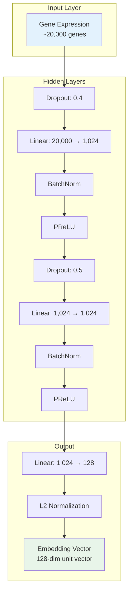
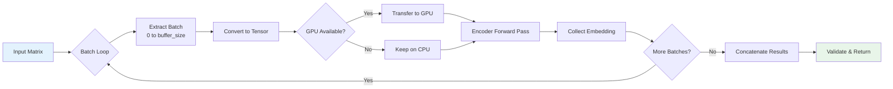

Cell embeddings are compressed numerical representations of single-cell gene expression profiles that capture biological similarity in a reduced-dimensional space. The SCimilarity library implements these embeddings through a deep neural network encoder that transforms high-dimensional gene expression data (typically thousands of genes) into a fixed-dimensional latent vector (128 dimensions by default), enabling efficient similarity computation across millions of cells. This page explains the foundational concepts, architecture, and practical usage of cell embeddings in the SCimilarity framework.

## The Cell Embedding Pipeline

The cell embedding pipeline transforms raw gene expression data into normalized latent vectors through a structured sequence of preprocessing and neural network operations. The process begins with data alignment to match the model's expected gene space, followed by log-normalization, and concludes with neural network inference that produces L2-normalized embeddings suitable for similarity calculations.

```mermaid
flowchart TD
    A[Raw Gene Expression Matrix] --> B[Gene Space Alignment]
    B --> C[Log Normalization<br/>(target sum 1e4, log1p)]
    C --> D[Encoder Neural Network]
    D --> E[L2 Normalization]
    E --> F[Final Embedding Vector<br/>(128-dim)]
    
    style A fill:#e1f5fe
    style F fill:#c8e6c9
```

The pipeline ensures that all cells are represented in a consistent feature space, with embeddings normalized to unit length for reliable similarity computations using cosine distance or inner products. The `CellEmbedding` class orchestrates this process, managing model loading, data validation, and batch processing to handle datasets ranging from single cells to millions of profiles.

Sources: [cell_embedding.py](/src/scimilarity/cell_embedding.py#L1-L157), [utils.py](/src/scimilarity/utils.py#L4-L48)

## Encoder Neural Network Architecture

The encoder network uses a feedforward architecture that progressively reduces dimensionality while preserving biological signal. The network consists of multiple fully connected layers with batch normalization, dropout regularization, and parametric ReLU (PReLU) activations, culminating in a linear projection to the latent space followed by L2 normalization.



**Key Architectural Components:**

- **Input Dropout (0.4)**: Applied at the input layer to prevent overfitting to spurious gene expression patterns
- **Hidden Layers**: Two configurable hidden layers (default: 1,024 neurons each) with dropout (0.5), batch normalization, and PReLU activations that learn optimal negative slopes
- **Latent Projection**: Final linear layer maps to the embedding dimension (default: 128)
- **L2 Normalization**: Ensures all embeddings are unit vectors, making cosine similarity equivalent to dot products

The architecture balances representational capacity with generalization, using dropout and batch normalization to handle the high-dimensional, sparse nature of single-cell expression data.

Sources: [nn_models.py](/src/scimilarity/nn_models.py#L12-L112)

## Model Initialization and Configuration

The `CellEmbedding` class loads a pre-trained encoder model and its associated metadata from a directory containing model artifacts. Upon initialization, the class reads the gene order file, architecture configuration, and model weights to reconstruct the encoder network.

**Model Artifacts:**

| File | Purpose | Format |
|------|---------|--------|
| `encoder.ckpt` | PyTorch model weights | PyTorch checkpoint |
| `gene_order.tsv` | Gene names in model space | Plain text (one per line) |
| `layer_sizes.json` | Network dimensions | JSON |
| `label_ints.csv` | Cell type label mappings | CSV |

The initialization process automatically infers network architecture from the checkpoint, extracting the latent dimension and hidden layer sizes from the weight tensor dimensions. This design allows flexible deployment of models with different architectures without code changes.

> [!TIP]
> The gene order file is critical: your input data must contain exactly these genes in the same order, or the alignment step will fail or produce incorrect results. Use the `align_dataset()` utility to handle this automatically.

```python
from scimilarity import CellEmbedding

# Initialize with pre-trained model
ce = CellEmbedding(model_path="/opt/data/model", use_gpu=False)

# Access model properties
print(f"Latent dimensions: {ce.latent_dim}")  # e.g., 128
print(f"Gene space size: {ce.n_genes}")       # e.g., 19,231
```

Sources: [cell_embedding.py](/src/scimilarity/cell_embedding.py#L19-L71)

## Data Preparation Requirements

Before generating embeddings, gene expression data must undergo two critical preprocessing steps: gene space alignment and log-normalization. These ensure that the input format matches what the encoder expects and that expression values are on the appropriate scale.

### Gene Space Alignment

The model expects genes in a specific order corresponding to its training data. The `align_dataset()` utility reorders and subsets your input data to match the model's gene order.

```python
from scimilarity.utils import align_dataset

# Align to model's gene space
aligned_data = align_dataset(
    data=adata, 
    target_gene_order=ce.gene_order,
    gene_overlap_threshold=5000  # Require at least 5000 overlapping genes
)
```

### Log Normalization

Expression values must be normalized to a consistent scale. The standard normalization is library size normalization to 10,000 counts per cell followed by log1p transformation.

```python
from scimilarity.utils import lognorm_counts

# Apply log normalization (TP10K + log1p)
normalized_data = lognorm_counts(aligned_data)
# Input: counts in .layers['counts']
# Output: normalized data in .X
```

The normalization formula applied is:
- Step 1: Normalize to target sum: `X_normalized = X * (target_sum / row_sum)`
- Step 2: Apply log1p: `X_final = log1p(X_normalized)`

This matches the normalization used during model training and is critical for producing biologically meaningful embeddings.

Sources: [utils.py](/src/scimilarity/utils.py#L4-L48), [utils.py](/src/scimilarity/utils.py#L50-L133)

## Generating Embeddings

The `get_embeddings()` method processes gene expression matrices in configurable batches, supporting multiple input formats including sparse matrices (CSR/CSC), dense arrays, and PyTorch tensors. The method handles large datasets efficiently through batching and provides GPU acceleration when available.

**Method Parameters:**

| Parameter | Type | Default | Description |
|-----------|------|---------|-------------|
| `X` | Union[sparse, array, Tensor] | Required | Log-normalized expression matrix |
| `num_cells` | int | -1 | Number of cells to embed (-1 = all) |
| `buffer_size` | int | 10,000 | Batch size for processing |

**Supported Input Formats:**

- `scipy.sparse.csr_matrix`: Compressed sparse row format (recommended for large datasets)
- `scipy.sparse.csc_matrix`: Compressed sparse column format
- `numpy.ndarray`: Dense array format
- `torch.Tensor`: PyTorch tensor (can be on CPU or GPU)

```python
from scimilarity import CellEmbedding
from scimilarity.utils import align_dataset, lognorm_counts

# Initialize model
ce = CellEmbedding(model_path="/opt/data/model", use_gpu=False)

# Prepare data
aligned_data = align_dataset(adata, ce.gene_order)
normalized_data = lognorm_counts(aligned_data)

# Generate embeddings
embeddings = ce.get_embeddings(
    X=normalized_data.X,           # Log-normalized expression matrix
    num_cells=-1,                  # Process all cells
    buffer_size=10000              # Process in batches of 10,000
)

# Output: numpy.ndarray of shape (n_cells, 128)
# embeddings[i] is the 128-dimensional vector for cell i
```

The method automatically handles type conversion to PyTorch tensors, manages GPU transfer if requested, and performs post-processing validation including NaN detection. For Zarr-backed sparse matrices, the method materializes arrays when processing small batches to avoid performance overhead.

> [!TIP]
> The buffer_size parameter trades off memory usage versus processing speed. For very large datasets (>1M cells), increase buffer_size (e.g., 50,000-100,000) to reduce batch overhead, but ensure sufficient GPU/CPU memory is available.

Sources: [cell_embedding.py](/src/scimilarity/cell_embedding.py#L72-L157)

## Properties of Generated Embeddings

The embedding vectors produced by the encoder possess specific mathematical properties that enable efficient similarity computation and biological interpretation. Understanding these properties is essential for downstream analysis tasks.

**Mathematical Properties:**

1. **Unit Length**: All embeddings are L2-normalized to have Euclidean norm of 1.0
2. **Fixed Dimension**: Standard models produce 128-dimensional vectors (configurable)
3. **Dense Representation**: Unlike input sparse matrices, embeddings are dense
4. **Non-Negative**: While not strictly enforced, embeddings typically contain both positive and negative values

**Implications for Similarity Computation:**

Because embeddings are unit vectors, cosine similarity simplifies to the dot product:

```
cosine_similarity(a, b) = (a · b) / (||a|| × ||b||) = a · b
```

This optimization enables extremely fast similarity calculations across millions of cells using matrix operations or approximate nearest neighbor algorithms like HNSW.

**Biological Interpretation:**

- **Spatial Proximity**: Cells closer in embedding space typically share similar expression profiles and biological states
- **Cluster Structure**: Known cell types form distinct, well-separated clusters in the embedding space
- **Continuum Representation**: Continuous biological processes (e.g., differentiation trajectories) appear as smooth gradients in the embedding space

These properties make embeddings ideal for cell search, clustering, annotation, and visualization tasks. For detailed exploration of similarity search methods, see [K-NN Search with HNSW](10-k-nn-search-with-hnsw).

Sources: [nn_models.py](/src/scimilarity/nn_models.py#L64-L75)

## Batch Processing and Performance Considerations

The embedding generation process is designed for scalability, supporting datasets from single cells to tens of millions of profiles. Understanding the batch processing mechanics and memory management is critical for efficient large-scale embedding generation.

**Batch Processing Flow:**



**Performance Characteristics:**

| Dataset Size | Recommended buffer_size | Estimated Throughput* |
|--------------|------------------------|----------------------|
| < 10K cells | 5,000 | ~1,000 cells/sec (CPU) |
| 10K-100K cells | 10,000-20,000 | ~2,000 cells/sec (CPU) |
| 100K-1M cells | 50,000-100,000 | ~5,000 cells/sec (GPU) |
| > 1M cells | 100,000+ | ~10,000 cells/sec (GPU) |

*Throughput varies by hardware configuration and expression matrix sparsity.

**Memory Management:**

- **CPU Mode**: Primary memory constraint is the expression matrix batch size
- **GPU Mode**: Both expression batch and embeddings must fit in GPU memory
- **Zarr Optimization**: For small batches, Zarr arrays are materialized to avoid indexing overhead

The `build_embeddings.py` script demonstrates large-scale embedding generation using TileDB for data storage, processing cells in configurable batches and writing embeddings directly to persistent storage without loading entire datasets into memory.

Sources: [cell_embedding.py](/src/scimilarity/cell_embedding.py#L95-L155), [build_embeddings.py](/scripts/build_embeddings.py#L39-L121)

## Practical Examples and Common Patterns

### Basic Embedding Generation

The most common use case is generating embeddings for a new single-cell dataset to enable similarity search against reference atlases.

```python
import anndata as ad
from scimilarity import CellEmbedding
from scimilarity.utils import align_dataset, lognorm_counts

# Load your data
adata = ad.read_h5ad("your_data.h5ad")

# Initialize model
ce = CellEmbedding(model_path="/opt/data/model")

# Preprocess
aligned_adata = align_dataset(adata, ce.gene_order)
normalized_adata = lognorm_counts(aligned_adata)

# Generate embeddings
embeddings = ce.get_embeddings(normalized_adata.X)

# Store results
adata.obsm["X_scimilarity"] = embeddings
```

### Subsetting and Partial Processing

When working with very large datasets, you may want to embed only a subset of cells.

```python
# Embed first 100,000 cells only
embeddings = ce.get_embeddings(
    normalized_adata.X, 
    num_cells=100000,
    buffer_size=50000
)

# Process a specific cell index range
cell_subset = normalized_adata.X[50000:100000]
embeddings_subset = ce.get_embeddings(cell_subset)
```

### GPU Acceleration

For large-scale embedding generation, GPU acceleration provides significant speedup.

```python
# Initialize with GPU support
ce = CellEmbedding(model_path="/opt/data/model", use_gpu=True)

# Everything else remains the same
embeddings = ce.get_embeddings(normalized_adata.X)
```

Sources: [cell_embedding.py](/src/scimilarity/cell_embedding.py#L1-L157)

## Troubleshooting Common Issues

### Dimension Mismatches

**Problem**: `RuntimeError: mat1 and mat2 shapes cannot be multiplied`

**Cause**: Input gene space does not match model's gene space after alignment.

**Solution**: Verify gene overlap and check that `align_dataset()` succeeded:

```python
aligned_data = align_dataset(adata, ce.gene_order)
assert aligned_data.n_vars == len(ce.gene_order), "Gene space mismatch"
```

### NaN in Embeddings

**Problem**: `RuntimeError: NaN detected in embeddings`

**Cause**: Input contains NaN values or all-zero expression profiles.

**Solution**: Clean input data before normalization:

```python
import numpy as np
# Check for NaN in raw counts
if np.isnan(adata.layers['counts']).any():
    adata.layers['counts'] = np.nan_to_num(adata.layers['counts'], nan=0.0)

# Remove cells with no detected genes
n_genes_per_cell = np.array(adata.layers['counts'].sum(axis=1)).ravel()
adata = adata[n_genes_per_cell > 0]
```

### Memory Issues

**Problem**: Out of memory errors during embedding generation.

**Solution**: Reduce `buffer_size` or switch to CPU processing:

```python
# Reduce batch size
embeddings = ce.get_embeddings(X, buffer_size=1000)

# Or use CPU for very large datasets
ce_cpu = CellEmbedding(model_path="/opt/data/model", use_gpu=False)
```

Sources: [cell_embedding.py](/src/scimilarity/cell_embedding.py#L95-L157), [utils.py](/src/scimilarity/utils.py#L19-L30)

## Integration with Downstream Tasks

Cell embeddings serve as the foundation for multiple analytical workflows in the SCimilarity ecosystem. Once embeddings are generated, they can be immediately used for:

- **Similarity Search**: Find similar cells across datasets using k-NN algorithms. See [K-NN Search with HNSW](10-k-nn-search-with-hnsw) for efficient large-scale search
- **Cell Type Annotation**: Classify unknown cells using reference embeddings and cell type labels. Refer to [Cell Annotation API Reference](13-cell-annotation-api-reference)
- **Visualization**: Project embeddings to 2D using UMAP or t-SNE for exploratory analysis. The [visualizations](/src/scimilarity/visualizations.py) module provides utilities
- **Clustering**: Apply clustering algorithms directly on embeddings to discover novel cell states

The modular design allows embeddings to be generated once and reused across multiple analysis pipelines, making them a valuable intermediate representation in single-cell analysis workflows.

For deeper understanding of the encoder architecture and how it learns to represent biological similarity, continue to [Encoder and Decoder Architecture](7-encoder-and-decoder-architecture). To learn how these embeddings capture meaningful biological relationships in the latent space, proceed to [Understanding Latent Space Representations](8-understanding-latent-space-representations).
