The SCimilarity framework employs a symmetric encoder-decoder architecture optimized for single-cell RNA-seq data analysis. This architecture transforms high-dimensional gene expression profiles into compact latent representations that preserve biologically meaningful relationships while enabling efficient similarity search across millions of cell profiles. The dual-component design serves distinct purposes: the encoder creates metric-space embeddings for downstream tasks like cell search and annotation, while the decoder provides reconstruction constraints during training to ensure the latent space captures essential expression information.

## Architectural Overview

The complete architecture consists of two neural network modules working in tandem during training, with the encoder serving as the primary inference component. The system uses PyTorch's nn.Module as its foundation, integrating seamlessly with PyTorch Lightning for training workflows. The encoder compresses gene expression data (typically thousands of dimensions) into a compact latent space (default 128 dimensions), while the decoder attempts to reconstruct the original input from this compressed representation.

```mermaid
graph TB
    subgraph Training_Mode["Training Mode"]
        X[Gene Expression Input<br/>n_genes dimensions] -->|Dropout & Linear| EN1[Encoder Layer 1]
        EN1 -->|BatchNorm & PReLU| EN2[Encoder Layer 2]
        EN2 -->|...| EN_N[Encoder Layer N]
        EN_N -->|L2 Normalization| Z[Latent Space<br/>latent_dim dimensions]
        Z --> DE1[Decoder Layer 1]
        DE1 -->|BatchNorm & PReLU| DE2[Decoder Layer 2]
        DE2 -->|...| DE_M[Decoder Layer M]
        DE_M --> X_hat[Reconstruction Output<br/>n_genes dimensions]
        Z -->|Triplet Loss| TL[Metric Learning]
        X_hat -->|MSE Loss| RL[Reconstruction Learning]
        TL & RL --> FinalLoss[Mixed Loss]
    end
    
    subgraph Inference_Mode["Inference Mode"]
        X2[Gene Expression Input] -->|Dropout & Linear| EN1_2[Encoder Layer 1]
        EN1_2 -->|BatchNorm & PReLU| EN2_2[Encoder Layer 2]
        EN2_2 -->|...| EN_N_2[Encoder Layer N]
        EN_N_2 -->|L2 Normalization| Z2[Normalized Embedding<br/>Used for search & annotation]
    end
```

> [!TIP]
> The encoder's output is always L2-normalized before use, creating a unit hypersphere where cosine similarity equals dot product. This normalization is critical for metric learning performance and enables efficient similarity computations across the entire latent space.

## Encoder Architecture

The encoder serves as the primary workhorse of the SCimilarity framework, responsible for converting raw gene expression profiles into compact, biologically meaningful embeddings. It implements a feedforward neural network with configurable depth and width, designed to handle sparse, high-dimensional single-cell data efficiently.

### Network Structure

The encoder's architecture follows a progressive dimensionality reduction pattern, where each layer transforms the representation until reaching the target latent dimension. The construction logic iterates through a user-specified list of hidden dimensions, creating a modular stack of transformation layers.

**Layer Construction Pattern:**

For the input layer (first hidden layer), the architecture applies a dedicated dropout rate (`input_dropout`, default 0.4), which is typically higher than subsequent layers to handle the sparsity and noise inherent in scRNA-seq data. The input layer includes: Dropout → Linear transformation → BatchNorm1d → PReLU activation. This pattern repeats for subsequent hidden layers with the standard dropout rate (`dropout`, default 0.5) and linear projections between the hidden dimensions.

Sources: [nn_models.py](src/scimilarity/nn_models.py#L31-L63)

**Default Configuration Parameters:**

| Parameter | Default Value | Description |
|-----------|---------------|-------------|
| `n_genes` | Variable | Number of genes in gene space (input dimensions) |
| `latent_dim` | 128 | Latent space dimensionality |
| `hidden_dim` | [1024, 1024] | Hidden layer dimensions (depth = 2, width = 1024) |
| `dropout` | 0.5 | Dropout rate for hidden layers |
| `input_dropout` | 0.4 | Dropout rate for input layer |

Sources: [nn_models.py](src/scimilarity/nn_models.py#L31-L38)

### Forward Pass and Normalization

The encoder's forward pass sequentially applies each layer in the network stack, culminating in a critical L2 normalization step. This normalization ensures that all embeddings lie on the unit hypersphere, which is essential for the metric learning objectives used during training. The normalization is computed across feature dimensions (dim=1), meaning each cell's embedding is normalized independently.

Sources: [nn_models.py](src/scimilarity/nn_models.py#L64-L80)

### Activation Functions

The encoder uses PReLU (Parametric ReLU) as its activation function, which offers advantages over standard ReLU by introducing a learnable parameter for the negative slope. This choice helps mitigate the "dying ReLU" problem where neurons can become permanently inactive, particularly important in biological data where features may have sparse but meaningful expression patterns. Each PReLU maintains separate learnable parameters for optimal gradient flow.

Sources: [nn_models.py](src/scimilarity/nn_models.py#L49), [nn_models.py](src/scimilarity/nn_models.py#L58)

### State Management

The encoder provides methods for saving and loading model states, enabling persistence of trained weights. The state dictionary contains all learnable parameters (weights and biases), and the loading method supports both CPU and GPU environments through appropriate device mapping.

Sources: [nn_models.py](src/scimilarity/nn_models.py#L82-L111)

## Decoder Architecture

The decoder complements the encoder by attempting to reconstruct the original gene expression profile from the latent representation. While the encoder is the primary component used in inference (cell search, annotation, etc.), the decoder provides essential training signals through reconstruction loss that constrains the latent space to preserve biologically relevant information.

### Symmetric Design

The decoder's architecture mirrors the encoder's structure in reverse order, creating symmetry that facilitates learning stable representations. Hidden dimensions are processed in the reverse order of the encoder's configuration, enabling the network to progressively expand from the compact latent space back to the full gene expression space.

**Layer Construction Pattern:**

Unlike the encoder, the decoder's first hidden layer (which receives the latent space input) does not apply dropout. This design choice preserves the information encoded in the latent representation, which is already a compressed and processed version of the input. Subsequent hidden layers apply the standard dropout rate (`dropout`, default 0.5) to prevent overfitting during the expansion phase. Each hidden layer follows: Linear → BatchNorm1d → PReLU activation, with dropout applied between layers for positions after the first.

Sources: [nn_models.py](src/scimilarity/nn_models.py#L130-L159)

### Output Layer

The decoder's final layer is a simple linear projection from the last hidden dimension to the original gene space dimension (`n_genes`). Unlike the encoder, no activation function or normalization is applied to the output, as the decoder aims to reconstruct continuous gene expression values. The absence of a final non-linearity allows the model to learn both positive and negative expression values, which can be beneficial when modeling log-normalized data.

Sources: [nn_models.py](src/scimilarity/nn_models.py#L158-L159)

### Forward Pass

The decoder's forward pass applies each transformation layer sequentially, expanding the latent representation back to the original gene expression space. The output represents the reconstructed gene expression profile, which is compared against the original input during training using Mean Squared Error (MSE) loss.

Sources: [nn_models.py](src/scimilarity/nn_models.py#L161-L176)

## Training Integration

The encoder and decoder are integrated within the `MetricLearning` PyTorch Lightning module, which orchestrates the complete training process. This integration demonstrates how the two components work together to achieve the dual objectives of metric learning (via triplet loss) and reconstruction fidelity (via MSE loss).

### Instantiation and Configuration

The `MetricLearning` module instantiates both the encoder and decoder during initialization, passing shared hyperparameters to ensure architectural consistency. The encoder receives the original hidden dimension list, while the decoder receives the reversed list to maintain symmetry.

Sources: [training_models.py](src/scimilarity/training_models.py#L119-L131)

**Training-Specific Configuration:**

The training module uses a slightly deeper architecture by default (3 hidden layers of [1024, 1024, 1024]) compared to inference defaults (2 hidden layers of [1024, 1024]), providing additional capacity for learning complex mappings during the training phase.

Sources: [training_models.py](src/scimilarity/training_models.py#L77)

### Forward Pass Integration

During training, the forward pass processes data through both components: first encoding the input to the latent space, then decoding back to reconstruction. The intermediate latent representation (`z`) is also used directly for triplet loss computation, making it the focal point of metric learning objectives.

Sources: [training_models.py](src/scimilarity/training_models.py#L187-L205)

### Loss Computation

The training objective combines two loss components through a weighted sum: triplet loss (for metric learning) and MSE reconstruction loss (for information preservation). The triplet loss weight (`triplet_loss_weight`, default 0.001) is typically small, emphasizing reconstruction fidelity while still providing metric learning signals. When `triplet_loss_weight` is 0, training reduces to pure autoencoder behavior; when set to 1, it becomes pure metric learning without reconstruction constraints.

Sources: [training_models.py](src/scimilarity/training_models.py#L293-L315)

**Loss Function Integration:**

| Loss Component | Purpose | Weight | Target |
|----------------|---------|--------|--------|
| Triplet Loss | Metric learning | 0.001 (default) | Latent space structure |
| MSE Loss | Reconstruction fidelity | 0.999 (implicit) | Input preservation |

Sources: [training_models.py](src/scimilarity/training_models.py#L238-L245), [training_models.py](src/scimilarity/training_models.py#L309-L314)

## Inference and Deployment

For production use cases (cell search, annotation, embedding generation), only the encoder component is required. The decoder is exclusive to training and provides no utility during inference, as the goal is to generate embeddings rather than reconstruct inputs.

### CellEmbedding Class

The `CellEmbedding` class provides a high-level interface for embedding generation using a pre-trained encoder. It handles model loading, gene order alignment, and batch processing, abstracting away PyTorch-specific details from end users.

Sources: [cell_embedding.py](src/scimilarity/cell_embedding.py#L4-L71)

**Inference Workflow:**

1. **Model Loading**: The class loads only the encoder architecture and weights from a checkpoint file
2. **Gene Order Alignment**: It reads and applies the gene order used during training
3. **Architecture Inference**: Hidden dimensions and latent space size are inferred from saved layer size metadata
4. **Evaluation Mode**: The model is set to evaluation mode (`model.eval()`) to disable dropout and batch normalization updates
5. **Inference Mode**: Gradient computation is disabled (`torch.inference_mode()`) for memory efficiency

Sources: [cell_embedding.py](src/scimilarity/cell_embedding.py#L19-L65)

> [!TIP]
> During inference, the encoder operates in evaluation mode with dropout disabled and batch normalization parameters frozen. Combined with `torch.inference_mode()`, this configuration maximizes throughput and minimizes memory usage when processing millions of cell profiles.

### Batch Processing

The `get_embeddings` method processes large datasets efficiently through buffered batch processing. By default, it processes 10,000 cells at a time (`buffer_size=10000`), allowing it to handle datasets much larger than available GPU memory. This approach also supports sparse matrix inputs (CSR, CSC) and Zarr-backed data structures commonly used in single-cell analysis pipelines.

Sources: [cell_embedding.py](src/scimilarity/cell_embedding.py#L72-L156)

## Architecture Design Rationale

The specific design choices in SCimilarity's encoder-decoder architecture reflect the unique challenges of single-cell RNA-seq data analysis and the requirements of large-scale cell search applications.

### Normalization for Metric Learning

The L2 normalization of encoder outputs is fundamental to the architecture's success. By projecting all embeddings onto the unit hypersphere, the system ensures that distance metrics (cosine similarity, Euclidean distance) behave consistently regardless of expression magnitude. This normalization enables meaningful similarity comparisons across different cell types, experimental conditions, and studies.

Sources: [nn_models.py](src/scimilarity/nn_models.py#L80)

### Separate Dropout Strategies

The use of different dropout rates for the input layer (`input_dropout=0.4`) versus hidden layers (`dropout=0.5`) recognizes the distinct characteristics of gene expression data. The higher input dropout accounts for technical noise and dropout events (genes not detected due to sampling limitations), while the standard hidden layer dropout provides regularization against overfitting to study-specific artifacts.

Sources: [nn_models.py](src/scimilarity/nn_models.py#L36-L37), [nn_models.py](src/scimilarity/nn_models.py#L44-L59)

### Reconstruction as Auxiliary Loss

The decoder's role as an auxiliary component rather than a primary inference target reflects the framework's prioritization of metric learning over perfect reconstruction. The MSE reconstruction loss serves as a regularizer that prevents the latent space from collapsing or ignoring biologically relevant variation in pursuit of trivial triplet loss optimization.

Sources: [training_models.py](src/scimilarity/training_models.py#L293-L315)

### Symmetry and Stability

The symmetric design between encoder and decoder, with hidden dimensions reversed, creates a balanced architecture that learns stable representations. This symmetry provides inductive biases that help the network learn meaningful transformations rather than arbitrary mappings, which is particularly important when the training data spans multiple studies with technical variation.

Sources: [nn_models.py](src/scimilarity/nn_models.py#L22-L25), [training_models.py](src/scimilarity/training_models.py#L127-L130)

## Configuration and Customization

The architecture supports extensive customization through hyperparameter configuration, allowing researchers to adapt the model to specific datasets or computational constraints.

### Depth and Width Configuration

The `hidden_dim` parameter controls both network depth (length of the list) and width (individual values). Increasing depth provides more capacity for learning complex transformations but increases computational cost and risk of overfitting. Wider layers capture more feature interactions per level but require more memory and training data.

Sources: [nn_models.py](src/scimilarity/nn_models.py#L35)

**Configuration Examples:**

| Use Case | hidden_dim | Characteristics |
|----------|------------|-----------------|
| Default (training) | [1024, 1024, 1024] | Balanced capacity, good for large datasets |
| Default (inference) | [1024, 1024] | Efficient, sufficient for pretrained models |
| Lightweight | [512, 512] | Reduced memory, faster inference |
| High-capacity | [2048, 2048, 2048, 2048] | Maximum expressiveness, requires more data |

### Latent Space Dimensionality

The `latent_dim` parameter controls the dimensionality of the embedding space. The default value of 128 provides a balance between representation power and computational efficiency. Lower dimensions (e.g., 64) reduce memory usage and accelerate similarity search but may lose fine-grained biological distinctions. Higher dimensions (e.g., 256) capture more subtle variations but increase storage and computation requirements.

Sources: [nn_models.py](src/scimilarity/nn_models.py#L34)

## Performance Considerations

The architecture is designed for scalability, with performance optimizations targeting both training throughput and inference latency.

### Memory Efficiency

During inference, the encoder processes data in batches without storing intermediate activations for gradient computation, dramatically reducing memory requirements. The use of sparse matrix support (CSR, CSC formats) further optimizes memory usage for typical single-cell datasets where gene expression matrices are highly sparse.

Sources: [cell_embedding.py](src/scimilarity/cell_embedding.py#L126-L141)

### GPU Acceleration

Both encoder and decoder support GPU acceleration through transparent device management. During training, the entire model operates on GPU for maximum throughput. During inference, the `use_gpu` parameter controls whether embeddings are computed on GPU (faster for large batches) or CPU (better for small batches or when GPU is unavailable).

Sources: [nn_models.py](src/scimilarity/nn_models.py#L93-L110), [cell_embedding.py](src/scimilarity/cell_embedding.py#L62-L64)

### Batch Processing Overhead

The buffered batch processing in `CellEmbedding.get_embeddings` introduces minimal overhead while enabling processing of arbitrarily large datasets. The default buffer size of 10,000 cells provides a good balance between GPU utilization and memory footprint, but this can be tuned based on available hardware and dataset characteristics.

Sources: [cell_embedding.py](src/scimilarity/cell_embedding.py#L76), [cell_embedding.py](src/scimilarity/cell_embedding.py#L127-L141)

The encoder-decoder architecture in SCimilarity represents a carefully designed system optimized for the unique challenges of single-cell RNA-seq analysis. By combining metric learning objectives with reconstruction constraints, it produces embeddings that preserve biologically meaningful relationships while enabling efficient similarity search across millions of cell profiles. The architecture's modularity, flexibility, and performance optimizations make it suitable for both research exploration and production deployment in large-scale cell atlas applications.

For deeper understanding of how these embeddings enable cell search and similarity queries, continue to [Understanding Latent Space Representations](8-understanding-latent-space-representations). To learn about the practical applications of these embeddings in cell search workflows, explore [Cell Query API Reference](9-cell-query-api-reference).