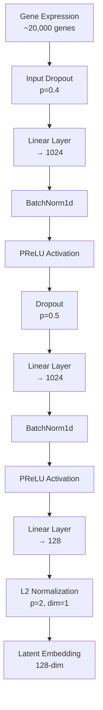

The latent space in SCimilarity is a learned embedding space where high-dimensional gene expression profiles are projected into a lower-dimensional representation that preserves semantic cell-type relationships. This 128-dimensional vector space enables efficient similarity search and cross-study generalization through metric learning techniques.

## Latent Space Architecture

The latent space is constructed through a deep encoder network that maps gene expression vectors (typically ~20,000 genes) to compact 128-dimensional embeddings. The encoder architecture consists of multiple fully-connected layers with batch normalization and dropout regularization:

```python
# Default architecture from nn_models.py
Encoder(
    n_genes=~20000,
    latent_dim=128,
    hidden_dim=[1024, 1024],
    dropout=0.5,
    input_dropout=0.4
)
```

Sources: [nn_models.py](src/scimilarity/nn_models.py#L31-L63)

The encoder processes input through the following transformation pipeline:



The L2 normalization applied in the final layer ensures all embeddings lie on the unit hypersphere, which simplifies similarity calculations using cosine or Euclidean distance. This normalization is critical for consistent distance measurements across the latent space [nn_models.py](src/scimilarity/nn_models.py#L78).

Sources: [nn_models.py](src/scimilarity/nn_models.py#L64-L80)

## Metric Learning and Space Geometry

The latent space is not arbitrarily constructed—it is shaped through metric learning using triplet loss. This optimization technique ensures that cells of the same type cluster together while different types are pushed apart.

The triplet loss operates on triplets of anchor-positive-negative cells:
- **Anchor**: Reference cell
- **Positive**: Same cell type as anchor
- **Negative**: Different cell type from anchor

The loss function minimizes the distance between anchor and positive pairs while ensuring the distance between anchor and negative pairs exceeds a specified margin:

```python
# Triplet margin loss implementation
loss = max(
    distance(anchor, positive) - distance(anchor, negative) + margin,
    0
)
```

Sources: [triplet_selector.py](src/scimilarity/triplet_selector.py#L399-L437)

The key hyperparameter controlling the space geometry is the margin, set at 0.05 by default. This small margin encourages tight clustering of similar cell types while maintaining separation between distinct types:

| Parameter | Default | Purpose | Effect on Latent Space |
|-----------|---------|---------|------------------------|
| margin | 0.05 | Minimum separation for negative pairs | Smaller values create denser clusters, larger values increase separation |
| negative_selection | "semihard" | Strategy for selecting negative samples | Semihard negatives improve training stability |
| sample_across_studies | True | Whether negatives can come from different studies | Enables cross-study generalization |

Sources: [training_models.py](src/scimilarity/training_models.py#L73-L93)

> [!TIP]
> The semihard negative selection strategy is particularly important for latent space quality. Semihard negatives are samples that violate the margin constraint but are not the hardest possible negatives, preventing the model from collapsing to trivial solutions and ensuring robust embeddings that generalize well to unseen cell types.

## Distance Computation and Similarity

SCimilarity uses Euclidean distance as the primary metric for comparing latent space representations. The pairwise distance matrix is computed efficiently using vectorized operations:

```python
distance_matrix = (
    -2 * np.matmul(vectors, np.matrix.transpose(vectors))
    + vectors_squared_sum.reshape(1, -1)
    + vectors_squared_sum.reshape(-1, 1)
)
```

Sources: [triplet_selector.py](src/scimilarity/triplet_selector.py#L201-L220)

Due to L2 normalization of embeddings, Euclidean distance in this space is equivalent to cosine distance (since both vectors lie on the unit sphere). This mathematical property enables flexible similarity search operations:
- Euclidean distance for exact nearest neighbor search
- Cosine similarity for ranking applications
- HNSW indexing for approximate nearest neighbor search at scale

The distance computation supports batch processing for efficiency, enabling similarity search across millions of cells with sub-second response times.

Sources: [cell_search_knn.py](src/scimilarity/cell_search_knn.py#L64-L67)

## Generating Latent Embeddings

The `CellEmbedding` class provides the primary API for projecting gene expression data into the latent space. This class loads a pretrained encoder model and exposes a simple interface for computing embeddings:

```python
from scimilarity import CellEmbedding
from scimilarity.utils import align_dataset, lognorm_counts

# Initialize the embedding model
ce = CellEmbedding(model_path="/path/to/model")

# Align gene order and normalize expression
data = align_dataset(data, ce.gene_order)
data = lognorm_counts(data)

# Compute embeddings for all cells
embeddings = ce.get_embeddings(data.X)
# Returns: numpy.ndarray [num_cells x 128]
```

Sources: [cell_embedding.py](src/scimilarity/cell_embedding.py#L72-L120)

The embedding process supports batched computation with configurable buffer sizes, enabling processing of datasets ranging from thousands to millions of cells without memory constraints:

| Parameter | Default | Description |
|-----------|---------|-------------|
| num_cells | -1 | Number of cells to embed (-1 for all cells) |
| buffer_size | 10000 | Cells processed per batch |

Sources: [cell_embedding.py](src/scimilarity/cell_embedding.py#L72-L120)

The computed embeddings can be used directly for downstream tasks including:
- Similarity search via k-nearest neighbors
- Cell type annotation and classification
- Visualization (after dimensionality reduction)
- Integration across multiple studies

## Semantic Properties and Interpretability

The learned latent space exhibits several important semantic properties that emerge from the metric learning objective:

1. **Cell Type Clustering**: Cells of the same type form tight clusters in the latent space, with centroids representing canonical expression signatures.

2. **Graded Differentiation**: Transitional cell states occupy positions between terminal states, reflecting biological differentiation trajectories.

3. **Cross-Study Consistency**: The space generalizes across studies and experimental platforms, enabling direct comparison without batch correction.

4. **Gene-Level Attribution**: The gradient-based `Interpreter` class can identify which genes contribute most to the position of a cell in the latent space, providing biological interpretability:

```python
from scimilarity import Interpreter

interpreter = Interpreter(ce.model, ce.gene_order)
attributions = interpreter.get_attributions(anchor_cells, negative_cells)
# Returns: gene importance scores for explaining cell differences
```

Sources: [interpreter.py](src/scimilarity/interpreter.py#L1-L100)

The semantic organization of the latent space enables biologically meaningful operations such as identifying similar cell states across tissues, discovering novel cell types based on outlier positions, and characterizing differentiation trajectories through interpolation between cluster centroids.

Sources: [interpreter.py](src/scimilarity/interpreter.py#L44-L76)

## Integration with Model Training

The latent space is not static—it evolves during training as the metric learning objective refines the embedding quality. The training process combines two complementary loss functions:

```python
# Combined loss from training_models.py
triplet_loss = metric_learning_triplet_loss(embeddings, labels, studies)
reconstruction_loss = mse_loss(input, decoder_output)
total_loss = triplet_loss + reconstruction_loss
```

Sources: [training_models.py](src/scimilarity/training_models.py#L207-L293)

| Loss Component | Weight | Purpose |
|---------------|--------|---------|
| Triplet loss | Primary | Shapes latent space geometry for cell-type separation |
| Reconstruction loss | Secondary | Prevents information loss and encourages smooth manifold |

The reconstruction loss ensures the encoder preserves sufficient information about the original gene expression, preventing collapse and maintaining biological interpretability. During training, the model also tracks average silhouette width (ASW) as a quantitative measure of clustering quality.

Sources: [training_models.py](src/scimilarity/training_models.py#L293-L296)

## Latent Space in Production

For production applications, the latent space serves as the foundation for scalable cell search capabilities. The embeddings enable efficient indexing and retrieval using approximate nearest neighbor algorithms:

```python
from scimilarity import CellSearchKNN

# Initialize search model with k-NN index
search = CellSearchKNN(model_path="/path/to/model", knn_type="hnsw")
search.load_knn_index(knn_file="knn_index.hnsw")

# Query for similar cells
neighbors, distances = search.get_nearest_neighbors(query_embeddings, k=50)
```

Sources: [cell_search_knn.py](src/scimilarity/cell_search_knn.py#L6-L67)

The HNSW (Hierarchical Navigable Small World) index provides logarithmic-time search complexity, enabling sub-second similarity search across millions of cells. This capability transforms the latent space from a representation into a functional search engine for biological discovery.

Sources: [cell_search_knn.py](src/scimilarity/cell_search_knn.py#L40-L67)

## Next Steps

Having understood the latent space architecture and properties, you can explore specific applications:

- Learn how to perform efficient similarity searches with [Cell Query API Reference](9-cell-query-api-reference)
- Understand the advanced HNSW indexing for large-scale search in [K-NN Search with HNSW](10-k-nn-search-with-hnsw)
- Explore how the latent space enables cell type classification in [Understanding Cell Type Classification](14-understanding-cell-type-classification)
- Dive deeper into the metric learning methodology in [Metric Learning with Triplet Loss](18-metric-learning-with-triplet-loss)