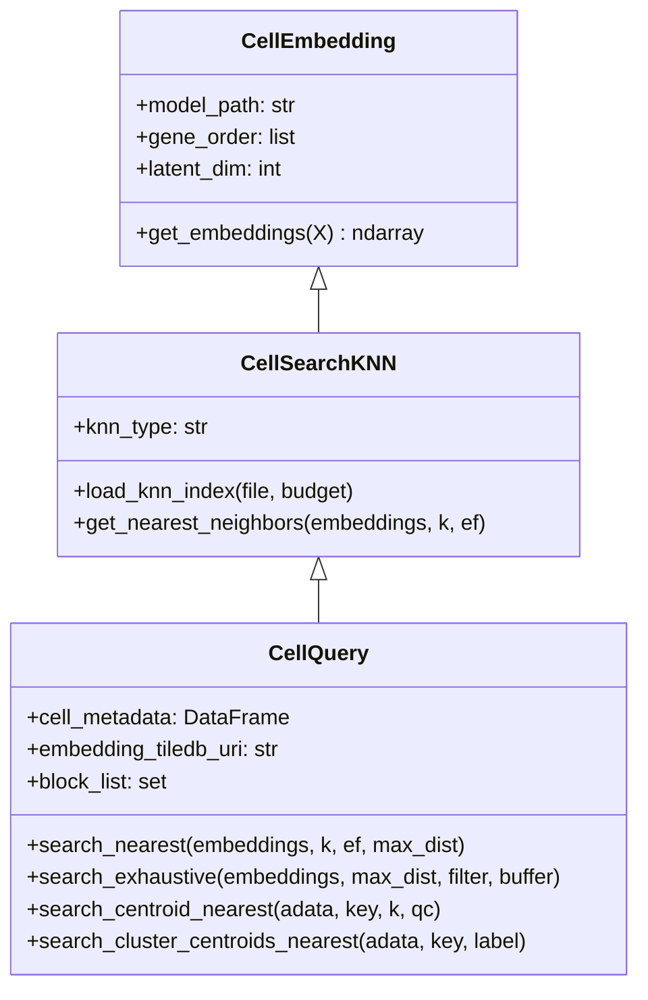
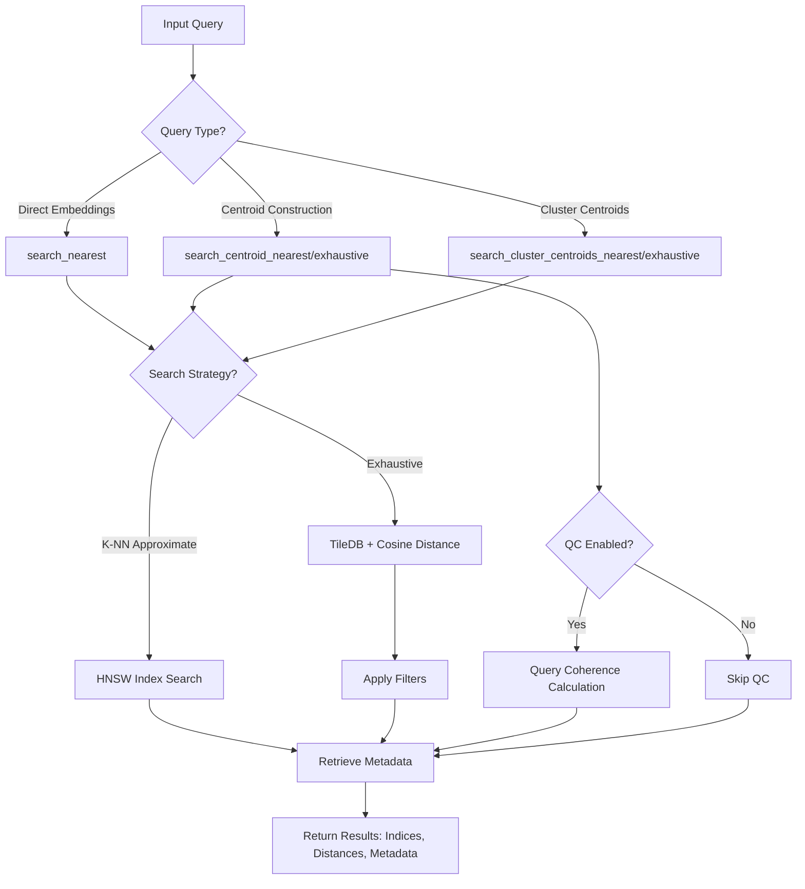

The CellQuery module provides a comprehensive API for performing cell-based similarity searches against large-scale embedding databases. It bridges the gap between individual cell embeddings and sophisticated query patterns, supporting both high-performance approximate K-NN searches and exhaustive searches with precise metadata filtering. This reference documents the complete CellQuery interface, covering initialization, search methodologies, and auxiliary utilities for downstream analysis.

Sources: [cell_query.py](src/scimilarity/cell_query.py), [cell_search_knn.py](src/scimilarity/cell_search_knn.py)

## Architecture Overview

CellQuery operates through a three-layer inheritance hierarchy that progressively adds functionality for cell similarity searches. The base `CellEmbedding` class handles model loading and embedding generation, `CellSearchKNN` manages the HNSW approximate nearest neighbor index, and `CellQuery` provides high-level query orchestration with metadata integration and multiple search strategies.



The search process flows from query preparation through index traversal to result aggregation, with optional quality control checkpoints for centroid-based queries.



Sources: [cell_query.py](src/scimilarity/cell_query.py#L31-L92), [cell_search_knn.py](src/scimilarity/cell_search_knn.py#L23-L39)

## Initialization

The CellQuery constructor establishes the connection to pre-trained models, loads the K-NN index, and initializes metadata access through TileDB arrays. This setup enables efficient querying across millions of cells with minimal runtime overhead.

```python
from scimilarity import CellQuery

cq = CellQuery(
    model_path="/path/to/model",
    use_gpu=False,
    filenames=None,  # Optional: override default filenames
    metadata_tiledb_uri="cell_metadata",
    embedding_tiledb_uri="cell_embedding",
    knn_type="hnswlib",  # Backend for approximate search
    load_knn=True  # Load K-NN index immediately
)
```

### Initialization Parameters

| Parameter | Type | Default | Description |
|-----------|------|---------|-------------|
| `model_path` | `str` | required | Directory containing model files, cellsearch data, and indices |
| `use_gpu` | `bool` | `False` | Enable GPU acceleration for embedding computation |
| `filenames` | `dict` | `None` | Override default filenames for K-NN, metadata, and embeddings |
| `metadata_tiledb_uri` | `str` | `"cell_metadata"` | TileDB URI for metadata storage |
| `embedding_tiledb_uri` | `str` | `"cell_embedding"` | TileDB URI for embedding array |
| `knn_type` | `str` | `"hnswlib"` | K-NN backend implementation |
| `load_knn` | `bool` | `True` | Load K-NN index during initialization |

During initialization, the constructor creates a `cellsearch` subdirectory within the model path, establishes TileDB connections for metadata and embeddings, and builds a `study_sample_index` mapping for efficient sample-level lookups. The `block_list` attribute is initialized as an empty set and can be populated to exclude specific cell types from queries.

Sources: [cell_query.py](src/scimilarity/cell_query.py#L31-L92)

## Core Search Methods

### Direct Embedding Search (K-NN)

The `search_nearest` method performs high-speed approximate nearest neighbor searches using the HNSW (Hierarchical Navigable Small World) algorithm. This approach is optimized for querying large cell databases where sub-millisecond performance per query is required.

```python
nn_idxs, nn_dists, metadata = cq.search_nearest(
    embeddings=query_embeddings,
    k=10000,
    ef=100,  # Dynamically allocated search list size
    max_dist=None  # Optional distance threshold
)
```

The method accepts query embeddings directly, avoiding the need to embed query cells at runtime if embeddings are pre-computed. When `max_dist` is specified, the method automatically expands the search space (`k=1000000`) and post-filters results based on the distance threshold.

> [!TIP]
> The `ef` parameter controls the HNSW algorithm's dynamic list size, trading accuracy for speed. Larger `ef` values improve recall at the cost of increased query time. For production queries, start with `ef=k` and increase if precision requirements are not met.

| Return Value | Type | Description |
|--------------|------|-------------|
| `nn_idxs` | `List[ndarray]` | Neighbor indices for each query embedding |
| `nn_dists` | `List[ndarray]` | Cosine distances to neighbors |
| `metadata` | `DataFrame` | Annotated cell metadata with `embedding_idx` and `query_nn_dist` columns |

Sources: [cell_query.py](src/scimilarity/cell_query.py#L206-L275)

### Direct Embedding Search (Exhaustive)

The `search_exhaustive` method performs brute-force cosine distance calculations against all cells in the database, enabling precise metadata filtering that is not possible with the HNSW index. This approach is slower but provides exact distance calculations and flexible filtering capabilities.

```python
nn_idxs, nn_dists, metadata = cq.search_exhaustive(
    embeddings=query_embeddings,
    max_dist=0.03,  # Cosine distance threshold
    metadata_filter={
        "tissue": "lung",
        "disease": "IPF"
    },
    buffer_size=100000  # Cells processed per batch
)
```

Metadata filtering allows precise targeting of cell populations based on study, tissue, disease, or custom metadata columns. The search processes cells in batches to manage memory usage efficiently, with results aggregated and sorted by distance across batches.

> [!TIP]
> Exhaustive searches scale linearly with database size. For databases exceeding 10 million cells, consider combining K-NN search with metadata post-processing for acceptable performance, or partition the database by metadata attributes.

Sources: [cell_query.py](src/scimilarity/cell_query.py#L475-L560)

## Centroid-Based Queries

### Centroid Search (K-NN)

The `search_centroid_nearest` method constructs a query centroid from marked cells and searches for similar populations. This is ideal for cell type discovery, phenotype matching, and cross-dataset validation studies where the query consists of multiple related cells.

```python
# Mark cells for centroid construction
adata.obs["query_cells"] = (adata.obs["celltype_name"] == "macrophage").astype(int)

centroid_embedding, nn_idxs, nn_dists, metadata, qc_stats = cq.search_centroid_nearest(
    adata=adata,
    centroid_key="query_cells",
    k=10000,
    ef=100,
    max_dist=None,
    qc=True,
    qc_params={"k_clusters": 10},
    random_seed=4
)
```

The quality control (QC) mechanism assesses query coherence by performing k-means clustering on query cell embeddings and measuring overlap between cluster neighbors and the overall query results. A high `query_coherence` score indicates that the query cells form a coherent population in the embedding space.

| Return Value | Type | Description |
|--------------|------|-------------|
| `centroid_embedding` | `ndarray` | Single embedding representing the query centroid |
| `nn_idxs` | `List[ndarray]` | Neighbor indices for the centroid |
| `nn_dists` | `List[ndarray]` | Cosine distances to neighbors |
| `metadata` | `DataFrame` | Annotated cell metadata |
| `qc_stats` | `dict` | Quality control metrics including `query_coherence` |

Sources: [cell_query.py](src/scimilarity/cell_query.py#L277-L376)

### Centroid Search (Exhaustive)

The exhaustive variant of centroid search combines the centroid construction methodology with precise metadata filtering, enabling targeted searches for specific cell populations within defined tissue or disease contexts.

```python
centroid_embedding, nn_idxs, nn_dists, metadata, qc_stats = cq.search_centroid_exhaustive(
    adata=adata,
    centroid_key="query_cells",
    max_dist=0.03,
    metadata_filter={"tissue": "lung"},
    qc=True,
    qc_params={"k_clusters": 10},
    buffer_size=100000,
    random_seed=4
)
```

This method is particularly useful for validating cell type annotations across datasets or discovering similar cell populations under specific experimental conditions.

Sources: [cell_query.py](src/scimilarity/cell_query.py#L561-L653)

## Cluster Centroid Queries

### Cluster Centroids Search (K-NN)

The `search_cluster_centroids_nearest` method computes centroids for all clusters within an AnnData object (or a specific cluster if specified) and performs parallel searches against the database. This approach is ideal for comparing clustering solutions across datasets or identifying cluster matches in reference databases.

```python
centroid_embeddings, cluster_idx, nn_idxs, nn_dists, metadata = cq.search_cluster_centroids_nearest(
    adata=adata,
    cluster_key="leiden",  # Column in adata.obs containing cluster labels
    cluster_label=None,  # None = all clusters, or specify single label
    k=10000,
    ef=100,
    skip_null=True,
    max_dist=None
)
```

The method returns dictionary-structured results keyed by cluster label, enabling per-cluster analysis without manual result partitioning. Centroids are computed as log-normalized means (CPM = 10,000) to ensure consistency with the embedding model's training distribution.

| Return Value | Type | Description |
|--------------|------|-------------|
| `centroid_embeddings` | `ndarray` | Array of cluster centroid embeddings |
| `cluster_idx` | `list` | Cluster labels corresponding to centroid order |
| `nn_idxs` | `Dict[str, ndarray]` | Neighbor indices keyed by cluster label |
| `nn_dists` | `Dict[str, ndarray]` | Distances keyed by cluster label |
| `metadata` | `DataFrame` | Combined metadata with `centroid` column |

Sources: [cell_query.py](src/scimilarity/cell_query.py#L377-L474)

### Cluster Centroids Search (Exhaustive)

The exhaustive cluster centroid search extends the K-NN variant with metadata filtering capabilities, enabling precise comparisons of cluster-specific cell populations across defined experimental conditions.

```python
centroid_embeddings, cluster_idx, nn_idxs, nn_dists, metadata = cq.search_cluster_centroids_exhaustive(
    adata=adata,
    cluster_key="leiden",
    cluster_label=None,
    max_dist=0.03,
    metadata_filter={"disease": "IPF"},
    buffer_size=100000,
    skip_null=True
)
```

This method is particularly valuable for comparative analyses where cluster identities need to be validated against reference datasets with specific metadata constraints.

Sources: [cell_query.py](src/scimilarity/cell_query.py#L654-L744)

## Utility Methods

### Retrieving Precomputed Embeddings

The `get_precomputed_embeddings` method provides efficient access to stored embeddings without requiring model inference, useful for downstream analysis or visualization tasks.

```python
embeddings = cq.get_precomputed_embeddings(idx=[0, 1, 100, 1000])
```

This method reads directly from the TileDB embedding array, avoiding the computational overhead of model inference when embeddings are already available in the database.

Sources: [cell_query.py](src/scimilarity/cell_query.py#L93-L112)

### Annotating Cell Indices

The `annotate_cell_index` method maps global cell indices to sample-specific cell indices, enabling downstream analysis that requires per-sample cell addressing.

```python
metadata = cq.annotate_cell_index(metadata)
```

The input DataFrame must contain `study`, `sample`, `data_type`, and `index` columns. The method adds a `cell_index` column representing the cell number within each sample dataset, distinct from the global obs.index.

Sources: [cell_query.py](src/scimilarity/cell_query.py#L117-L149)

### Compiling Sample Metadata

The `compile_sample_metadata` method aggregates metadata across nearest neighbor results, providing study-level summaries for query interpretation.

```python
sample_metadata = cq.compile_sample_metadata(
    nn_idxs=nn_idxs,
    levels=["study", "sample", "tissue", "disease"]
)
```

This method is particularly useful for understanding the tissue and disease distribution of query results, enabling rapid assessment of query specificity and relevance.

Sources: [cell_query.py](src/scimilarity/cell_query.py#L150-L205)

## Search Method Comparison

| Method | Search Strategy | Metadata Filtering | Use Case | Performance |
|--------|----------------|-------------------|----------|-------------|
| `search_nearest` | HNSW (approximate) | Post-query only | Fast exploratory searches | O(log n) |
| `search_exhaustive` | Brute-force (exact) | Pre-filter + post-filter | Precise targeted searches | O(n) |
| `search_centroid_nearest` | HNSW (approximate) | Post-query only | Cell type discovery | O(log n) + QC overhead |
| `search_centroid_exhaustive` | Brute-force (exact) | Pre-filter + post-filter | Validated cell type queries | O(n) + QC overhead |
| `search_cluster_centroids_nearest` | HNSW (approximate) | Post-query only | Cluster matching | O(c × log n) |
| `search_cluster_centroids_exhaustive` | Brute-force (exact) | Pre-filter + post-filter | Precise cluster comparisons | O(c × n) |

*Note: n = number of cells in database, c = number of clusters*

## Performance Considerations

Memory requirements for CellQuery are dominated by the K-NN index and TileDB array metadata. For the full SCimilarity model (23.4M cells), the K-NN index requires approximately 8GB RAM, while TileDB metadata requires an additional 4-8GB depending on the number of metadata columns.

> [!TIP]
> The `buffer_size` parameter in exhaustive searches controls memory usage during batch processing. For systems with limited RAM, reduce `buffer_size` to 50000 or lower. This increases I/O operations but prevents out-of-memory errors during large database scans.

GPU acceleration via `use_gpu=True` provides significant speedup for embedding computation (approximately 10-20x faster than CPU) but does not accelerate K-NN searches or metadata retrieval. GPU acceleration is most beneficial when computing embeddings for large query datasets or during centroid construction.

Sources: [cell_embedding.py](src/scimilarity/cell_embedding.py#L19-L48)

## Next Steps

For deeper understanding of the search infrastructure, explore the [K-NN Search with HNSW](10-k-nn-search-with-hnsw) documentation, which details the HNSW algorithm implementation and tuning parameters. For applications requiring precise distance calculations with complex filtering requirements, the [Exhaustive Search Methods](11-exhaustive-search-methods) page provides optimization strategies for large-scale database queries. When integrating search results into analytical pipelines, refer to [Metadata Filtering and Query Optimization](12-metadata-filtering-and-query-optimization) for advanced filtering techniques and result aggregation patterns.
