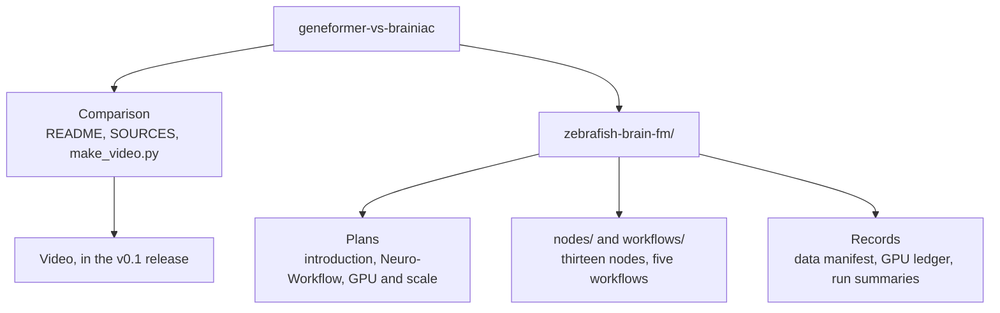

# Geneformer and BrainIAC, side by side

A working comparison of two biomedical foundation models: [Geneformer](https://huggingface.co/ctheodoris/Geneformer), which reads single-cell transcriptomes, and [BrainIAC](https://github.com/AIM-KannLab/BrainIAC), which reads structural brain MRI. It is built from published papers and public code only. It contains no new results.

The comparison also exists as a narrated video of about three minutes. Download it from the [latest release](https://github.com/Kays3/geneformer-vs-brainiac/releases/latest), or rebuild it with the command below.

## The comparison

| | Geneformer | BrainIAC |
|---|---|---|
| Input | The transcriptome of one cell | One structural brain MRI scan, in 3D |
| How the input is encoded | Gene tokens ranked by expression (rank value encoding) | Scan resized to 96 x 96 x 96 voxels, cut into 16-voxel patches |
| Model | Transformer; a cell becomes an embedding (768 numbers in the V2-104M model) | 3D vision transformer: 12 layers, 12 heads, 768 hidden units |
| Pretraining | Self-supervised, on about 30 million single-cell transcriptomes at first and now more than 100 million | Self-supervised contrastive learning (SimCLR); 48,965 brain MRIs for training and validation |
| Adaptation | Zero-shot embeddings; fine-tuning with one task or several; a quantized model for speed | One backbone, one small head per task |
| Tasks shown | Disease state within a cell type; in silico perturbation to rank candidate targets | Brain age, IDH mutation, mild cognitive impairment, glioma overall survival, MR sequence type, time to stroke, tumour segmentation |
| Main claim | Better predictions in network biology when task data are limited; candidate therapeutic targets for cardiomyopathy | Better than supervised training and other pretrained models, most of all in few-shot settings and on hard tasks |
| How it explains itself | In silico perturbation: a shift in the model's embedding of a cell | Saliency maps from attention |
| Unit of explanation | A gene | A brain region |
| Access | Model and code on Hugging Face; a published protocol | Code on GitHub; weights by download link; non-commercial academic research licence |

Sources for every row are in [SOURCES.md](https://github.com/Kays3/geneformer-vs-brainiac/blob/HEAD/SOURCES.md).

## Questions to ask of either model

These are working questions for evaluating a foundation model. They are not findings about Geneformer or BrainIAC.

1. Is the test split by donor or patient, not by cell or scan?
2. Does the classifier fail when the labels are permuted?
3. Do random genes, or random brain regions, score as often as the reported ones?
4. Does a second site or cohort give the same answer?
5. Does the result survive a change of seed, hardware, numeric precision or model size?
6. Were the benchmarks fixed before the run, and are the negative results reported?

## What the comparison cannot say

It is not a head-to-head. The two models share no data, no task and no metric. Neither model was run for it: no BrainIAC or Geneformer result in this repository was produced by the author.

## Next steps

- [ ] Run the BrainIAC quickstart on its public sample data and record what it takes.
- [ ] Try the six questions on one BrainIAC task. Check the BrainIAC licence first.
- [ ] Do the same on public data with Geneformer, starting from [geneformer-petadimension-starter](https://github.com/Kays3/geneformer-petadimension-starter).
- [ ] Choose a licence for this repository. It has none yet.

## What is in this repository



## New project: a zebrafish brain model

[`zebrafish-brain-fm/`](https://github.com/Kays3/geneformer-vs-brainiac/blob/HEAD/zebrafish-brain-fm) starts a model of the larval zebrafish brain that joins single-cell data, brain architecture and functional genomics. It holds the [introduction](https://github.com/Kays3/geneformer-vs-brainiac/blob/HEAD/zebrafish-brain-fm/README.md), the [setup](https://github.com/Kays3/geneformer-vs-brainiac/blob/HEAD/zebrafish-brain-fm/SETUP.md), a plan to build it on [Neuro-Workflow](https://github.com/Kays3/geneformer-vs-brainiac/blob/HEAD/zebrafish-brain-fm/NEURO-WORKFLOW-PLAN.md), a plan for [GPU use and scale](https://github.com/Kays3/geneformer-vs-brainiac/blob/HEAD/zebrafish-brain-fm/GPU-AND-SCALE.md) and a data manifest. Stage 0 is done for the retina: six public single-cell data sets are downloaded and recorded ([RETINA.md](https://github.com/Kays3/geneformer-vs-brainiac/blob/HEAD/zebrafish-brain-fm/RETINA.md)). The first runs on real cells are done. On 10,000 retina nuclei the smallest model came close to a principal-components baseline but did not match it ([STAGE1-RETINA.md](https://github.com/Kays3/geneformer-vs-brainiac/blob/HEAD/zebrafish-brain-fm/STAGE1-RETINA.md)). Geneformer and scGPT, used frozen through an ortholog map, beat both ([STAGE1B-EXTERNAL-MODELS.md](https://github.com/Kays3/geneformer-vs-brainiac/blob/HEAD/zebrafish-brain-fm/STAGE1B-EXTERNAL-MODELS.md)). Every workflow is drawn from its code in [WORKFLOWS.md](https://github.com/Kays3/geneformer-vs-brainiac/blob/HEAD/zebrafish-brain-fm/WORKFLOWS.md).

## Rebuild the video

Needs macOS (for the `say` voice and the Arial font) and [uv](https://docs.astral.sh/uv/).

```bash
uv run --with pillow --with imageio-ffmpeg python make_video.py
```

The slides and the narration are defined in `make_video.py`. The script writes `geneformer-vs-brainiac.mp4`, a silent copy and `narration.txt`.

## Rule for this repository

Public sources only. Unpublished results, lab figures and anything from private repositories stay out.

Kaisar Dauyey, Laboratory of Mathematical Biology, Hokkaido University.
