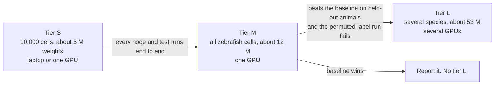
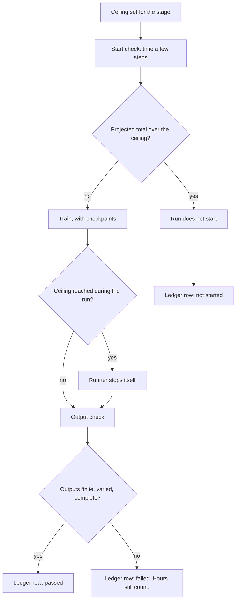

# Plan: GPU use and scale

No timing has been measured. Every figure below is either arithmetic from a stated assumption or a number to be measured. No GPU-hour estimate is given, because none can be defended before a timed run.

## Scale of the data

| Quantity | Value | Basis |
|---|---|---|
| Cells in the two largest atlases | about 710,000 | 220,000 (Raj 2020) + 489,686 (Daniocell) |
| Tokens per cell | up to 2,048 | Assumption: a ranked gene list cut at 2,048 genes |
| Tokens per pass over the data | up to 1.45 billion | 710,000 x 2,048 |
| Gene vocabulary | about 30,000 | Assumption, to be fixed at stage 0 from the genome annotation |
| Stage 3 gene screens | 2,772 | 132 mutated genes, each with 20 matched random genes: 132 x 21 |

Most cells express fewer than 2,048 genes, so the real token count is lower. Measure it at stage 1.

## Model sizes

A transformer layer of width d has about 12 d² weights. The gene embedding adds vocabulary x d.

| Tier | Layers | Width | Layer weights | Embedding | Total |
|---|---|---|---|---|---|
| S | 4 | 128 | 0.8 M | 3.8 M | about 5 M |
| M | 6 | 256 | 4.7 M | 7.7 M | about 12 M |
| L | 12 | 512 | 37.7 M | 15.4 M | about 53 M |

## Tiers

| Tier | Data | Hardware | Purpose | Go on when |
|---|---|---|---|---|
| S | 10,000 cells | Laptop, no GPU | Prove that every node and every test runs end to end | The whole stage 1 workflow passes, baseline included |
| M | All zebrafish cells | One GPU | The first real model | It beats the baseline on held-out animals, and the permuted-label run fails as it should |
| L | Zebrafish plus other species through orthologs | Several GPUs or a cluster | Test whether more data helps | Tier M has passed, and the ortholog map is validated |

With about 710,000 cells, tier L on zebrafish alone is likely to overfit. Tier L is for the cross-species question, not for a larger zebrafish-only model.

## Rules for GPU use

1. **A ceiling first.** Set a GPU-hour ceiling for each stage before its first run. Do not raise it during the stage.
2. **A ledger.** Every GPU run adds a row to [`compute/gpu-ledger.tsv`](https://github.com/Kays3/geneformer-vs-brainiac/blob/HEAD/zebrafish-brain-fm/compute/gpu-ledger.tsv): date, stage, run, hardware, hours, ceiling, output check. Failed runs count.
3. **A start check.** Before a full run, time a short one (for example 200 steps), project the total and print it beside the ceiling. If the projection exceeds the ceiling, the run does not start.
4. **A stop in the runner.** The runner stops itself at the ceiling.
5. **Check before you charge.** Look at the output of a run before recording it as done: outputs are not all zero, not all equal, and of the expected count.
6. **One job at a time** on a GPU, with checkpoints so that a stopped run resumes.
7. **Precision.** Mixed precision is acceptable for training. For gene removal in stage 3, use full precision until a comparison on a sample of genes shows that reduced precision gives the same shifts.
8. **Seeds.** Repeat one training run with a second seed before reading any difference between models.

The path of one GPU run under these rules:

## GPU work inside Neuro-Workflow

- A training node launches the job, waits, and returns the checkpoint path, its sha256 and the hours used. Model weights do not travel through ports.
- The start check is its own node, placed before the training node, so that the graph cannot train without it.
- A ledger node appends the row after the output check node passes.
- The workflow context declares what a run needs. `resource_requirements` with `cpus` and `memory_gb` is in the Neuro-Workflow schema documentation; whether a GPU field is honoured is to be checked.

## To measure before any ceiling is set

- Tokens per cell, from the real data.
- Steps per second for tier S on a laptop and tier M on the chosen GPU.
- Peak memory at the chosen batch size.
- Disk space for raw and tokenized data.
- Seconds per gene screen in stage 3, from three timed screens.

The tiers, the rules and the assumptions are the author's proposal.

## First measurement: the tier S smoke test (15 November 2026)

The smallest model was trained on **synthetic cells**, to check that the nodes run and to get a first timing. The cells are random type profiles plus noise. The result says nothing about zebrafish.

Run it with `uv run python workflows/tier_s_smoke.py --steps 300`. The full record is [`compute/runs/tier-s-smoke-20261115.json`](https://github.com/Kays3/geneformer-vs-brainiac/blob/HEAD/zebrafish-brain-fm/compute/runs/tier-s-smoke-20261115.json).

| Quantity | Value |
|---|---|
| Model | 4 layers, width 128: 4,895,616 weights (the table above says about 5 M) |
| Data | 9,000 training cells, 1,000 held-out cells, 30,000 gene tokens, 2,048 genes per cell |
| Hardware and precision | One NVIDIA GB10, fp32 |
| Steps | 300 of 300, batch of 32 cells |
| Time | 177.9 s: 1.69 steps per second, about 110,500 tokens per second |
| Peak GPU memory | 11.35 GB |
| Held-out loss | 9.916 |
| Baseline: gene frequency | 10.127 |
| Baseline: uniform | 10.309 |

What it shows:

- The model beats both baselines on held-out cells after 300 steps. The margin is small, and the data are synthetic.
- The start check works. The first attempt, at 600 steps, projected 394 s against the 360 s ceiling and did not start. The ceiling was kept and the steps were halved. Both attempts are in the ledger: 0.051 of 0.1 GPU-hours.
- At this speed, one pass over 1.45 billion tokens with the tier S model would take about 3.7 hours on this GPU (1.45 billion / 110,500 per second). This is arithmetic from one short run, on synthetic cells of full length.

What it does not show: anything about real cells, the tier M model, a second seed, or the permuted-label control.

In this test the start check sits inside the training node. The plan above asks for a separate start-check node; that is still to do.

## Second measurement: the tier M model on synthetic cells (15 November 2026)

The tier M sized model was trained on **synthetic cells** to measure speed and memory. It is not the tier M model of the plan, which needs real cells. The result says nothing about zebrafish.

Run it with `uv run python workflows/tier_m_timing.py --steps 2500 --ceiling 60`. The full record is [`compute/runs/tier-m-timing-20261115.json`](https://github.com/Kays3/geneformer-vs-brainiac/blob/HEAD/zebrafish-brain-fm/compute/runs/tier-m-timing-20261115.json).

| Quantity | Tier S smoke test | Tier M timing run |
|---|---|---|
| Model | 4 layers, width 128 | 6 layers, width 256 |
| Weights | 4,895,616 | 12,943,616 |
| Training and held-out cells | 9,000 and 1,000 | 18,000 and 2,000 |
| Steps, batch of 32 | 300 | 2,500 |
| Training time | 177.9 s | 2,876.7 s |
| Steps per second | 1.69 | 0.87 |
| Tokens per second | about 110,500 | about 57,000 |
| Peak GPU memory | 11.35 GB | 14.8 GB |
| Held-out loss | 9.916 | 9.591 |
| Baseline: gene frequency | 10.127 | 10.127 |
| Baseline: uniform | 10.309 | 10.309 |

What it shows:

- The tier M model runs at about half the speed of tier S and needs 14.8 GB at this batch size.
- The start check projected 2,937 s against a 3,600 s ceiling; the run took 2,877 s of training and 48.4 minutes from start to checkpoint.
- One pass over 1.45 billion tokens with the tier M model would take about 7.1 hours on this GPU (1.45 billion / 57,000 per second). This is arithmetic from one run on synthetic cells of full length.
- The stage ceiling was 1.0 GPU-hour. The calibration and this run used 0.818.

The two held-out losses cannot be compared as "tier M is better": the tier M run had eight times the steps and twice the cells. No conclusion about model size follows.

GPU time recorded so far, all on synthetic cells: 0.869 GPU-hours.

## Third measurement: tier S on real retina nuclei (15 November 2026)

The first runs on real cells. The design, benchmarks and results are in [STAGE1-RETINA.md](https://github.com/Kays3/geneformer-vs-brainiac/blob/HEAD/zebrafish-brain-fm/STAGE1-RETINA.md); this section gives only the cost.

| Quantity | Value |
|---|---|
| Model | 4 layers, width 128, 3,315,072 weights (vocabulary of 17,651 genes) |
| Data | 7,731 training and 2,269 held-out nuclei; median of 1,013 gene tokens per training nucleus |
| Steps | 3,000 of 3,000 per seed, batch of 32, two seeds |
| Training time | 987.5 s and 987.7 s: 3.04 steps per second |
| Peak GPU memory | 8.24 GB |
| Start check | Projected 1,087 s and 1,104 s against a 2,700 s ceiling |
| GPU-hours charged | 0.722 of the 2.0 ceiling for stage 1, tiny test included |

These figures cannot be set beside the two runs on synthetic cells. Real nuclei are about half as long, and since stage 1 the training node computes gene logits only at the masked positions, which cuts both time and memory.

## Fourth measurement: two published models, frozen (15 November 2026)

Geneformer V2-104M and scGPT whole-human embedded the same 10,000 nuclei, without training. Results are in [STAGE1B-EXTERNAL-MODELS.md](https://github.com/Kays3/geneformer-vs-brainiac/blob/HEAD/zebrafish-brain-fm/STAGE1B-EXTERNAL-MODELS.md).

| Quantity | Value |
|---|---|
| Geneformer alone, whole workflow | 4.0 minutes |
| Geneformer and scGPT, whole workflow | 6.1 minutes |
| GPU-hours charged, test runs included | 0.239 |
| Stage 1 and 1b together | 0.961 of the 2.0 ceiling |
| Disk for the two environments and weights | about 10.5 GB |

GPU time recorded so far, all stages: 1.830 GPU-hours.
