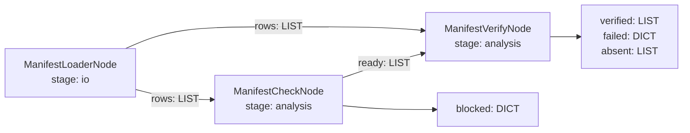
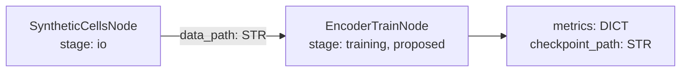
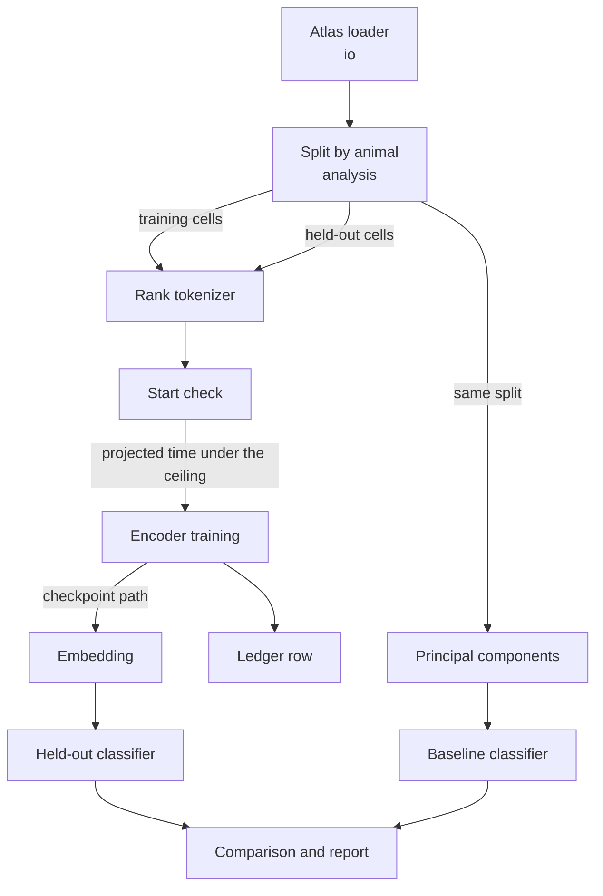

# Plan: Neuro-Workflow as the main architecture

[Neuro-Workflow](https://github.com/oist/neuro-workflow) is a model builder from the Neural Computation Unit at OIST. It organizes brain modelling as a graph of nodes. Each node is a Python class with a schema that states its role, inputs, outputs and parameters, so that people and AI agents can both read and connect it. This plan makes that graph the frame of the zebrafish brain model: every step of every stage is a node, and every stage is a workflow.

Read at commit `3a4b03b6` (14 November 2026). Neuro-Workflow is not yet published; its README asks users to check back for the citation.

## What is checked

Five workflows run, built from the thirteen nodes in [`nodes/`](https://github.com/Kays3/geneformer-vs-brainiac/blob/HEAD/zebrafish-brain-fm/nodes). [WORKFLOWS.md](https://github.com/Kays3/geneformer-vs-brainiac/blob/HEAD/zebrafish-brain-fm/WORKFLOWS.md) draws each one from its code. The fourth, [`workflows/stage1_retina_tier_s.py`](https://github.com/Kays3/geneformer-vs-brainiac/blob/HEAD/zebrafish-brain-fm/workflows/stage1_retina_tier_s.py), is the first on real cells; its graph and results are in [STAGE1-RETINA.md](https://github.com/Kays3/geneformer-vs-brainiac/blob/HEAD/zebrafish-brain-fm/STAGE1-RETINA.md). [nodes/README.md](https://github.com/Kays3/geneformer-vs-brainiac/blob/HEAD/zebrafish-brain-fm/nodes/README.md) is the reference for both.

[`workflows/stage0_inventory.py`](https://github.com/Kays3/geneformer-vs-brainiac/blob/HEAD/zebrafish-brain-fm/workflows/stage0_inventory.py) reads the data manifest, reports which data sets may be used, and verifies their files. On 15 November 2026, with the retina data in place, it reported 6 ready and verified and 10 blocked.

[`workflows/tier_s_smoke.py`](https://github.com/Kays3/geneformer-vs-brainiac/blob/HEAD/zebrafish-brain-fm/workflows/tier_s_smoke.py) trains the smallest model on synthetic cells. It ran on 15 November 2026 on one GPU. [`workflows/tier_m_timing.py`](https://github.com/Kays3/geneformer-vs-brainiac/blob/HEAD/zebrafish-brain-fm/workflows/tier_m_timing.py) is the same graph with the larger model. The numbers of both are in [GPU-AND-SCALE.md](https://github.com/Kays3/geneformer-vs-brainiac/blob/HEAD/zebrafish-brain-fm/GPU-AND-SCALE.md).

Nothing else in this plan has been run.

## Why use it

- **One form for every step.** A loader, a tokenizer, a training run and a null test all become nodes with typed ports. The stages in the [introduction](https://github.com/Kays3/geneformer-vs-brainiac/blob/HEAD/zebrafish-brain-fm/README.md) become graphs that can be read, saved and rerun.
- **Agents can operate it.** The schema carries a description of each node, port and parameter. An agent can assemble a test from nodes without reading their code.
- **The path to simulation.** Neuro-Workflow already runs NEST and TVB as nodes. A zebrafish model built in the same frame can later feed a whole-brain simulation, which is the step a model of expression alone cannot take.

## How the project maps to nodes

Neuro-Workflow's stage list is `io`, `neuron`, `population`, `synapse`, `connectivity`, `stimulus`, `simulation`, `analysis`, `optimization`.

| Project stage | Nodes | Neuro-Workflow stage |
|---|---|---|
| 0 Inventory | Manifest loader, manifest check, manifest verify (all written) | `io`, `analysis` |
| 1 Cell encoder | Atlas loader; rank tokenizer; encoder training; embedding; held-out classifier; baseline classifier | `io`, then see the gap below |
| 2 Cells into the brain | Region atlas loader; marker map loader; region predictor; random marker null | `io`, `analysis` |
| 3 Functional genomics | Mutant map loader; in silico gene removal; region comparison; matched random gene null | `io`, `analysis` |
| 4 Image encoder | Stack loader; 3D encoder training | `io`, then see the gap below |
| Later: simulation | Region wiring from the atlas to a TVB connectome; whole-brain simulation; comparison with measured activity maps | `connectivity`, `simulation`, `analysis` |

The stage 1 workflow, as first planned. The workflow that ran differs: it has no separate start-check or ledger node, and it adds two controls (untrained weights, permuted labels). See [STAGE1-RETINA.md](https://github.com/Kays3/geneformer-vs-brainiac/blob/HEAD/zebrafish-brain-fm/STAGE1-RETINA.md) for the graph as run. The result branch and the baseline branch read the same held-out split, so the comparison is part of the graph.

## Gaps to settle first

1. **No stage for machine learning.** Tokenizing, pretraining and fine-tuning match none of the nine stages. The node guide allows a new stage to be proposed. Decide the names (for example `representation` and `training`) and ask the Neuro-Workflow maintainers before many nodes exist. The smoke-test training node already uses `stage="training"`; the library ran it without complaint, but the name is not agreed.
2. **Long GPU runs inside a node are little tried here.** The longest so far lasted 48 minutes and ran detached without trouble. The library describes itself as an in-memory workflow library. A training node should launch and watch a job and return a path to a checkpoint. It should not hold the model in a port. See [GPU-AND-SCALE.md](https://github.com/Kays3/geneformer-vs-brainiac/blob/HEAD/zebrafish-brain-fm/GPU-AND-SCALE.md).
3. **Large data on ports.** Ports carry Python objects. Atlases of hundreds of thousands of cells should pass as file paths with a sha256, not as arrays.
4. **Licence.** Neuro-Workflow is under PolyForm Noncommercial 1.0.0. This project depends on it as an installed package and copies none of its code. Choose this repository's own licence with that in mind.
5. **Where nodes live.** Nodes stay in this repository's `nodes/` folder. Offering them to the Neuro-Workflow node library is a later, separate decision.

## Node rules for this project

- One node is one scientific operation.
- `type` starts with `zfbrain_`. `model_source` points to the paper or repository behind the node.
- Every description is written for a reader who cannot see the code.
- Every node that produces a result has a partner node that produces its null or baseline, and the workflow connects both.
- Each method returns a dictionary whose keys are the names of its output ports.

## Order of work

1. Settle gaps 1 and 4.
2. Stage 0 is done for six retina data sets ([RETINA.md](https://github.com/Kays3/geneformer-vs-brainiac/blob/HEAD/zebrafish-brain-fm/RETINA.md)). Ten sources remain blocked in the manifest.
3. Done: the stage 1 nodes and a tier S run on 10,000 real retina nuclei of one data set. The baseline won ([STAGE1-RETINA.md](https://github.com/Kays3/geneformer-vs-brainiac/blob/HEAD/zebrafish-brain-fm/STAGE1-RETINA.md)).
4. Done: Geneformer and scGPT on the same test, each run in its own environment through one node ([STAGE1B-EXTERNAL-MODELS.md](https://github.com/Kays3/geneformer-vs-brainiac/blob/HEAD/zebrafish-brain-fm/STAGE1B-EXTERNAL-MODELS.md)). Both beat the baseline.
4a. Write the gene identifier map node: the six retina data sets use four kinds of identifier. A test on labels from a second study needs it.
5. Rerun stage 1 on all 137,490 nuclei, with the benchmarks unchanged.

## Sources

- Neuro-Workflow repository, README, `NODE_SCHEMA.md` and `NODE_CREATION_GUIDE.md`: <https://github.com/oist/neuro-workflow>
- Gutierrez et al. A spiking neural network builder for systematic data-to-model workflow. *Frontiers in Neuroinformatics* (2022). [doi:10.3389/fninf.2022.855765](https://doi.org/10.3389/fninf.2022.855765) (the first-generation builder that the README names)

The mapping, the gaps and the rules are the author's proposal.
