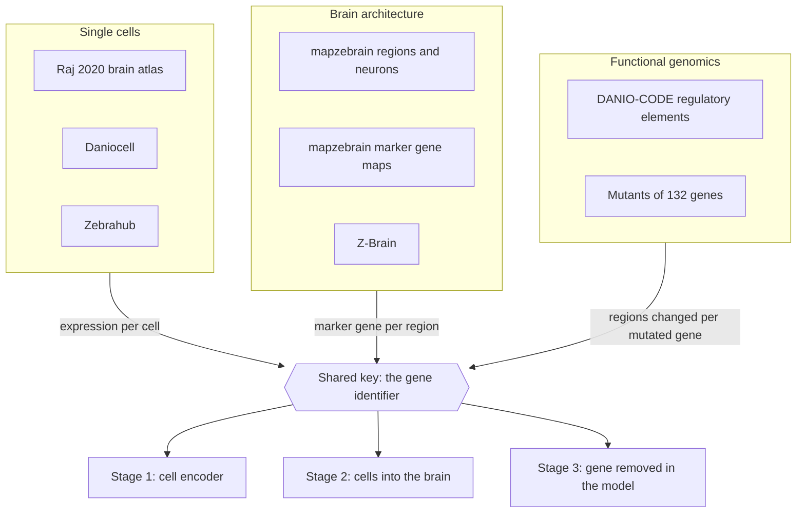
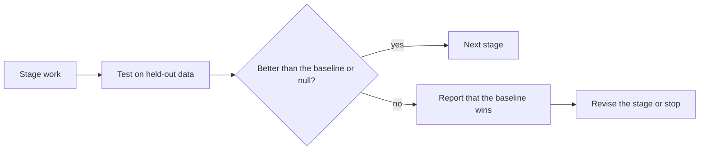

# A foundation model of the zebrafish brain: introduction

This folder starts a new project: one model of the larval zebrafish brain that joins three kinds of public data.

1. **Single cells.** What each cell expresses.
2. **Brain architecture.** Where cells sit, and how regions are wired.
3. **Functional genomics.** What regulates a gene, and what happens to the brain when the gene is removed.

Web page of this introduction: <https://claude.ai/artifact/4hozJekQgTHWnEeZTGN9VC> (private until shared; the source is `artifact/intro.html`).

**Status: two published models, used as they are, beat both the baseline and this project's own small model.** On 10,000 real retina nuclei, tested on held-out samples, cell type is predicted with macro F1 0.894 from scGPT and 0.879 from Geneformer, both trained on human cells only, against 0.853 for principal components and 0.81 to 0.83 for the tier S model trained here (see [STAGE1-RETINA.md](https://github.com/Kays3/geneformer-vs-brainiac/blob/HEAD/zebrafish-brain-fm/STAGE1-RETINA.md) and [STAGE1B-EXTERNAL-MODELS.md](https://github.com/Kays3/geneformer-vs-brainiac/blob/HEAD/zebrafish-brain-fm/STAGE1B-EXTERNAL-MODELS.md)). Stage 0 is done for six retina data sets (see [RETINA.md](https://github.com/Kays3/geneformer-vs-brainiac/blob/HEAD/zebrafish-brain-fm/RETINA.md)). Earlier runs on synthetic cells tested the code and measured speed (see [GPU-AND-SCALE.md](https://github.com/Kays3/geneformer-vs-brainiac/blob/HEAD/zebrafish-brain-fm/GPU-AND-SCALE.md)).

## Interactive retina simulation

[Open the zebrafish retinal patch viewer](https://github.com/Kays3/geneformer-vs-brainiac/blob/HEAD/zebrafish-brain-fm/retina-simulation/index.html) to compare wild-type activity with a simulated *synj1* perturbation. See the [simulation notes](https://github.com/Kays3/geneformer-vs-brainiac/blob/HEAD/zebrafish-brain-fm/retina-simulation/README.md) for the model assumptions and the GPU sweep.

## Documents

| Read | For |
|---|---|
| This page | The idea, the data sources, the stages and their tests |
| [RETINA.md](https://github.com/Kays3/geneformer-vs-brainiac/blob/HEAD/zebrafish-brain-fm/RETINA.md) | Stage 0 for the retina: the six data sets that are ready, and what the inventory found |
| [STAGE1-RETINA.md](https://github.com/Kays3/geneformer-vs-brainiac/blob/HEAD/zebrafish-brain-fm/STAGE1-RETINA.md) | The first run on real cells: design and benchmarks fixed before the run, then the results |
| [STAGE1B-EXTERNAL-MODELS.md](https://github.com/Kays3/geneformer-vs-brainiac/blob/HEAD/zebrafish-brain-fm/STAGE1B-EXTERNAL-MODELS.md) | Geneformer and scGPT on the same test: benchmarks fixed before the run, then the results |
| [WORKFLOWS.md](https://github.com/Kays3/geneformer-vs-brainiac/blob/HEAD/zebrafish-brain-fm/WORKFLOWS.md) | Every workflow as a diagram, generated from the code |
| [SETUP.md](https://github.com/Kays3/geneformer-vs-brainiac/blob/HEAD/zebrafish-brain-fm/SETUP.md) | Installing, the first commands, working across machines |
| [NEURO-WORKFLOW-PLAN.md](https://github.com/Kays3/geneformer-vs-brainiac/blob/HEAD/zebrafish-brain-fm/NEURO-WORKFLOW-PLAN.md) | The architecture: every step a schema-defined node |
| [nodes/README.md](https://github.com/Kays3/geneformer-vs-brainiac/blob/HEAD/zebrafish-brain-fm/nodes/README.md) | Reference for each node and workflow that exists now |
| [GPU-AND-SCALE.md](https://github.com/Kays3/geneformer-vs-brainiac/blob/HEAD/zebrafish-brain-fm/GPU-AND-SCALE.md) | Model sizes, the three tiers, GPU rules, the first measurement |
| [data/MANIFEST.tsv](https://github.com/Kays3/geneformer-vs-brainiac/blob/HEAD/zebrafish-brain-fm/data/MANIFEST.tsv) | One row per data set: path, sha256, licence |
| [compute/gpu-ledger.tsv](https://github.com/Kays3/geneformer-vs-brainiac/blob/HEAD/zebrafish-brain-fm/compute/gpu-ledger.tsv) | One row per GPU run |

## The idea in one paragraph

The three kinds of data do not share cells or animals. They share **genes**. A single-cell atlas gives the expression of each gene in each cell. A brain atlas gives maps of marker genes in each region. A mutant collection gives, for each gene, the brain regions that change when the gene is lost. So the gene identifier is the key that joins the layers, and the model is built and tested around that key.

## The three layers and their public sources

| Layer | Source | What it gives |
|---|---|---|
| Single cells | Raj et al. 2020 | About 220,000 zebrafish brain cells, 12 stages from embryo to larva, about 800 clusters |
| Single cells | Daniocell (Sur et al. 2023) | 489,686 cells of the whole animal, 62 stages, 3 to 120 hours post-fertilization |
| Single cells | Zebrahub (Lange et al. 2024) | Single embryos sequenced at ten stages, with light-sheet lineage reconstructions |
| Architecture | mapzebrain (Kunst et al. 2019) | Reference brain at 6 days post-fertilization, over 2,000 traced neurons, 72 regions, over 100 transgene patterns |
| Architecture | mapzebrain gene expression (Shainer et al. 2023) | Maps of marker genes across the larval brain, registered to the same reference |
| Architecture and activity | Z-Brain (Randlett et al. 2015) | Region definitions and whole-brain activity maps |
| Functional genomics | DANIO-CODE (Baranasic et al. 2022) | 1,802 genomic data sets, over 140,000 cis-regulatory elements across development |
| Functional genomics | Thyme et al. 2019 | Mutants of 132 genes, each with whole-brain activity maps, structural differences and behaviour |

"Functional genomics" is read here as regulatory annotation plus mutant phenotypes. Change this table if you mean something else, for example functional imaging alone.

## Why this is hard, stated first

- **Scale.** The two largest atlases here hold about 710,000 cells together. Geneformer was pretrained on about 30 million and later more than 100 million. A model trained on zebrafish alone will be small. Whether it deserves the name "foundation model" is a question for the tests below, not an assumption.
- **Stage mismatch.** Daniocell ends at 120 hours. The mapzebrain reference is at 6 days. Cells and atlas must be matched by stage, or the mismatch must be measured.
- **No shared cells.** No cell has both a transcriptome and a position. Every link from a cell to a region is an inference through marker genes.
- **Gene identifiers.** Zebrafish has many duplicated genes. Reusing a model trained on human cells needs an ortholog map, and that map is many-to-many.
- **Licences.** The reuse terms of each source are not checked yet. That is stage 0.

## Stages

Each stage has a simple baseline. If the baseline wins, the stage reports that.

| Stage | Work | Test | Baseline or null |
|---|---|---|---|
| 0 | Inventory: download terms, file formats, genome build, gene identifiers. Record each data set in `data/MANIFEST.tsv`. Done for six retina data sets ([RETINA.md](https://github.com/Kays3/geneformer-vs-brainiac/blob/HEAD/zebrafish-brain-fm/RETINA.md)) | None | None |
| 1 | Cell encoder: genes ranked by expression in each cell, read by a small transformer | Cell type and stage on held-out animals and held-out data sets | Principal components with a linear classifier |
| 2 | Cells into the brain: predict the region of a cell from its expression, through the marker gene maps | Regions of cell types with known positions | Random marker sets of the same size |
| 3 | Functional genomics: remove a gene in the model and predict which regions change | The 132 mutants: predicted regions against the measured maps | Expression-matched random genes |
| 4 | Image encoder for registered brain stacks, in the manner of BrainIAC | To be set after stage 2 | To be set |

Every stage passes the same gate before the next one starts:

Stage 3 is the reason to combine the layers. The mutant collection is a set of measured answers, so an in silico perturbation can be scored against an experiment and against random genes.

## Evaluation rules

The six questions in the [repository README](https://github.com/Kays3/geneformer-vs-brainiac/blob/HEAD/README.md) apply here from the first run: split by animal, permute the labels, compare with random genes and random regions, repeat on a second data set, repeat across seed and precision, and fix the benchmarks before the run.

## Open decisions

- Retina first is now the working scope. Whether the brain-wide sources in the table above follow, and when, is open.

- Train from scratch on zebrafish, adapt a model trained on other species through orthologs, or do both and compare. Stage 1b is evidence for adapting: two human-trained models, frozen and fed through an ortholog map, are ahead of the model trained here.
- One larval stage only (6 days), or development as well.
- Which reference space is the standard: mapzebrain or Z-Brain.
- Where training runs. The laptop is for writing and small checks only.

## Sources

Article details are from PubMed, read on 15 November 2026.

- Raj B, et al. Emergence of neuronal diversity during vertebrate brain development. *Neuron* 108, 1058-1074 (2020). [doi:10.1016/j.neuron.2020.09.023](https://doi.org/10.1016/j.neuron.2020.09.023)
- Sur A, et al. Single-cell analysis of shared signatures and transcriptional diversity during zebrafish development. *Developmental Cell* 58, 3028-3047 (2023). [doi:10.1016/j.devcel.2023.11.001](https://doi.org/10.1016/j.devcel.2023.11.001)
- Lange M, et al. A multimodal zebrafish developmental atlas reveals the state-transition dynamics of late-vertebrate pluripotent axial progenitors. *Cell* 187, 6742-6759 (2024). [doi:10.1016/j.cell.2024.09.047](https://doi.org/10.1016/j.cell.2024.09.047)
- Kunst M, et al. A cellular-resolution atlas of the larval zebrafish brain. *Neuron* 103, 21-38 (2019). [doi:10.1016/j.neuron.2019.04.034](https://doi.org/10.1016/j.neuron.2019.04.034)
- Shainer I, et al. A single-cell resolution gene expression atlas of the larval zebrafish brain. *Science Advances* 9, eade9909 (2023). [doi:10.1126/sciadv.ade9909](https://doi.org/10.1126/sciadv.ade9909)
- Randlett O, et al. Whole-brain activity mapping onto a zebrafish brain atlas. *Nature Methods* 12, 1039-1046 (2015). [doi:10.1038/nmeth.3581](https://doi.org/10.1038/nmeth.3581)
- Baranasic D, et al. Multiomic atlas with functional stratification and developmental dynamics of zebrafish cis-regulatory elements. *Nature Genetics* 54, 1037-1050 (2022). [doi:10.1038/s41588-022-01089-w](https://doi.org/10.1038/s41588-022-01089-w)
- Thyme SB, et al. Phenotypic landscape of schizophrenia-associated genes defines candidates and their shared functions. *Cell* 177, 478-491 (2019). [doi:10.1016/j.cell.2019.01.048](https://doi.org/10.1016/j.cell.2019.01.048)
- Geneformer and BrainIAC: see [../SOURCES.md](https://github.com/Kays3/geneformer-vs-brainiac/blob/HEAD/SOURCES.md).

The plan, the stages and the tests are the author's own proposal. They are not taken from these papers.
