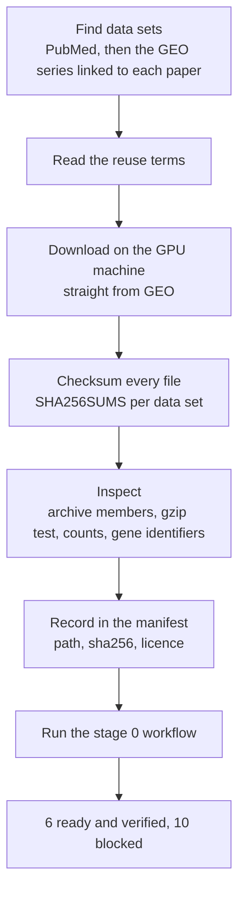

# Stage 0 for the zebrafish retina

The project starts with the retina. Stage 0 is done for six public single-cell data sets: each is downloaded, checksummed, inspected and recorded in [`data/MANIFEST.tsv`](https://github.com/Kays3/geneformer-vs-brainiac/blob/HEAD/zebrafish-brain-fm/data/MANIFEST.tsv). One of them, the Lyu 2023 set, has been used for the first run on real cells ([STAGE1-RETINA.md](https://github.com/Kays3/geneformer-vs-brainiac/blob/HEAD/zebrafish-brain-fm/STAGE1-RETINA.md)). The other five have not been used.

Done on 15 November 2026. Article details are from PubMed; accessions, file names and sizes are from NCBI GEO; the counts below were read from the downloaded files.

## Why the retina first

- Its cell classes are few and well defined: photoreceptors, horizontal cells, bipolar cells, amacrine cells, retinal ganglion cells and Müller glia. That gives stage 1 a clear test.
- One study covers all three layers of this project for one cell class. Kölsch et al. 2021 classified retinal ganglion cells by single-cell transcriptomics, related the types to dendrite shape and to axon projections into the brain, measured their tuning by calcium imaging, and removed one group of types to test behaviour.
- The retina has paired RNA and chromatin data from the same study (Lyu et al. 2023), which is the functional genomics layer.

## What is ready

All six came from NCBI GEO. The files sit under `data/raw/<accession>/` on the GPU machine, outside git.

| Data set | Accession | Cells or barcodes | Genes | Gene identifiers | Size |
|---|---|---|---|---|---|
| Xu 2020, retina development | GSE122680 | 35,791 in 8 samples | 28,951 | Ensembl ids | 176 MB |
| Celotto 2023, regeneration | GSE226373 | 24,604 in 5 samples | 27,691 | Ensembl ids, GRCz11 Ensembl 95 | 39 MB |
| Kölsch 2021, ganglion cells | GSE152842 | 48,588 adult and 12,698 larval | 24,105 | Upper-case symbols | 78 MB |
| Hahn 2023, retina atlas (zebrafish part) | GSE237214 | 150,535 | 25,233 | Upper-case symbols | 132 MB |
| Ogawa 2021, adult photoreceptors | GSE175929 | 12,833 in 1 sample | 37,375 | Lawson Lab ids, with their GTF | 496 MB |
| Lyu 2023, injury, single-nucleus RNA | GSE239410 | 137,490 | 32,520 | Ensembl ids; cell type labels included | 454 MB |

Together: 422,539 cells or barcodes, 1.4 GB.

These are the numbers in the deposited files. No quality filter has been applied here, and some files may hold unfiltered barcodes: Xu et al. report about 20,000 cells in their abstract, and their files hold 35,791 barcodes.

## How stage 0 was done



The `sha256` column of the manifest is the sha256 of the data set's `SHA256SUMS` file, which lists the sha256 of every file in the folder. The workflow recomputes all of them:

```bash
uv run python workflows/stage0_inventory.py
```

## Reuse terms

The licence recorded for the six is NCBI's general policy, read on 15 November 2026 at <https://www.ncbi.nlm.nih.gov/home/about/policies/>: NCBI places no restrictions on the use or distribution of the data, and does not accept data whose submitter asked for restrictions on reuse or redistribution; some submitters may still claim rights in the data.

This is a database policy, not a licence granted by each study. The data statement of each paper has not been read. Read them before any redistribution of the data or of anything derived from it, and cite each paper.

## What stage 0 found that changes the plan

1. **Four kinds of gene identifier.** Three data sets use Ensembl ids, two use upper-case symbols without ids, and one uses Lawson Lab ids with its own annotation file. Whether the upper-case symbols are zebrafish symbols in capitals or orthologue names is not checked. A gene identifier map is the first task of stage 1; without it the data sets cannot share a vocabulary.
2. **Gene counts differ**, from 24,105 to 37,375, so the annotations differ too.
3. **Stages and conditions differ.** Development, adult, larva, injury and regeneration are all present. A split by data set is also a split by condition.
4. **Formats differ.** Sparse matrices, one HDF5 file, and dense tables of up to 150,535 columns that need care with memory.
5. **Animals are not identified in every file.** Samples are; the split by animal that the plan asks for needs the sample sheets from GEO.

## Not done

| Item | Why |
|---|---|
| Lyu 2023 single-nucleus ATAC (GSE239410, 2.1 GB) | Functional genomics layer; listed in the manifest, not downloaded |
| Hoang 2020 Müller glia RNA and ATAC (GSE135406, 173 MB) | Zebrafish and mouse, bulk; listed, not downloaded |
| Raj 2020 retina objects (in GSE158142) | The series is large; listed, not downloaded |
| Hellevik 2024 bipolar cells | No GEO series is linked to the paper in PubMed; the source was not traced |
| Retinal architecture data | The projection and tuning data of Kölsch et al. are not in the GEO series; their location was not traced |
| Per-paper data statements | Not read |
| Quality filtering, gene map, any model | Stage 1 |

## Sources

- Xu B, et al. Unifying developmental programs for embryonic and postembryonic neurogenesis in the zebrafish retina. *Development* 147 (2020). [doi:10.1242/dev.185660](https://doi.org/10.1242/dev.185660)
- Celotto L, et al. Single-cell RNA sequencing unravels the transcriptional network underlying zebrafish retina regeneration. *eLife* 12 (2023). [doi:10.7554/eLife.86507](https://doi.org/10.7554/eLife.86507)
- Kölsch Y, et al. Molecular classification of zebrafish retinal ganglion cells links genes to cell types to behavior. *Neuron* 109, 645-662 (2021). [doi:10.1016/j.neuron.2020.12.003](https://doi.org/10.1016/j.neuron.2020.12.003)
- Hahn J, et al. Evolution of neuronal cell classes and types in the vertebrate retina. *Nature* 624, 415-424 (2023). [doi:10.1038/s41586-023-06638-9](https://doi.org/10.1038/s41586-023-06638-9)
- Ogawa Y, Corbo JC. Partitioning of gene expression among zebrafish photoreceptor subtypes. *Scientific Reports* 11, 17340 (2021). [doi:10.1038/s41598-021-96837-z](https://doi.org/10.1038/s41598-021-96837-z)
- Lyu P, et al. Common and divergent gene regulatory networks control injury-induced and developmental neurogenesis in zebrafish retina. *Nature Communications* 14, 8477 (2023). [doi:10.1038/s41467-023-44142-w](https://doi.org/10.1038/s41467-023-44142-w)
- Hoang T, et al. Gene regulatory networks controlling vertebrate retinal regeneration. *Science* 370 (2020). [doi:10.1126/science.abb8598](https://doi.org/10.1126/science.abb8598)
