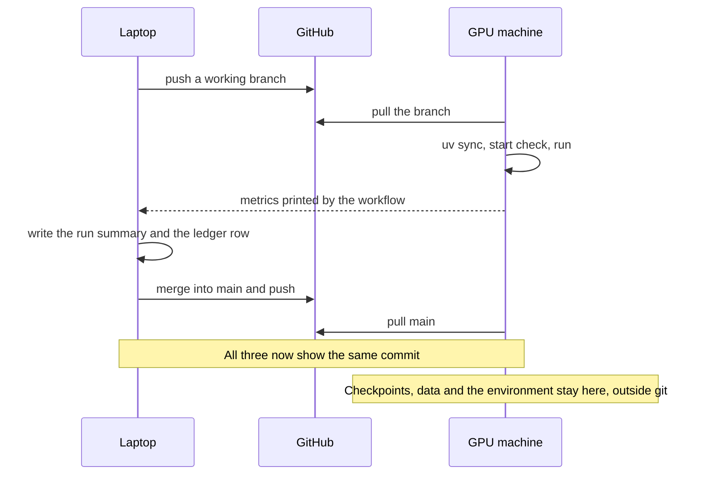

# Setup

What is checked, on 15 November 2026 on a Linux aarch64 GPU machine, from a fresh clone at commit `464fd11`: `uv sync` completes (about 26 seconds, 6.2 GB environment), `scanpy` 1.12.6 and `torch` 2.15.0 import, `torch` sees the GPU, and the stage 0 workflow runs. With the retina data in place it reports 6 ready and verified and 10 blocked; on a machine without the data it reports the 6 as not on this machine. Downloading data and training are untested. On macOS only the dependency resolution was checked.

## 1. Environment

Needs [uv](https://docs.astral.sh/uv/) and Python 3.11 or later.

```bash
git clone https://github.com/Kays3/geneformer-vs-brainiac.git
cd geneformer-vs-brainiac/zebrafish-brain-fm
uv sync
uv run python -c "import scanpy, torch; print(scanpy.__version__, torch.__version__)"
```

Then run the first workflow. It reads the manifest, lists the data sets that may be used, and checks the files of those that are on this machine against their checksums:

```bash
uv run python workflows/stage0_inventory.py
```

The smallest model can be trained on synthetic cells as a smoke test. It took about three minutes on one GPU; `--tiny` takes seconds on any machine:

```bash
uv run python workflows/tier_s_smoke.py --tiny
uv run python workflows/tier_s_smoke.py --steps 300
```

`neuroworkflow` is installed from its GitHub repository, which is large; the first install can be slow. The other packages are `anndata` and `scanpy` for single-cell tables, `torch` and `transformers` for the model, and `datasets` for tokenized cells. Image packages come with stage 4.

## 2. Folders

```
zebrafish-brain-fm/
  README.md          introduction and plan
  SETUP.md           this file
  pyproject.toml     dependencies
  uv.lock            resolved versions
  NEURO-WORKFLOW-PLAN.md  the node architecture
  GPU-AND-SCALE.md   tiers, model sizes, GPU rules
  nodes/             Neuro-Workflow nodes of this project, with a reference README
  workflows/         one script per workflow
  compute/gpu-ledger.tsv  one row per GPU run
  STAGE1-RETINA.md   the first run on real cells: benchmarks, then results
  STAGE1B-EXTERNAL-MODELS.md  Geneformer and scGPT on the same test
  WORKFLOWS.md       every workflow as a diagram, generated from the code
  tools/draw_workflows.py     writes WORKFLOWS.md
  external/geneformer/, external/scgpt/   one environment per published model: setup.sh, embed.py
  compute/runs/      one summary per GPU run
  runs/              checkpoints and full metrics (not in git)
  data/MANIFEST.tsv  one row per data set: source, path, sha256, licence
  data/raw/          downloads (not in git)
  data/derived/      tokenized cells, region tables (not in git)
  artifact/          the introduction as a web page
```

Add `tests/` with the first node that computes something.

## 3. Data rule

No data in git. Each data set gets a folder `data/raw/<accession>/` with a `SHA256SUMS` file that lists every file in it. The manifest records the folder, the sha256 of that `SHA256SUMS` file, and the licence:

```bash
cd data/raw/<accession>
sha256sum * > SHA256SUMS      # run before SHA256SUMS exists, or exclude it
sha256sum SHA256SUMS          # this value goes in the manifest
```

A data set with an empty licence cell is not used.

## 4. Stage 0 checklist

- [x] Retina: six single-cell data sets downloaded, checksummed and recorded, with NCBI's general reuse policy as the licence ([RETINA.md](https://github.com/Kays3/geneformer-vs-brainiac/blob/HEAD/zebrafish-brain-fm/RETINA.md)).
- [ ] Read the data statement of each retina paper.
- [ ] Read the download and reuse terms of the ten sources still blocked in the manifest.
- [ ] Fix the genome build and the gene identifier set for the whole project. The six retina data sets use four kinds of identifier.
- [ ] Choose the reference brain space.
- [ ] Choose the larval stage or stages.
- [ ] Write the stage 1 test and its baseline before any training.
- [ ] Decide where training runs, and how much compute stage 1 may use.

## 4a. Published models

Each published model has its own environment, because their requirements conflict with the project's. Run each setup once on the GPU machine:

```bash
bash external/geneformer/setup.sh   # Geneformer at a pinned commit, V2-104M weights, about 3.7 GB
bash external/scgpt/setup.sh        # scGPT from its main branch, whole-human checkpoint, about 6.8 GB
uv run python workflows/stage1b_retina_external.py --with-scgpt
```

Both ran on 15 November 2026 on a Linux aarch64 GPU machine. scGPT is installed from its main branch and is not pinned to a commit; pin it before relying on a rerun.

After changing a workflow, redraw the diagrams:

```bash
uv run python tools/draw_workflows.py
```

## 5. Working across machines

Code moves through git only. Large files stay on the machine that made them.



- Write and review on the laptop. Do not run `uv sync` or `uv run` there unless you want the full environment on it: the install includes PyTorch and a large clone of Neuro-Workflow.
- Run on the GPU machine from a clean clone, so that the commit in the run summary is the code that ran.
- A run summary in `compute/runs/` carries the commit, the command and the first 16 characters of the checkpoint's sha256. That is the link between git and the files that are not in git.
- After a run, check that all three copies agree: `git status -sb` and `git log --oneline -1` on each.

| In git | Not in git |
|---|---|
| Code, plans, the manifest, the ledger, run summaries | `data/raw/`, `data/derived/`, `runs/` (checkpoints and full metrics), `.venv/` |

## 6. Hardware

Stage 0 and small checks run on a laptop. Model training needs a GPU machine. The compute for stage 1 is not estimated yet. [GPU-AND-SCALE.md](https://github.com/Kays3/geneformer-vs-brainiac/blob/HEAD/zebrafish-brain-fm/GPU-AND-SCALE.md) gives the tiers and the rules, including the timed start check before any full run.
