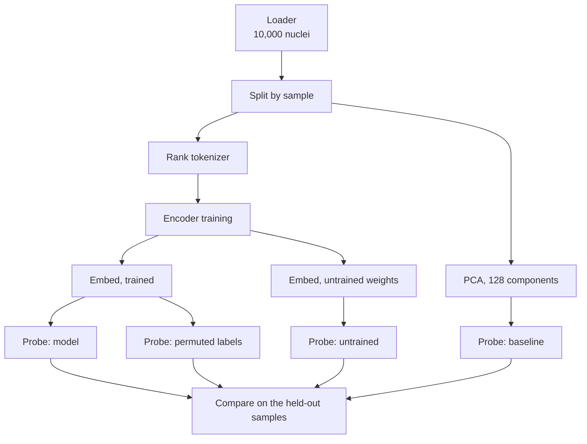

# Stage 1 on real retina cells: design and benchmarks

Written on 15 November 2026, **before the first run on real cells**. The results section at the end is added afterwards and does not change anything above it.

## The question

Does the smallest model (tier S: 4 layers, width 128), trained by masked-gene prediction on real retina nuclei, give cell representations that predict cell type on held-out samples at least as well as a simple baseline?

## Data

GSE239410, single-nucleus RNA of the zebrafish retina after injury (Lyu et al. 2023, [doi:10.1038/s41467-023-44142-w](https://doi.org/10.1038/s41467-023-44142-w)). The deposited file holds 137,490 nuclei in 13 samples (one control; light damage and NMDA damage at six time points each) and 14 cell type labels. The article is published under CC BY 4.0; the licence recorded for the data is NCBI's general policy ([RETINA.md](https://github.com/Kays3/geneformer-vs-brainiac/blob/HEAD/zebrafish-brain-fm/RETINA.md)).

One data set only, so no gene identifier map is needed yet.

## Design

| Choice | Value | Fixed by |
|---|---|---|
| Cells | 10,000 nuclei drawn at random from all 137,490 | seed 0 |
| Split | By sample: 3 of the 13 samples held out (20%, rounded), drawn from the sorted sample names | seed 0 |
| Tokens | Genes ranked by counts scaled to 10,000 per nucleus and divided by the gene's median non-zero value in the training nuclei; up to 2,048 genes | training nuclei only |
| Vocabulary | Genes seen in at least 3 training nuclei | training nuclei only |
| Model | 4 layers, width 128, 4 heads; 15% of genes masked; AdamW at 0.001; batch of 32; full precision | |
| Training | 3,000 steps, model seeds 0 and 1 | |
| Features | Mean hidden state over the genes of a nucleus | |
| Test | Logistic regression from frozen features to the 14 deposited labels, fitted on training nuclei, scored on the held-out samples | |

## Benchmarks, fixed now

The primary measure is **macro F1 over the cell types present in the held-out samples**.

| Check | Passes when |
|---|---|
| Baseline | Model macro F1 is at least the PCA baseline's. Reported with a 95% interval of the difference, from a paired bootstrap over held-out nuclei |
| Training adds something | Model macro F1 is above that of the same model with untrained weights |
| Permuted labels | With training labels shuffled, macro F1 is below twice the chance level |
| Masked-gene loss | Held-out loss is below the gene-frequency baseline |
| Second seed | Both model seeds are reported, whatever they show |

If the PCA baseline wins, the result is reported as "the baseline wins".

## What this run cannot show, whatever the numbers

- **The labels are not independent.** They come from the authors' own analysis of the same expression data. Agreement with them shows agreement with that analysis, not correctness about biology.
- **Samples are not animals.** A sample may pool several fish. The split is by sample.
- **Samples differ by condition.** Each sample is a different treatment or time point, and there is one control. Holding out a sample also holds out a condition.
- **Rare types are few.** Some labels have under 1% of nuclei, so a 10,000-nucleus draw leaves a handful of them in the held-out samples. Macro F1 gives them full weight and will be noisy.
- **Cell classes of the retina are easy to separate.** A high score for every method is the likely outcome and would not show that the model is useful.
- **One data set, one tissue, one small model, two seeds.**

## GPU ceiling

2 GPU-hours for stage 1, set by the project lead on 15 November 2026. It covers every attempt, failed ones included. Each run has a timed start check and a ceiling of its own.

---

# Results

Added on 15 November 2026, after both runs. Nothing above this line was changed. Code commit `a14ca15`; full records in [`compute/runs/`](https://github.com/Kays3/geneformer-vs-brainiac/blob/HEAD/zebrafish-brain-fm/compute/runs).

Both runs completed: 3,000 of 3,000 steps each, all losses finite. The split held out the samples `Control_2`, `LD_96hr` and `NMDA_96hr`: 2,269 nuclei, against 7,731 for training. The vocabulary was 17,651 genes, the median nucleus had 1,000 gene tokens, and the model had 3,315,072 weights.

## Cell type on the held-out samples

| Features | Macro F1 | Balanced accuracy | Accuracy |
|---|---|---|---|
| **PCA baseline, 128 components** | **0.853** | 0.841 | 0.968 |
| Model, seed 0 | 0.826 | 0.802 | 0.960 |
| Model, seed 1 | 0.808 | 0.795 | 0.955 |
| Model with untrained weights, seed 0 | 0.566 | 0.577 | 0.830 |
| Model with untrained weights, seed 1 | 0.577 | 0.580 | 0.836 |
| Model, permuted training labels, seed 0 | 0.038 | 0.067 | 0.264 |
| Model, permuted training labels, seed 1 | 0.040 | 0.071 | 0.280 |

Chance is 0.071 (14 classes).

Model minus PCA baseline, macro F1, paired bootstrap over held-out nuclei: seed 0, -0.027 (95% interval -0.062 to 0.009); seed 1, -0.045 (-0.079 to -0.014).

## The benchmarks

| Check | Seed 0 | Seed 1 |
|---|---|---|
| Baseline: model macro F1 at least the PCA baseline's | **Failed** (0.826 against 0.853) | **Failed** (0.808 against 0.853) |
| Training adds something: above the untrained model | Passed (0.826 against 0.566) | Passed (0.808 against 0.577) |
| Permuted labels: below twice chance (0.143) | Passed (0.038) | Passed (0.040) |
| Masked-gene loss: held-out loss below the gene-frequency baseline | Passed (4.545 against 8.931) | Passed (4.708 against 8.931) |
| Second seed reported | Yes | Yes |

**The baseline wins.** On this test the tier S model does not match principal components. The gap is small, 0.03 to 0.05 in macro F1. In seed 0 the interval of the difference includes zero; in seed 1 it does not. With two seeds, the fair reading is that the model is behind or at best level, and not ahead.

## What the runs do show

- Training works on real nuclei. The held-out masked-gene loss fell from 9.5 to about 4.6, far below the gene-frequency baseline of 8.9, and the two seeds agree (4.545 and 4.708).
- Training adds a great deal over an untrained model of the same shape: macro F1 0.81 to 0.83 against 0.57 to 0.58.
- The permuted-label control fails as it should.
- The two seeds differ by 0.018 in macro F1. That is the size of difference that cannot be read between any two models here.

## Reading the result

- The limits listed before the run all apply. In particular the labels come from the authors' own analysis of the same expression data, and that analysis used principal components, so the baseline starts close to the labels.
- Macro F1 gives the rare types full weight, and they are few in the held-out samples: 8 microglia, and 19 each of the AC, BC and RGC progenitor labels. Accuracy over all nuclei is 0.955 to 0.968 for model and baseline alike.
- The model saw 7,731 nuclei for 16 minutes. This run does not say what a larger model, more nuclei or longer training would do.
- The only control sample was held out by the seeded draw, so the model never trained on uninjured retina, and neither did the baseline.

## Cost

| Run | From start to end | GPU-hours charged |
|---|---|---|
| Tiny test (1,000 nuclei, 50 steps) | 54 s | 0.015 |
| Seed 0 | 21.2 minutes, 987.5 s of it training | 0.353 |
| Seed 1 | 21.2 minutes, 987.7 s of it training | 0.354 |
| **Stage 1 total** | | **0.722 of 2.0** |

The time charged is the whole workflow, which includes loading and tokenizing on the CPU, so it overstates GPU use. Training ran at 3.04 steps per second with 8.24 GB of peak GPU memory.

## What to try next, and what not to conclude

Not to conclude: that the model is worse than PCA in general, or that it is nearly as good. One tissue, one data set, one small model, two seeds.

Worth trying inside the remaining 1.278 GPU-hours, each as its own registered run with the benchmarks unchanged:

1. All 137,490 nuclei in place of 10,000, with the same split by sample.
2. A test the baseline was not built for: labels from a different study of the same tissue, which needs the gene identifier map first.
3. A third seed, to firm up the seed-to-seed spread.
