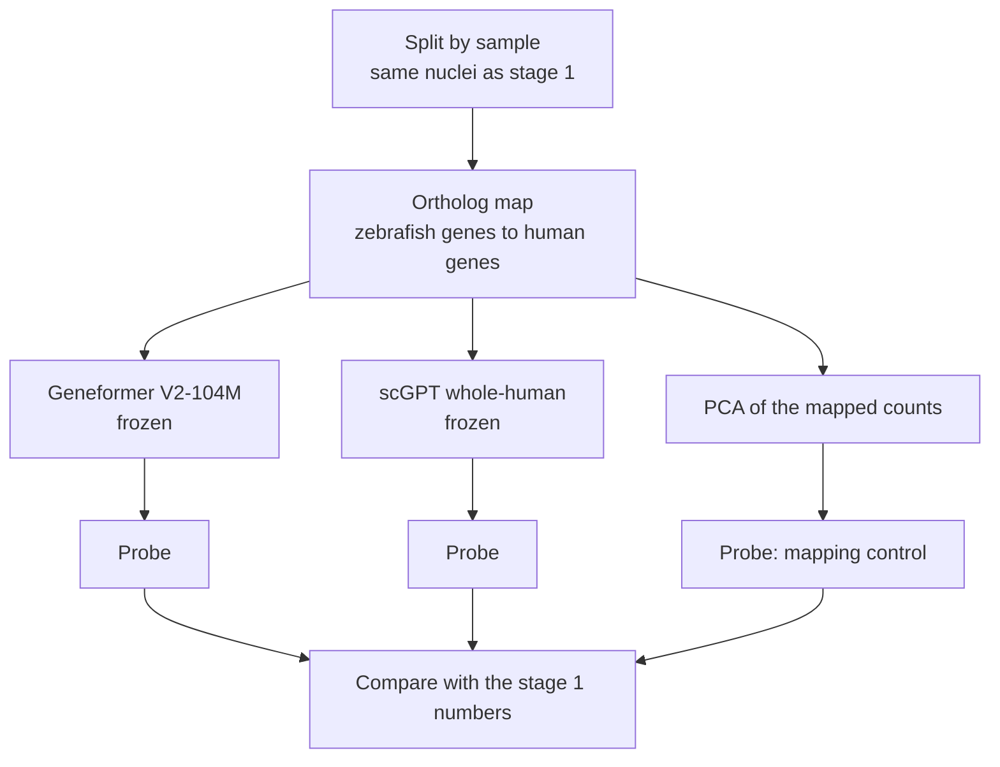

# Stage 1b: Geneformer and scGPT on the same retina test

Written on 15 November 2026, **before any of these runs**. The results section at the end is added afterwards and does not change anything above it.

## The question

On the stage 1 test ([STAGE1-RETINA.md](https://github.com/Kays3/geneformer-vs-brainiac/blob/HEAD/zebrafish-brain-fm/STAGE1-RETINA.md)), how do two published foundation models trained on human cells compare with the principal-components baseline and with this project's tier S model?

## What stays the same as stage 1

The 10,000 nuclei of GSE239410 (seed 0), the split by sample (held out: `Control_2`, `LD_96hr`, `NMDA_96hr`), the 14 deposited labels, the logistic-regression probe, and the primary measure: macro F1 over the cell types in the held-out samples.

## What is new

| Item | Choice, fixed now |
|---|---|
| Geneformer | V2-104M at Hugging Face commit `1f7fbae`, with its own tokenizer. Features: the `<cls>` position of the second-to-last layer. This is the recipe of the public repository `Kays3/geneformer-petadimension-starter`. No fine-tuning |
| scGPT | The `whole-human` checkpoint named in the scGPT README, through the package's own `embed_data` function. No fine-tuning |
| Gene mapping | Both models know human genes only. Zebrafish genes are mapped to human orthologs with the Ensembl BioMart table of release 116 |
| Mapping rule | Keep a zebrafish gene if it has exactly one human ortholog in the table. Sum the counts of zebrafish genes that share a human gene. Drop zebrafish genes with no human ortholog or with more than one |
| Control for the mapping | Principal components (128) of the mapped human-gene counts. It shows what the gene mapping alone costs, apart from any model |

## Benchmarks, fixed now

| Check | Passes when |
|---|---|
| Each external model against the stage 1 PCA baseline (0.853) | Its macro F1 is at least 0.853 |
| Each external model against the mapping control | Its macro F1 is at least that of PCA on the mapped counts. Reported with a 95% interval of the difference from a paired bootstrap over held-out nuclei |
| Each external model against the tier S model | Reported against both seeds (0.826 and 0.808); no pass mark |
| Mapping cost | Reported: the share of genes and of counts that survive the mapping, and the macro F1 lost between PCA on all genes and PCA on mapped genes |

Every result is reported, including a model that cannot be installed or run. In that case the report says "not run" and gives the reason.

## What these runs cannot show, whatever the numbers

- **This is a cross-species, zero-shot use.** Both models were trained on human cells. A low score here says little about them on human data or after fine-tuning.
- **The gene mapping removes information** before either model sees a nucleus. Zebrafish has many duplicated genes, and the rule above drops or merges them.
- **The comparison is not like for like.** Geneformer has about 104 million weights and scGPT is of similar order; the tier S model has 3.3 million and saw 7,731 nuclei. The external models saw tens of millions of human cells and no zebrafish.
- The limits of stage 1 all still apply: labels from the authors' own analysis, samples that are not animals, the one control sample held out, few nuclei of the rare types.

## Cost

These runs are charged to the stage 1 ceiling of 2.0 GPU-hours, of which 1.278 remained on 15 November 2026. Model weights are downloaded to the GPU machine and recorded in the manifest with checksums.

---

# Results

Added on 15 November 2026, after the runs. Nothing above this line was changed. Code commit `2a9d0c2`; full record in [`compute/runs/stage1b-retina-external-20261115.json`](https://github.com/Kays3/geneformer-vs-brainiac/blob/HEAD/zebrafish-brain-fm/compute/runs/stage1b-retina-external-20261115.json).

Both published models were installed and run. Each embedded all 10,000 nuclei; none was left without tokens.

## Cell type on the held-out samples

Same 2,269 held-out nuclei, same probe, same measure as stage 1.

| Features | Width | Macro F1 | Balanced accuracy | Accuracy |
|---|---|---|---|---|
| **scGPT whole-human, frozen** | 512 | **0.894** | 0.881 | 0.967 |
| **Geneformer V2-104M, frozen** | 768 | **0.879** | 0.868 | 0.970 |
| PCA of all zebrafish genes (the stage 1 baseline, repeated) | 128 | 0.853 | 0.841 | 0.968 |
| PCA of the mapped human genes (mapping control) | 128 | 0.841 | 0.827 | 0.967 |
| Tier S model of this project, seed 0 (from stage 1) | 128 | 0.826 | 0.802 | 0.960 |
| Tier S model of this project, seed 1 (from stage 1) | 128 | 0.808 | 0.795 | 0.955 |

## The benchmarks

| Check | Geneformer | scGPT |
|---|---|---|
| At least the stage 1 PCA baseline (0.853) | **Passed** (0.879) | **Passed** (0.894) |
| At least the mapping control (0.841) | **Passed**: +0.038 (95% interval 0.003 to 0.069) | **Passed**: +0.053 (0.024 to 0.085) |
| Against the tier S model (0.826 and 0.808) | Higher by 0.05 to 0.07 | Higher by 0.07 to 0.09 |

Against PCA of all genes, with intervals: Geneformer +0.026 (-0.007 to 0.056), scGPT +0.041 (0.011 to 0.071). So scGPT is ahead of the stage 1 baseline with an interval that excludes zero. Geneformer is ahead by the point estimate, with an interval that includes zero.

## The cost of the gene mapping

| Quantity | Value |
|---|---|
| Zebrafish genes in the data | 32,520 |
| Zebrafish genes with exactly one human ortholog, kept | 16,295 |
| Human genes after summing | 12,721 |
| Share of all counts kept | 69.2% |
| Human genes found in the scGPT vocabulary | 12,545 of 12,716 with a unique symbol |
| Median Geneformer tokens per nucleus | 795 |
| Macro F1 lost by PCA through the mapping | 0.012 (0.853 to 0.841) |

Half of the genes and 31% of the counts are lost before either model sees a nucleus, and both models still come out ahead.

## Checks made

- **The stage 1 baseline reproduced exactly**: PCA of all genes gave 0.8532 again.
- **Geneformer was run twice** (once alone, once with scGPT in the workflow). The two feature arrays are identical: largest absolute difference 0.0.
- Loading Geneformer reported two weights as newly initialized, `pooler.dense.weight` and `pooler.dense.bias`. The feature used here is taken before the pooler, so they do not enter it.
- scGPT's `embed_data` runs with mixed precision by default. Full precision was not tried.

## One check added after the results (not registered)

The published models give wider feature vectors (768 and 512) than the 128 principal components. To see whether width alone explains the gap, PCA was rerun at 512 and 768 components with the same probe. This was decided after seeing the results, so it is exploratory.

| PCA components | All genes | Mapped genes |
|---|---|---|
| 128 (registered) | 0.853 | 0.841 |
| 512 | 0.828 | 0.811 |
| 768 | 0.820 | 0.804 |

More components made PCA worse on this test. Width does not explain the gap.

## Reading the result

- **Two models trained only on human cells, used without any fine-tuning and through a lossy gene mapping, separate zebrafish retinal cell types better than principal components and better than this project's small model.** That is the plain finding.
- **It is a real point against the tier S model as it stands.** A 3.3-million-weight model trained for 16 minutes on 7,731 nuclei is behind models with tens of millions of weights trained on tens of millions of cells. The comparison is not like for like, and it was not meant to be.
- **The gaps are small in absolute terms**: 0.03 to 0.05 over PCA, on a test where accuracy over all nuclei is 0.96 to 0.97 for every method. The differences sit in the rare types, which have 8 to 19 held-out nuclei each.
- **The labels still come from the authors' own analysis** of the same data. That favoured PCA in stage 1; here two models that never saw these data agree with those labels more closely than PCA does, which is some evidence the labels reflect cell identity and not only the authors' pipeline.
- All limits listed before the run apply: one data set, one tissue, split by sample, the only control sample held out.

## Cost

| Run | From start to end | GPU-hours charged |
|---|---|---|
| Test runs on 1,000 nuclei (four, two of which failed before embedding) | under 4.3 minutes in all | 0.072, an upper bound |
| Geneformer alone, 10,000 nuclei | 4.0 minutes | 0.066 |
| Geneformer and scGPT, 10,000 nuclei | 6.1 minutes | 0.101 |
| **Stage 1 and 1b together** | | **0.961 of 2.0** |

The time charged is the whole workflow, most of it on the CPU, so it overstates GPU use.

## What follows for the project

1. A cross-species baseline now exists. Any model built here has to beat 0.894 on this test, not 0.853.
2. The cheapest strong option is to start from one of the published models and adapt it to zebrafish, in place of training from nothing. This was an open decision in the introduction; this result is evidence for it.
3. The gene mapping deserves its own test: a mapping that keeps duplicated zebrafish genes might raise both published models further.
