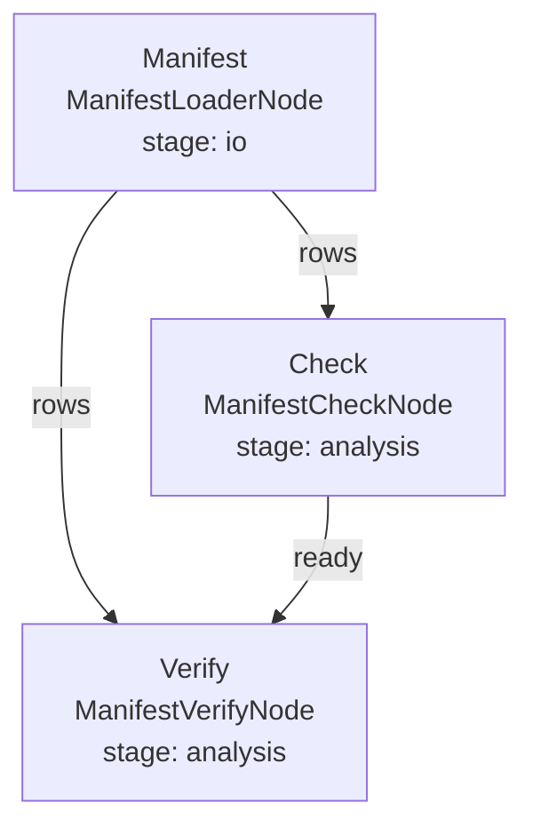
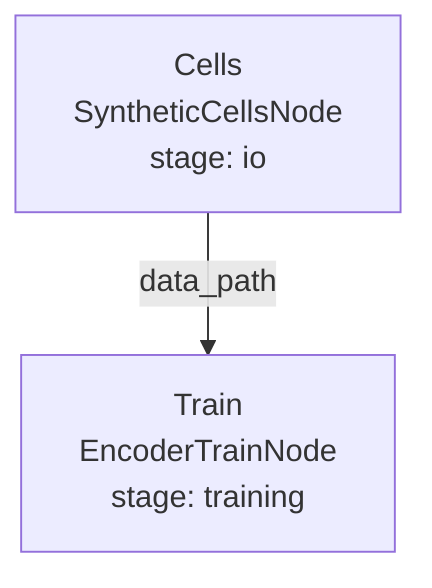
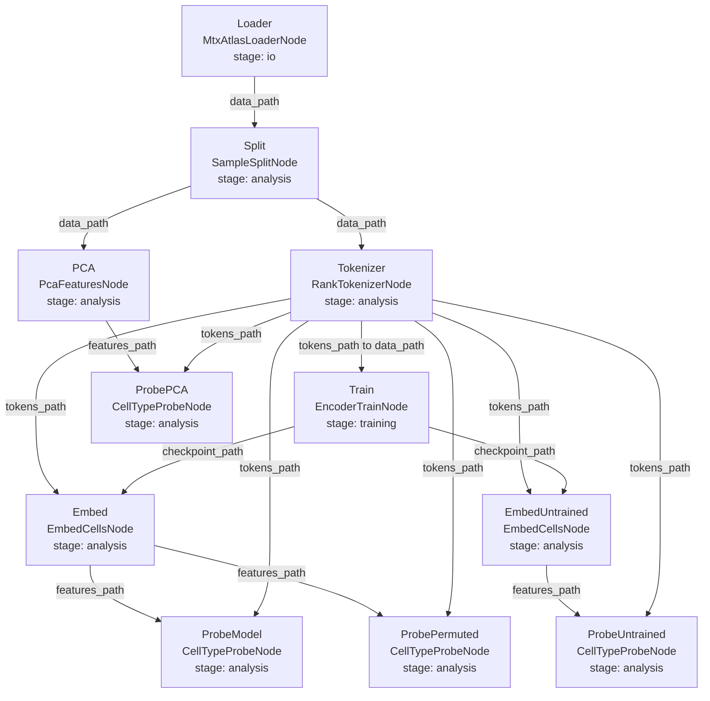
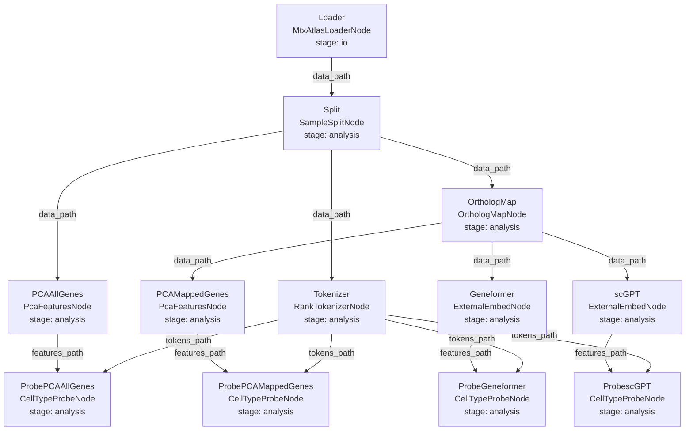

# Workflows, drawn from the code

Generated by `tools/draw_workflows.py`. Do not edit by hand: change the workflow script and run the tool again.

Each box is a node: its name in the workflow, its class where the two differ, and its Neuro-Workflow stage. Each arrow is a connection between two ports and carries the port name. The stage `training` is this project's proposal and is not in the Neuro-Workflow stage list.

## Stage 0: data inventory

`workflows/stage0_inventory.py`: 3 nodes of 3 kinds, 3 connections.

## Tier S smoke test on synthetic cells

`workflows/tier_s_smoke.py`: 2 nodes of 2 kinds, 1 connection.
The tier M timing run (`tier_m_timing.py`) has the same graph with a larger model.

## Stage 1: tier S model on real retina nuclei

`workflows/stage1_retina_tier_s.py`: 11 nodes of 7 kinds, 16 connections.

## Stage 1b: Geneformer and scGPT on the same retina test

`workflows/stage1b_retina_external.py`: 12 nodes of 7 kinds, 15 connections.
Drawn with `--with-scgpt`. Without it the scGPT node and its probe are absent.

