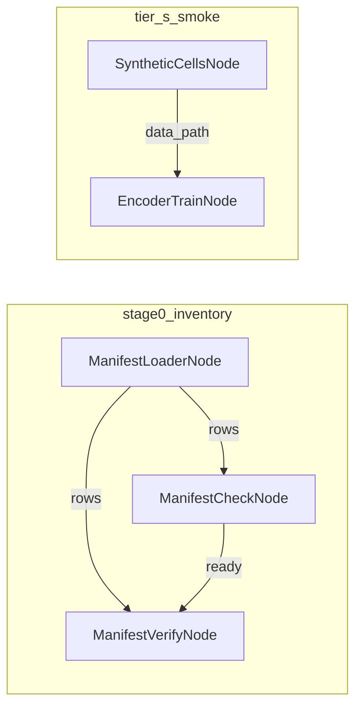
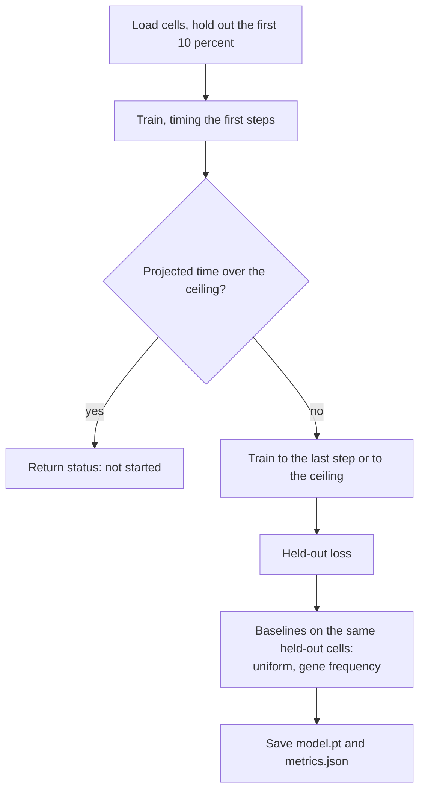
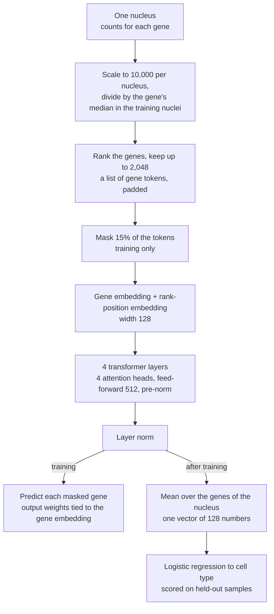

# Nodes and workflows

Reference for what exists now. Each node is one file in this folder and one class with a `NODE_DEFINITION`. The definitions in the code are the source of truth; this page repeats them for reading.

All thirteen nodes ran on 15 November 2026. Diagrams of every workflow, generated from the code, are in [WORKFLOWS.md](https://github.com/Kays3/geneformer-vs-brainiac/blob/HEAD/zebrafish-brain-fm/WORKFLOWS.md). None has unit tests yet. `rank_encoder.py` is not a node: it holds the model that the training and embedding nodes share.

## Workflows

| Workflow | Graph | Needs | Run |
|---|---|---|---|
| [`stage0_inventory.py`](https://github.com/Kays3/geneformer-vs-brainiac/blob/HEAD/zebrafish-brain-fm/workflows/stage0_inventory.py) | ManifestLoader → ManifestCheck → ManifestVerify | Neuro-Workflow only | `uv run python workflows/stage0_inventory.py` |
| [`tier_s_smoke.py`](https://github.com/Kays3/geneformer-vs-brainiac/blob/HEAD/zebrafish-brain-fm/workflows/tier_s_smoke.py) | SyntheticCells → EncoderTrain | PyTorch; a GPU for the full size | `uv run python workflows/tier_s_smoke.py --tiny` or `--steps 300` |
| [`stage1_retina_tier_s.py`](https://github.com/Kays3/geneformer-vs-brainiac/blob/HEAD/zebrafish-brain-fm/workflows/stage1_retina_tier_s.py) | Loader → Split → Tokenizer → Train → Embed → Probe, with a PCA baseline and two controls | PyTorch, a GPU, and the GSE239410 files | `uv run python workflows/stage1_retina_tier_s.py --tiny`, or `--steps 3000 --ceiling 45 --seed 0` |
| [`stage1b_retina_external.py`](https://github.com/Kays3/geneformer-vs-brainiac/blob/HEAD/zebrafish-brain-fm/workflows/stage1b_retina_external.py) | Loader → Split → OrthologMap → Geneformer and scGPT → Probe, with PCA controls | The stage 1 needs, plus the two environments under `external/` | `uv run python workflows/stage1b_retina_external.py --with-scgpt` |
| [`tier_m_timing.py`](https://github.com/Kays3/geneformer-vs-brainiac/blob/HEAD/zebrafish-brain-fm/workflows/tier_m_timing.py) | SyntheticCells → EncoderTrain, at 6 layers and width 256 | PyTorch and a GPU | `uv run python workflows/tier_m_timing.py --steps 2500 --ceiling 60` |

## ManifestLoaderNode

`manifest_loader.py` · type `zfbrain_manifest_loader` · stage `io`

Reads `data/MANIFEST.tsv` into a list of dictionaries. The manifest has one row per data set: layer, tissue, name, accession, paper, folder, sha256, licence and its source, size, stage and a note.

| Kind | Name | Type or default | Meaning |
|---|---|---|---|
| Parameter | `manifest_path` | `data/MANIFEST.tsv` | Path of the manifest |
| Output | `rows` | LIST | One dictionary per data set, keyed by column name |

## ManifestCheckNode

`manifest_check.py` · type `zfbrain_manifest_check` · stage `analysis`

Splits data sets into those that may be used and those that may not. A data set is ready only when `local_path`, `sha256` and `licence` are all filled.

| Kind | Name | Type | Meaning |
|---|---|---|---|
| Input | `rows` | LIST | From the manifest loader |
| Output | `ready` | LIST | Names of usable data sets |
| Output | `blocked` | DICT | For each other data set, its empty fields |

## ManifestVerifyNode

`manifest_verify.py` · type `zfbrain_manifest_verify` · stage `analysis`

Checks the files of each ready data set on the machine where it runs. The folder must hold a `SHA256SUMS` file whose own sha256 equals the manifest value, and every file listed in it must match.

| Kind | Name | Type or default | Meaning |
|---|---|---|---|
| Parameter | `root` | `.` | Folder that the manifest paths are relative to |
| Input | `rows` | LIST | From the manifest loader |
| Input | `ready` | LIST | From the manifest check |
| Output | `verified` | LIST | Data sets whose files all match |
| Output | `failed` | DICT | Data sets present but not matching, with the reason |
| Output | `absent` | LIST | Ready data sets whose folder is not on this machine |

## SyntheticCellsNode

`synthetic_cells.py` · type `zfbrain_synthetic_cells` · stage `io`

Makes cells for smoke tests and timing. Each cell type has a random score for every gene; a cell is its type's scores plus noise, and its tokens are the top genes in order. The cells carry no biology.

| Kind | Name | Type or default | Meaning |
|---|---|---|---|
| Parameter | `n_cells` | 10000 | Number of cells |
| Parameter | `vocab_size` | 30000 | Number of gene tokens |
| Parameter | `seq_len` | 2048 | Genes kept per cell |
| Parameter | `n_types` | 8 | Number of synthetic cell types |
| Parameter | `noise` | 1.0 | Noise SD, against a profile SD of 1 |
| Parameter | `seed` | 0 | Random seed |
| Parameter | `out_path` | `data/derived/synthetic_cells.pt` | File to write |
| Output | `data_path` | STR | The saved file |
| Output | `n_cells` | INT | Cells written |

## EncoderTrainNode

`encoder_train.py` · type `zfbrain_encoder_train` · stage `training` (proposed, not in the Neuro-Workflow stage list)

Trains a small transformer by masked-gene prediction. The model has a gene embedding, a rank-position embedding, a transformer encoder and output weights tied to the gene embedding.

What the method does, in order:

| Kind | Name | Type or default | Meaning |
|---|---|---|---|
| Input | `data_path` | STR | File from the synthetic cells node |
| Parameter | `layers`, `width`, `heads` | 4, 128, 4 | Model size |
| Parameter | `steps`, `batch_size` | 600, 32 | Training length |
| Parameter | `mask_fraction` | 0.15 | Share of gene tokens masked |
| Parameter | `learning_rate` | 0.001 | AdamW learning rate |
| Parameter | `holdout_fraction` | 0.1 | Share of cells never trained on |
| Parameter | `seed` | 0 | Random seed |
| Parameter | `ceiling_minutes` | 6.0 | Time ceiling for the run |
| Parameter | `start_check_steps` | 10 | Timed steps behind the projection |
| Parameter | `out_dir` | `runs/tier_s_smoke` | Folder for the checkpoint and metrics |
| Output | `metrics` | DICT | Device, weights, timing, losses, baselines, status |
| Output | `checkpoint_path` | STR | Saved weights; empty if the run did not start |

Known limits:

- The start check is inside this node. The GPU plan asks for a separate node.
- The first timed steps include GPU start-up, so the projection runs high.
- For synthetic cells the held-out cells are the first rows of the file. For real cells the split comes from SampleSplitNode, by sample.
- The gene-frequency baseline is the only non-trivial baseline. There is no permuted-label control, because this task has no labels.

## The model

`rank_encoder.py` holds the network that EncoderTrainNode trains and EmbedCellsNode reads. As run in stage 1 it has 3,315,072 weights; the gene embedding for 17,651 genes is the largest part. No cell type label enters the model.

## Stage 1 nodes

Six nodes carry the first run on real cells. The graph and its benchmarks are in [STAGE1-RETINA.md](https://github.com/Kays3/geneformer-vs-brainiac/blob/HEAD/zebrafish-brain-fm/STAGE1-RETINA.md).

| Node | File | Stage | Does | Main inputs → outputs |
|---|---|---|---|---|
| MtxAtlasLoaderNode | `mtx_atlas_loader.py` | `io` | Reads a deposited count matrix with its gene and cell tables, keeps the full matrix in a cache file, writes a random sample of cells | none → `data_path`, `n_cells`, `n_samples` |
| SampleSplitNode | `sample_split.py` | `analysis` | Holds out whole samples, drawn with a seed from the sorted sample names | `data_path` → `data_path`, `heldout_samples`, `n_heldout_cells` |
| RankTokenizerNode | `rank_tokenizer.py` | `analysis` | Ranks each cell's genes by scaled expression; the scaling and the vocabulary use training cells only | `data_path` → `tokens_path`, `vocab_size`, `median_genes_per_cell` |
| PcaFeaturesNode | `pca_features.py` | `analysis` | The baseline: log-scaled counts projected on components fitted on training cells | `data_path` → `features_path` |
| EmbedCellsNode | `embed_cells.py` | `analysis` | One vector per cell from the encoder; `random_init` gives the untrained control | `tokens_path`, `checkpoint_path` → `features_path` |
| CellTypeProbeNode | `cell_type_probe.py` | `analysis` | Logistic regression from fixed features to cell type, scored on held-out samples; `permute_labels` gives the control that must fail | `features_path`, `tokens_path` → `metrics`, `predictions_path` |

Two more nodes carry stage 1b ([STAGE1B-EXTERNAL-MODELS.md](https://github.com/Kays3/geneformer-vs-brainiac/blob/HEAD/zebrafish-brain-fm/STAGE1B-EXTERNAL-MODELS.md)):

| Node | File | Stage | Does | Main inputs → outputs |
|---|---|---|---|---|
| OrthologMapNode | `ortholog_map.py` | `analysis` | Converts zebrafish counts to human genes: keeps a gene with exactly one human ortholog, sums genes that share one | `data_path` → `data_path`, `mapping` |
| ExternalEmbedNode | `external_embed.py` | `analysis` | Runs a published model's `embed.py` in that model's own environment under `external/` and returns its features | `data_path` → `features_path`, `n_features` |

Every workflow script has a `build()` function that makes the graph without running it. `tools/draw_workflows.py` uses it to write WORKFLOWS.md, and `--check` fails when that file is out of date.

Since stage 1, EncoderTrainNode reads padded cells and a split made upstream, and computes gene logits only at the masked positions. Its speed and memory are therefore not comparable with the two runs on synthetic cells recorded earlier.

## Adding a node

1. Copy the shape of an existing node. Give it a `type` that starts with `zfbrain_`.
2. Write every description for a reader who cannot see the code.
3. Return a dictionary whose keys are the output port names.
4. Pass large data as a file path, not as an array.
5. If the node produces a result, write the node that produces its baseline or null in the same change.
6. Add the node to this page.
