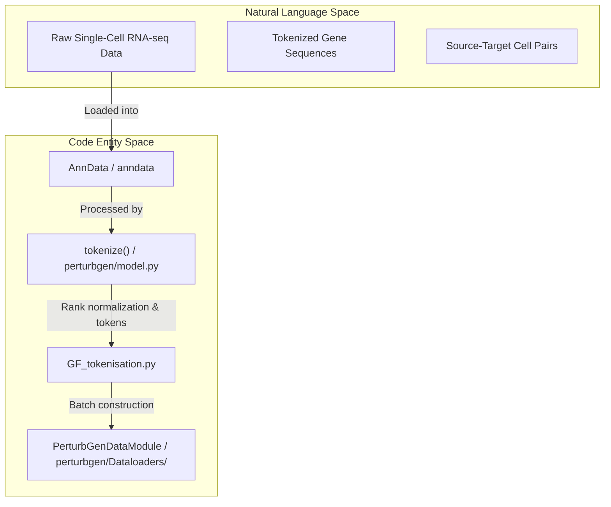
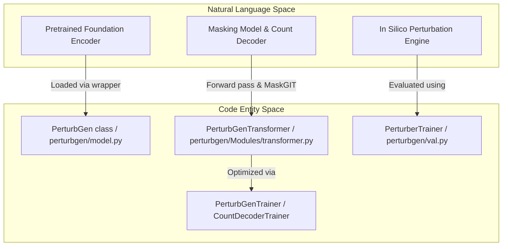

# PerturbGen Overview

Relevant source files

The following files were used as context for generating this wiki page:

- [README.md](README.md)
- [docs/fig1.png](docs/fig1.png)
- [docs/index.rst](docs/index.rst)
- [perturbgen/__init__.py](perturbgen/__init__.py)
- [requirements.txt](requirements.txt)

PerturbGen is a scientific Python library and generative foundation model designed to predict how genetic or signaling perturbations reshape transcriptional programs across cellular trajectories [README.md:4-8](), [docs/index.rst:9-11](). Unlike traditional methods that focus on static cell states, PerturbGen models biological transitions—such as differentiation or disease progression—as a sequence-to-sequence problem [docs/index.rst:11-11]().

By training on over 100 million single-cell transcriptomes, the model learns to propagate the effects of early-stage perturbations to terminal outcomes, enabling the discovery of context-specific gene programs and the simulation of large-scale in silico perturbation atlases [README.md:8-10]().

### Key Capabilities
*   **Trajectory Prediction:** Infers intermediate and future cell states by predicting gene expression at specified target states [README.md:10-10]().
*   **In Silico Perturbation:** Simulates genetic interventions (e.g., knockouts or overexpressions) to observe downstream transcriptional shifts [docs/index.rst:11-11]().
*   **Gene Program Discovery:** Aggregates learned gene embeddings across biological covariates (time, lineage, stage) to identify de novo regulatory programs [README.md:10-10]().
*   **Perturbation Induced Programs (PIPs):** Clusters perturbations with similar effects to identify established regulators and novel drivers of state transitions [README.md:10-10]().

---

### System Architecture and Code Mapping

The following diagrams bridge natural language biological concepts to the precise code entities and modules implementing them within the repository.

Title: "NaturalLanguageToCodeDataPipeline"

Sources: [README.md:4-10](), [perturbgen/__init__.py:3-5](), [docs/index.rst:11-11]()

Title: "NaturalLanguageToCodeModelArchitecture"

Sources: [README.md:10-11](), [docs/index.rst:11-11](), [perturbgen/__init__.py:3-5]()

---

### Repository Organization

The repository is structured around a scvi-tools-style Python API and a rich set of CLI entrypoints [perturbgen/__init__.py:3-5]():

| Component | Responsibility | Key Files/Modules |
| :--- | :--- | :--- |
| **Model & API** | Main `PerturbGen` class, tokenization, model loading. | `perturbgen/model.py`, `perturbgen/__init__.py` |
| **Transformer Core** | Encoder-decoder architecture, self/cross attention, CountHead. | `perturbgen/Modules/transformer.py`, `scmaskgit/` |
| **Trainers** | Phase 1 masking and Phase 2 count decoder training loops. | `perturbgen/Trainers/` |
| **Inference & Perturbation**| `val.py`, in silico perturbation simulation, embedding extraction. | `perturbgen/val.py`, `perturbgen/Trainers/perturber.py` |

---

### Child Sections and Detailed Documentation

For deep technical details, please proceed to the child pages:

- **[Getting Started: Installation and Environment Setup](#1.1)** — Poetry and pip installation, Python 3.11 environment configuration, Hugging Face checkpoint downloads, and hardware prerequisites.
- **[End-to-End Tutorial and Workflow Overview](#1.2)** — Full pipeline walkthrough from raw data preprocessing to perturbation atlas generation using tutorial notebooks.
- **[Python API and CLI Entrypoints](#1.3)** — Comprehensive reference for the programmatic API (`perturbgen/model.py`) and command-line interfaces (`perturbgen/__main__.py`).

Sources: [README.md:1-130](), [docs/index.rst:1-48](), [perturbgen/__init__.py:1-5]()

---