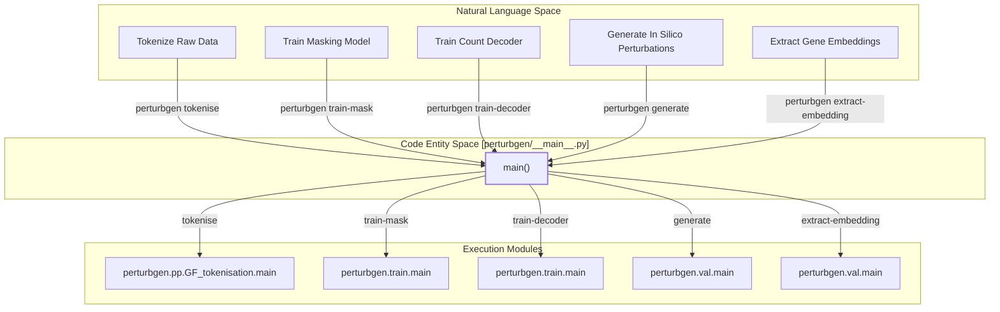
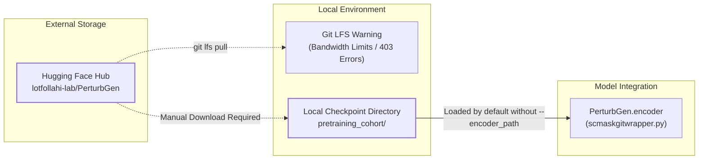

# Getting Started: Installation and Environment Setup

<details>
<summary>Relevant source files</summary>

The following files were used as context for generating this wiki page:

- [Dockerfile](Dockerfile)
- [README.md](README.md)
- [docs/Makefile](docs/Makefile)
- [docs/fig1.png](docs/fig1.png)
- [docs/installation.rst](docs/installation.rst)
- [docs/tutorial.rst](docs/tutorial.rst)
- [poetry.lock](poetry.lock)
- [pyproject.toml](pyproject.toml)
- [requirements.txt](requirements.txt)

</details>


This page provides technical instructions for setting up the PerturbGen development and execution environment. PerturbGen is a generative transformer framework for modeling cellular perturbation effects, requiring a Python 3.11 environment, specialized single-cell dependencies, and specific hardware configurations for high-throughput single-cell RNA-seq training and inference [README.md:4-9](), [pyproject.toml:9-20]().

---

## System Requirements and Hardware Setup

Preprocessing, tokenization, and inference workflows can execute entirely on CPU architectures (a minimum of 32 GB RAM is recommended for larger datasets) [README.md:44-45](). Conversely, model training requires a CUDA-compatible GPU [README.md:46](). 

### GPU Memory Profile
The following empirical measurements illustrate peak GPU memory utilization across training stages using the default tutorial batch size of 64 on the LPS dataset [README.md:46-49]():

| Training Stage | Default Batch Size | Peak GPU Memory | Recommended Hardware |
| :--- | :--- | :--- | :--- |
| **Masking Model (`train-mask`)** | 64 | 13.8 GB [README.md:52]() | 24 GB GPU (e.g., RTX 3090/4090) [README.md:55]() |
| **Count Decoder (`train-decoder`)** | 64 | 15.8 GB [README.md:53]() | 24 GB GPU (e.g., RTX 3090/4090) [README.md:55]() |

> ⚠️ **Note on Memory Limits:** On 16 GB GPUs, count-decoder training operates near capacity [README.md:56](). If an out-of-memory (OOM) error occurs, reduce the batch size via the `--batch_size` CLI argument [README.md:56-58](). Multi-GPU environments automatically utilize Distributed Data Parallel (DDP) or DeepSpeed (ZeRO stage 2) via `--parallel_distribution deepspeed` [README.md:60-63]().

**Sources:** [README.md:42-64]()

---

## Installation Methods

PerturbGen can be installed using Poetry (recommended for developers), standard pip, or via a pre-configured Docker container [README.md:20-40](), [docs/installation.rst:51-55](), [Dockerfile:1-15]().

### Method 1: Poetry Installation (Recommended)
Poetry locks exact library versions specified in `poetry.lock` to ensure environment reproducibility [poetry.lock:1]().

```bash
# Clone the repository
git clone https://github.com/Lotfollahi-lab/Perturbgen.git
cd Perturbgen/

# Install Poetry (if not already installed)
curl -sSL https://install.python-poetry.org | python3 -

# Configure environment with Python 3.11 and install dependencies
poetry env use python3.11
poetry install

# Activate the virtual environment
source "$(poetry env info -p)/bin/activate"
```
[README.md:14-40](), [docs/installation.rst:4-39]()

### Method 2: Pip Installation
For environments using traditional virtual environments and `pip`, the exact package dependencies are mirrored in `requirements.txt` [requirements.txt:1-3]():

```bash
pip install -r requirements.txt
pip install -e . --no-deps
```
[requirements.txt:3]()

### Method 3: Docker Container
PerturbGen provides a container definition based on Python 3.11 with OpenMPI support pre-configured [Dockerfile:3-8]().

```bash
# Build the container image targeting Linux AMD64
docker build -t perturbgen .

# Execute the CLI entry point inside the container
docker run --rm perturbgen --help
```
[Dockerfile:3-15]()

**Sources:** [README.md:12-41](), [docs/installation.rst:4-39](), [requirements.txt:1-3](), [Dockerfile:1-15]()

---

## CLI Entry Point and Command Architecture

Once installed, the package exposes the `perturbgen` console script, which routes high-level user commands to underlying Python modules [pyproject.toml:12-13](), [docs/installation.rst:57-71]().


**Sources:** [pyproject.toml:12-13](), [perturbgen/__main__.py:40-85]()

---

## Pretrained Checkpoints and Hugging Face Integration

PerturbGen relies on pretrained foundation model encoder weights [README.md:106-113](). 



> ⚠️ **Important Checkpoint Note:** The `pretraining_cohort/` directory uses Git LFS, which may encounter bandwidth throttling or `403` errors [README.md:112](). Users must download the `.ckpt` files directly from the [Hugging Face Repository](https://huggingface.co/lotfollahi-lab/PerturbGen/tree/main) and place them into `pretraining_cohort/` manually [README.md:110-113](). Model training scripts automatically look in this directory by default, eliminating the need to specify `--encoder_path` explicitly [README.md:113]().

**Sources:** [README.md:106-114]()

---

## Documentation and Development Tools

### Building Documentation Locally
Documentation is written in reStructuredText (`.rst`) and compiled using Sphinx [docs/Makefile:1-13](). 

```bash
# Install documentation extras via Poetry
poetry install --with=docs

# Build HTML documentation
cd docs/
make html
```
[docs/Makefile:8-13]()

To preview updates interactively using `sphinx-autobuild`, run [docs/Makefile:22-23]():
```bash
make livehtml
```
[docs/Makefile:22-23]()

### Notebook Management with Jupytext
The repository stores exploratory computational notebooks as paired Python scripts ending in `_nb.py` to maintain clean version control histories [README.md:82-84](). To convert and execute them locally:

```bash
jupytext --to ipynb --execute <your_file>_nb.py
```
[README.md:88-89]()

**Sources:** [README.md:82-89](), [docs/Makefile:1-23]()

---