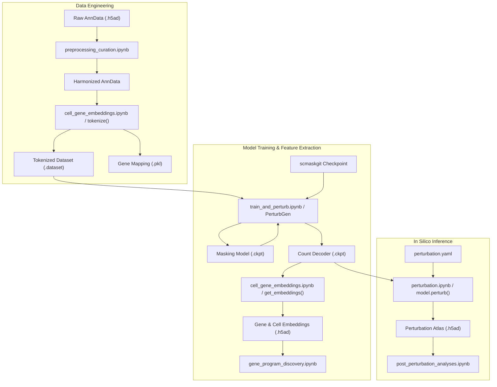
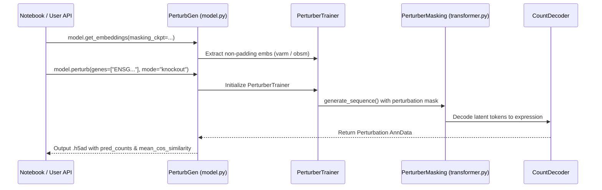

# End-to-End Tutorial and Workflow Overview

Relevant source files

The following files were used as context for generating this wiki page:

- [docs/examples/cell_gene_embeddings.ipynb](docs/examples/cell_gene_embeddings.ipynb)
- [docs/examples/gene_program_discovery.ipynb](docs/examples/gene_program_discovery.ipynb)
- [docs/examples/post_perturbation_analyses.ipynb](docs/examples/post_perturbation_analyses.ipynb)
- [docs/examples/preprocessing_curation.ipynb](docs/examples/preprocessing_curation.ipynb)
- [docs/examples/train_and_perturb.ipynb](docs/examples/train_and_perturb.ipynb)
- [docs/installation.rst](docs/installation.rst)
- [docs/tutorial.rst](docs/tutorial.rst)
- [perturbgen/model.py](perturbgen/model.py)

## Purpose and Scope
This page provides a comprehensive technical walkthrough of the **PerturbGen** end-to-end pipeline, tracing the lifecycle of single-cell RNA sequencing data from raw transcriptomes to a perturbation atlas and downstream gene program discovery. It links the high-level workflow to the repository's example notebooks (`preprocessing_curation`, `cell_gene_embeddings`, `train_and_perturb`, `perturbation`, `gene_program_discovery`, and `post_perturbation_analyses`), detailing how data ingestion, tokenization, two-phase transformer training, and in silico perturbation connect via the scvi-tools-style Python API (`perturbgen/model.py`) and underlying modules [docs/tutorial.rst:9-16](), [perturbgen/model.py:1-27]().

---

## Workflow Pipeline Architecture & System-to-Code Mapping

The PerturbGen pipeline bridges raw single-cell annotations to deep generative modeling through three core execution tiers: **Data Engineering**, **Model Training & Embedding Extraction**, and **In Silico Inference & Post-Analysis**.

Title: PerturbGen End-to-End System-to-Code Mapping

**Sources:** [docs/tutorial.rst:9-16](), [perturbgen/model.py:1-27](), [docs/examples/train_and_perturb.ipynb:1-36]()

---

## 1. Data Preprocessing and Curation (`preprocessing_curation`)
The initial stage standardizes heterogeneous single-cell datasets into a clean format suitable for downstream ranking and tokenization [docs/examples/preprocessing_curation.ipynb:8-18]().
*   **QC Filtering:** Removal of low-quality cells based on mitochondrial gene percentage (`pct_counts_mt`) and total counts (`total_counts`) [docs/examples/preprocessing_curation.ipynb:128-134]().
*   **ID Mapping:** Harmonizing gene identifiers to Ensembl gene IDs to align with the core vocabulary file (`TOKEN_DICTIONARY_FILE`) [docs/examples/train_and_perturb.ipynb:43-48]().
*   **Metadata Harmonization:** Standardizing cell-type labels (`cell_type_harmonized`) and temporal covariates (`time_after_LPS`) across public and private study batches [docs/examples/preprocessing_curation.ipynb:225-238]().

**Sources:** [docs/examples/preprocessing_curation.ipynb:8-238]()

---

## 2. Tokenization and Cell Pairing (`cell_gene_embeddings` / `tokenize`)
Once preprocessed, data is processed via `perturbgen.tokenize()` [perturbgen/model.py:69-150]() or the tokenization notebooks:
*   **Gene Ranking:** Genes within each cell are sorted by normalized expression to implement Geneformer-style rank-value encoding.
*   **Highly Variable Genes (HVG):** Supports `hvg_mode='after_tokenisation'` or `before_tokenisation` with `seurat_v3` flavor to select the top `n_hvg` genes (e.g., 2000) [perturbgen/model.py:81-90]().
*   **Cell Pairing:** Pairs cells from a source timepoint (`reference_time`) to target timepoints (`time_point_order`) using strategies such as stratified sampling (`pairing_mode='stratified'`) or optimal transport mapping [perturbgen/model.py:73-91]().
*   **Outputs:** Writes binary `.dataset` containers and h5ad pairing companions consumed directly by `PerturbGenDataModule` [perturbgen/model.py:179-186]().

**Sources:** [perturbgen/model.py:69-150](), [docs/examples/cell_gene_embeddings.ipynb:1-48]()

---

## 3. Two-Phase Model Training (`train_and_perturb` / `PerturbGen`)
Model training is handled through the Python API class `PerturbGen` [perturbgen/model.py:152-186]() or the `train_and_perturb` tutorial [docs/examples/train_and_perturb.ipynb:1-36]():
*   **Phase 1: Masking Model Training (`train_masking`)**: Loads a frozen `scmaskgit` pretrained encoder foundation backbone, adding transformer layers and conditioning tokens (`cond_list`) [perturbgen/model.py:155-176](), [docs/examples/train_and_perturb.ipynb:43-48](). It optimizes Masked Language Modeling (MLM) cross-entropy loss over rank tokens.
*   **Phase 2: Count Decoder Training (`train_count`)**: Freezes the masking transformer and trains the `CountHead` MLP to project latent representations back to gene expression counts, supporting Zero-Inflated Negative Binomial (`zinb`), Negative Binomial (`nb`), or Mean Squared Error (`mse`) losses [perturbgen/model.py:15-16](), [perturbgen/model.py:172]().

**Sources:** [perturbgen/model.py:1-186](), [docs/examples/train_and_perturb.ipynb:1-36]()

---

## 4. In Silico Perturbation, Embeddings, and Downstream Analysis

Trained checkpoints are used to extract representations, simulate causal knockouts, and discover gene programs.

Title: Code Entity Interaction for Inference and Analysis

*   **Embedding Extraction (`cell_gene_embeddings.ipynb`)**: `model.get_embeddings()` extracts cell-level classification embeddings (`obsm['cls_embeddings']`) and time-resolved gene embeddings (`varm`) [docs/examples/cell_gene_embeddings.ipynb:85-104]().
*   **Gene Program Discovery (`gene_program_discovery.ipynb`)**: Gene embedding matrices are clustered and analyzed via gene set enrichment (`gseapy`) to uncover coordinated functional modules (PIPs) [docs/examples/gene_program_discovery.ipynb:18-22]().
*   **In Silico Perturbation (`perturbation.ipynb` / `model.perturb`)**: Executes dual forward passes (control vs. perturbed) to evaluate transcriptional response via cosine similarity and differential expression [docs/examples/post_perturbation_analyses.ipynb:16-24]().
*   **Post-Perturbation Analysis (`post_perturbation_analyses.ipynb`)**: Combines perturbed and unperturbed layers (`layers['pred_counts']`, `.X`) into a unified AnnData to quantify perturbation effects across cell types [docs/examples/post_perturbation_analyses.ipynb:76-202]().

**Sources:** [docs/examples/cell_gene_embeddings.ipynb:1-114](), [docs/examples/gene_program_discovery.ipynb:1-105](), [docs/examples/post_perturbation_analyses.ipynb:1-202](), [perturbgen/model.py:1-27]()

---