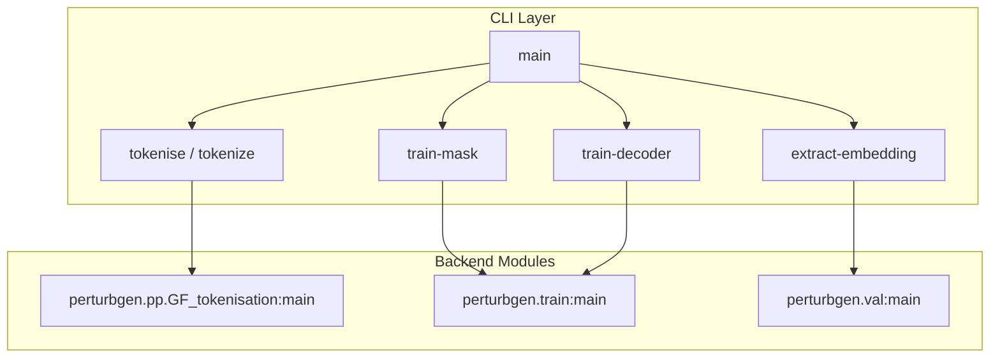
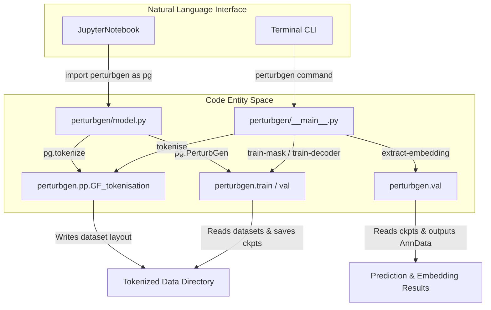

# Python API and CLI Entrypoints

<details>
<summary>Relevant source files</summary>

The following files were used as context for generating this wiki page:

- [docs/examples/train_and_perturb.ipynb](docs/examples/train_and_perturb.ipynb)
- [docs/installation.rst](docs/installation.rst)
- [docs/tutorial.rst](docs/tutorial.rst)
- [perturbgen/__main__.py](perturbgen/__main__.py)
- [perturbgen/batch_job_script/cytoimmgen/extrapolation/2_run_train_masking_extrapolation.sh](perturbgen/batch_job_script/cytoimmgen/extrapolation/2_run_train_masking_extrapolation.sh)
- [perturbgen/model.py](perturbgen/model.py)

</details>


## Purpose and Scope
This page documents the programmatic interfaces of PerturbGen: the scvi-tools-inspired Python API implemented in `perturbgen/model.py` and the Click-based command-line interface (CLI) in `perturbgen/__main__.py`. These entrypoints provide both in-process interactive execution (ideal for Jupyter notebooks and custom analytical pipelines) and batch execution via terminal commands or HPC job submission scripts.

---

## Python API (`perturbgen/model.py`)

The Python API wraps core training, tokenization, embedding extraction, and in silico perturbation routines inside an object-oriented interface. All operations run **in-process**, eliminating the need to shell out to external scripts.

### Core Utilities and Aliases
- **`_preserve_cwd()`**: A context manager that records the current working directory upon entry and restores it on exit. This prevents underlying training and validation entry points (which call `os.chdir()`) from silently shifting a notebook's working directory [perturbgen/model.py:43-55]().
- **`_MODE_ALIASES` & `_WHERE_ALIASES`**: Mapping dictionaries that translate user-friendly perturbation terms (e.g., `"knockout"` to `"mask"`, `"source"` to `"src"`) into the internal parameters expected by the model engine [perturbgen/model.py:58-66]().

### Tokenization Wrapper
The `tokenize()` function provides an idempotent programmatic wrapper around the tokenization pipeline. If the output directory already exists, it returns the path immediately unless `overwrite=True` is specified [perturbgen/model.py:69-117]().

```python
def tokenize(
    adata_path: str,
    dataset: str,
    reference_time: str,
    *,
    time_obs: str,
    time_point_order: Sequence[str],
    var_list: Sequence[str],
    main_pairing_obs: str,
    gene_median_path: str,
    token_dict_path: str,
    gene_mapping_path: str,
    n_hvg: int = 2000,
    ...
) -> str
```
It builds an argument list (`argv`) and invokes `perturbgen.pp.GF_tokenisation.main(argv)` within the `_preserve_cwd()` context [perturbgen/model.py:119-149]().

### The `PerturbGen` Class
The `PerturbGen` class manages the lifecycle of a model over a tokenized dataset [perturbgen/model.py:152-186](). Key methods include:
- `__init__(tokenized_dir, source, ...)`: Initializes dataset paths, network dimensions (`d_model=768`, `n_layers=6`), conditioning variables, and backbone encoder configurations.
- `train_masking()`: Executes Phase 1 training of the masking model.
- `train_count()`: Executes Phase 2 training of the count decoder using a specified masking checkpoint.
- `get_embeddings()`: Extracts cell and gene representations from trained checkpoints.
- `perturb(genes, mode, where, ...)`: Performs in silico gene perturbations (such as knockout or overexpression) and returns predicted state changes.
- `save()` / `load()`: Serialization utilities for model persistence.

Sources: [perturbgen/model.py:1-186]()

---

## CLI Entrypoints (`perturbgen/__main__.py`)

The command-line interface uses `click` and features an ordered subcommand structure via the `OrderedGroup` class [perturbgen/__main__.py:7-40]().

### Subcommand Definitions
The CLI exposes the following primary commands:



1. **`tokenise` / `tokenize`**: Calls `perturbgen.pp.GF_tokenisation.main(args)` for raw data preprocessing and tokenization [perturbgen/__main__.py:45-58]().
2. **`train-mask`**: Invokes `perturbgen.train.main(args)` to train Phase 1 masking models [perturbgen/__main__.py:60-67]().
3. **`train-decoder`**: Invokes `perturbgen.train.main(args)` to train Phase 2 count decoders [perturbgen/__main__.py:69-76]().
4. **`extract-embedding`**: Invokes `perturbgen.val.main(args)` to load model checkpoints and extract cellular or gene embeddings [perturbgen/__main__.py:78-85]().

Sources: [perturbgen/__main__.py:1-88]()

---

## API-to-Backend Architecture

The following diagram illustrates how user requests bridge natural language or notebook commands to the underlying Python API and CLI modules.



Sources: [perturbgen/model.py:1-186](), [perturbgen/__main__.py:1-88](), [docs/examples/train_and_perturb.ipynb:1-50]()

---