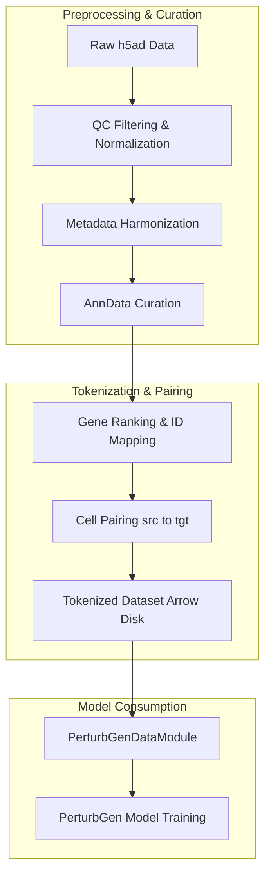
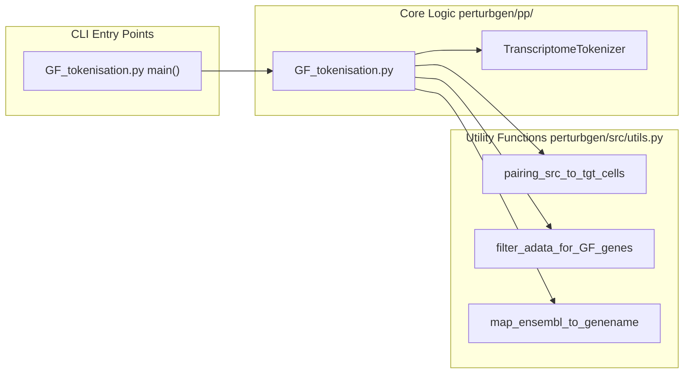
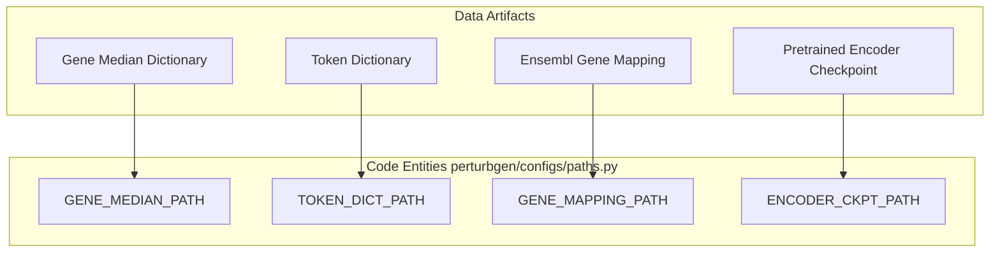

# Data Pipeline

Relevant source files

The following files were used as context for generating this wiki page:

- [docs/_static/fig2.png](docs/_static/fig2.png)
- [docs/architecture.png](docs/architecture.png)
- [docs/data.rst](docs/data.rst)
- [perturbgen/configs/__init__.py](perturbgen/configs/__init__.py)
- [perturbgen/configs/paths.py](perturbgen/configs/paths.py)
- [perturbgen/pp/GF_tokenisation.py](perturbgen/pp/GF_tokenisation.py)

The PerturbGen data pipeline transforms raw single-cell RNA-seq (scRNA-seq) data into structured, tokenized datasets suitable for training and evaluating generative perturbation models. This process involves quality control, metadata harmonization, and Geneformer-style rank-based tokenization with cell pairing strategies [perturbgen/pp/GF_tokenisation.py:11-22]().

### High-Level Data Flow

The pipeline follows a sequential flow from raw acquisition to the final dataset consumed by model dataloaders [perturbgen/configs/paths.py:28-30]().

Title: Data Pipeline Architecture Flow

Sources:
- [perturbgen/pp/GF_tokenisation.py:37-144]()
- [perturbgen/configs/paths.py:28-30]()

---

### Data Preprocessing and Curation

The initial stage prepares raw `AnnData` objects for downstream tokenization. This includes filtering cells based on mitochondrial content and gene counts, mapping gene identifiers (e.g., Ensembl IDs to gene names), and harmonizing cell metadata [perturbgen/pp/GF_tokenisation.py:216-233]().

For details, see [Data Preprocessing and Curation](#2.1).

Sources:
- [perturbgen/pp/GF_tokenisation.py:213-233]()

---

### Tokenization and Cell Pairing

PerturbGen utilizes a Geneformer-style tokenization where genes are ranked by their normalized expression levels within each cell [perturbgen/pp/GF_tokenisation.py:11-22](). These ranked genes are mapped to unique integer tokens using precomputed dictionaries [perturbgen/configs/paths.py:8-11]().

A critical component of the pipeline is **Cell Pairing**, which defines how source cells (e.g., control/reference) are mapped to target cells (e.g., perturbed/stimulated) to create training pairs [perturbgen/pp/GF_tokenisation.py:87-92](). The pipeline supports several strategies:
*   `random`: Randomly pairs cells across conditions.
*   `stratified`: Pairs cells within the same biological strata or cell type.
*   `mapping`: Uses a predefined file to link specific source and target cells.

For details, see [Tokenization and Cell Pairing](#2.2).

Sources:
- [perturbgen/pp/GF_tokenisation.py:87-92]()
- [perturbgen/configs/paths.py:8-11]()

---

### Pretraining Cohort Pipeline

For large-scale foundation model training (e.g., the 100M-cell corpus), PerturbGen employs specialized infrastructure hosted on S3-compatible storage at the Wellcome Sanger Institute, enabling large-scale batch tokenization and gene median calculations [docs/data.rst:1-37]().

For details, see [Pretraining Cohort Pipeline](#2.3).

Sources:
- [docs/data.rst:1-37]()

---

### Code and Path Entity Mappings

The following diagrams bridge natural language concepts to specific code entities, CLI entry points, and path configurations responsible for executing the pipeline.

Title: CLI and Core Processing Code Entities

Sources:
- [perturbgen/pp/GF_tokenisation.py:11-22]()
- [perturbgen/pp/GF_tokenisation.py:213-233]()

Title: Configuration and Path Variable Mapping

Sources:
- [perturbgen/configs/paths.py:8-16]()

---