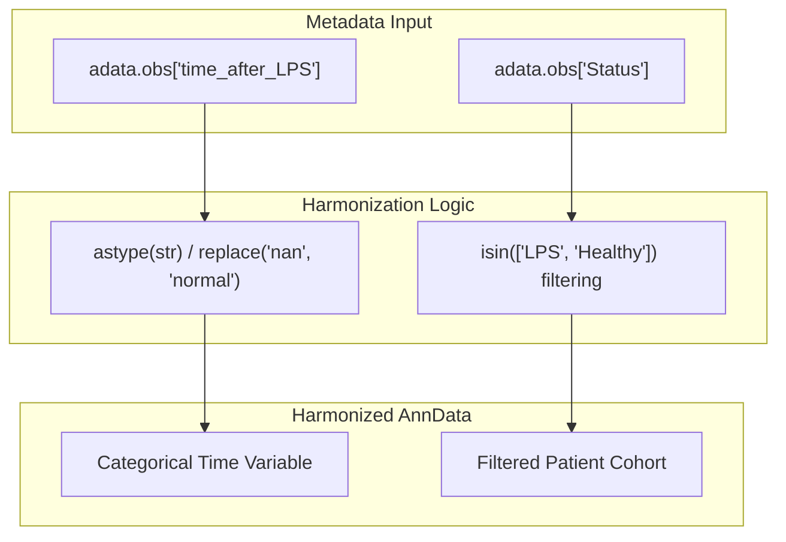

# Data Preprocessing and Curation

<details>
<summary>Relevant source files</summary>

The following files were used as context for generating this wiki page:

- [docs/_static/fig2.png](docs/_static/fig2.png)
- [docs/architecture.png](docs/architecture.png)
- [docs/data.rst](docs/data.rst)
- [docs/examples/cell_gene_embeddings.ipynb](docs/examples/cell_gene_embeddings.ipynb)
- [docs/examples/preprocessing_curation.ipynb](docs/examples/preprocessing_curation.ipynb)
- [perturbgen/pp/__init__.py](perturbgen/pp/__init__.py)
- [perturbgen/pp/ensembl_mapping_dict_gc95M.pkl](perturbgen/pp/ensembl_mapping_dict_gc95M.pkl)
- [perturbgen/pp/gene_median_dict_gftokens_gc95M.pkl](perturbgen/pp/gene_median_dict_gftokens_gc95M.pkl)

</details>


This page describes the technical implementation of the data preprocessing and curation pipeline used to prepare single-cell RNA-seq (scRNA-seq) datasets for PerturbGen. The primary entry point for this stage is the `preprocessing_curation` notebook (`docs/examples/preprocessing_curation.ipynb`), which handles the transformation of raw `AnnData` objects into a harmonized, filtered, and concatenated format suitable for tokenization [docs/examples/preprocessing_curation.ipynb:16-18](). Remote data access guidelines and pretraining corpus downloads are documented in `docs/data.rst` [docs/data.rst:1-11]().

## Pipeline Overview

The preprocessing pipeline ensures that diverse datasets (public and private) share a common feature space and metadata structure. This is critical for the PerturbGen transformer, which relies on consistent gene Ensembl IDs and categorical biological covariates (e.g., time points, cell types).

### Data Flow and Code Entity Mapping

The following diagram illustrates how raw data files are processed through various `scanpy` and `pandas` operations to reach a curated state, mapping the abstract workflow to specific code entities and modules.

**Data Transformation Workflow**
```mermaid
graph TD
    subgraph "Input Space"
        A["Raw ".h5ad" Files"/.FTP Download]
    end

    subgraph "Preprocessing ("preprocessing_curation.ipynb")"
        B["sc.read()"]
        C["QC Filtering (MT, Gene Counts)"]
        D["Ensembl ID Mapping ("ensembl_mapping_dict_gc95M.pkl")"]
        E["Metadata Harmonization"]
        F["sc.concat()"]
    end

    subgraph "Output Space"
        G["Curated AnnData"]
    end

    A --> B
    B --> C
    C --> D
    D --> E
    E --> F
    F --> G
```
Sources: [docs/examples/preprocessing_curation.ipynb:107-108](), [docs/examples/preprocessing_curation.ipynb:217-218](), [perturbgen/pp/__init__.py:1-7]()

---

## 1. Quality Control (QC) Filtering

The pipeline applies standard scRNA-seq quality control metrics to remove low-quality cells and potential doublets that might skew the model's understanding of perturbation effects.

### Filtering Criteria
- **Mitochondrial Content:** Cells with high mitochondrial gene expression (e.g., `pct_counts_mt`) are typically filtered out as they often represent apoptotic or damaged cells [docs/examples/preprocessing_curation.ipynb:129-130]().
- **Gene Counts:** Filtering is performed based on `n_genes_by_counts` and `total_counts` to ensure each cell has sufficient information for the transformer encoder [docs/examples/preprocessing_curation.ipynb:129-129]().
- **Condition Selection:** The notebook demonstrates subsetting the `AnnData.obs` to include only relevant biological conditions, such as "LPS" and "Healthy" [docs/examples/preprocessing_curation.ipynb:217-218]().

Sources: [docs/examples/preprocessing_curation.ipynb:128-134](), [docs/examples/preprocessing_curation.ipynb:217-218]()

---

## 2. Metadata Harmonization and Curation

To enable cross-study training, metadata columns must be standardized. This involves converting continuous or noisy strings into ordered categorical variables.

### Timepoint Normalization
The pipeline converts time-related observations into a unified categorical format. For example, in the LPS dataset, `nan` values are mapped to "normal" (control), and specific timepoints are labeled with suffixes to indicate the perturbation [docs/examples/preprocessing_curation.ipynb:235-253]().

| Original `obs['time_after_LPS']` | Processed Category | Role |
| :--- | :--- | :--- |
| `nan` | `normal` | Control/Baseline |
| `90m` | `90m_LPS` | Early Response |
| `10h` | `10h_LPS` | Late Response |

### Cell-Type Harmonization
Different studies often use varying nomenclature for the same cell types. The curation process involves mapping these to a common set of labels (e.g., mapping "CD14+ Monocytes" and "Mono_CD14" to a single "Monocyte" category) to allow the model to learn cell-type-specific perturbation responses across different data sources.

**Metadata Processing Architecture**

Sources: [docs/examples/preprocessing_curation.ipynb:235-253](), [docs/examples/preprocessing_curation.ipynb:217-218]()

---

## 3. Feature Space Alignment (Ensembl ID Mapping)

PerturbGen uses a gene-based tokenization strategy. To ensure compatibility with the pretrained Geneformer-style foundation model, all genes must be represented by their Ensembl IDs, configured via lookup dictionaries stored in `perturbgen/pp/` [perturbgen/pp/__init__.py:1-7]().

- **Mapping Files:** Dictionaries such as `ENSEMBL_MAPPING_FILE` (`ensembl_mapping_dict_gc95M.pkl`) and `GENE_MEDIAN_FILE` (`gene_median_dict_gftokens_gc95M.pkl`) translate gene symbols to canonical Ensembl stable IDs [perturbgen/pp/__init__.py:5-7]().
- **Intersection:** When concatenating multiple datasets, the pipeline ensures gene intersection or padding to maintain consistent feature dimensionality.

Sources: [perturbgen/pp/__init__.py:1-7](), [docs/examples/preprocessing_curation.ipynb:128-130]()

---

## 4. Cross-Study Concatenation and Data Access

The final step of the curation process is the merging of different `AnnData` objects into a single master object. Large-scale public and manuscript datasets are hosted on S3-compatible object storage at the Wellcome Sanger Institute and can be downloaded via AWS CLI [docs/data.rst:1-24]().

### Implementation Details
The concatenation uses `scanpy.concat()` or `anndata.concat()` to join objects along the observation axis [docs/examples/preprocessing_curation.ipynb:16-18](). Key considerations include:
1. **Layer Management:** Ensuring that the `raw` counts are preserved in a specific layer (e.g., `adata.layers['raw']`), as the PerturbGen count decoder requires raw counts for its ZINB/NB loss functions [docs/examples/preprocessing_curation.ipynb:133-133]().
2. **Observation Uniqueness:** Appending study-specific prefixes to `obs_names` to prevent index collisions.
3. **Categorical Consistency:** Aligning the `categories` of biological covariates across all sub-datasets to prevent "category mismatch" errors during PyTorch data loading.

Sources: [docs/examples/preprocessing_curation.ipynb:128-134](), [docs/data.rst:1-37]()

---