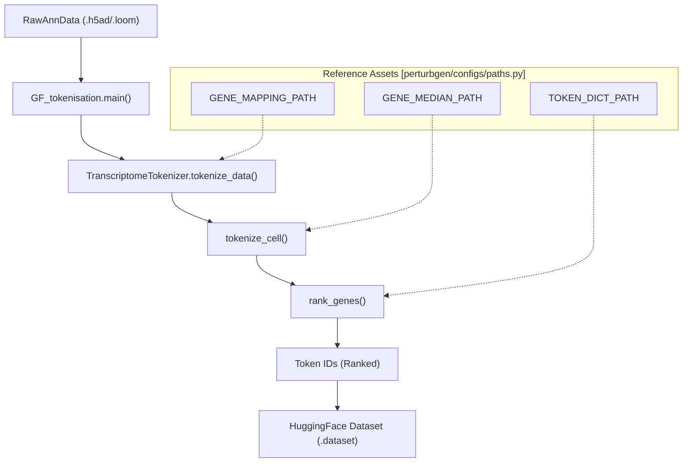
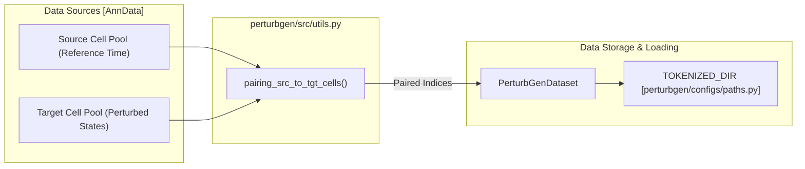

# Tokenization and Cell Pairing

Relevant source files

The following files were used as context for generating this wiki page:

- [perturbgen/configs/__init__.py](perturbgen/configs/__init__.py)
- [perturbgen/configs/paths.py](perturbgen/configs/paths.py)
- [perturbgen/pp/GF_tokenisation.py](perturbgen/pp/GF_tokenisation.py)
- [perturbgen/pp/token_dict_gftokens_gc95M.pkl](perturbgen/pp/token_dict_gftokens_gc95M.pkl)
- [perturbgen/pp/tokenizer.py](perturbgen/pp/tokenizer.py)
- [perturbgen/src/gf_utils.py](perturbgen/src/gf_utils.py)

## Purpose and Scope
This page details the Geneformer-style tokenization and cell pairing pipeline in PerturbGen. It covers how raw single-cell RNA-seq transcriptomes are converted into rank-value encoded token sequences, how genes are filtered and mapped using reference dictionaries (`perturbgen/pp/token_dict_gftokens_gc95M.pkl`, `perturbgen/pp/gene_median_dict_gftokens_gc95M.pkl`), and how source-to-target cell pairing strategies (`random`, `stratified`, `mapping`) prepare paired datasets for downstream transformer models.

Sources: [perturbgen/pp/tokenizer.py:1-40](), [perturbgen/pp/GF_tokenisation.py:1-36](), [perturbgen/configs/paths.py:1-35]()

---

## Geneformer-Style Tokenization and Ranking
PerturbGen uses a rank-value encoding scheme adapted from Geneformer. Instead of raw or log-normalized values, expression vectors are normalized, scaled by global gene medians across a large reference corpus, and sorted by relative expression.

### Core Ranking Functions
The low-level transformation is implemented in `perturbgen/pp/tokenizer.py`:
* `rank_genes(gene_vector, gene_tokens)`: Sorts non-zero gene expression vectors in descending order and maps them to corresponding token IDs [perturbgen/pp/tokenizer.py:66-72]().
* `tokenize_cell(gene_vector, gene_tokens)`: Identifies non-zero entries via `np.nonzero` and applies median-scaled ranking [perturbgen/pp/tokenizer.py:75-83]().
* `sum_ensembl_ids(...)`: Collapses duplicate Ensembl IDs by summing counts when mapping input genes to reference dictionaries [perturbgen/pp/GF_tokenisation.py:86-140]().

**Figure 1: Tokenization Pipeline & Code Entities**

Sources: [perturbgen/pp/tokenizer.py:66-83](), [perturbgen/pp/GF_tokenisation.py:213-233](), [perturbgen/configs/paths.py:8-16]()

Sources: [perturbgen/pp/tokenizer.py:66-83](), [perturbgen/pp/GF_tokenisation.py:213-233]()

---

## Gene Filtering and Selection Modes
The `perturbgen/pp/GF_tokenisation.py` script exposes command-line arguments to control how genes and cells are filtered before or after tokenization [perturbgen/pp/GF_tokenisation.py:37-211]().

### Configuration Parameters
| CLI Argument | Choices / Type | Default | Role |
| :--- | :--- | :--- | :--- |
| `--gene_filtering_mode` | `hvg`, `degs`, `all` | `hvg` | Strategy for gene subsetting [perturbgen/pp/GF_tokenisation.py:53-58]() |
| `--hvg_mode` | `before_tokenisation`, `after_tokenisation` | `before_tokenisation` | When to calculate highly variable genes [perturbgen/pp/GF_tokenisation.py:60-65]() |
| `--hvg_flavor` | `seurat`, `seurat_v3`, `cell_ranger` | `seurat` | Scanpy highly variable genes flavor [perturbgen/pp/GF_tokenisation.py:67-76]() |
| `--pairing_mode` | `stratified`, `random`, `mapping` | `random` | Cell pairing strategy between source and target [perturbgen/pp/GF_tokenisation.py:87-92]() |
| `--exclude_non_GF_genes` | boolean | `False` | Exclude genes absent from the Geneformer dictionary [perturbgen/pp/GF_tokenisation.py:145-149]() |
| `--remove_mito_ribo_genes` | boolean | `False` | Exclude mitochondrial and ribosomal genes [perturbgen/pp/GF_tokenisation.py:150-155]() |

Sources: [perturbgen/pp/GF_tokenisation.py:37-180]()

---

## Source-to-Target Cell Pairing Strategies
To train the model on perturbation responses, PerturbGen pairs source (control/baseline) cells with target (perturbed/treated) cells across timepoints or conditions using `pairing_src_to_tgt_cells` from `perturbgen/src/utils.py` [perturbgen/pp/GF_tokenisation.py:14-22]().

### Pairing Strategies Overview
* **Random (`random`)**: Pairs source and target cells randomly without covariate constraints. Best for homogeneous populations or baseline setups [perturbgen/pp/GF_tokenisation.py:87-92]().
* **Stratified (`stratified`)**: Constrains pairing within shared biological covariates (e.g., cell type, donor, or developmental stage specified by `main_pairing_obs`) [perturbgen/pp/GF_tokenisation.py:107-118]().
* **Mapping (`mapping`)**: Uses an external mapping file (`pairing_file`) to establish deterministic source-to-target correspondences based on lineage trajectories [perturbgen/pp/GF_tokenisation.py:101-106]().

**Figure 2: Cell Pairing Code Architecture**

Sources: [perturbgen/pp/GF_tokenisation.py:87-118](), [perturbgen/configs/paths.py:28-35](), [perturbgen/src/utils.py:14-22]()

Sources: [perturbgen/pp/GF_tokenisation.py:87-118](), [perturbgen/src/utils.py:14-22]()

---