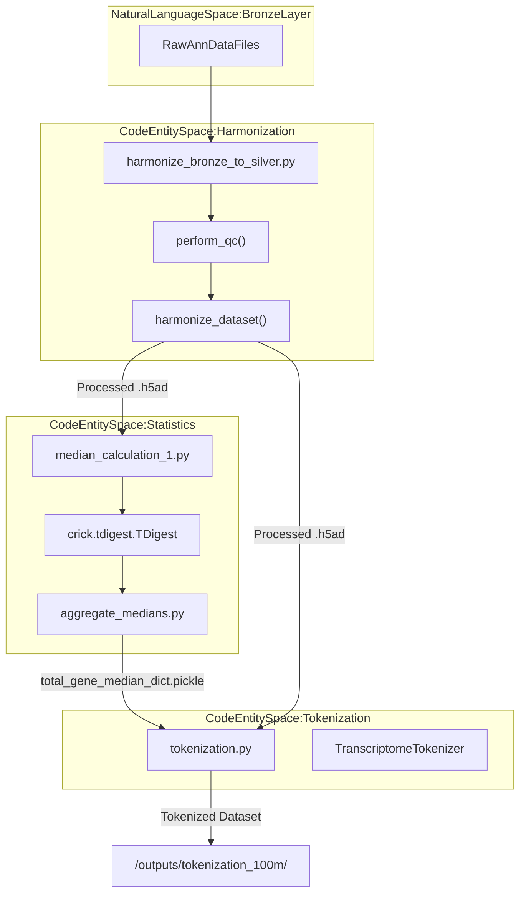
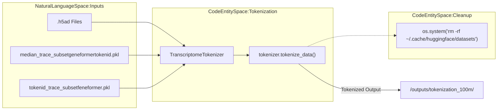

# Pretraining Cohort Pipeline

Relevant source files

The following files were used as context for generating this wiki page:

- [pretraining_cohort/median_calculation/aggregate_medians.py](pretraining_cohort/median_calculation/aggregate_medians.py)
- [pretraining_cohort/median_calculation/median_calculation_1.py](pretraining_cohort/median_calculation/median_calculation_1.py)
- [pretraining_cohort/preprocessing/config_am74.yaml](pretraining_cohort/preprocessing/config_am74.yaml)
- [pretraining_cohort/preprocessing/harmonize_bronze_to_silver.py](pretraining_cohort/preprocessing/harmonize_bronze_to_silver.py)
- [pretraining_cohort/preprocessing/launch_harmonize.sh](pretraining_cohort/preprocessing/launch_harmonize.sh)
- [pretraining_cohort/preprocessing/readme](pretraining_cohort/preprocessing/readme)
- [pretraining_cohort/tokenization/tokenization.py](pretraining_cohort/tokenization/tokenization.py)

The Pretraining Cohort Pipeline is a high-throughput data infrastructure designed to process a 100M-cell corpus from raw "bronze" data to tokenized "silver" datasets suitable for training the `scmaskgit` foundation model. It handles metadata harmonization, quality control (QC), large-scale gene expression normalization via TDigest, and bulk tokenization.

## Pipeline Overview

The pipeline operates in three distinct phases, typically executed on high-performance computing (HPC) environments (e.g., Sanger COG/S3 infrastructure) using SLURM or similar job schedulers:

1.  **Bronze-to-Silver Harmonization**: Raw `AnnData` files are standardized, filtered for protein-coding genes, and subjected to automated quality control.
2.  **Global Gene Median Calculation**: To perform rank-based tokenization across 100M cells, the pipeline calculates global non-zero medians for every gene using `crick.tdigest` to prevent memory overflow.
3.  **Bulk Tokenization**: Standardized datasets are converted into ranked token sequences using the `Geneformer`-based `TranscriptomeTokenizer`.

### Data Flow and Code Entity Mapping

The following diagram bridges natural language functional descriptions to specific code entities and files within the pipeline infrastructure.

**Pretraining Data Infrastructure Flow**

Sources: [pretraining_cohort/preprocessing/harmonize_bronze_to_silver.py:1-150](), [pretraining_cohort/median_calculation/median_calculation_1.py:1-62](), [pretraining_cohort/median_calculation/aggregate_medians.py:1-65](), [pretraining_cohort/tokenization/tokenization.py:1-41]()

---

## 1. Bronze-to-Silver Harmonization

The harmonization script `harmonize_bronze_to_silver.py` transforms raw datasets into a unified format. This is orchestrated by `launch_harmonize.sh`, which loads the required environment modules and activates the `scanpy` conda environment [pretraining_cohort/preprocessing/launch_harmonize.sh:1-15]().

### Key Functions and Modules
*   **`perform_qc(adata, ...)`**: Executes quality control by detecting mitochondrial (`MT-`), ribosomal (`RPS`/`RPL`), and hemoglobin (`HB`) genes [pretraining_cohort/preprocessing/harmonize_bronze_to_silver.py:82-92](). It uses Median Absolute Deviation (MAD) via `is_outlier()` to flag and remove cells exceeding thresholds in `log1p_total_counts`, `log1p_n_genes_by_counts`, and `pct_counts_mt` [pretraining_cohort/preprocessing/harmonize_bronze_to_silver.py:105-124]().
*   **`harmonize_dataset(config)`**: Maps heterogeneous metadata fields (`development_stage`, `tissue`, `disease`) to a controlled vocabulary using pickle-based mapping dictionaries loaded via `load_pickle()` [pretraining_cohort/preprocessing/harmonize_bronze_to_silver.py:147-180]().
*   **Gene Filtering**: Filters out non-coding elements like `LINC` and `MIR` genes alongside unwanted Ensembl IDs specified in `remove_ensembl_txt` [pretraining_cohort/preprocessing/harmonize_bronze_to_silver.py:52-79]().

### Configuration Entity Mapping
| Code Entity | Purpose | Source |
| :--- | :--- | :--- |
| `input_dir` | Path to raw HTAN/Atlas datasets | [pretraining_cohort/preprocessing/config_am74.yaml:1]() |
| `dev_stage_map` | Dictionary path for age/stage normalization | [pretraining_cohort/preprocessing/config_am74.yaml:3]() |
| `tissue_map` | Dictionary path for tissue harmonization | [pretraining_cohort/preprocessing/config_am74.yaml:4]() |
| `disease_map` | Dictionary path for disease harmonization | [pretraining_cohort/preprocessing/config_am74.yaml:5]() |
| `gene_filtering` | Parameters for removing non-coding/low-quality genes | [pretraining_cohort/preprocessing/config_am74.yaml:9-11]() |

Sources: [pretraining_cohort/preprocessing/harmonize_bronze_to_silver.py:32-152](), [pretraining_cohort/preprocessing/config_am74.yaml:1-11]()

---

## 2. Large-Scale Median Calculation

Rank-based tokenization requires the median non-zero expression of each gene across the entire corpus. Calculating this across 100M cells is computationally prohibitive with standard in-memory arrays.

### Implementation with TDigest
The pipeline uses the `crick` library's `TDigest` data structure to perform incremental, memory-efficient estimation of quantiles.

1.  **Local Calculation (`median_calculation_1.py`)**: 
    *   Iterates through each `.h5ad` file in `input_dir` [pretraining_cohort/median_calculation/median_calculation_1.py:16-20]().
    *   Normalizes raw counts to counts-per-10k (`norm_X`) [pretraining_cohort/median_calculation/median_calculation_1.py:32-34]().
    *   Updates a `crick.tdigest.TDigest()` object for each gene using only non-zero values [pretraining_cohort/median_calculation/median_calculation_1.py:40-45]().
    *   Serializes and saves a `.pickle` containing the file-level median digest dictionary [pretraining_cohort/median_calculation/median_calculation_1.py:48-51]().

2.  **Aggregation (`aggregate_medians.py`)**:
    *   Walks through the output directory via `merge_all_tdigests()` and merges all individual `TDigest` objects using `dict_value_tdigest.merge(new_gene_tdigest)` [pretraining_cohort/median_calculation/aggregate_medians.py:6-37]().
    *   Computes the final 0.5 quantile (median) for each gene to produce `total_gene_median_dict.pickle` and `detected_gene_median_dict.pickle` [pretraining_cohort/median_calculation/aggregate_medians.py:51-57]().

Sources: [pretraining_cohort/median_calculation/median_calculation_1.py:16-51](), [pretraining_cohort/median_calculation/aggregate_medians.py:6-57]()

---

## 3. Bulk Tokenization

The final stage converts normalized expression values into token sequences using `TranscriptomeTokenizer`.

### Tokenization Architecture and Execution
The script `tokenization.py` initializes the tokenizer with the global medians, token dictionaries, and gene mapping files [pretraining_cohort/tokenization/tokenization.py:11-18]().

**Tokenization System Architecture**

Sources: [pretraining_cohort/tokenization/tokenization.py:1-41]()

### Key Parameters and Configuration
*   **`model_input_size=4096`**: Sets the maximum sequence length for the transformer model [pretraining_cohort/tokenization/tokenization.py:13]().
*   **`use_generator=True`**: Streams data dynamically to prevent memory exhaustion during bulk tokenization [pretraining_cohort/tokenization/tokenization.py:34]().
*   **`nproc=32`**: Parallelizes processing across 32 CPU cores [pretraining_cohort/tokenization/tokenization.py:17]().
*   **Cache Management**: Explicitly purges Hugging Face dataset caches between iterations to manage storage overhead on shared HPC nodes [pretraining_cohort/tokenization/tokenization.py:41]().

Sources: [pretraining_cohort/tokenization/tokenization.py:1-41]()

---