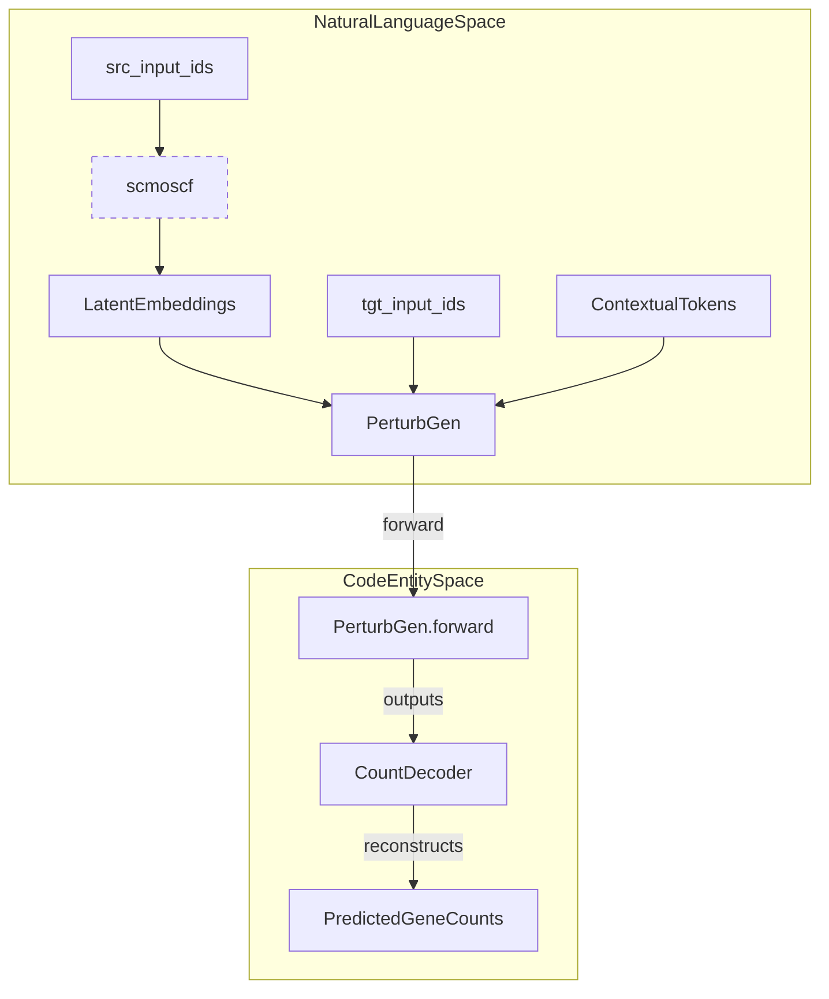
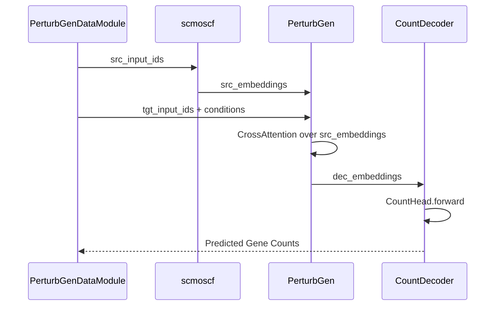

# Model Architecture

Relevant source files

The following files were used as context for generating this wiki page:

- [docs/index.rst](docs/index.rst)
- [perturbgen/Modules/transformer.py](perturbgen/Modules/transformer.py)

PerturbGen is a trajectory-aware, generative transformer designed to predict cellular responses to perturbations across time and state transitions. It formulates perturbation modeling as a sequence-to-sequence (S2S) problem, mapping an unperturbed source cell state to a perturbed target state at a later time point [docs/index.rst:11-11]().

The architecture is composed of two primary stages: a masking model for generating gene-token sequences and a count decoder for reconstructing gene expression values [docs/index.rst:11-11]().

### High-Level Design

PerturbGen utilizes an encoder-decoder Transformer framework [docs/index.rst:11-11](). The model is designed to handle high-dimensional single-cell data by representing cells as ranked gene sequences, following a Geneformer-style tokenization [docs/index.rst:11-11]().

**Sources:** [docs/index.rst:11-11](), [perturbgen/Modules/transformer.py:18-18](), [perturbgen/Modules/transformer.py:255-265]()

---

### Component Overview

#### 3.1 scmaskgit: Pretrained Encoder Foundation Model
The encoder is a pretrained 12-layer foundation model (`scmoscf`) from the `scmaskgit` sub-package [perturbgen/Modules/transformer.py:17-17](), [docs/index.rst:11-11](). It is typically frozen during PerturbGen training to provide stable, high-quality embeddings of the source cell state. It is trained on a corpus of 100M+ cells to capture fundamental gene-gene relationships.

For details, see [scmaskgit: Pretrained Encoder Foundation Model](#3.1).

**Sources:** [docs/index.rst:11-11](), [perturbgen/Modules/transformer.py:17-18]()

#### 3.2 PerturbGen Transformer: Masking Model and Decoder
The core of PerturbGen is the `PerturbGen` class in `perturbgen/Modules/transformer.py` [perturbgen/Modules/transformer.py:255-255](). This module implements:
*   **Positional Encoding:** Supports multiple modes including `time_pos_sin` and `comb_sin` to handle multi-timepoint trajectories via `PositionalEncoding` [perturbgen/Modules/transformer.py:34-49]().
*   **Cross-Attention:** The decoder uses cross-attention to attend to the source embeddings while performing self-attention over the target sequence [docs/index.rst:11-11]().
*   **Count Decoder:** A specialized `CountDecoder` (or `CountHead`) MLP maps the transformer's latent embeddings back to transcript counts using probabilistic models like ZINB or NB [perturbgen/Modules/transformer.py:534-540]().

For details, see [PerturbGen Transformer: Masking Model and Decoder](#3.2).

**Sources:** [docs/index.rst:11-11](), [perturbgen/Modules/transformer.py:34-49](), [perturbgen/Modules/transformer.py:255-255]()

#### 3.3 MaskGIT-Style Iterative Generation
Unlike autoregressive models, PerturbGen uses a non-autoregressive iterative refinement scheme [docs/index.rst:11-11](). This is implemented in the `PerturberMasking` class, which extends the base transformer with a `generate_sequence` loop [perturbgen/Perturb/transformer.py:22-127]().
*   **Mask Schedulers:** Uses functions like `cosine`, `pow`, or `log` via `noise_schedule` to determine the number of tokens to unmask at each iteration [perturbgen/Modules/transformer.py:29-29]().
*   **Sampling:** Employs Gumbel sampling (`gumbel_sample`) and top-k filtering (`top_k`) to select the most confident gene tokens [perturbgen/Modules/transformer.py:27-30]().

For details, see [MaskGIT-Style Iterative Generation](#3.3).

**Sources:** [docs/index.rst:11-11](), [perturbgen/Modules/transformer.py:25-32]()

---

### Data Flow and Logic

The following diagram illustrates how specific code entities interact to transform input tokens into predicted counts.

**Sources:** [perturbgen/Modules/transformer.py:18-18](), [perturbgen/Modules/transformer.py:255-265](), [perturbgen/Modules/transformer.py:534-540]()

### Summary Table of Architectural Components

| Component | Code Entity | Primary Responsibility |
| :--- | :--- | :--- |
| **Encoder** | `scmaskgit.Modules.T_model.scmoscf` | Embedding source cell gene sequences [perturbgen/Modules/transformer.py:18](). |
| **Decoder** | `perturbgen.Modules.transformer.PerturbGen` | Predicting target tokens using cross-attention [perturbgen/Modules/transformer.py:255](). |
| **Positional Encoding** | `perturbgen.Modules.transformer.PositionalEncoding` | Injecting time and gene-rank information [perturbgen/Modules/transformer.py:34](). |
| **Generation Loop** | `perturbgen.Perturb.transformer.PerturberMasking` | Iterative MaskGIT-style sequence refinement [perturbgen/Perturb/transformer.py:22](). |
| **Count Head** | `perturbgen.Modules.transformer.CountDecoder` | Mapping embeddings to gene expression counts [perturbgen/Modules/transformer.py:534](). |

**Sources:** [perturbgen/Modules/transformer.py:18-540](), [perturbgen/Perturb/transformer.py:22-22]()

---