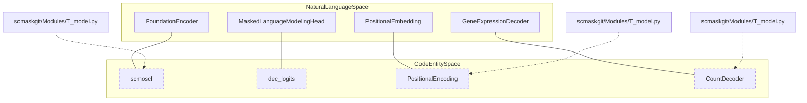
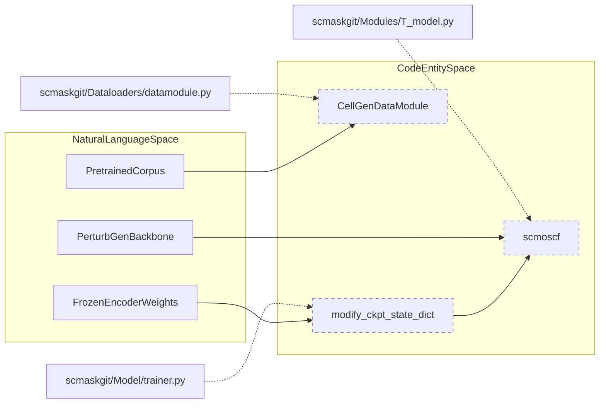

# scmaskgit: Pretrained Encoder Foundation Model

Relevant source files

The following files were used as context for generating this wiki page:

- [scmaskgit/Dataloaders/datamodule.py](scmaskgit/Dataloaders/datamodule.py)
- [scmaskgit/Model/__init__.py](scmaskgit/Model/__init__.py)
- [scmaskgit/Model/trainer.py](scmaskgit/Model/trainer.py)
- [scmaskgit/Modules/T_model.py](scmaskgit/Modules/T_model.py)
- [scmaskgit/Modules/__init__.py](scmaskgit/Modules/__init__.py)
- [scmaskgit/hpo.py](scmaskgit/hpo.py)
- [scmaskgit/pp/mpl_style.mplstyle](scmaskgit/pp/mpl_style.mplstyle)
- [scmaskgit/pp/plt_tokenisation.py](scmaskgit/pp/plt_tokenisation.py)
- [scmaskgit/train.py](scmaskgit/train.py)
- [scmaskgit/val.py](scmaskgit/val.py)

The `scmaskgit` sub-package provides the foundation model infrastructure for PerturbGen. It consists of a large-scale transformer-based encoder trained on over 100 million single cells, designed to extract robust biological representations from single-cell gene expression data. This encoder is subsequently utilized by PerturbGen as a frozen feature extractor for downstream perturbation modeling.

## Architectural Overview and T_model Components

The core architecture, defined in `scmoscf` [scmaskgit/Modules/T_model.py:1218-1240](), follows a Masked Language Modeling (MLM) paradigm similar to BERT or Geneformer but optimized for single-cell genomics. It supports multiple encoding modes, including frozen Geneformer weights, fine-tuned variants, or a custom transformer encoder [scmaskgit/Model/trainer.py:85-87]().

### Key Architectural Modules

*   **`scmoscf` (Transformer Model):** The primary orchestration class managing the encoder-decoder flow for masked gene token modeling [scmaskgit/Modules/T_model.py:1218-1240]().
*   **`PositionalEncoding`:** Supports various positional and temporal embedding modes, including `time_pos_sin` (sinusoidal encoding for time and position), `comb_sin`, `sin_learnt`, and `time_pos_learnt` [scmaskgit/Modules/T_model.py:32-46]().
*   **`CrossAttention`:** A flexible attention module supporting both self-attention and cross-attention between different timepoints or cellular contexts [scmaskgit/Modules/T_model.py:176-185]().
*   **`Mlp`:** Standard multilayer perceptron block with GELU activation and configurable dropout [scmaskgit/Modules/T_model.py:149-173]().
*   **`CountDecoder`:** MLP-based decoder head used to map latent representations back to gene expression count distributions (ZINB/NB/MSE) [scmaskgit/Modules/T_model.py:1133-1152]().

### Natural Language to Code Entity Mapping: Architecture

The following diagram maps high-level architectural concepts to their specific implementation classes and files.

**Model Architecture Mapping**

Sources: `[scmaskgit/Modules/T_model.py:32-46, 1133-1152, 1218-1240]()`, `[scmaskgit/Model/trainer.py:182]()`

---

## Datamodule and Data Loading

Data loading is orchestrated via PyTorch Lightning data modules and custom dataset classes [scmaskgit/Dataloaders/datamodule.py:46-109]().

### `CellGenDataset` and `CellGenDataModule`
*   **`CellGenDataset`:** Wraps Hugging Face `DatasetDict` instances, handling time steps, source counts, condition tensors, and custom split indices [scmaskgit/Dataloaders/datamodule.py:46-84]().
*   **`CellGenDataModule`:** Manages `train_dataloader`, `val_dataloader`, and `test_dataloader` generation, loading token dictionaries (e.g., Geneformer `TOKEN_DICTIONARY_FILE`), managing padding tokens (`pad_token_id`), and supporting multi-timepoint modeling (`pred_tps`, `context_tps`) [scmaskgit/Dataloaders/datamodule.py:87-189]().
*   **Padding Utilities:** `pad_tensor` and `pad_tensor_list` handle dynamic or constant tensor padding to uniform sequence lengths [scmaskgit/Dataloaders/datamodule.py:13-42]().

Sources: `[scmaskgit/Dataloaders/datamodule.py:13-189]()`

---

## Losses, Metrics, and Trainer Infrastructure

Training and validation loops are encapsulated within PyTorch Lightning `LightningModule` implementations.

### `CellGenTrainer` Features
*   **Precision Management:** Detects hardware accelerators (e.g., A100/H100) and configures `float32_matmul_precision` [scmaskgit/Model/trainer.py:52-60]().
*   **Loss Functions:** Utilizes `nn.CrossEntropyLoss` for masked language modeling prediction tasks [scmaskgit/Model/trainer.py:120]().
*   **Metrics:** Tracks model performance using `Perplexity` (ignoring padding tokens via `ignore_index=-100`) and `MeanSquaredError` [scmaskgit/Model/trainer.py:127-128]().
*   **Optimizer Configuration:** Configures standard `Adam` optimization with parameter-specific learning rates and weight decay [scmaskgit/Model/trainer.py:162-169]().

Sources: `[scmaskgit/Model/trainer.py:52-169]()`

---

## Hyperparameter Optimization (`hpo.py`)

The sub-package provides `scmaskgit/hpo.py` for automated hyperparameter tuning using **Ray Tune** and **BOHB** (Bayesian Optimization and HyperBand) [scmaskgit/hpo.py:27-29]().

### HPO Configuration Workflow
*   **Command-Line Arguments:** Exposes tuning flags for `--train_mode` (`masking` vs `count`), learning rates (`cellgen_lr`, `count_lr`), weight decays (`cellgen_wd`, `count_wd`), dropout rates, feedforward dimensions (`d_ff`), and mask schedulers (`cosine`, `exp`, `pow`) [scmaskgit/hpo.py:51-166]().
*   **Tune Integration:** Utilizes `_TuneReportCallback` subclassing `TuneReportCallback` and `pl.Callback` to report metrics back to Ray Tune [scmaskgit/hpo.py:15-47]().

Sources: `[scmaskgit/hpo.py:15-47, 51-166]()`

---

## Training and Validation Entrypoints (`train.py` and `val.py`)

Standalone entrypoints facilitate execution across HPC clusters and interactive development environments.

*   **`train.py`:** Parses training arguments (splitting modes, dataset paths, batch sizes, worker counts, loss modes like `zinb`, `nb`, `mse`) and instantiates Lightning trainers [scmaskgit/train.py:42-197]().
*   **`val.py`:** Provides validation and evaluation entrypoints for checking pretrained checkpoints, computing evaluation metrics, and extracting frozen embeddings [scmaskgit/val.py:3-197]().

Sources: `[scmaskgit/train.py:42-197](), [scmaskgit/val.py:3-197]()`

---

## Integration with PerturbGen via Wrapper

Once the `scmaskgit` encoder is pretrained on large-scale single-cell corpora (e.g., 100M+ cells), its frozen weights are loaded into PerturbGen via wrapper utilities.

### Integration Mechanism
*   **Weight Loading:** Checkpoints are loaded and state dictionaries adapted using `modify_ckpt_state_dict` to ensure structural compatibility [scmaskgit/Model/trainer.py:39]().
*   **Frozen Feature Extraction:** PerturbGen leverages the pretrained encoder as a frozen feature extractor (`GF_frozen`), passing tokens through the backbone to generate high-dimensional embeddings [scmaskgit/train.py:204-210](), [scmaskgit/Model/trainer.py:43]().

### Natural Language to Code Entity Mapping: Integration Flow

The following diagram maps the conceptual workflow of loading pretrained weights into PerturbGen.

**Integration Data Flow**

Sources: `[scmaskgit/Dataloaders/datamodule.py:87-189](), [scmaskgit/Model/trainer.py:39](), [scmaskgit/Modules/T_model.py:1218-1240]()`

---