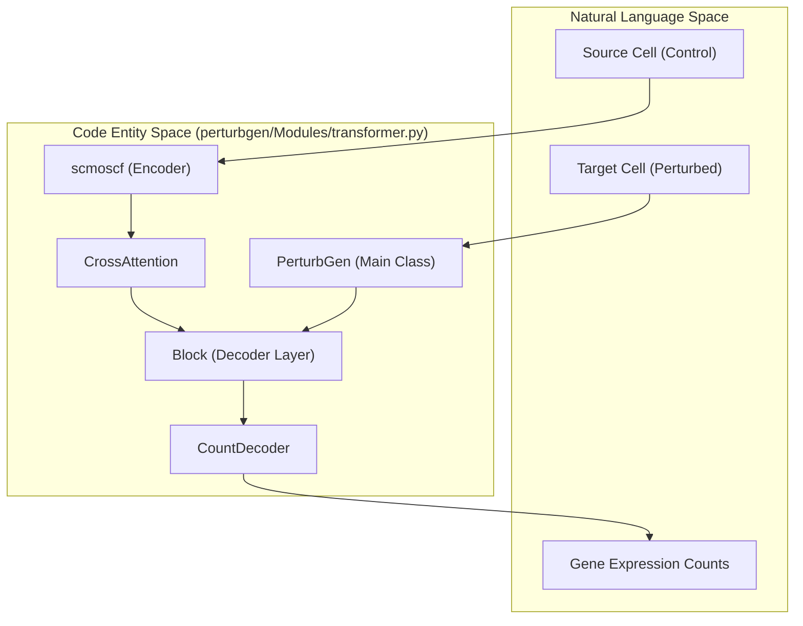
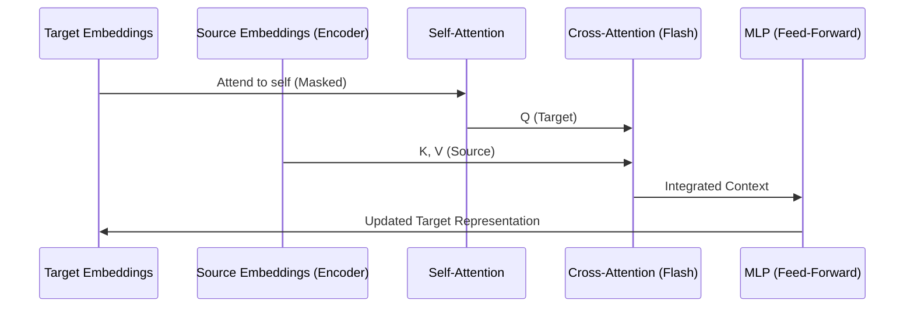
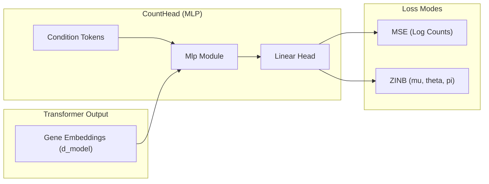

# PerturbGen Transformer: Masking Model and Decoder

Relevant source files

The following files were used as context for generating this wiki page:

- [perturbgen/Modules/transformer.py](perturbgen/Modules/transformer.py)

The PerturbGen architecture is a two-stage transformer-based generative model designed to simulate single-cell perturbations. It consists of a masking model (the encoder-decoder) and a count decoder. The architecture leverages a frozen pretrained encoder (`scmaskgit`) and a specialized transformer decoder that handles multi-timepoint modeling through cross-attention and flexible positional encodings.

### 1. The PerturbGen Encoder-Decoder Architecture

The `PerturbGen` class is the central module that orchestrates the data flow between the source cell (control) and the target cell (perturbed/future state) [perturbgen/Modules/transformer.py:274-285](). It integrates a pretrained encoder, a transformer decoder, and a count head.

#### Core Components
- **Encoder**: Typically uses `scmoscf` from the `scmaskgit` package [perturbgen/Modules/transformer.py:17](). It is loaded as a frozen foundation model to provide high-quality embeddings of the source cell [perturbgen/Modules/transformer.py:316-324]().
- **Decoder**: A custom transformer decoder that uses `Block` modules with `CrossAttention` to attend to the source cell's embeddings while generating the target sequence [perturbgen/Modules/transformer.py:461-480]().
- **Count Decoder**: An MLP-based head that maps the generated gene embeddings back to numerical expression values [perturbgen/Modules/transformer.py:650-659]().

**PerturbGen Entity Mapping**

Sources: [perturbgen/Modules/transformer.py:17-21](), [perturbgen/Modules/transformer.py:274-330](), [perturbgen/Modules/transformer.py:461-480]().

---

### 2. Positional Encoding Modes

The `PositionalEncoding` class handles both spatial (gene rank) and temporal (timepoint) information. This is critical for multi-timepoint modeling where the model must distinguish between cells at different stages of a perturbation response [perturbgen/Modules/transformer.py:32-47]().

| Mode | Description | Use Case |
| :--- | :--- | :--- |
| `time_pos_sin` | Separate sinusoidal encodings for time and position, summed together [perturbgen/Modules/transformer.py:85-91](). | Default; allows for time interpolation. |
| `comb_sin` | A single sinusoidal encoding across a flattened (time * length) sequence [perturbgen/Modules/transformer.py:92-96](). | Strictly ordered time sequences. |
| `sin_learnt` | Sinusoidal time encoding with learned gene position embeddings [perturbgen/Modules/transformer.py:97-103](). | Fixed gene sets with temporal flexibility. |
| `time_pos_learnt` | Fully learned embeddings for both time and position [perturbgen/Modules/transformer.py:104-110](). | Highest flexibility; no extrapolation. |

Sources: [perturbgen/Modules/transformer.py:32-112](), [perturbgen/Modules/transformer.py:137-161]().

---

### 3. Decoder Blocks and Flash Attention

The decoder is composed of multiple `Block` modules. Each block contains a self-attention layer for the target sequence and a cross-attention layer to integrate source information [perturbgen/Modules/transformer.py:461-480]().

#### CrossAttention with Flash Attention
The `CrossAttention` module implements multi-head attention where the Queries (Q) come from the target sequence, and Keys (K) and Values (V) come from the source (encoder) output [perturbgen/Modules/transformer.py:417-430]().
- **Flash Attention Integration**: It utilizes `scaled_dot_product_attention` with the `sdpa_kernel` to enable Flash Attention (Memory Efficient/Flash) when supported by the hardware, significantly reducing memory overhead for long gene sequences [perturbgen/Modules/transformer.py:441-455]().

**Data Flow in Decoder Block**

Sources: [perturbgen/Modules/transformer.py:417-455](), [perturbgen/Modules/transformer.py:461-490]().

---

### 4. Context Generation for Multi-Timepoint Modeling

PerturbGen supports "contextual" generation, where information from previous timepoints is used to predict the next. This is managed by the `context_tps` and `pred_tps` parameters [perturbgen/Modules/transformer.py:291-295]().

In the `forward` pass, the model:
1. Concatenates embeddings from context timepoints [perturbgen/Modules/transformer.py:535-540]().
2. Aggregates these via the `Block` layers using cross-attention [perturbgen/Modules/transformer.py:545-555]().
3. This allows the model to "see" the trajectory of a cell's state across multiple observed timepoints before predicting the perturbed state [perturbgen/Modules/transformer.py:560-570]().

Sources: [perturbgen/Modules/transformer.py:291-300](), [perturbgen/Modules/transformer.py:530-570]().

---

### 5. CountDecoder and CountHead

The `CountDecoder` (Phase 2 of training) is responsible for converting the high-dimensional gene embeddings produced by the transformer into actual transcript counts [perturbgen/Modules/transformer.py:650-659]().

#### CountHead MLP
The `CountHead` is a multi-layer perceptron that processes the decoder's output. It can be configured for different loss distributions:
- **MSE**: Predicts normalized log counts directly.
- **NB/ZINB**: Predicts parameters (mean $\mu$, dispersion $\theta$, and dropout $\pi$) for Negative Binomial or Zero-Inflated Negative Binomial distributions [perturbgen/Modules/transformer.py:610-630]().

#### Implementation Details
- **Conditioning**: The `CountHead` can be conditioned on batch or cell-type metadata using `concat_cond_tokens` to account for technical variation [perturbgen/src/utils.py:207-220]().
- **Size Factors**: It incorporates library size factors to ensure the predicted counts are properly scaled to the original cell's sequencing depth [perturbgen/Modules/transformer.py:665-675]().

**Count Decoding Logic**

Sources: [perturbgen/Modules/transformer.py:164-190](), [perturbgen/Modules/transformer.py:610-675](), [perturbgen/src/utils.py:207-230]().

---