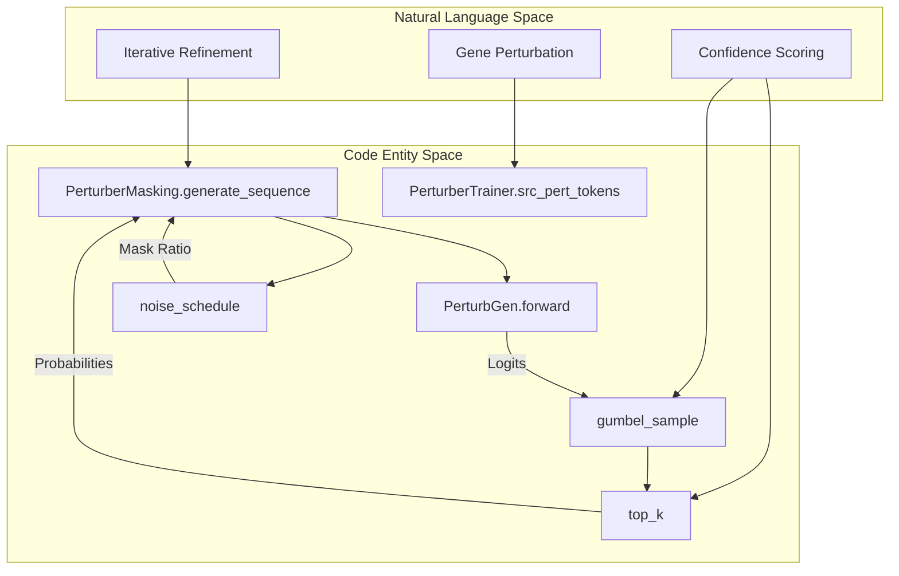
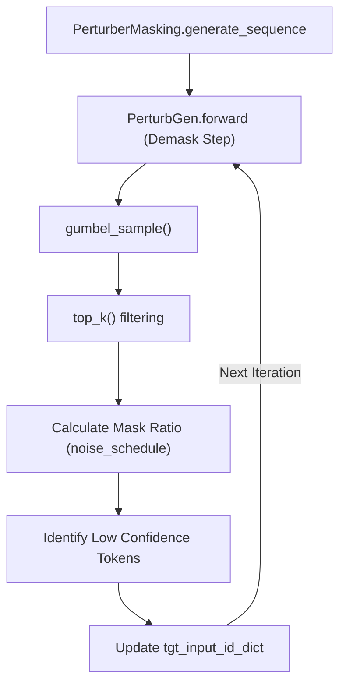

# MaskGIT-Style Iterative Generation

Relevant source files

The following files were used as context for generating this wiki page:

- [perturbgen/Modules/transformer.py](perturbgen/Modules/transformer.py)
- [perturbgen/Perturb/trainer.py](perturbgen/Perturb/trainer.py)
- [perturbgen/Perturb/transformer.py](perturbgen/Perturb/transformer.py)
- [perturbgen/batch_job_script/cytoimmgen/extrapolation/3_run_train_count_extrapolation.sh](perturbgen/batch_job_script/cytoimmgen/extrapolation/3_run_train_count_extrapolation.sh)
- [perturbgen/run_test.sh](perturbgen/run_test.sh)
- [perturbgen/src/utils.py](perturbgen/src/utils.py)

PerturbGen utilizes a non-autoregressive iterative decoding scheme inspired by MaskGIT to simulate single-cell gene expression profiles. Unlike traditional autoregressive models that generate tokens sequentially, PerturbGen predicts multiple gene tokens simultaneously and refines them over several iterations using a confidence-based remasking strategy [perturbgen/Perturb/transformer.py:127-143]().

## Generation Scheme Overview

The iterative generation process is primarily managed by the `PerturberMasking.generate_sequence` loop. This method takes a partially masked sequence and iteratively "demasks" tokens based on the model's prediction confidence [perturbgen/Perturb/transformer.py:127-186]().

### Iterative Loop Logic
1.  **Initialization**: The target sequence is initialized with the `mask_token` for all positions except for fixed prompts/conditioning tokens [perturbgen/Perturb/transformer.py:99-102]().
2.  **Model Prediction**: In each iteration, the `PerturbGen` model performs a forward pass to predict the logits for all masked positions [perturbgen/Perturb/transformer.py:246-250]().
3.  **Sampling**: Token candidates are selected using Gumbel sampling and top-k filtering to maintain biological diversity [perturbgen/Perturb/transformer.py:255-265]().
4.  **Confidence Calculation**: The model calculates confidence scores for each predicted token.
5.  **Remasking**: Based on a predefined mask scheduler, the least confident tokens are reverted to the `mask_token` for the next iteration [perturbgen/Perturb/transformer.py:298-315]().

### Data Flow: Generation to Code Entities
The following diagram illustrates the relationship between the iterative generation logic and the specific code modules involved.

**Iterative Generation Data Flow**

Sources: [perturbgen/Perturb/transformer.py:127-186](), [perturbgen/Perturb/trainer.py:158-176](), [perturbgen/src/utils.py:25-30]()

---

## Mask Schedulers

The number of tokens to remain masked at each iteration $i$ is determined by a mask scheduler $\gamma(r)$, where $r = i/N$ (ratio of current iteration to total iterations). PerturbGen implements several scheduling functions in `perturbgen.src.utils.noise_schedule` [perturbgen/src/utils.py:27]().

| Scheduler | Formula / Behavior | Use Case |
| :--- | :--- | :--- |
| **Cosine** | $\cos(\frac{\pi}{2} \cdot r)$ | Smooth transition, standard for MaskGIT. |
| **Pow** | $1 - r^k$ | Accelerated demasking at early or late stages. |
| **Log** | $-\log(r)$ | Slower demasking initially. |
| **Exp** | $\exp(-r)$ | Rapid initial demasking. |
| **Uniform** | $1 - r$ | Linear demasking rate. |

Sources: [perturbgen/Perturb/transformer.py:67-68](), [perturbgen/src/utils.py:27]()

---

## Confidence-Based Remasking

At the end of each iteration, the model must decide which predicted tokens to keep and which to remask. This is handled by the `can_remask_prev_masked` logic within `generate_sequence` [perturbgen/Perturb/transformer.py:135-136]().

1.  **Logit Extraction**: The model extracts logits for the `mask_token` positions.
2.  **Temperature Scaling**: Logits are scaled by a `starting_temperature` to control the randomness of the output [perturbgen/Perturb/transformer.py:137]().
3.  **Top-k Filtering**: Low-probability tokens are filtered out to prevent the model from sampling biologically implausible gene sequences [perturbgen/Perturb/transformer.py:258-262]().
4.  **Remasking Map**: A mask is created where tokens with the lowest confidence scores (relative to the scheduler's required mask ratio) are reset to `self.mask_token` [perturbgen/Perturb/transformer.py:305-315]().

**Remasking Logic Diagram**

Sources: [perturbgen/Perturb/transformer.py:246-315](), [perturbgen/src/utils.py:25-30]()

---

## Implementation Details

### Key Functions and Classes

#### `PerturberMasking` (Class)
Inherits from `PerturbGen` and implements the `generate` and `generate_sequence` methods. It wraps the core transformer to support iterative demasking during inference [perturbgen/Perturb/transformer.py:22-28]().

#### `generate_sequence` (Method)
The core implementation of the MaskGIT algorithm. It manages the iteration loop, calls the `demask_fn` (the model forward pass), and applies the remasking logic [perturbgen/Perturb/transformer.py:127-186]().

#### `gumbel_sample` & `top_k` (Utilities)
Helper functions used to sample from the model's output distribution. `top_k` prevents the "long tail" of low-probability genes from being selected, which is critical for maintaining the sparsity and structure of single-cell data [perturbgen/src/utils.py:25-30]().

### Hyperparameters for Generation
*   **`iterations`**: Number of refinement steps (default: 18) [perturbgen/Perturb/transformer.py:38]().
*   **`temperature`**: Controls the sharpness of the distribution (typically 2.0-3.0) [perturbgen/Perturb/transformer.py:37]().
*   **`topk_filter_thres`**: The cumulative probability threshold for filtering (default: 0.9) [perturbgen/Perturb/transformer.py:36]().

Sources: [perturbgen/Perturb/transformer.py:31-44](), [perturbgen/Perturb/transformer.py:127-143](), [perturbgen/src/utils.py:23-30]()

---