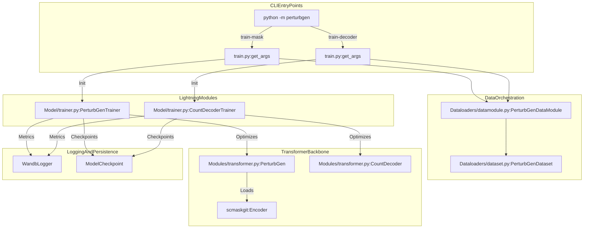
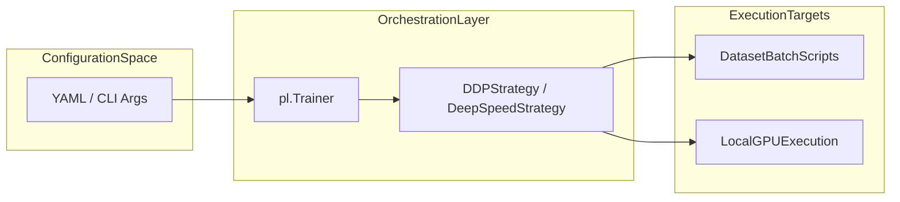

# Training

Relevant source files

The following files were used as context for generating this wiki page:

- [perturbgen/Model/trainer.py](perturbgen/Model/trainer.py)
- [perturbgen/tests/test_cellgen_training.py](perturbgen/tests/test_cellgen_training.py)
- [perturbgen/train.py](perturbgen/train.py)

The purpose of this page is to provide a high-level overview of the two-phase training lifecycle in PerturbGen, detailing how models transition from masking model pretraining to count decoder calibration. Training orchestration is managed via the `train.py` command-line interface and PyTorch Lightning [perturbgen/train.py:1-25](), abstracting away multi-GPU distribution (DDP or DeepSpeed) [perturbgen/train.py:70-74]() and experiment tracking (Weights & Biases) [perturbgen/train.py:169-194]().

This is a parent page. For deep technical details, please refer to the child pages:
- **[Phase 1: Masking Model Training (PerturbGenTrainer)](#4.1)**
- **[Phase 2: Count Decoder Training (CountDecoderTrainer)](#4.2)**
- **[Hyperparameter Sweeps and Batch Job Scripts](#4.3)**

---

### Training Workflow Overview

The PerturbGen training lifecycle is structured as a decoupled two-phase process:
1. **Phase 1 (Masking Model)**: Trains the transformer backbone using Masked Language Modeling (MLM) and cross-attention over source states to learn gene sequence dependencies [perturbgen/Model/trainer.py:75-171]().
2. **Phase 2 (Count Decoder)**: Freezes the transformer backbone and optimizes the `CountHead` to predict absolute transcript counts using Zero-Inflated Negative Binomial (ZINB), Negative Binomial (NB), or MSE losses [perturbgen/Model/trainer.py:502-580]().

#### System Orchestration

The following diagram bridges natural language training concepts to code entities across the `perturbgen` package.

**Training Component Interaction**

Sources: [perturbgen/train.py:60-195](), [perturbgen/Model/trainer.py:75-171](), [perturbgen/Dataloaders/datamodule.py:12-30]()

---

### Phase 1: Masking Model Training

Phase 1 initializes and trains the `PerturbGen` transformer using `PerturbGenTrainer` [perturbgen/Model/trainer.py:75-194](). This stage relies on the `train-mask` CLI command [perturbgen/train.py:63-68]() to ingest tokenized single-cell pairs, apply masking schedulers (cosine, power, exponential), and optimize cross-entropy loss over masked tokens.

For complete coverage of the `PerturbGenTrainer` lifecycle, loss computation, perplexity metrics, and token conditioning (`concat_cond_tokens`), see **[Phase 1: Masking Model Training (PerturbGenTrainer)](#4.1)**.

Sources: [perturbgen/Model/trainer.py:75-194](), [perturbgen/train.py:60-105]()

---

### Phase 2: Count Decoder Training

Once the masking model has captured sequence representations, Phase 2 engages the `CountDecoderTrainer` [perturbgen/Model/trainer.py:502-580]() via the `train-decoder` CLI command [perturbgen/train.py:63-68](). This phase links the latent representations from the frozen transformer backbone to explicit continuous transcript counts via the `CountHead` module.

For details on configuration parameters, ZINB/NB/MSE distribution loss formulations, size factors, dispersion parameters ($\theta$), and evaluation metrics (EMD, MMD, ROUGE), see **[Phase 2: Count Decoder Training (CountDecoderTrainer)](#4.2)**.

Sources: [perturbgen/Model/trainer.py:502-580](), [perturbgen/train.py:60-105]()

---

### Hyperparameter Sweeps and Execution

Scaling training across high-performance computing (HPC) environments is supported via distributed strategies (`ddp` or `deepspeed`) [perturbgen/train.py:70-74]() and Weights & Biases configuration sweeps (`perturbgen/configs/sweep/`). 

**Training Execution Flow**

Sources: [perturbgen/train.py:70-74](), [perturbgen/train.py:1-25]()

For information regarding W&B sweep configurations, `run_sweep.sh`, and dataset-specific HPC batch scripts (`lps/`, `hspc/`, `eb/`, `sko/`, `cytoimmgen/`), see **[Hyperparameter Sweeps and Batch Job Scripts](#4.3)**.

Sources: [perturbgen/train.py:1-25](), [perturbgen/configs/__init__.py:1-10]()

---