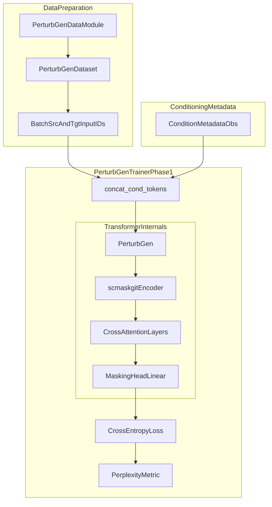
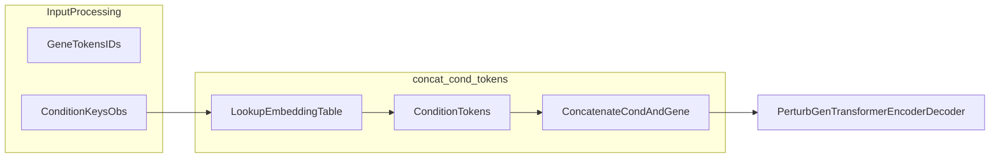

# Phase 1: Masking Model Training (PerturbGenTrainer)

Relevant source files

The following files were used as context for generating this wiki page:

- [perturbgen/Model/trainer.py](perturbgen/Model/trainer.py)
- [perturbgen/tests/test_cellgen_training.py](perturbgen/tests/test_cellgen_training.py)
- [perturbgen/train.py](perturbgen/train.py)

Phase 1 of the PerturbGen training lifecycle focuses on training the **Masking Model**. This stage employs a Masked Language Modeling (MLM) objective to teach the transformer how to predict gene identities within a cell's expression profile, conditioned on specific biological contexts (e.g., cell type, timepoint, or perturbation). The goal is to optimize the `PerturbGen` transformer's ability to reconstruct gene sequences before the count decoder is attached in Phase 2.

### Training Orchestration and CLI

The masking phase is initiated via the `train-mask` command (aliased through the `perturbgen` entry point). The primary entry point for training is `perturbgen/train.py`, which parses hyperparameters and initializes the PyTorch Lightning infrastructure.

#### Key CLI Arguments
| Argument | Description | Code Reference |
| :--- | :--- | :--- |
| `--train_mode` | Set to `masking` for Phase 1. | [perturbgen/train.py:63-68]() |
| `--encoder` | Usually `scmaskgit` to use the pretrained foundation model. | [perturbgen/train.py:196-204]() |
| `--mask_scheduler` | Scheduler for the masking ratio (`cosine`, `exp`, `pow`). | [perturbgen/train.py:146-150]() |
| `--mapping_dict_path` | Path to the token ID to gene name mapping pickle. | [perturbgen/train.py:131-135]() |
| `--pred_tps` | Timepoints to include in the training/prediction objective. | [perturbgen/train.py:158-163]() |

Sources: [perturbgen/train.py:60-205]()

---

### PerturbGenTrainer (LightningModule)

The `PerturbGenTrainer` class defined in `perturbgen/Model/trainer.py` handles the training logic, loss calculation, and logging for the masking phase [perturbgen/Model/trainer.py:75-124](). It encapsulates the `PerturbGen` transformer and manages the data flow between the encoder and the masking head [perturbgen/Model/trainer.py:149-171]().

#### System Architecture: Training Data Flow
The following diagram illustrates how data flows from the `PerturbGenDataModule` through the `PerturbGenTrainer` to the underlying model components.

**Data Flow: Tokenized Input to MLM Loss**

Sources: [perturbgen/Model/trainer.py:75-194](), [perturbgen/src/utils.py:38-39]()

---

### Masked Language Modeling (MLM) Loss and Metrics

The primary objective during Phase 1 is a categorical cross-entropy loss over the masked tokens. The model is presented with a target gene sequence where a portion of the tokens are replaced with a special `[MASK]` token based on the `mask_scheduler`.

1.  **Masking Mechanism**: The `PerturbGen` module applies a mask to the target input token IDs.
2.  **Loss Function**: `nn.CrossEntropyLoss` computes the cross-entropy loss against ground-truth gene IDs [perturbgen/Model/trainer.py:172]().
3.  **Perplexity**: The trainer instantiates `Perplexity(ignore_index=-100)` using `torchmetrics.text` to monitor how effectively the model predicts masked gene tokens [perturbgen/Model/trainer.py:178]().

Sources: [perturbgen/Model/trainer.py:172-179](), [perturbgen/Modules/transformer.py:26-27]()

---

### Conditioning System

PerturbGen uses a flexible conditioning system to steer the generation process. This is implemented via the `concat_cond_tokens` utility function.

#### Implementation Detail: `concat_cond_tokens`
This function takes categorical variables from the dataset (e.g., `cell_type`, `donor`, `treatment`) and maps them to learned embedding vectors. These tokens are prepended to the input sequence, allowing the self-attention and cross-attention mechanisms to attend to the biological context.

**Conditioning Logic**

Sources: [perturbgen/src/utils.py:38-40](), [perturbgen/Model/trainer.py:167]()

---

### Key Hyperparameters

The performance of the masking model is highly sensitive to the hyperparameters defined in the `PerturbGenTrainer.__init__` constructor:

| Hyperparameter | Code Reference | Description |
| :--- | :--- | :--- |
| `d_model` | [perturbgen/Model/trainer.py:79]() | Dimension of the transformer embeddings (e.g., 256, 768). |
| `num_layers` | [perturbgen/Model/trainer.py:81]() | Number of transformer blocks in the PerturbGen decoder. |
| `d_ff` | [perturbgen/Model/trainer.py:82]() | Hidden dimension of the feed-forward network within blocks. |
| `mask_scheduler` | [perturbgen/Model/trainer.py:106]() | Determines the ratio of tokens masked during training (`cosine`, `pow`, `log`, `exp`). |
| `pos_encoding_mode` | [perturbgen/Model/trainer.py:108-110]() | Method for encoding gene order/rank (`time_pos_sin`, `comb_sin`, `sin_learnt`). |
| `mlm_probability` | [perturbgen/Model/trainer.py:85]() | Base probability for masking tokens if not using a scheduler. |

Sources: [perturbgen/Model/trainer.py:75-124]()

---

### Attention Aggregation and Logging

During validation, `PerturbGenTrainer` can be configured to return attention weights. The `aggregate_attn_weights` and `return_attn_weights` functions in `perturbgen/src/utils.py` collapse multi-head attention into a single interpretability map, which is logged to visualize which genes the model focuses on when predicting a specific perturbation effect.

Sources: [perturbgen/Model/trainer.py:37-43](), [perturbgen/src/utils.py:37-43]()

---