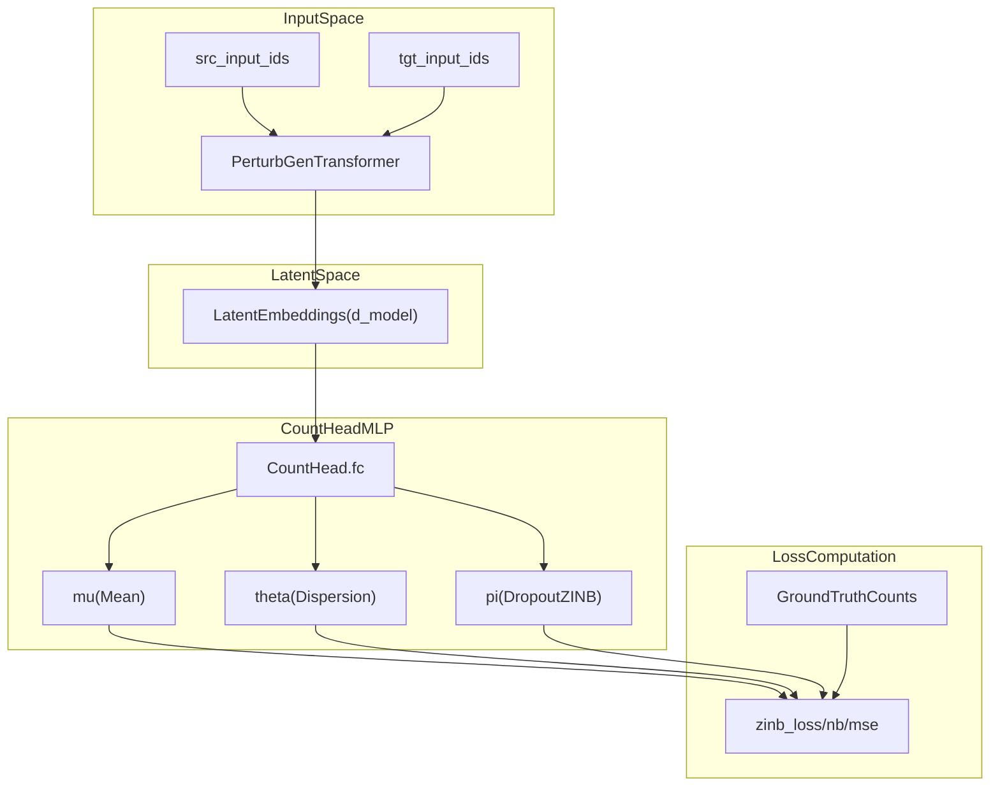
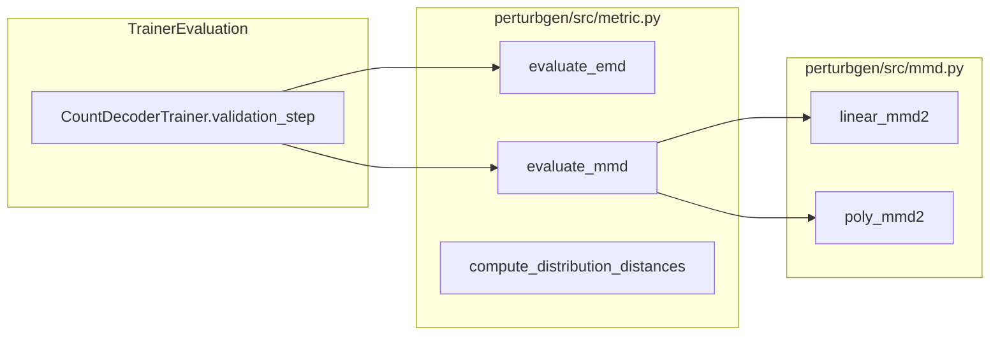
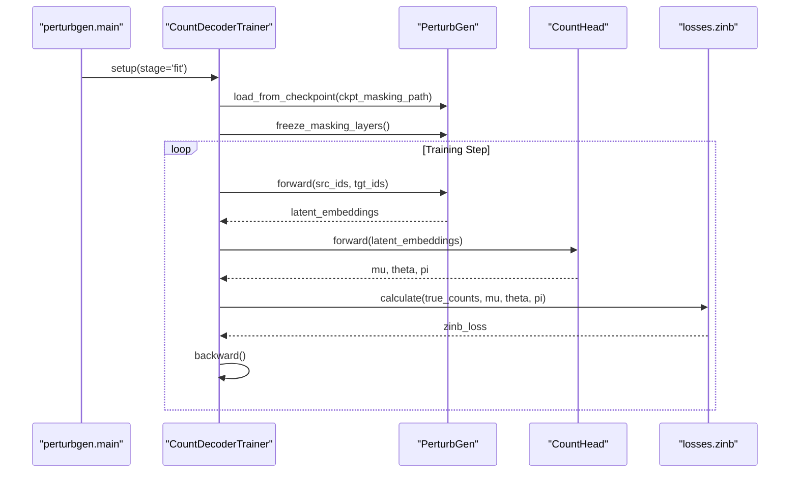

# Phase Phase 2: Count Decoder Training (CountDecoderTrainer)

<details>
<summary>Relevant source files</summary>

The following files were used as context for generating this wiki page:

- [perturbgen/Model/trainer.py](perturbgen/Model/trainer.py)
- [perturbgen/src/losses.py](perturbgen/src/losses.py)
- [perturbgen/tests/test_cellgen_training.py](perturbgen/tests/test_cellgen_training.py)

</details>


Phase 2 of the PerturbGen training lifecycle focuses on mapping the latent representations generated by the transformer to actual gene expression counts. While Phase 1 (Masking Model) learns the categorical structure of gene sequences, Phase 2 trains a specialized **CountHead** to reconstruct quantitative expression values using probabilistic distribution losses (ZINB, NB, or MSE).

## Overview and CLI Command

The count decoder is trained using the `train-decoder` CLI command, which initializes the `CountDecoderTrainer`. This stage typically requires a pretrained and frozen masking model checkpoint from Phase 1.

**Key CLI Command:**
```bash
python -m perturbgen train-decoder \
    --train_mode count_decoder \
    --ckpt_masking_path path/to/phase1_checkpoint.ckpt \
    --loss_type zinb \
    --output_dir ./results/decoder_training
```
Sources: [docs/examples/03_train_perturbgen.ipynb:165-188](), [perturbgen/Model/trainer.py:59-109]()

## CountDecoderTrainer Implementation

The `CountDecoderTrainer` is a `LightningModule` that manages the training loop for count reconstruction. It leverages the latent states from the `PerturbGen` transformer and passes them through a `CountHead` MLP.

### Data Flow and Architecture
The trainer receives tokenized input sequences. The transformer encoder-decoder processes these into latent embeddings, which are then fed into the `CountHead` to predict distribution parameters (mean, dispersion, and dropout).

Title: Count Decoder Data Flow

Sources: [perturbgen/Modules/transformer.py:756-780](), [perturbgen/Model/trainer.py:26-34]()

## CountHead MLP and Dispersion Modeling

The `CountHead` is a multi-layer perceptron defined in `perturbgen/Modules/transformer.py`. It is responsible for outputting the parameters of the chosen count distribution.

*   **Structure:** It consists of a linear layer followed by activation functions tailored to the distribution parameters [perturbgen/Modules/transformer.py:768-778]().
*   **Dispersion (Theta):** The model supports different theta modeling strategies. It can learn a global dispersion parameter per gene or estimate it locally per cell [perturbgen/src/losses.py:126-130]().
*   **Size Factor Handling:** To account for varying sequencing depths, predicted means ($\mu$) are often scaled by cell-specific size factors during the loss calculation.

Sources: [perturbgen/Modules/transformer.py:756-780](), [perturbgen/src/losses.py:49-150]()

## Loss Modes

PerturbGen supports three primary loss functions for count reconstruction, implemented in `perturbgen/src/losses.py`:

| Loss Mode | Description | Parameters |
| :--- | :--- | :--- |
| **ZINB** | Zero-Inflated Negative Binomial. Best for sparse scRNA-seq data. | $\mu$ (mean), $\theta$ (dispersion), $\pi$ (dropout) |
| **NB** | Negative Binomial. Models overdispersed count data. | $\mu$ (mean), $\theta$ (dispersion) |
| **MSE** | Mean Squared Error. Used for log-normalized or denoised data. | Predicted vs. True Counts |

### Loss Implementation Detail
The ZINB loss calculation handles the zero-inflation component using a softplus activation on the dropout logits ($\pi$) to ensure numerical stability [perturbgen/src/losses.py:131-150]().

Sources: [perturbgen/src/losses.py:49-150](), [perturbgen/Model/trainer.py:22-27]()

## Evaluation Metrics

During and after training, the `CountDecoderTrainer` evaluates the quality of generated counts using several statistical distances and correlations:

1.  **EMD (Earth Mover's Distance):** Measures the distance between predicted and true expression distributions across genes [perturbgen/src/metric.py:198-215]().
2.  **Wasserstein Distance:** Calculated via optimal transport to compare the geometry of the predicted vs. observed manifolds [perturbgen/src/metric.py:20-21]().
3.  **MMD (Maximum Mean Discrepancy):** Uses RBF, linear, or polynomial kernels to test if the two samples come from the same distribution [perturbgen/src/mmd.py:15-39](), [perturbgen/src/metric.py:132-164]().
4.  **Pearson Correlation of Delta Counts:** Evaluates the model's ability to predict the *change* in counts between control and perturbed states.

Title: Evaluation Logic in Code

Sources: [perturbgen/src/metric.py:132-215](), [perturbgen/src/mmd.py:1-40](), [perturbgen/Model/trainer.py:28-34]()

## Data Flow: Code Entity Space

The following diagram maps the logical training phases to the specific Python classes and methods involved in Phase 2.

Title: Phase 2 Code Execution Path

Sources: [perturbgen/Model/trainer.py:59-155](), [perturbgen/Modules/transformer.py:756-780](), [perturbgen/src/losses.py:92-150]()

---