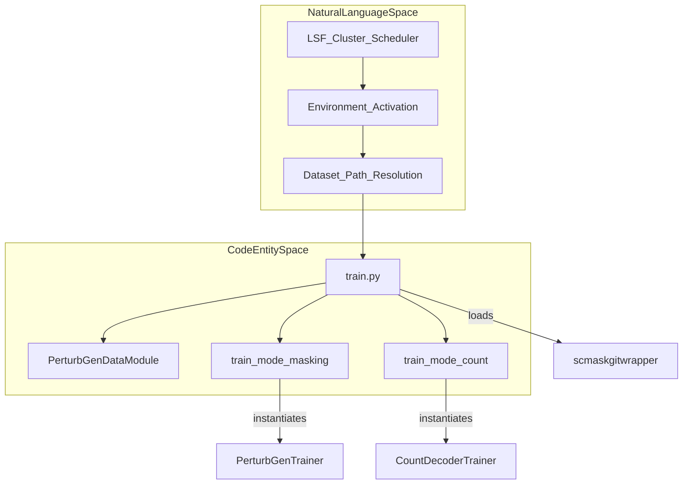
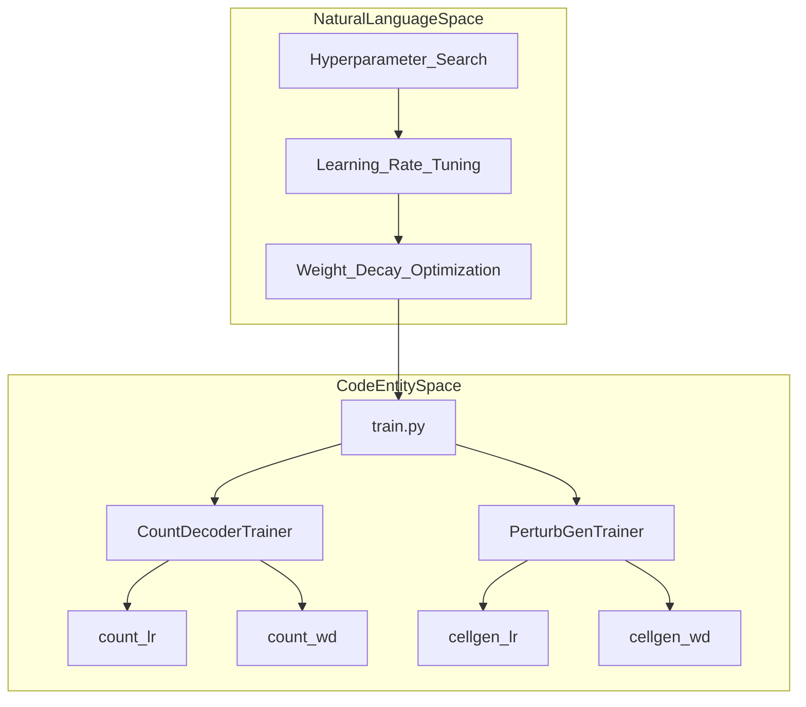

# Hyperparameter Sweeps and Batch Job Scripts

Relevant source files

The following files were used as context for generating this wiki page:

- [perturbgen/batch_job_script/cytoimmgen/interpolation/2_run_train_masking_GF_frozen_interpolation.sh](perturbgen/batch_job_script/cytoimmgen/interpolation/2_run_train_masking_GF_frozen_interpolation.sh)
- [perturbgen/batch_job_script/cytoimmgen/interpolation/3_run_train_count_GF_frozen_interpolation.sh](perturbgen/batch_job_script/cytoimmgen/interpolation/3_run_train_count_GF_frozen_interpolation.sh)
- [perturbgen/batch_job_script/eb/extrapolation/2_run_train_masking_GF_frozen_extrapolation.sh](perturbgen/batch_job_script/eb/extrapolation/2_run_train_masking_GF_frozen_extrapolation.sh)
- [perturbgen/batch_job_script/hspc/2.1_run_train_masking_all_tf_timepoints_tissue.sh](perturbgen/batch_job_script/hspc/2.1_run_train_masking_all_tf_timepoints_tissue.sh)
- [perturbgen/batch_job_script/lps/interpolation/3_run_train_count_interpolation.sh](perturbgen/batch_job_script/lps/interpolation/3_run_train_count_interpolation.sh)
- [perturbgen/batch_job_script/sko/3_run_train_count_interpolation_sko.sh](perturbgen/batch_job_script/sko/3_run_train_count_interpolation_sko.sh)
- [perturbgen/batch_job_script/sko/3_run_train_count_interpolation_sko_5k.sh](perturbgen/batch_job_script/sko/3_run_train_count_interpolation_sko_5k.sh)

This page documents the infrastructure for executing large-scale training and hyperparameter optimization for PerturbGen on High-Performance Computing (HPC) clusters. It covers the configuration of dataset-specific batch job scripts (`lps/`, `hspc/`, `eb/`, `sko/`, `cytoimmgen/`) for HPC execution under interpolation and extrapolation settings, as well as W&B sweep orchestration.

## Purpose and Scope

The PerturbGen repository provides a robust set of shell scripts and configuration patterns to manage training on LSF-based HPC clusters (targeting the Sanger Institute infrastructure). These scripts automate the transition between **Phase 1 (Masking Model)** and **Phase 2 (Count Decoder)** training, handle environment activation, and define dataset-specific hyperparameters for interpolation and extrapolation tasks.

Sources: [perturbgen/batch_job_script/sko/3_run_train_count_interpolation_sko.sh:1-29](), [perturbgen/batch_job_script/cytoimmgen/interpolation/2_run_train_masking_GF_frozen_interpolation.sh:1-23]()

## HPC Batch Job Infrastructure

PerturbGen utilizes `.sh` scripts tailored for the IBM Spectrum LSF scheduler (`#BSUB` directives). These scripts manage resource allocation (GPUs, memory, CPU cores) and invoke `train.py` with specific arguments for different biological datasets.

### Dataset-Specific Configurations

Batch scripts are organized by dataset within `perturbgen/batch_job_script/`. Each script indicates the training phase and experimental setup (interpolation vs. extrapolation).

| Dataset | Script Path | Key Purpose |
|:---|:---|:---|
| **SKO** | `sko/3_run_train_count_interpolation_sko.sh` | Count decoder training for SKO interpolation [perturbgen/batch_job_script/sko/3_run_train_count_interpolation_sko.sh:31-67]() |
| **CytoImmGen** | `cytoimmgen/interpolation/2_run_train_masking_GF_frozen_interpolation.sh` | Masking model training with frozen foundation encoder [perturbgen/batch_job_script/cytoimmgen/interpolation/2_run_train_masking_GF_frozen_interpolation.sh:36-65]() |
| **CytoImmGen** | `cytoimmgen/interpolation/3_run_train_count_GF_frozen_interpolation.sh` | Count decoder training for CytoImmGen interpolation [perturbgen/batch_job_script/cytoimmgen/interpolation/3_run_train_count_GF_frozen_interpolation.sh:36-69]() |
| **HSPC** | `hspc/2.1_run_train_masking_all_tf_timepoints_tissue.sh` | Fine-tuning the foundation encoder on HSPC tissue data [perturbgen/batch_job_script/hspc/2.1_run_train_masking_all_tf_timepoints_tissue.sh:39-70]() |
| **EB** | `eb/extrapolation/2_run_train_masking_GF_frozen_extrapolation.sh` | Masking training for Embryoid Body (EB) extrapolation [perturbgen/batch_job_script/eb/extrapolation/2_run_train_masking_GF_frozen_extrapolation.sh:38-64]() |
| **LPS** | `lps/interpolation/3_run_train_count_interpolation.sh` | Count decoder training for LPS response modeling [perturbgen/batch_job_script/lps/interpolation/3_run_train_count_interpolation.sh:31-67]() |

### Execution Flow and Resource Management

The scripts request specific hardware via LSF directives (e.g., exclusive GPU access, up to 50GB RAM) [perturbgen/batch_job_script/sko/3_run_train_count_interpolation_sko.sh:3-12]().

Natural Language Space to Code Entity Space: HPC Job Orchestration

Sources: [perturbgen/batch_job_script/sko/3_run_train_count_interpolation_sko.sh:1-67](), [perturbgen/batch_job_script/cytoimmgen/interpolation/2_run_train_masking_GF_frozen_interpolation.sh:1-66]()

## Training Phase Transitions

The transition from Masking Model (Phase 1) to Count Decoder (Phase 2) is handled by passing the resulting checkpoint from Phase 1 into the Phase 2 script via `--ckpt_masking_path`.

### Phase 1: Masking Model Training
Scripts invoke `train.py` with `--train_mode masking` [perturbgen/batch_job_script/cytoimmgen/interpolation/2_run_train_masking_GF_frozen_interpolation.sh:36-37](). Key parameters include `--mask_scheduler` (e.g., `pow`, `cosine`) and `--pred_tps` [perturbgen/batch_job_script/cytoimmgen/interpolation/2_run_train_masking_GF_frozen_interpolation.sh:54-61]().

### Phase 2: Count Decoder Training
Scripts invoke `train.py` with `--train_mode count` [perturbgen/batch_job_script/cytoimmgen/interpolation/3_run_train_count_GF_frozen_interpolation.sh:36-37](). This phase requires `--ckpt_masking_path` pointing to the Phase 1 checkpoint [perturbgen/batch_job_script/cytoimmgen/interpolation/3_run_train_count_GF_frozen_interpolation.sh:41]().

Sources: [perturbgen/batch_job_script/cytoimmgen/interpolation/2_run_train_masking_GF_frozen_interpolation.sh:36-65](), [perturbgen/batch_job_script/cytoimmgen/interpolation/3_run_train_count_GF_frozen_interpolation.sh:36-69]()

## Hyperparameter Sweep Logic

Natural Language Space to Code Entity Space: Sweep Execution Mapping

Sources: [perturbgen/batch_job_script/sko/3_run_train_count_interpolation_sko.sh:46-49](), [perturbgen/batch_job_script/cytoimmgen/interpolation/2_run_train_masking_GF_frozen_interpolation.sh:48-49]()

## Dataset-Specific Parameters Summary

| Dataset | Learning Rate | Epochs | Mask Scheduler | Positional Encoding | Loss Mode |
|:---|:---|:---|:---|:---|:---|
| **SKO** | 1e-3 (count) | 3 | `cosine` | `time_pos_sin` | `nb` / `zinb` [perturbgen/batch_job_script/sko/3_run_train_count_interpolation_sko.sh:44-54]() |
| **CytoImmGen** | 1e-5 (mask) | 20 | `pow` | `time_pos_sin` | `zinb` [perturbgen/batch_job_script/cytoimmgen/interpolation/2_run_train_masking_GF_frozen_interpolation.sh:47-62]() |
| **HSPC** | 1e-5 (mask) | 25 | `pow` | `time_pos_sin` | N/A (masking) [perturbgen/batch_job_script/hspc/2.1_run_train_masking_all_tf_timepoints_tissue.sh:52-66]() |
| **EB** | 1e-3 (mask) | 50 | `pow` | `time_pos_sin` | N/A (masking) [perturbgen/batch_job_script/eb/extrapolation/2_run_train_masking_GF_frozen_extrapolation.sh:49-61]() |
| **LPS** | 1e-3 (count) | 5 | `pow` | `time_pos_sin` | `zinb` [perturbgen/batch_job_script/lps/interpolation/3_run_train_count_interpolation.sh:44-61]() |

Sources: [perturbgen/batch_job_script/sko/3_run_train_count_interpolation_sko.sh:44-54](), [perturbgen/batch_job_script/cytoimmgen/interpolation/2_run_train_masking_GF_frozen_interpolation.sh:47-62](), [perturbgen/batch_job_script/hspc/2.1_run_train_masking_all_tf_timepoints_tissue.sh:52-66](), [perturbgen/batch_job_script/eb/extrapolation/2_run_train_masking_GF_frozen_extrapolation.sh:49-61](), [perturbgen/batch_job_script/lps/interpolation/3_run_train_count_interpolation.sh:44-61]()

---