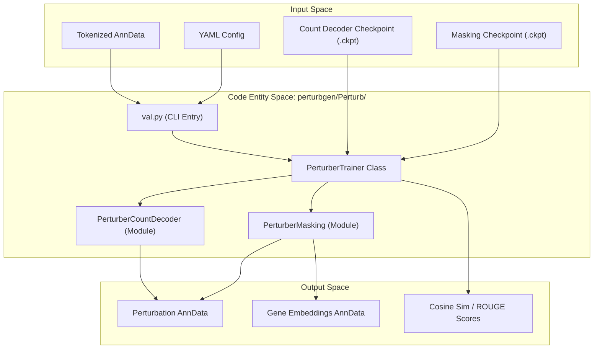
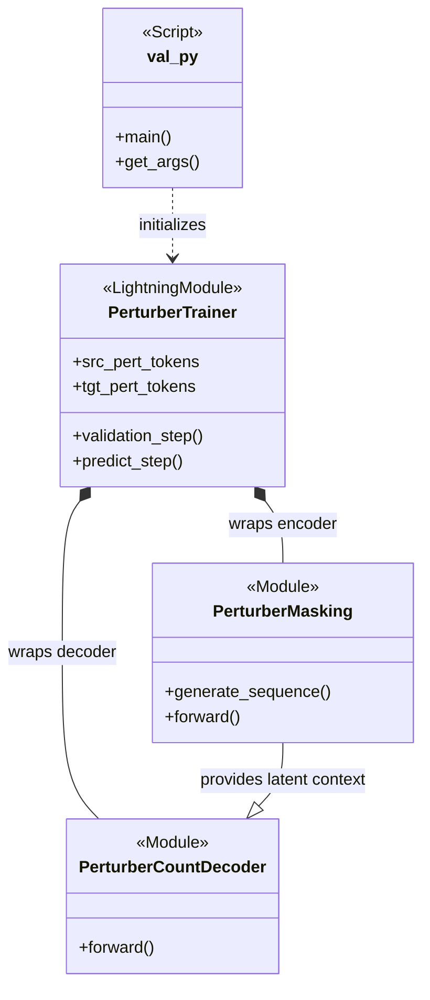

# Inference and Perturbation Simulation

Relevant source files

The following files were used as context for generating this wiki page:

- [docs/examples/perturbation.ipynb](docs/examples/perturbation.ipynb)
- [perturbgen/Perturb/val.py](perturbgen/Perturb/val.py)
- [perturbgen/tests/test_api_perturb.py](perturbgen/tests/test_api_perturb.py)
- [perturbgen/val.py](perturbgen/val.py)

The PerturbGen framework extends beyond training to provide a robust suite for **in silico** experimentation. Once a model has been trained on time-course single-cell data, it can be used to simulate the effects of genetic perturbations or to extract high-dimensional gene embeddings that capture transcriptional dynamics. This stage of the pipeline bridges the gap between predictive modeling and biological discovery by allowing researchers to test hypotheses without laboratory intervention.

The inference engine primarily utilizes two specialized trainers: the `PerturberTrainer` for simulating gene modifications and the `CountDecoderTrainer` (in evaluation mode) for generating predicted expression profiles and embeddings.

### System Overview: From Model to Simulation

The following diagram illustrates how trained checkpoints and configuration files are ingested by the inference scripts to produce perturbation atlases and gene embeddings.

**Inference Workflow Architecture**

Sources: [perturbgen/Perturb/val.py:31-38](), [perturbgen/tests/test_api_perturb.py:43-61]()

---

### In Silico Perturbation
The perturbation pipeline allows users to simulate various genetic modifications—such as knockouts (masking/deletion) or overexpressions—on specific genes within a cell. The `PerturberTrainer` manages a dual forward pass: one for the "control" (unperturbed) state and one for the "perturbed" state. By comparing these states, the model calculates the predicted shift in the transcriptional landscape.

*   **Perturbation Modes**: Supports modes such as mask, pad, delete, and overexpress configurations [perturbgen/val.py:37-41]().
*   **Metrics**: Evaluates simulation accuracy using Cosine Similarity and ROUGE scores to compare predicted sequences against ground truth [perturbgen/tests/test_api_perturb.py:77-82]().
*   **Output**: Generates specialized AnnData objects containing the delta-expression values for every gene across the transcriptome [perturbgen/Perturb/val.py:48-66]().

For details, see [In Silico Perturbation: PerturberTrainer and val.py](#5.1).

### Gene Embedding Extraction
PerturbGen's transformer architecture learns rich, time-resolved representations of genes. The extraction mode in `val.py` allows users to export these latent vectors. These embeddings represent the "functional state" of a gene within a specific biological context (e.g., a specific cell type at a specific time point).

*   **Computation**: Embeddings are typically derived from the mean of non-padding tokens in the encoder's final hidden states [perturbgen/val.py:86-91]().
*   **Downstream Use**: These embeddings serve as the input for discovering Gene Programs (GPs) and identifying hub genes in regulatory networks.

For details, see [Gene Embedding Extraction](#5.2).

### Post-Perturbation Analysis
The results of inference are processed through downstream notebooks to interpret the biological signals. This involves clustering the simulated responses to identify **Perturbation-Induced Programs (PIPs)**.

*   **Clustering**: Groups genes that respond similarly to the same perturbation [docs/examples/perturbation.ipynb:23-28]().
*   **Visualization**: Aggregates embeddings across biological covariates (like `Donor` or `Cell_type`) to visualize the trajectory of the perturbation effect [docs/examples/perturbation.ipynb:14-20]().

For details, see [Post-Perturbation Analysis: Gene Programs and PIPs](#5.3).

---

### Inference Logic Mapping
This diagram maps the high-level inference tasks to the specific classes and methods in the perturbation sub-packages.

**Code Entity Mapping: Inference Logic**

Sources: [perturbgen/Perturb/val.py:41-46](), [perturbgen/tests/test_api_perturb.py:10-12]()

### Key Files and Components
| Component | Path | Role |
| :--- | :--- | :--- |
| **CLI Entry** | `perturbgen/Perturb/val.py` | Orchestrates the perturbation run using YAML configurations [perturbgen/Perturb/val.py:31-46](). |
| **Logic Controller** | `perturbgen/Perturb/trainer.py` | Implements the perturbation-specific logic and metrics handling [perturbgen/Perturb/val.py:14-16](). |
| **Test Suite** | `perturbgen/tests/test_api_perturb.py` | Validates configuration building and API boundaries for `PerturbGen.perturb()` [perturbgen/tests/test_api_perturb.py:28-61](). |
| **Notebook Demo** | `docs/examples/perturbation.ipynb` | Provides a practical example of running a perturbation on time-course datasets [docs/examples/perturbation.ipynb:14-20](). |

Sources: [perturbgen/val.py](), [perturbgen/Perturb/val.py](), [perturbgen/tests/test_api_perturb.py](), [docs/examples/perturbation.ipynb]()

---