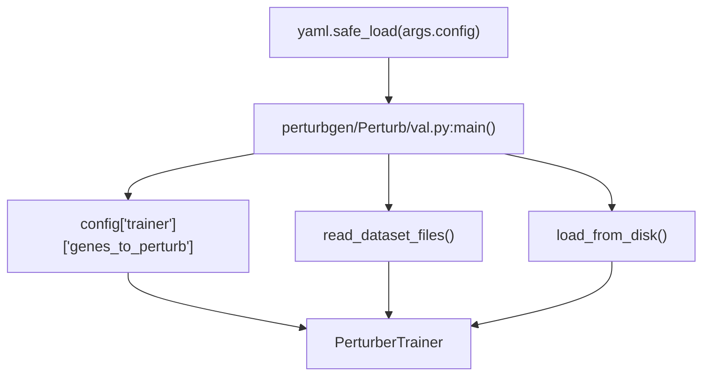
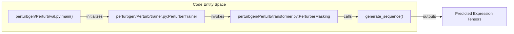

# In Silico Perturbation: PerturberTrainer and val.py

Relevant source files

The following files were used as context for generating this wiki page:

- [docs/examples/perturbation.ipynb](docs/examples/perturbation.ipynb)
- [perturbgen/Perturb/trainer.py](perturbgen/Perturb/trainer.py)
- [perturbgen/Perturb/transformer.py](perturbgen/Perturb/transformer.py)
- [perturbgen/Perturb/val.py](perturbgen/Perturb/val.py)
- [perturbgen/batch_job_script/cytoimmgen/extrapolation/3_run_train_count_extrapolation.sh](perturbgen/batch_job_script/cytoimmgen/extrapolation/3_run_train_count_extrapolation.sh)
- [perturbgen/configs/eval/HSPC/mask_src_inference_perturbation_jobarray.yaml](perturbgen/configs/eval/HSPC/mask_src_inference_perturbation_jobarray.yaml)
- [perturbgen/configs/eval/LPS/mask_src_inference_perturbation_IL1B.yaml](perturbgen/configs/eval/LPS/mask_src_inference_perturbation_IL1B.yaml)
- [perturbgen/run_test.sh](perturbgen/run_test.sh)
- [perturbgen/src/utils.py](perturbgen/src/utils.py)
- [perturbgen/tests/test_api_perturb.py](perturbgen/tests/test_api_perturb.py)

The in silico perturbation pipeline enables the simulation of transcriptomic responses to gene manipulations (such as knockouts, overexpressions, or token masking) using trained PerturbGen models. This document details the implementation of the evaluation and perturbation script `perturbgen/Perturb/val.py` and the core orchestration class `PerturberTrainer` defined in `perturbgen/Perturb/trainer.py`.

---

### Configuration Loading and Initialization in val.py

The execution entrypoint for in silico perturbations is `perturbgen/Perturb/val.py`, which parses a YAML configuration file to set up environment paths, datasets, target AnnData objects, and target gene lists [perturbgen/Perturb/val.py:31-45]().

*   **Configuration Parsing:** Reads user-specified parameters via `yaml.safe_load` from the specified config path [perturbgen/Perturb/val.py:44-45]().
*   **Data Ingestion:** Loads target AnnData objects via `read_dataset_files` and source/target datasets from disk using Hugging Face datasets utilities [perturbgen/Perturb/val.py:48-52]().
*   **Gene Selection:** Filters perturbation targets based on `perturb_genes_file`, `perturb_cluster`, and `perturb_colname` configuration fields [perturbgen/Perturb/val.py:68-82]().
*   **Output Deduplication:** Scans the designated `output_dir` for existing result files matching the pattern `adata_g[GENE]_ssrc` to avoid redundant computations [perturbgen/Perturb/val.py:102-120]().

**System Architecture: Configuration to Trainer Execution**

**Sources:** [perturbgen/Perturb/val.py:31-120]()

---

### PerturberTrainer and Perturbation Mechanics

The `PerturberTrainer` class inherits from `CountDecoderTrainer` and serves as the central orchestration module for running perturbations [perturbgen/Perturb/trainer.py:25-46]().

*   **Mode Validation:** Enforces the specification of `validation_mode`, `perturbation_sequence` (`src` or `tgt`), and `perturbation_mode` (`mask`, `pad`, `delete`, `overexpress`) [perturbgen/Perturb/trainer.py:31-60]().
*   **Token Mapping:** Translates human-readable gene names into tensor token indices (`src_pert_tokens` and `tgt_pert_tokens`) using mapping dictionaries (`mapping_dict_path` and `tokenid_to_rowid_path`) [perturbgen/Perturb/trainer.py:62-134]().
*   **Model Initialization:** Instantiates `PerturberMasking` (`pretrained_model`) with architectural hyperparameters such as `d_model`, `num_heads`, `num_layers`, and `mask_scheduler` [perturbgen/Perturb/trainer.py:158-171]().

| Perturbation Mode | Description | Implementation Behavior |
| :--- | :--- | :--- |
| `mask` | Masks the target gene token | Replaces the token ID with `self.mask_token` |
| `pad` | Pads the target gene token | Replaces the token ID with `self.pad_token` |
| `delete` | Removes the gene token | Deletes the token from the sequence tensor |
| `overexpress` | Simulates overexpression | Shifts the token ranking to the front of the sequence |

**Sources:** [perturbgen/Perturb/trainer.py:25-171]()

---

### Dual Forward Pass and Sequence Generation

The core simulation relies on comparing unperturbed (control) cell predictions against perturbed cell predictions.

*   **Control Pass:** The model processes the source cell inputs normally to predict baseline target expression states [perturbgen/Perturb/trainer.py:158-185]().
*   **Perturbed Pass:** The `PerturberTrainer` modifies input tensors at the specified `pert_tps` using the configured `perturbation_mode` [perturbgen/Perturb/trainer.py:87-147]().
*   **Iterative Decoding:** Non-autoregressive sequence generation is performed via `PerturberMasking.generate` and `generate_sequence`, leveraging MaskGIT-style iterative decoding with schedulers like `cosine`, `pow`, `log`, `exp`, or `uniform` [perturbgen/Perturb/transformer.py:30-137]().

**Code Entity Interaction: Perturbation Execution Flow**

**Sources:** [perturbgen/Perturb/val.py:41-170](), [perturbgen/Perturb/trainer.py:25-185](), [perturbgen/Perturb/transformer.py:30-137]()

---

### Metrics and AnnData Output Generation

To evaluate the impact of an in silico perturbation, the pipeline computes evaluation metrics and formats outputs into Scanpy-compatible AnnData objects [perturbgen/Perturb/trainer.py:18](), [perturbgen/src/utils.py:18-24]().

*   **Cosine Similarity:** Calculated between latent cell embeddings of control and perturbed states using `torch.nn.functional.cosine_similarity` [perturbgen/src/utils.py:24]().
*   **ROUGE Score:** Evaluates token set overlap between predicted sequences via `compute_rouge_score` [perturbgen/src/utils.py:18]().
*   **AnnData Serialization:** The function `return_perturbation_adata` wraps prediction tensors, observed count matrices, and cell metadata into structured `.h5ad` files stored inside `output_dir` [perturbgen/src/utils.py:21](), [perturbgen/configs/eval/LPS/mask_src_inference_perturbation_IL1B.yaml:26]().

**Sources:** [perturbgen/Perturb/trainer.py:18-22](), [perturbgen/src/utils.py:18-24]()

---