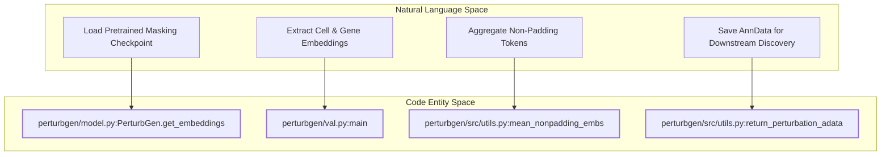
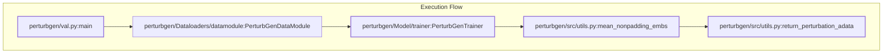

# Gene Embedding Extraction

<details>
<summary>Relevant source files</summary>

The following files were used as context for generating this wiki page:

- [docs/examples/cell_gene_embeddings.ipynb](docs/examples/cell_gene_embeddings.ipynb)
- [docs/examples/preprocessing_curation.ipynb](docs/examples/preprocessing_curation.ipynb)
- [perturbgen/val.py](perturbgen/val.py)

</details>


Gene embedding extraction is a specialized inference mode in PerturbGen used to obtain high-dimensional vector representations of cells and genes. Unlike cell-level embeddings, time-resolved gene embeddings capture the functional state and relational context of genes within specific biological conditions (e.g., time points or cell types). These embeddings serve as the foundation for downstream gene program discovery, where clustering and latent space analysis reveal perturbation-induced programs (PIPs) [docs/examples/cell_gene_embeddings.ipynb:8-12]().

## Extraction Pipeline Overview and Entry Points

The extraction process can be triggered via the Python API method `PerturbGen.get_embeddings()` or through the command-line interface using `val.py` in embedding/masking mode [perturbgen/val.py:87-91](), [docs/examples/cell_gene_embeddings.ipynb:97-103](). 

### System Flow: Natural Language to Code Entities

The following diagram maps the high-level conceptual stages of embedding extraction to their precise code implementations and file locations.

**Natural Language to Code Mapping: Embedding Extraction Pipeline**

**Sources:** `docs/examples/cell_gene_embeddings.ipynb` [34-47](), `perturbgen/val.py` [87-109](), `perturbgen/src/utils.py` [155-325]().

---

## The `extract-embedding` CLI and Python API

Extraction relies on Phase 1 Masking Model checkpoints. Users can invoke the extraction via Python using the `PerturbGen` class interface [docs/examples/cell_gene_embeddings.ipynb:66-77]():

```python
model = pg.PerturbGen(
    TOKENIZED_DIR,
    source="normal",
    n_hvg=2000,
    n_layers=6, d_ff=32, d_model=768,
    pred_tps=[1, 2, 3],
    var_list=["cell_type_harmonized", "cell_pairing_index", "time_after_LPS"],
    cond_list=["time_after_LPS"],
    mask_scheduler="cosine",
    context_mode=True,
    max_len=797, tgt_vocab_size=2002,
)
```

### Key Parameters and Arguments
| Argument / Parameter | Description | Code Reference |
| :--- | :--- | :--- |
| `--test_mode masking` | Sets the validation mode to utilize the Phase 1 masking model logic. | [perturbgen/val.py:37-41]() |
| `--return_embeddings` | Boolean flag to enable embedding extraction outputs. | [perturbgen/val.py:87-91]() |
| `--ckpt_masking_path` | Path to the `.ckpt` file from Phase 1 masking model training. | [perturbgen/val.py:99-103]() |
| `return_cell_embs` | Python API flag to extract cell representations (`obsm["cls_embeddings"]`). | [docs/examples/cell_gene_embeddings.ipynb:100-100]() |
| `return_gene_embs` | Python API flag to extract time-resolved gene representations (`varm`). | [docs/examples/cell_gene_embeddings.ipynb:101-101]() |

**Sources:** `perturbgen/val.py` [33-109](), `docs/examples/cell_gene_embeddings.ipynb` [66-103]().

---

## Implementation Details: Hidden States and Aggregation

### 1. Forward Pass and Hidden States
During inference, tokenized gene sequences pass through the scmaskgit encoder and transformer backbone. The model captures the output hidden states of the final transformer block prior to any classification or masking heads [perturbgen/val.py:87-91]().

### 2. Computing Mean Non-Padding Embeddings
Because gene sequences are padded to a fixed length (`max_len`), padding tokens (`token_id=0`) must be excluded from representation calculations. The utility function `mean_nonpadding_embs` performs this aggregation.

**Detailed Execution Flow: Gene Embedding Computation**

**Sources:** `perturbgen/val.py` [17-18](), `perturbgen/src/utils.py` [274-325]().

---

## Resulting AnnData Structure

The final output of the embedding extraction pipeline is an `AnnData` container structured for downstream trajectory and gene program analysis:
- **`X`**: Contains the mean embedding vectors or observation matrices.
- **`obsm["cls_embeddings"]`**: Stores cell-level classification and global representation embeddings [docs/examples/cell_gene_embeddings.ipynb:85-87]().
- **`varm`**: Stores condition-specific gene embeddings (`gene_embs_condition`), yielding one vector representation per gene per time point or covariate [docs/examples/cell_gene_embeddings.ipynb:85-87]().

**Sources:** `perturbgen/src/utils.py` [155-271](), `docs/examples/cell_gene_embeddings.ipynb` [85-88]().

---