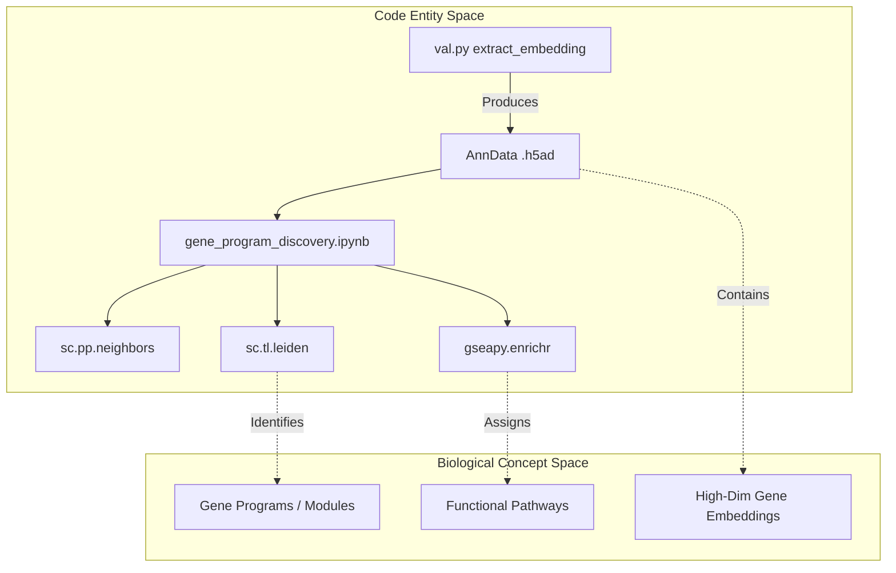
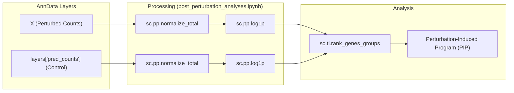

# Post-Perturbation Analysis: Gene Programs and PIPs

Relevant source files

The following files were used as context for generating this wiki page:

- [docs/examples/gene_program_discovery.ipynb](docs/examples/gene_program_discovery.ipynb)
- [docs/examples/post_perturbation_analyses.ipynb](docs/examples/post_perturbation_analyses.ipynb)
- [docs/examples/reference/mart_export.txt](docs/examples/reference/mart_export.txt)

This section details the downstream analytical workflows for interpreting results from the PerturbGen pipeline. It focuses on two primary areas: the discovery of **de novo gene programs** from learned embeddings and the systematic analysis of **Perturbation-Induced Programs (PIPs)**—the transcriptomic shifts observed following *in silico* perturbation.

## 1. Gene Program Discovery

PerturbGen maps genes into a high-dimensional embedding space where proximity represents coordinated biological function. By clustering these embeddings, users can identify gene programs that serve as candidate targets for further study.

### Data Flow and Input
The discovery process utilizes the output of the embedding extraction process, which produces an `AnnData` object where observations (`n_obs`) are genes at specific conditions or timepoints, and the feature matrix `X` contains the embedding vectors [docs/examples/gene_program_discovery.ipynb:18-20]().

### Implementation Details
The analysis typically follows this sequence in `docs/examples/gene_program_discovery.ipynb`:
1. **Loading Embeddings**: Gene embeddings are stored in the `.varm` attribute of the cell-level `AnnData`, indexed by timepoints (e.g., `10h_LPS`, `6h_LPS`, `90m_LPS`) [docs/examples/gene_program_discovery.ipynb:80-92]().
2. **Neighborhood Graph Construction**: Using Scanpy, a neighborhood graph is built on the gene embeddings to enable downstream manifold learning and clustering [docs/examples/gene_program_discovery.ipynb:109-111]().
3. **Clustering**: Standard community detection algorithms group genes into functional modules.
4. **Enrichment Analysis**: Tools like `gseapy` are used to perform Gene Set Enrichment Analysis (GSEA) on the resulting clusters to assign biological labels to the discovered programs [docs/examples/gene_program_discovery.ipynb:45-45]().

**Sources:** [docs/examples/gene_program_discovery.ipynb:15-21](), [docs/examples/gene_program_discovery.ipynb:45-48](), [docs/examples/gene_program_discovery.ipynb:80-92]()

---

## 2. Post-Perturbation Analysis (PIPs)

Once *in silico* perturbations are performed (using the perturbation inference scripts/notebooks), the resulting transcriptomic shifts are analyzed to quantify the "perturbation effect" across different biological contexts.

### The Perturbation Output Structure
The output is an `.h5ad` file containing the following key components:
* **`X`**: The main matrix containing **perturbed** gene expression counts [docs/examples/post_perturbation_analyses.ipynb:23-23]().
* **`layers['pred_counts']`**: Reconstructed gene expression counts **prior** to perturbation (the control state) [docs/examples/post_perturbation_analyses.ipynb:20-20]().
* **`obs['mean_cos_similarity']`**: A per-cell metric representing the average cosine similarity of gene embeddings between post-perturbation and pre-perturbation states. Lower values indicate a stronger predicted biological shift [docs/examples/post_perturbation_analyses.ipynb:16-16]().

### Analysis Workflow
The `docs/examples/post_perturbation_analyses.ipynb` notebook implements the comparison between perturbed and unperturbed states:

| Step | Action | Description |
| :--- | :--- | :--- |
| **Data Alignment** | `AnnData.concatenate` | Merges the perturbed and unperturbed (from `pred_counts`) observations into a single object [docs/examples/post_perturbation_analyses.ipynb:135-135](). |
| **Normalization** | `sc.pp.normalize_total` | Scales raw counts to a standard library size [docs/examples/post_perturbation_analyses.ipynb:153-153](). |
| **Log-Transformation** | `sc.pp.log1p` | Stabilizes variance for downstream differential expression [docs/examples/post_perturbation_analyses.ipynb:154-154](). |
| **DEG Identification** | `sc.tl.rank_genes_groups` | Identifies significant Differentially Expressed Genes (DEGs) between the `status='perturbed'` and `status='unperturbed'` groups [docs/examples/post_perturbation_analyses.ipynb:196-197](). |

### Interpreting the Perturbation Atlas
The "Perturbation Atlas" is generated by aggregating these effects across cell types and timepoints. A high number of DEGs or a low `mean_cos_similarity` in a specific cell type indicates that the perturbed gene is a key regulator for that specific lineage [docs/examples/post_perturbation_analyses.ipynb:196-197]().

**Sources:** [docs/examples/post_perturbation_analyses.ipynb:15-23](), [docs/examples/post_perturbation_analyses.ipynb:80-84](), [docs/examples/post_perturbation_analyses.ipynb:135-135](), [docs/examples/post_perturbation_analyses.ipynb:153-154]()

---

## 3. System Diagrams

### Embedding and Analysis Logic
This diagram illustrates the flow from the extraction of embeddings to the discovery of gene programs, bridging code entities with biological concepts.

**Gene Program Discovery Pipeline**

**Sources:** [docs/examples/gene_program_discovery.ipynb:18-20](), [docs/examples/gene_program_discovery.ipynb:45-48](), [docs/examples/gene_program_discovery.ipynb:80-92]()

### Post-Perturbation Data Flow
This diagram maps the technical handling of counts and layers during the analysis of perturbation effects in the post-perturbation pipeline.

**Perturbation Effect Calculation**

**Sources:** [docs/examples/post_perturbation_analyses.ipynb:15-23](), [docs/examples/post_perturbation_analyses.ipynb:93-94](), [docs/examples/post_perturbation_analyses.ipynb:135-135](), [docs/examples/post_perturbation_analyses.ipynb:153-154]()

---