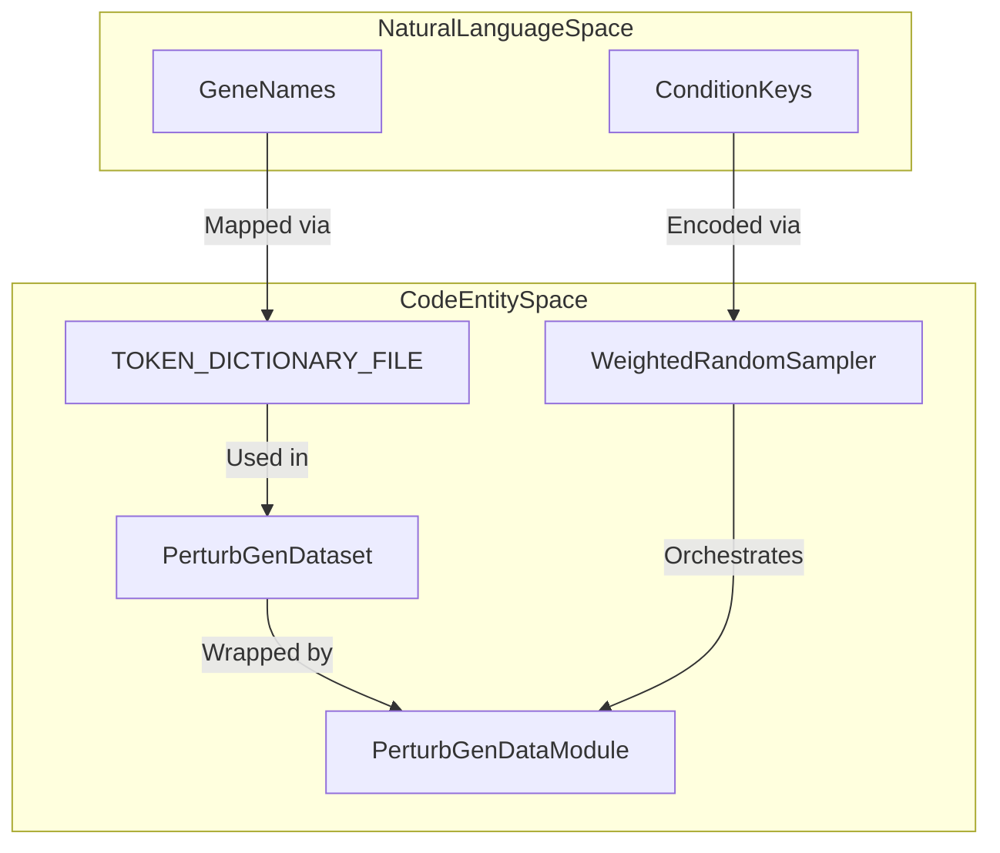
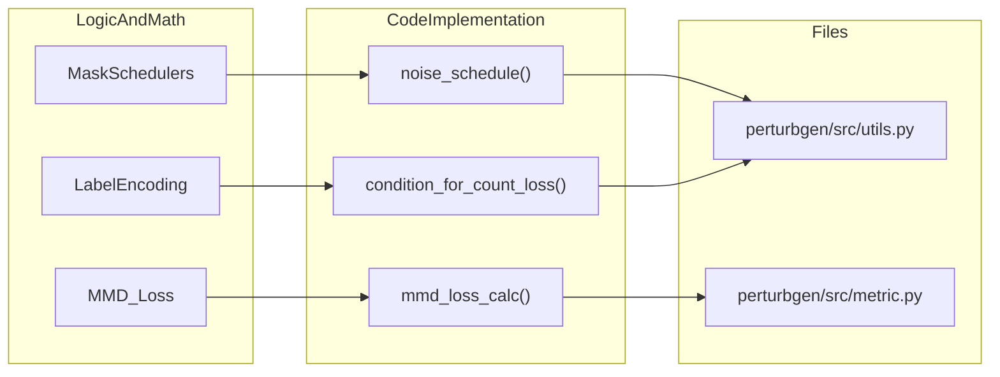

# Utilities, Metrics, and Data Structures

Relevant source files

The following files were used as context for generating this wiki page:

- [perturbgen/Perturb/trainer.py](perturbgen/Perturb/trainer.py)
- [perturbgen/Perturb/transformer.py](perturbgen/Perturb/transformer.py)
- [perturbgen/batch_job_script/cytoimmgen/extrapolation/3_run_train_count_extrapolation.sh](perturbgen/batch_job_script/cytoimmgen/extrapolation/3_run_train_count_extrapolation.sh)
- [perturbgen/run_test.sh](perturbgen/run_test.sh)
- [perturbgen/src/metric.py](perturbgen/src/metric.py)
- [perturbgen/src/utils.py](perturbgen/src/utils.py)

This page provides an overview of the shared utility modules, evaluation metrics, and data loading structures used across the PerturbGen codebase. These components bridge raw biological data to the transformer's expected input format, provide the mathematical rigor required for model evaluation, and define the PyTorch Lightning data infrastructure. 

As a parent page, this section offers a high-level summary. For comprehensive technical details, consult the respective child pages linked below.

---

## 6.1 Core Utility Functions (perturbgen/src/utils.py)
The `perturbgen/src/utils.py` module contains essential helper functions used for data manipulation, dimensionality adjustments, condition encoding, and model scheduling [perturbgen/src/utils.py:1-194](). 

Key functionalities implemented in this module include:
* **Learning Rate Scheduling**: `WarmupScheduler` manages linear warmup phases followed by constant learning rates [perturbgen/src/utils.py:30-58]().
* **Dimension Overrides**: `apply_dim_overrides` handles manual overrides for target vocabulary size and sequence length when loading pretrained checkpoints [perturbgen/src/utils.py:59-83]().
* **Gene Mapping**: `map_ensembl_to_genename` links Ensembl IDs to gene names within `AnnData` objects [perturbgen/src/utils.py:103-127]().
* **Condition Encoding**: `condition_for_count_loss` encodes batch keys, cell types, and combined condition strings for the count prediction loss [perturbgen/src/utils.py:130-194]().

For details, see [Core Utility Functions (perturbgen/src/utils.py)](#6.1).

**Sources:** [perturbgen/src/utils.py:30-194]()

---

## 6.2 Evaluation Metrics
Evaluation within PerturbGen spans both discrete token sequence space and continuous gene expression space. These metrics reside across `perturbgen/src/metric.py` and the `scmaskgit` sub-package.

| Metric Category | Code Entity | Purpose |
| :--- | :--- | :--- |
| **Distributional** | `compute_e_distance`, `evaluate_mmd` | Measures distance between predicted and ground-truth cell distributions [perturbgen/src/metric.py:32-49](), [perturbgen/src/metric.py:132-195](). |
| **Statistical** | `wasserstein_distance`, `pearsonr` | Evaluates gene count distributions and delta-count correlations. |
| **Sequence** | `compute_rouge_score` | Evaluates overlap between predicted and true gene rank sequences. |

For details, see [Evaluation Metrics](#6.2).

**Sources:** [perturbgen/src/metric.py:27-195]()

---

## 6.3 Data Loading: PerturbGenDataModule and PerturbGenDataset
PerturbGen uses a structured PyTorch Lightning pipeline to manage multi-timepoint single-cell experiments and dataset batching.

### Data Flow Architecture
The following diagram illustrates the relationship between metadata space and the `PerturbGenDataModule` structures.

**Diagram: Data Structure Mapping**

**Sources:** [perturbgen/src/utils.py:103-194]()

### Core Components
* **PerturbGenDataset**: Aligns source datasets with target datasets across multiple timepoints (`tgt_dataset_t1`, `tgt_dataset_t2`) and handles raw expression values.
* **PerturbGenDataModule**: Orchestrates train, validation, and test splits while applying a `WeightedRandomSampler` to balance biological conditions.

For details, see [Data Loading: PerturbGenDataModule and PerturbGenDataset](#6.3).

**Sources:** [perturbgen/src/utils.py:130-194]()

---

## 6.4 System Entity Mapping
The following diagram links high-level utility concepts to specific classes and functions within the repository.

**Diagram: Utility and Metric Entity Bridge**

**Sources:** [perturbgen/src/utils.py:130-194](), [perturbgen/src/metric.py:103-126](), [perturbgen/Perturb/transformer.py:12-18]()

---